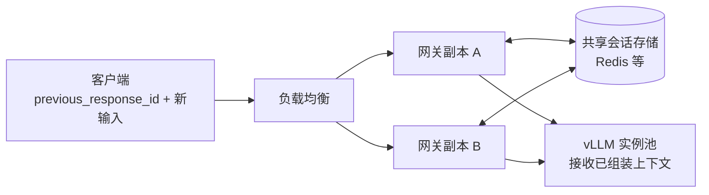
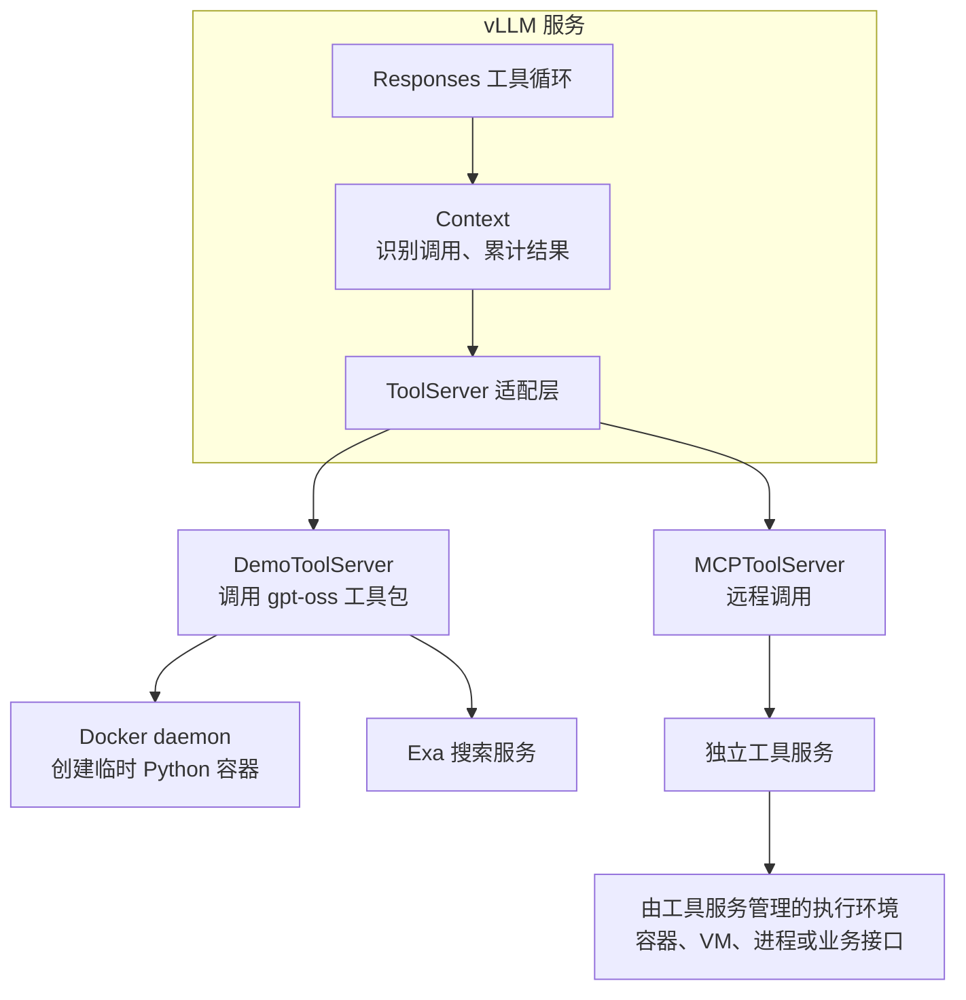
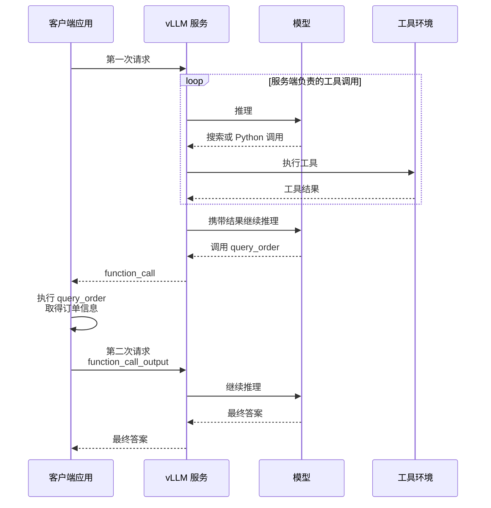

1. Table of Contents, ordered
{:toc}

把一个查天气的应用从 Chat Completions 改成 Responses API，客户端可以少传历史，还可能一次请求就拿到搜索、计算后的答案。这两种变化涉及不同的服务端能力：前者需要恢复上下文，后者还需要执行工具并继续调用模型。

沿着同一个工具调用例子，可以看清 Responses 改变了什么，以及 vLLM 的接口兼容、历史存储和工具运行时分别承担哪些工作。

## 同一次天气查询的三种接口形态

模型无法凭参数知道此刻的天气。应用向它声明 `get_weather` 函数，模型生成函数名与参数，应用查询天气，再把结果交给模型组织答案。**声明函数只提供调用说明，并没有把函数实现上传给推理服务。** 这是 [OpenAI 函数调用文档](https://developers.openai.com/api/docs/guides/function-calling)描述的应用侧执行流程。

以下三组示例都使用同一任务：“北京现在天气怎么样？”工具结果固定为晴、23°C，仅用于演示协议。第一轮强制选择工具，第二轮只总结已有结果，不再提供工具；需要连续执行工具的应用应继续传入相应 `tools`。

请求体完整列出；响应保留本次全部消息和工具条目，省略 `usage`、创建时间等无关元数据。ID 均为示意值。示例对照的是 **OpenAI 协议语义**，具体 vLLM 模型与版本的支持边界在后文说明。

### Chat Completions：工具调用嵌在 assistant 消息中

第一次请求，`POST /v1/chat/completions`：

```json
{
  "model": "gpt-4.1-mini",
  "store": false,
  "messages": [
    {"role": "system", "content": "用中文简洁回答，天气信息以工具结果为准。"},
    {"role": "user", "content": "北京现在天气怎么样？"}
  ],
  "tools": [
    {
      "type": "function",
      "function": {
        "name": "get_weather",
        "description": "查询城市当前天气",
        "parameters": {
          "type": "object",
          "properties": {"city": {"type": "string"}},
          "required": ["city"],
          "additionalProperties": false
        },
        "strict": true
      }
    }
  ],
  "tool_choice": "required",
  "parallel_tool_calls": false
}
```

第一次响应，模型要求调用工具：

```json
{
  "id": "chatcmpl_101",
  "object": "chat.completion",
  "choices": [
    {
      "index": 0,
      "message": {
        "role": "assistant",
        "content": null,
        "tool_calls": [
          {
            "id": "call_123",
            "type": "function",
            "function": {
              "name": "get_weather",
              "arguments": "{\"city\":\"北京\"}"
            }
          }
        ]
      },
      "finish_reason": "tool_calls"
    }
  ]
}
```

应用执行函数后，第二次请求必须带上原消息、assistant 的调用消息和工具结果：

```json
{
  "model": "gpt-4.1-mini",
  "store": false,
  "messages": [
    {"role": "system", "content": "用中文简洁回答，天气信息以工具结果为准。"},
    {"role": "user", "content": "北京现在天气怎么样？"},
    {
      "role": "assistant",
      "content": null,
      "tool_calls": [
        {
          "id": "call_123",
          "type": "function",
          "function": {
            "name": "get_weather",
            "arguments": "{\"city\":\"北京\"}"
          }
        }
      ]
    },
    {
      "role": "tool",
      "tool_call_id": "call_123",
      "content": "{\"city\":\"北京\",\"temperature\":23,\"condition\":\"晴\"}"
    }
  ]
}
```

第二次响应：

```json
{
  "id": "chatcmpl_102",
  "object": "chat.completion",
  "choices": [
    {
      "index": 0,
      "message": {"role": "assistant", "content": "北京现在晴，气温 23°C。"},
      "finish_reason": "stop"
    }
  ]
}
```

### 无状态 Responses：调用与结果成为独立 Item

同一个函数，换成 `POST /v1/responses`。工具定义中的 `name`、`parameters` 等字段直接放在工具对象上，用户内容放入 `input`：

```json
{
  "model": "gpt-4.1-mini",
  "store": false,
  "instructions": "用中文简洁回答，天气信息以工具结果为准。",
  "input": [
    {"role": "user", "content": "北京现在天气怎么样？"}
  ],
  "tools": [
    {
      "type": "function",
      "name": "get_weather",
      "description": "查询城市当前天气",
      "parameters": {
        "type": "object",
        "properties": {"city": {"type": "string"}},
        "required": ["city"],
        "additionalProperties": false
      },
      "strict": true
    }
  ],
  "tool_choice": "required",
  "parallel_tool_calls": false
}
```

第一次响应中的工具调用是独立的 `function_call` Item：

```json
{
  "id": "resp_101",
  "object": "response",
  "status": "completed",
  "output": [
    {
      "id": "fc_101",
      "type": "function_call",
      "status": "completed",
      "call_id": "call_123",
      "name": "get_weather",
      "arguments": "{\"city\":\"北京\"}"
    }
  ]
}
```

应用执行函数后，第二次请求依然携带完整历史，只是换成 Item 序列：

```json
{
  "model": "gpt-4.1-mini",
  "store": false,
  "instructions": "用中文简洁回答，天气信息以工具结果为准。",
  "input": [
    {"role": "user", "content": "北京现在天气怎么样？"},
    {
      "id": "fc_101",
      "type": "function_call",
      "status": "completed",
      "call_id": "call_123",
      "name": "get_weather",
      "arguments": "{\"city\":\"北京\"}"
    },
    {
      "type": "function_call_output",
      "call_id": "call_123",
      "output": "{\"city\":\"北京\",\"temperature\":23,\"condition\":\"晴\"}"
    }
  ]
}
```

第二次响应：

```json
{
  "id": "resp_102",
  "object": "response",
  "status": "completed",
  "output": [
    {
      "id": "msg_102",
      "type": "message",
      "status": "completed",
      "role": "assistant",
      "content": [
        {"type": "output_text", "text": "北京现在晴，气温 23°C。", "annotations": []}
      ]
    }
  ]
}
```

### 有状态 Responses：用 previous_response_id 引用历史

第一次请求启用保存，其余任务和工具定义不变：

```json
{
  "model": "gpt-4.1-mini",
  "store": true,
  "instructions": "用中文简洁回答，天气信息以工具结果为准。",
  "input": [
    {"role": "user", "content": "北京现在天气怎么样？"}
  ],
  "tools": [
    {
      "type": "function",
      "name": "get_weather",
      "description": "查询城市当前天气",
      "parameters": {
        "type": "object",
        "properties": {"city": {"type": "string"}},
        "required": ["city"],
        "additionalProperties": false
      },
      "strict": true
    }
  ],
  "tool_choice": "required",
  "parallel_tool_calls": false
}
```

第一次响应的 Item 格式与无状态版本相同：

```json
{
  "id": "resp_201",
  "object": "response",
  "status": "completed",
  "output": [
    {
      "id": "fc_201",
      "type": "function_call",
      "status": "completed",
      "call_id": "call_123",
      "name": "get_weather",
      "arguments": "{\"city\":\"北京\"}"
    }
  ]
}
```

应用仍然需要执行 `get_weather`，然后发起第二次请求。区别是只提交历史引用和新增结果：

```json
{
  "model": "gpt-4.1-mini",
  "store": true,
  "previous_response_id": "resp_201",
  "instructions": "用中文简洁回答，天气信息以工具结果为准。",
  "input": [
    {
      "type": "function_call_output",
      "call_id": "call_123",
      "output": "{\"city\":\"北京\",\"temperature\":23,\"condition\":\"晴\"}"
    }
  ]
}
```

第二次响应仍然只包含本轮输出，不会把整段历史重复返回：

```json
{
  "id": "resp_202",
  "object": "response",
  "status": "completed",
  "output": [
    {
      "id": "msg_202",
      "type": "message",
      "status": "completed",
      "role": "assistant",
      "content": [
        {"type": "output_text", "text": "北京现在晴，气温 23°C。", "annotations": []}
      ]
    }
  ]
}
```

这里有三个不同的标识：`resp_201` 定位历史响应，`fc_201` 标识输出 Item，`call_123` 将函数调用与函数结果配对。第二轮的 `store: true` 让本轮也能被后续引用；上一轮 `instructions` 不会通过 `previous_response_id` 自动继承，因此示例重新发送。[迁移说明](https://developers.openai.com/api/docs/guides/migrate-to-responses)

三种形式的区别可以归结为：

| 对照项 | Chat Completions | 无状态 Responses | 有状态 Responses |
|---|---|---|---|
| 历史入口 | `messages` | `input` | `previous_response_id` 加新增 `input` |
| 函数调用 | assistant 消息内的 `tool_calls` | 独立 `function_call` Item | 同左 |
| 函数结果 | `role: tool` 消息 | `function_call_output` Item | 同左 |
| 本例由谁执行函数 | 应用 | 应用 | 应用 |
| 本例需要几次模型 API 请求 | 两次 | 两次 | 两次 |

**仅引入 `previous_response_id`，没有把工具循环搬到服务端。** 它改变的是历史交接方式。

## 历史托管以后，多实例服务要保存什么

客户端少传一段历史，服务端就必须能够通过 ID 找回那段历史。对于有负载均衡和滚动重启的推理集群，保存位置决定了这个引用是否可靠。

### 历史引用不等于模型获得持久记忆

在有效上下文、模型、模板和生成参数等价的前提下，手动传历史与服务端恢复历史可以产生等价的模型输入。模型不需要知道 HTTP 请求使用的是哪个接口；服务层负责把消息、工具结果等转换为模型接受的序列。此前的[模型接口与上下文处理](/posts/2026/10/19/openai-api-context-chat-template-serving/)详细解释了这层转换。

但“模型收到完整上下文”需要限定为**本次实际选入上下文窗口的内容**。历史可能经过截断、压缩或筛选，不能理解成永远包含全部聊天记录。使用缓存时，也不一定从头重算已有前缀。`previous_response_id` 解决历史寻址，KV Cache 复用推理中的中间结果；二者职责不同。OpenAI 的历史链也不会使先前上下文免于输入 token 计费。[会话状态文档](https://developers.openai.com/api/docs/guides/conversation-state) · [Prompt Caching 文档](https://developers.openai.com/api/docs/guides/prompt-caching)

对于会返回 reasoning Item 的模型，手动续接时还应按接口要求保留这些条目，不能只提取可见文字。Responses 的输出可以包含消息、推理条目和工具调用，这是它比单纯历史引用更广的接口设计。[推理模型文档](https://developers.openai.com/api/docs/guides/reasoning)

### vLLM 原生存储位于 API 进程内

以下实现核查固定在 vLLM 提交 [`d9fcde70`](https://github.com/vllm-project/vllm/tree/d9fcde70ffeda3bdfdb2f961ba7efb635559f5da)，避免把后续版本变化写成永久承诺。

`OpenAIServingResponses` 的 `response_store`、`msg_store` 和 `event_store` 是 Python 字典。保存功能由 `VLLM_ENABLE_RESPONSES_API_STORE` 控制，默认关闭；启用后，数据保存在处理请求的 **API 进程内存** 中。它既不是模型权重里的状态，也不是 GPU KV Cache。[Responses 服务源码](https://github.com/vllm-project/vllm/blob/d9fcde70ffeda3bdfdb2f961ba7efb635559f5da/vllm/entrypoints/openai/responses/serving.py)

由此可以直接推导出两个部署约束：

- 后续请求需要到达持有历史的 API 进程；只保证同一台物理机器仍可能不够。
- 进程重启后内存历史消失；粘性路由只能解决请求落点，不能解决持久化。

该实现也没有可直接配置的 Responses Redis 存储后端。通用插件机制不等于已经提供历史存储适配接口，不能靠添加一个 Redis 地址就让这些字典自动共享。

另外，该提交的非 Harmony 历史恢复路径在处理前次输出时，只将 `ResponseOutputMessage` 转回消息，没有同样恢复所有 `function_call`、reasoning 条目。因此，前面的标准协议示例不能被当成所有 vLLM 模型上的兼容性保证。[历史转换源码](https://github.com/vllm-project/vllm/blob/d9fcde70ffeda3bdfdb2f961ba7efb635559f5da/vllm/entrypoints/openai/responses/utils.py)

### 共享存储可以由网关承担

多实例部署可以让客户端继续传完整历史，也可以把 Responses 会话能力放到独立网关：各网关副本从共享存储读取历史，再将组装好的输入发给任意后端实例。



这是一种架构选择。现成实现中，独立项目 **vLLM Semantic Router** 的 `response_api` 服务支持 Redis，包括 `store_backend: redis` 和连接配置；这项能力属于 Router，不能写成 vLLM 推理服务原生的 Redis 插件。[Semantic Router 配置文档](https://vllm-sr.ai/docs/tutorials/global/api-and-observability/#response-api)

历史共享解决后，服务端仍然不一定会执行任何工具。保存状态与驱动任务继续前进，是两项独立能力。

## 从返回工具调用到服务端继续推理

天气示例中，模型第一次返回函数调用后，任务停下来等待应用。要让一次 API 请求完成搜索、计算和回答，服务端还需要拿到工具实现，执行调用，并把结果送回模型。

### Responses 为执行过程提供了条目结构

Chat Completions 已经支持工具调用。Responses 的变化包括将不同输出表示为独立 Item，并为托管工具及其执行过程提供对应结构。例如，自定义函数返回 `function_call`，托管搜索可以返回搜索调用条目，最终回答是 `message`；流式模式还可以持续发送相关事件。[Responses 迁移说明](https://developers.openai.com/api/docs/guides/migrate-to-responses) · [工具文档](https://developers.openai.com/api/docs/guides/tools)

这些结构让服务端有地方表达多步执行，但 **Item 格式本身不包含执行能力**。只有 function schema 时，服务端知道函数叫什么、参数怎样填写；只有接入执行器，才知道如何真正查询天气、运行代码或访问业务数据。

本文把“模型生成动作 → 执行工具 → 将结果加入上下文 → 再次生成”的过程称为工具循环，也就是讨论 Agent 时常说的 ReAct 式闭环；这里不要求模型输出可见的 Thought 文本。

### vLLM 确实实现了内层工具循环

vLLM 的 `_generate_with_builtin_tools` 包含一个循环：调用引擎生成、将输出写入上下文、判断是否需要执行内建工具，执行后追加结果并重新构建下一轮输入。下列伪代码保留了控制关系：

```python
# 简化自 vLLM 的服务端生成循环。
while True:
    output = await engine.generate(context)
    context.append_output(output)

    # 没有需要服务端执行的工具，就将本次响应交还调用方。
    if not context.need_builtin_tool_call():
        break

    result = await context.call_tool()
    context.append_tool_output(result)
    context.render_next_input()
```

实际代码调用的是 vLLM 内部的引擎接口，不是绕回 HTTP 再请求一次 Chat Completions。[生成循环源码](https://github.com/vllm-project/vllm/blob/d9fcde70ffeda3bdfdb2f961ba7efb635559f5da/vllm/entrypoints/openai/responses/serving.py)

是否执行工具并继续下一轮生成，由上下文实现和工具配置共同决定：

| 上下文实现 | 用途 | 服务端工具行为 |
|---|---|---|
| `SimpleContext` | 普通输出收集与响应组织 | `need_builtin_tool_call()` 恒为 `False` |
| `HarmonyContext` | GPT-OSS 的 Harmony 消息处理 | 支持识别、分派已配置的内建工具 |
| `ParsableContext` | 基于通用 parser 的处理路径 | 实验性支持，需启用 `VLLM_USE_EXPERIMENTAL_PARSER_CONTEXT` |

这些 Context 是上下文与分派逻辑，**不是沙箱**。在所核查版本中，内层执行判断仍主要围绕 `browser`、`python`、`container` 等约定命名空间；工具需要在服务端接入，并在请求中启用。`ParsableContext` 也不能视为全面等价支持，例如 demo browser 的对应执行方法仍抛出 `NotImplementedError`。[上下文源码](https://github.com/vllm-project/vllm/blob/d9fcde70ffeda3bdfdb2f961ba7efb635559f5da/vllm/entrypoints/openai/responses/context.py) · [工具包装器源码](https://github.com/vllm-project/vllm/blob/d9fcde70ffeda3bdfdb2f961ba7efb635559f5da/vllm/entrypoints/mcp/tool.py)

因此，vLLM 既能只返回工具调用，也能为受支持工具运行服务端循环。具体行为由模型路径、部署配置与工具种类决定。

## 工具执行环境怎样接入 vLLM

循环控制已经知道何时执行工具，接下来需要一个可调用的执行环境。这个环境可以与 API 服务同机，也可以在独立机器上；是否隔离、是否保留文件和进程，则是另一组设计。

### Demo 工具通过依赖包执行 Python 和搜索

启用 `--tool-server demo` 后，`DemoToolServer` 在依赖与环境验证通过时注册 Python、browser。vLLM 的包装器实际调用单独安装的 `gpt-oss` 包：Python 使用 `PythonTool`，browser 使用 `SimpleBrowserTool` 和 Exa 搜索后端，后者需要 `EXA_API_KEY`。这条路径直接调用工具包，不必先连接远程 MCP 服务。[工具服务源码](https://github.com/vllm-project/vllm/blob/d9fcde70ffeda3bdfdb2f961ba7efb635559f5da/vllm/entrypoints/mcp/tool_server.py)

默认 Python 后端的执行过程是：

1. 通过 Docker SDK 连接 Docker daemon，准备 `python:3.11` 镜像。
2. 每次调用创建并启动一个新容器。
3. 将模型生成的代码写入 `/tmp/script.py` 并执行。
4. 读取执行输出，转换成工具结果。
5. 在 `finally` 中删除容器。

该行为来自固定版本 [`gpt-oss PythonTool`](https://github.com/openai/gpt-oss/blob/5681a6b6552635e7b29cde94a61ca6a7aee90ebd/gpt_oss/tools/python_docker/docker_tool.py)。由此可知，默认变量和容器内文件不会跨工具调用保留：第一次只执行 `x = 42`，第二次只执行 `print(x)`，新容器中没有这个变量。

**会话历史连续，不代表执行环境连续。** 模型可能从上下文知道先前的计算结果，但 Python 进程和文件系统仍然是新的。`previous_response_id` 不能替代沙箱会话 ID。

官方将 demo Python 工具定位为参考实现，容器默认没有额外配置网络隔离。需要长期会话、资源调度和更完整隔离时，应另外提供相应执行服务。[vLLM 官方说明](https://docs.vllm.ai/en/latest/usage/security/#tool-server-and-mcp-security)；容器与 MicroVM 的层次差异可参见本站的 [CubeSandbox 原理](/ai/2026/08/06/cubesandbox-agent-infrastructure/)。

### 远程 MCP 工具服务拥有自己的执行环境

配置 `--tool-server tool-host:8000` 时，当前 `MCPToolServer` 将地址组成 `http://tool-host:8000/sse`，通过 MCP 初始化连接、获取工具描述，再在执行阶段调用远程工具。这是该实现采用的传输路径，不代表所有 MCP 实现都必须使用 SSE。[MCP 接入源码](https://github.com/vllm-project/vllm/blob/d9fcde70ffeda3bdfdb2f961ba7efb635559f5da/vllm/entrypoints/mcp/tool_server.py)



这里有三条独立边界：**远程描述部署位置，沙箱描述隔离方式，MCP 描述通信协议。** 一个远程 MCP 工具可以管理沙箱，也可以只是调用普通业务接口；vLLM 只需要能够调用受支持的执行器并取得结果。

当前 Harmony 与 Parsable 路径以本次 `request_id` 建立工具 session，远程连接携带 `x-session-id`；请求退出时会尝试对已使用的远程工具调用 `cleanup_session`。因此，跨请求保留沙箱状态需要工具服务明确实现生命周期，不能从历史引用自动推导出来。任意 MCP namespace 也不能仅凭被发现，就保证进入当前 vLLM 的内层执行分派。[会话与分派源码](https://github.com/vllm-project/vllm/blob/d9fcde70ffeda3bdfdb2f961ba7efb635559f5da/vllm/entrypoints/openai/responses/context.py)

## 客户端与服务端可以分担同一个循环

服务端可能拥有搜索和 Python 环境，但只有业务应用能查询公司内部订单。这时不需要选择唯一的循环位置：服务端执行它负责的工具，遇到应用负责的函数时，把控制权交还客户端。

### 一个外层请求可以包含多轮内部推理

下面的例子中，客户端指调用模型 API 的业务应用，不一定是浏览器。服务端可以先搜索、计算，再返回 `query_order`；应用查询订单并提交结果后，服务端继续生成答案。



这是根据两层分派机制得到的组合方式，实际可用工具仍需满足前述版本与配置约束。如果整个任务只使用服务端工具，第一次响应就可能给出最终答案：**客户端循环运行一轮后正常结束，服务端内部则可能已经多次调用模型。**

### 以待处理动作决定是否继续

客户端不必知道远端内部循环了几次，但必须知道哪些工具由自己负责，并正确消费响应条目。

| 响应内容 | 客户端动作 |
|---|---|
| 待应用执行的 `function_call` | 执行对应函数，提交 `function_call_output`，继续循环 |
| 已执行的服务端工具记录 | 展示或记录，不重复执行 |
| 最终答案，且没有待处理动作 | 结束循环 |
| 失败或不完整状态 | 按失败原因处理，不能当作成功完成 |

**`response.status == "completed"` 只表示本次响应生成完成。** 天气示例的第一次响应同样是 `completed`，但其中的函数仍等待应用执行。`function_call` 上的完成状态也不表示业务函数已经运行；不能仅看状态字段或是否存在文字就停止。

对于通用 Agent 客户端，保留外层工具循环很合理；对于执行能力和任务约定明确、工具完全托管的服务，一次请求后消费结果也可以。客户端应依据部署能力配置工具，不能仅凭 `/v1/responses` 路径猜测远端接管了哪些工作。

部署和迁移时，需要分别确认三项责任：**历史由谁保存和恢复，工具由谁执行，下一轮推理由谁发起。** `previous_response_id` 只直接改变第一项；服务端托管工具增加第二项能力；服务端工具循环进一步承担第三项。Responses 为这些组合提供了接口表达，实际兑现到哪一层，要看服务实现与配置。
