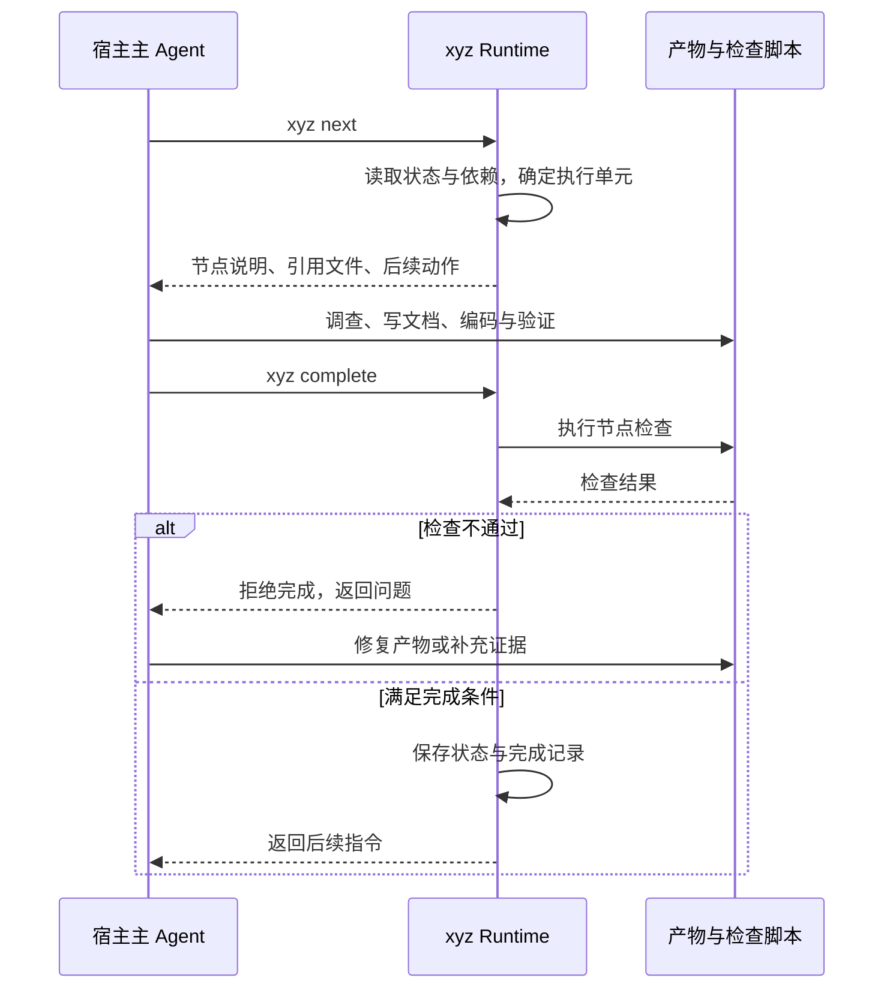
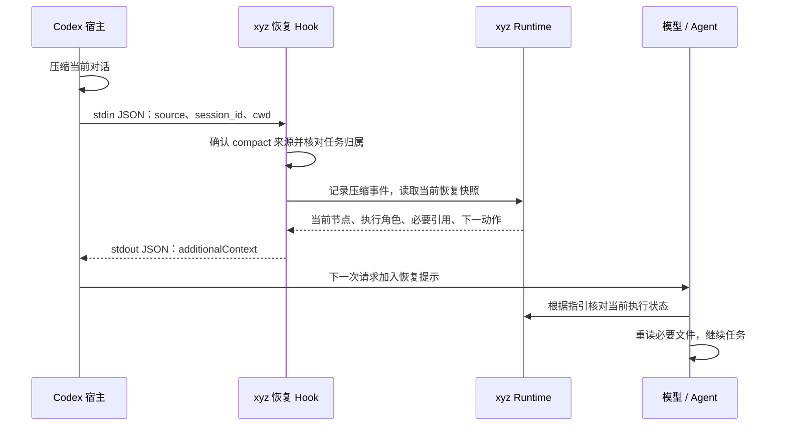
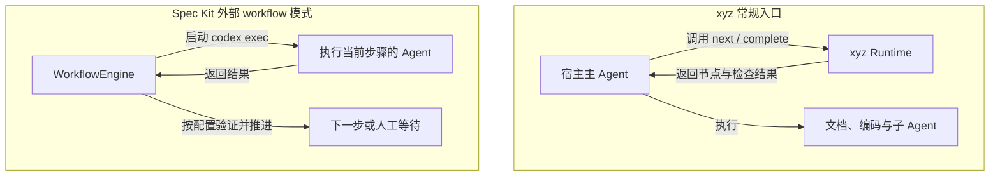

1. Table of Contents, ordered
{:toc}

把需求交给 Codex 或 Claude Code 后，希望它先澄清需求、再设计和编码，最后验证结果。一套以 Skill 为入口的工具也能组织这条流程，但这里有两种不同的推进力量：模型读完说明后选择下一步，程序根据状态决定下一步是否允许发生。

本文以 **xyz** 为例，沿着一次任务的启动、执行和恢复，解释这两种力量怎样配合，以及把外层流程放进代码后会改变什么。

> xyz 是所分析工具的脱敏代称。内部平台、域名、用户路径及标识均已泛化，涉及 xyz 的命令和代码片段经过改名、简化，用于解释机制，不是可直接安装的发行说明。xyz 的判断来自本地源码分析，未执行完整业务流程；公开工具的机制按 2026 年 10 月 22 日查阅的官方文档与源码核对。

## 从一轮研发任务看主 Agent 在哪里

用户已经在 Codex 或 Claude Code 中打开代码仓库，此时已有一个能读文件、执行命令和修改代码的 Agent。xyz 接入这段工作，首先复用的就是这个宿主 Agent。

安装发行包之后，用户可以调用 `xyz-init` Skill 检查环境，再通过 `xyz` Skill 创建或继续需求。新建入口收集需求名、研发流程和企业需求平台的完整链接；所分析发行包将这条链接作为创建的必要输入。随后，用户主要阅读产物、回答业务澄清并确认方案，Agent 负责调用内部命令，Dashboard 展示进度。

其当前默认流程可以概括为：

| 阶段 | Agent 完成的工作 | 用户参与的位置 |
|---|---|---|
| 整理输入 | 获取需求正文，整理本期范围与补充材料 | 补充范围和来源 |
| 需求分析 | 调查已有实现，形成并逐项审查功能需求 | 澄清业务规则，确认需求 |
| 技术设计 | 形成技术方案，确认后拆分有依赖的 TASK | 评审方案、决定取舍 |
| 开发验证 | 按任务依赖实现、验证并提交代码 | 处理必要的执行决策 |
| 代码审查与修复 | 独立子 Agent 审查变更，再按决定修复 | 决定修复或接受遗留问题 |

默认编码由主 Agent 在当前工作区按依赖串行执行；独立子 Agent 承担代码审查。其他流程可增加测试生成、测试环境部署和失败修复回路。**支持多 Agent 与多种流程，不等于每个默认任务都并行，也不等于流程完成后自动上线。**

这里的“主 Agent”仍是宿主会话。它读取 Skill，调用 xyz CLI，必要时使用宿主提供的子 Agent 能力。xyz 自己的 Go Runtime 负责业务流程状态，没有另行实现一套模型推理与工具调用循环。

因此，“带执行脚本的 Skill”能够描述它的包装方式；要解释它实际做了什么，还需要拆开三项职责：

| 组件 | 负责什么 |
|---|---|
| 宿主 Agent | 理解需求、调用工具、生成产物、执行编码，以及节点内部的探索 |
| Skill 与节点说明 | 教 Agent 怎样启动流程、完成节点、交接给用户和处理异常 |
| xyz Runtime 与检查脚本 | 保存状态、计算当前执行单元、验证完成请求、记录结果与恢复信息 |

本文将这套围绕 Agent 提供任务约束、执行检查与恢复机制的设施称为 **harness**。这个词并不意味着工具必须自建底层 Agent，也不能单独说明它拥有多强的控制权。

## 将研发约定变成可检查的流程状态

如果只写“先完成设计，再开始编码”，推进顺序主要依赖模型遵循文字。为了让完成情况可查询、可恢复，并让部分条件可以实际检查，xyz 把节点定义和运行状态交给了 CLI 背后的程序。

### 节点说明和检查代码承担不同工作

一个节点的配置同时指向执行说明与检查脚本。下面是简化后的结构：

```yaml
# 节点由当前主 Agent 执行。
- id: design
  type: inline

  # 说明如何调查、设计，以及生成哪些产物。
  ref: "<XYZ_HOME>/references/design.md"

  # 完成节点时，程序运行这个检查器。
  check_script: "<XYZ_HOME>/references/design-check.sh"
```

`ref` 中的分析步骤需要 Agent 执行；`check_script` 中的规则由程序运行。产物是否存在、结构是否满足约定、依赖任务是否完成等条件，可以成为可执行检查。方案是否真正覆盖业务、边界划分是否合理，则仍需要语义分析和评审。

主 Agent 通过 `xyz next` 获取当前可执行节点，按返回的说明工作，再调用完成接口：



需要人工判断时，Agent 还会登记等待内容、暂停流程，展示完整的确认对象。用户真实回复后，再恢复对应节点或执行者。用户通常不必手工逐条调用 CLI，但这些等待与恢复会反映到业务状态中。

### 状态机的控制范围取决于调用路径

**Runtime 能拒绝不合法的完成请求，却不能仅凭这套接口约束宿主会话的全部行为。** 如果 Agent 没有调用 `next` 或 `complete`，直接用其他工具修改文件，流程状态不会自动变成对所有文件操作的拦截器。

这使 xyz 具有两种同时存在的特征：它有真实的代码检查与持久化状态；它的常规执行循环又依赖宿主 Agent 遵循协议，持续调用这些接口。把前者称为“全是提示词”会漏掉程序已经完成的工作，把后者称为“完全由状态机控制”又会扩大保证范围。

判断 harness 的约束强度，需要落实到具体动作：**程序是记录了这件事、建议下一步，还是掌握了执行该动作的必经接口？**

## Skill 入口与 Hooks 分别怎样接入宿主

流程接口已经存在后，还需要让 Agent 知道它们，并在必要的宿主事件上自动调用脚本。xyz 的安装器为这两条路径分别完成配置。

### 安装器建立入口，宿主发现 Skill

最初由用户运行发行包安装脚本；用户明确委托后，也可以由已有 Agent 代为执行。安装器复制宿主对应的 Skill、节点说明、CLI 和脚本，创建终端启动入口，并写入 Hooks 配置。**部署 Skill 与注册 Hooks 是两项不同的安装工作；读取 Skill 则发生在使用阶段。**

以 Codex 分支为例，安装器默认将入口部署为 `~/.agents/skills/xyz/SKILL.md`，并在 `~/.local/bin/xyz` 建立终端启动入口。前者供宿主发现 Skill，后者供 shell 调用 CLI。Skill 文件可以抽象成：

```markdown
---
name: xyz
description: 用户要求启动 xyz 研发流程时使用。
---

1. 列出当前项目的需求。
2. 根据用户选择创建或切换需求。
3. 调用 xyz next，按返回的节点说明继续。
```

宿主先发现名称、描述和文件位置，在使用时读取完整说明，再按需读取引用文件或执行脚本。这就是 Skill 的渐进加载。把所有 Skill 全文预先塞入每次请求，并不是这套发现机制的要求。[Codex Skill 文档](https://learn.chatgpt.com/docs/build-skills)

`/xyz` 表示面向用户的工作流入口，不是操作系统中的可执行文件。具体选择语法由宿主界面决定：Codex CLI/IDE 提供 `/skills` 和 `$xyz` 这样的 Skill 入口，其他宿主或界面可能展示斜杠菜单。**在描述里写出 `/xyz`，本身不会注册一个跨客户端通用的内建命令。**

与它对应，终端里的 `xyz next` 才是执行 CLI 程序。前者让 Agent 加载工作说明，后者让操作系统启动可执行代码。

`/xyz-init` 同样是一个 Skill，职责是检查和补全已安装工具的运行环境。它出现在安装之后；不能依靠一个尚未安装、尚未被宿主发现的 Skill 来启动最初的安装。

### Hooks 由宿主事件驱动

Skill 需要 Agent 选择和执行；已正确配置的 Hook 则由宿主在匹配事件发生时调用。所分析安装器的 Codex 分支，会在用户级 `~/.codex/hooks.json` 中注册类似下面的命令：

```json
{
  "hooks": {
    "SessionStart": [
      {
        "hooks": [
          {
            "type": "command",
            "command": "bash <XYZ_HOME>/bin/sessionstart-compact-hook.sh"
          }
        ]
      }
    ]
  }
}
```

这段配置让宿主知道事件发生时启动哪个程序。这个版本的 Codex 配置没有在此处设置 `matcher`，而由脚本内部筛选 `source`；它的另一宿主分支会配置压缩来源的 matcher。**这是安装器的适配选择，不能推导为不同宿主具有完全相同的 Hook 协议。**

Hooks 的实际运行还取决于宿主支持、启用与信任状态。它们对应明确的生命周期或工具事件，并不是每一次模型思考前都自动触发。压缩恢复脚本的作用，需要沿着一次真实事件的输入和输出来理解。

## 对话压缩后，恢复的是任务依据与执行位置

长任务的难点不只是聊天越来越长。压缩之后，Agent 还必须知道自己负责哪个任务、已经完成什么、正在等谁，以及下一步应该读哪些材料。xyz 把这些业务信息保存在对话之外，再利用宿主事件将恢复入口送回模型。

### 三类状态需要分别管理

| 对象 | 在这个方案中的主要管理者 | 保存或处理的内容 |
|---|---|---|
| 模型对话上下文 | Codex / Claude Code | 消息历史、工具结果、窗口预算与压缩 |
| 工作流状态 | xyz Runtime | 需求、阶段、节点、TASK、等待状态与执行者绑定 |
| 工作依据与产物 | Agent 写入，流程引用 | 需求、设计、任务说明、调查证据与评审结果 |

因此，xyz 的“上下文管理”主要是**任务信息外置、按节点提供引用、维护执行者绑定，以及恢复时重新加载必要材料**。所分析路径没有实现另一套模型历史压缩算法，也没有接管宿主的 token 窗口。

外置文件能保留重要决定，前提是决定确实被写进产物。仅存在于旧聊天中的细节，不能因为有一个状态文件就被自动完整还原。

### 从事件 JSON 到恢复提示

当前 Codex 文档明确说明：主会话压缩后，会在下一次模型请求前运行对应的 `SessionStart` Hook，事件来源为 `compact`。命令 Hook 从标准输入接收 JSON，输出中的 `additionalContext` 可以成为模型的额外上下文。[Codex Hooks 文档](https://learn.chatgpt.com/docs/hooks#sessionstart)

在 xyz 的恢复路径中，这个事件经过以下处理：



脚本首先判断事件来源，再使用会话身份和工作目录定位需求。没有唯一匹配或归属不符时，不把某个任务的恢复信息贸然注入另一段会话。随后，它记录宿主发生过压缩，并通过类似 `xyz inspect current --format json` 的接口取得当前节点、角色、必要引用和后续动作。

记录压缩事件的命令不负责生成对话摘要；恢复快照也不等于完整聊天历史。脚本把快照组织为提示，返回给宿主的形式可以简化为：

```json
{
  "hookSpecificOutput": {
    "hookEventName": "SessionStart",
    "additionalContext": "当前仍在执行设计节点。按恢复快照中的引用清单补齐上下文，核对工作区与等待状态后继续。"
  }
}
```

**宿主调用脚本和接收输出是程序机制；Agent 是否正确理解提示、读取文件并完成任务，仍有模型执行这一层。** Hook 提供了不必等待模型主动想起的恢复时机，但没有因此接管整个推理循环。

任务恢复也不能只验收提示是否出现。还要确认它指向正确的需求和工作区，文件仍然可读，原执行者能否续接，以及下一步是否重复执行了已经完成的动作。这与[会话历史、执行环境和 Agent 循环的分工](/ai/2026/10/22/vllm-responses-api-state-tools-agent-loop/)是同一类责任边界。

## 把外层循环写进程序后，控制权怎样变化

xyz 的常规模式让主 Agent 持续调用流程接口。如果希望即使模型忘记下一步，程序也能明确停止、重试或启动后续节点，就需要让外部程序持有外层执行循环。

### 代码可以推进流程，同时复用已有 Agent

外层程序完全可以把“完成一个节点”委托给 Codex，待结果返回后再做验证。下面是架构伪代码，不对应某个 SDK 的固定 API：

```python
for step in workflow:
    # 节点内部仍可由现成 coding agent 调查和实现。
    result = coding_agent.run(step.prompt)

    # 外层程序决定是否允许进入下一节点。
    evidence = verify(step, result)
    if not evidence.accepted:
        raise StepRejected(evidence.reason)

    # 只在验证通过后保存该节点的完成状态。
    save_checkpoint(step, evidence)
```

这改变了**谁决定下一节点是否启动**，并不要求重写内层 Agent。调用现成 coding-agent CLI，同样可以实现这种编排。

“使用 SDK”也需要说明具体层次。[Codex SDK](https://learn.chatgpt.com/docs/codex-sdk)提供程序化启动、继续和恢复 Codex 会话的接口，复用的是已有 coding runtime；[OpenAI Agents SDK](https://developers.openai.com/api/docs/guides/agents/running-agents)这类框架则允许应用定义 Agent、工具与交接，由 runner 组织模型和工具循环。进一步使用状态化工作流框架时，关注点又会落在持久化、暂停与恢复上。它们能组合使用，但不能仅凭名字都带 SDK，就认为它们提供同样的上下文能力。

### Spec Kit 同时提供交互命令与外部工作流

[Spec Kit 的开发方法](/posts/2026/09/09/spec-kit-codex-workflow/)也先明确规格，再形成设计、任务和实现。当前官方流程包括项目原则 `constitution`，以及围绕单个需求的 `specify → plan → tasks → implement → converge`；`clarify`、`checklist`、`analyze` 可以作为相应质量环节。`converge` 检查实现和产物之间的遗漏，必要时追加任务，再进入实施与复查。[官方流程说明](https://github.github.io/spec-kit/reference/agentic-sdd.html)

在宿主里逐个调用这些命令时，用户与 Agent 推进流程，文件记录规格、计划和任务。它也包含前置检查脚本，因此不能将其概括为只有文档模板。

当前 Spec Kit 另外提供 `specify workflow run/resume/status`。它的 Python `WorkflowEngine` 支持步骤执行、条件与循环、人工 gate 和持久化恢复；运行状态、输入和日志保存在项目的工作流运行目录中。[Workflow 文档](https://github.github.io/spec-kit/reference/workflows.html)、[引擎源码](https://github.com/github/spec-kit/blob/main/src/specify_cli/workflows/engine.py)

其 [Codex adapter](https://github.com/github/spec-kit/blob/main/src/specify_cli/integrations/codex/__init__.py)构造的调用核心是：

```python
# 外层引擎通过非交互 CLI 委托一个步骤。
args = [codex_executable, "exec", prompt]
```

也就是程序启动 Agent，接收结果，再决定下一步。步骤间的工作流状态和文件产物，不应被理解成自动共用同一段 Codex 对话；所核实的这条调用路径本身没有使用会话恢复命令。



因此，比较两者时应该落到**具体使用模式和默认研发方法**。xyz 的这份发行包将需求身份、逐步评审、任务执行、会话恢复及企业研发工具接入组织成一套较具体的产品流程；Spec Kit 则同时提供通用规格开发方法，以及可组合的扩展和工作流机制。当前两者都有可执行代码、检查和状态，是否拥有这些组件已经不足以构成区别。

### 选型取决于要固定哪一层行为

| 关注点 | 由宿主 Agent 执行 Skill 协议 | 外部程序编排 Agent |
|---|---|---|
| 接入现有交互 | 直接复用当前会话和工具，适合边讨论边推进 | 需要设计节点输入输出和人工交接 |
| 流程推进 | 依赖 Agent 持续调用协议接口 | 程序决定启动、暂停、分支与重试 |
| 状态检查 | 脚本可拒绝非法状态更新 | 检查可成为下一步启动的必要条件 |
| 上下文衔接 | 复用宿主历史，配合文件和恢复提示 | 明确传递步骤输入输出；是否复用会话由实现决定 |
| 维护成本 | 维护提示协议、CLI 和宿主适配 | 还需维护调度、失败恢复、状态迁移与交互层 |

外部编排能够让步骤顺序更确定，但**程序启动过测试，不等于测试覆盖了需求；Agent 成功退出，也不等于产物正确**。同样，换成 SDK 不会自动让所有动作必须经过控制器：如果执行节点仍能从通用工具绕过流程，控制范围仍然有限。

需要稳定验收的步骤，可以先固化成代码检查；需要严格控制的动作，则要把实际执行权限放到对应控制点。模型继续负责适合探索和判断的工作，程序负责明确的状态、证据与动作边界。分析一套 Agent 工具时，沿着这条调用链追到每个决定的执行者，比只看它被称为 Skill、harness 还是 SDK 更有用。
