1. Table of Contents, ordered
{:toc}

> 数据来源：[AI Trends (November 2026) — AI Trend Analysis, LLM Statistics & Industry Insights](https://llm-stats.com/ai-trends)；抓取日期：2026-11-13；动态图表数量：48。

AI 模型的能力、价格、速度和使用偏好都在持续变化。单看某一张排行榜，很容易把评测分数、真实体验和成本效率混为一谈。这份报告先给出跨图整体判断及其依据，再说明方法和口径，随后按主题逐图展开。

**本期是截至 2026 年 11 月 13 日的快照，11 月与第四季度都尚未结束。** 对比基线为 10 月 20 日报告；跨期差异包含新增模型、历史补录与评分规则变化。长期选型原则沉淀在 [AI、LLM 与 Agent 维基](/wiki/ai-llm-agent/)。

# 整体趋势总结

## 1. 高分候选继续扩展，能力上限与价格下限分别由不同模型提供

**判断依据：** 本期 Claude Fable 5.2 的综合分为61.1、混合报价为每百万token 13.3美元；Kimi K3.1 Pro 为54.9分、3.3美元。图15与图22表明高分候选分布在不同价格段；两图的混合价权重不同，不能混算。评分准入规则也在11月更新，本文不将这些分数与10月直接相减来衡量真实进步。

## 2. 更低报价与更小总参数正在覆盖较高能力门槛

**判断依据：** 图26的50+分门槛最低报价为 ERNIE 5.5 Flash Preview 的0.42美元/百万token；图27、35给出同一模型52.3分、280B总参数。40+分最低报价仍约0.08美元。这里比较的是本期样本中的能力门槛，不等同于任务成功成本，更不是11月的效率环比。

## 3. 模型供给继续增加，历史补录占据显著部分

**判断依据：** 总收录由10月20日的414增至446，净增32；但9月记录由22修订为35，10月由12补至22，11月截至13日仅录得9个。国家图的441个样本中，美国234、中国151，仍占主要份额。累计差值不能全部算作当月发布。

## 4. 多模态已成为近期供给的常见属性，开放程度需要另行观察

**判断依据：** 本期第四季度31个模型中，多模态为25个（约81%），开放模型为11个（约35%）；图14的开放模型高分区又以MoE点为主。功能支持、权重开放和架构是三个不同维度，不能相互替代；第四季度也尚未结束。

## 5. 数据与参数规模仍不足以单独预测模型能力

**判断依据：** 图29已有82个模型披露至少1T训练token，但图30的数据量与综合分拟合R²只有0.10；图31中同为约28B的Qwen3.6-27B与Qwen3.8-27B分别为34.7、43.7分。部署筛选需要同时看任务表现、激活参数和运行条件。

## 6. 高吞吐模型扩大选择空间，速度与长上下文仍须独立验收

**判断依据：** 图39–41中，Mercury 3为1068 token/s、综合分35.7、编程指数20.8；Sonnet 5.5为42 token/s、57.0分、46.2编程分。图38的最大上下文纪录仍为200万token。输出吞吐与窗口容量都不能替代端到端完成时间和长文利用质量。

## 7. 偏好与能力有关联，昂贵并不保证更好的体验

**判断依据：** 图45中95个模型的综合分与一般偏好 Pearson r 为0.50，图47的价格与偏好拟合R²仅4%；图48八个条目又与10月完全一致。偏好提供独立线索，同时要核对评分尺度、样本范围和每张图的更新边界。

# 与上一期相比

> 对比基线：[2026 年 10 月模型趋势报告：能力、成本与选型边界](/ai/2026/10/20/ai-trends-2026-10/)；上一期抓取日期：2026-10-20。

两期均为 48 张图，原始标题与顺序完全一致，但评分方法页在版本号仍为 v3.1 时更新了证据准入规则。收录量增长包含历史回补，11 月与第四季度尚未结束；本节区分统计快照变化、口径变化和没有更新的图表，不将它们合成为能力或价格的月度增幅。

## 1. 图表清单未变，综合分的证据准入规则却有更新。

**对比证据：** 两期 48 个原始标题与顺序逐项一致。10 月记录的方法页标注 v3.1、更新于 9 月 2 日；当前 [LLM Stats Score 方法页](https://llm-stats.com/methodology/llm-stats-score) 同为 v3.1，更新时间为 11 月 3 日，并新增 benchmark admission tiers，说明未关联的社区榜单不再进入整体评分。

**可比性说明：** 同名版本号不能保证证据范围不变；综合分、编程指数及其派生门槛、价格效率和相关统计不可直接计算月度涨跌。

## 2. 总收录由 414 增至 446，国家图新增阿联酋分组。

**对比证据：** 总收录净增 32；国家图美国 216→234、中国 145→151、加拿大 5→7，新增阿联酋 6；法国 34、韩国 4、以色列与印度各 2、日本 1 均不变。国家标签合计由 409 增至 441。

**可比性说明：** 同类累计标签的快照差值可核对，但可能包含补录与分类修订；当前 446 个样本中 5 个缺国家字段，国家图为 441，不把净增 32 当成 11 月发布量。

## 3. 9 月历史发布量被回补，10 月补齐，11 月仍为阶段数据。

**对比证据：** 2026 年 9 月由 22 改为 35；10 月由截至 10 月 20 日的 12 改为 22；11 月截至 11 月 13 日显示 9。当前热力图 1–8 月依次为 6、19、20、21、8、15、16、28，与上一期一致。

**可比性说明：** 9 月变动是历史收录修订；10 月还混合了上期抓取之后的发布与可能补录。11 月未结束，不能与完整 10 月直接比较发布速度。

## 4. 历史回补改变第三季度结构，第四季度阶段样本继续扩展。

**对比证据：** 第三季度从总量 66、开放 30、多模态 46 修订为 79、37、51；第四季度总量由 12 增至 31，开放由 5/12（42%）变为 11/31（35%），多模态由 11/12（92%）变为 25/31（81%）。

**可比性说明：** 第三季度变化主要体现来源历史收录修订；第四季度在两个抓取日期都未结束，阶段比例变化不能视为完整季度之间的趋势反转。

## 5. 中国价格中位数标签保持每百万 token 0.45 美元。

**对比证据：** 两期 Price by Country 图卡均写明 China at $0.45/M tokens。

**可比性说明：** 可确认来源标签未变；样本或报价构成仍可能变化，不能据中位数不变认定每个模型均未调价。

## 6. 上下文纪录不变，公开的大训练数据样本增加。

**对比证据：** 两期上下文纪录均为 Grok-4 Fast Reasoning 的 2.0M token；披露 1T+ 训练 token 的模型从 73 增至 82，图卡拟合的翻倍时间从 1.5 年变为 1.7 年。

**可比性说明：** 这些标签不直接依赖综合分，可比较披露快照；样本新增不代表训练刚完成，拟合时间变动也不能解释成全行业训练速度放缓。

## 7. 偏好榜的八个可见模型与分数继续保持不变。

**对比证据：** 两期 Human Preference Map 均为 GPT-5.6 Sol 29.5、Claude Fable 5 27.2、GPT-5.5 24.5、Gemini 3.1 Pro 22.2、Qwen3.7 Max 22.1、Claude Opus 4.6 21.8、Claude Sonnet 5 与 Claude Opus 4.7 各 21.2。

**可比性说明：** 可直接确认这张卡的展示结果未变；它在 10 月也与 8 月一致，不能据页面标题更新到 11 月就称为 11 月新模型偏好排名。

# 方法与局限

- **时间快照**：图表与交互数据均于 2026 年 11 月 13 日采集。11 月和第四季度未结束，各图也未必同步更新；例如图 2 的定期采样止于 11 月 4 日，图 48 仍显示与上期相同的榜单。
- **评分方法**：当前 [LLM Stats Score 方法页](https://llm-stats.com/methodology/llm-stats-score)标注 v3.1、更新于 11 月 3 日，区分仅收录、类别计分与整体核心评测，并调整未关联社区榜单的纳入范围。10 月记录的同名版本更新时间不同，因此不能仅凭版本号相同断言同口径；本期历史曲线也不等于各历史月份当时保存的成绩。
- **价格口径**：多张图使用输入输出 5∶1 的混合价；图 22–24 使用 1∶1；图 18、20、21 等优先取数据源已有混合价，回退规则又不同。图 20 还将价格除以分数后乘 100。各图美元数值须按各自定义理解，不能直接拼接成任务费用。
- **样本与图表计算**：国家、参数、报价与吞吐字段的缺失会改变入选范围。针对明显冲突，另核对页面公开加载的绘图代码和[趋势数据](https://api.zeroeval.com/leaderboard/models/trends)：图 3 把原始编程指数 0.85 放大为 85；部分图存在百分号误标或许可分色失效。本文保留源图，并在对应图下明确说明，避免把显示错误当成行业变化。
- **相关不等于因果**：散点图或时间趋势只能说明变量共同变化，不能单独证明某个因素导致另一个结果。
- **来源边界**：图表版权与原始数据解释权归来源网站；引用时应保留来源链接和抓取日期。

# 数据范围与读图方法

本次分析覆盖来源页面在抓取时稳定呈现的 **48 张图表、8 个主题分组**，连续两次扫描的标题与顺序一致。明确数字优先来自交互提示，其次是图卡文字、坐标和可见标签；涉及筛选或计算问题时另核对公开数据与绘图逻辑，并说明复算方式。交互采样用于核验代表性数值，不代表覆盖全部数据点；仅凭图形走势得到的判断标记为视觉推断。

为完整保留坐标、图例与脚注，站内 PNG 由来源原始 SVG 重新导出，并调整文字对比度、补齐超出原画布的标签。这些处理只改善可读性，没有改动数据点、曲线或坐标映射。每张图下的“证据依据”可展开查看。

不同评测、价格口径、参数规模和吞吐量的采集条件并不完全一致，因此跨图比较适合发现候选趋势，不应被理解为严格受控实验。

## 读图术语

- **大语言模型与综合分（Large Language Model, LLM；LLM Stats Score）**：本文讨论的大模型以语言模型为主；综合分汇总来源纳入评测中的相对表现与不确定性，不是答题正确率，也不是所有能力的完整测量。
- **编程指数（Coding Index）**：来源以编程相关评测构成的能力视图，与整体综合分分开观察；没有评分不代表能力为零。
- **AIME（American Invitational Mathematics Examination，美国数学邀请赛）**：数学题评测的题目来源；图中AIME 2025与其他年份或任务不是同一个难度尺度。
- **MMMU（Massive Multi-discipline Multimodal Understanding and Reasoning，多学科多模态理解与推理）**：用于检验跨学科图文理解与推理；MMMU和MMMU Pro应分别阅读。
- **混合专家（Mixture of Experts, MoE）**：通过路由选择部分专家参与计算；总参数量与每次推理激活参数量不同。稠密模型（Dense Model）是另一种参数参与计算的方式。
- **开放权重（Open Weights）**：模型权重可获取，不必然包含完整训练数据、训练代码或无限制许可。本文按来源分类解释Open Source图例。
- **混合API单价（Blended API Price；Application Programming Interface）**：将输入、输出价格按某种权重组合成每百万token的报价；本文逐图区分5∶1、1∶1及数据源已有的混合价。
- **Arena偏好评分（Arena Rating）**：来自模型对比选择等偏好数据的相对评分；原始rating、标准化分和μ−3σ保守分是不同尺度，不能直接混算。
- **帕累托前沿（Pareto Frontier）**：在给定两个维度和样本中，找不到另一个点同时更好的候选集合；改变任务、样本或服务条件会改变前沿。
- **相关系数与拟合优度（Pearson Correlation Coefficient, r；Coefficient of Determination, R²）**：r表示线性关系的方向与强度，R²表示给定回归解释的方差比例；两者不等同于准确率，也不能单独证明因果。

# 基准与综合能力：前沿竞争需要可靠的评分口径

> **本组结论：** 多项旧基准进入高分区，综合分最高模型已超过60分；不同图的采样时间与计算方式却不完全一致。实验室编程榜存在已核实的倍率错误，解读前沿时应同时核对数据与图表逻辑。

## 图 01｜不同任务的基准饱和程度

*原始标题：Benchmark Saturation*

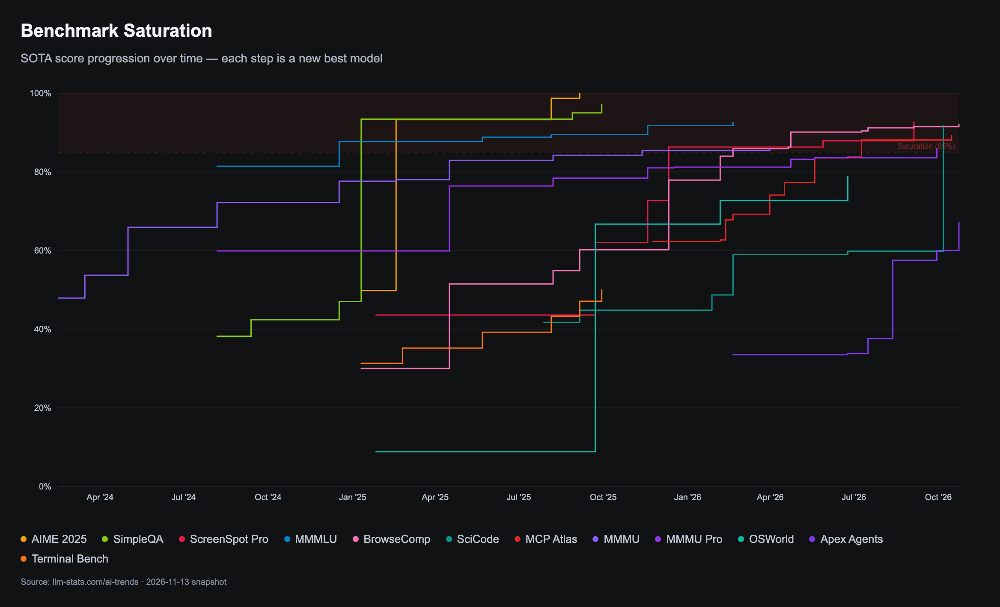

**怎么看：** 横轴为时间，纵轴为各基准的历史最高分；阶梯上升表示纪录刷新，85% 虚线是来源设置的饱和参考线。

**图表显示：** 部分基准已进入高分区，另一些任务仍明显低于参考线。比较模型时，单项基准是否还具有区分度，比把所有百分比视为同一种能力更有意义。

**关键模型 / 数据点：**

- 85%：来源设定的饱和参考线。
- 2025 年 6 月悬浮位置：SimpleQA 93.4%、AIME 2025 93.3%、MMMLU 88.8%。
- 同一悬浮位置：BrowseComp 51.5%、Terminal Bench 39.2%、OSWorld 8.8%。

**解读边界：** 这是各任务历史最好成绩，不代表全部模型；不同基准的分数不是统一难度尺度，也不能仅凭曲线终止位置判断任务停止进步。

证据依据

- **直接证据：**图中标注 Saturation (85%)；本图交互提示 给出 2025 年 6 月各项分数。
- **视觉推断：**多条曲线越过参考线，同时仍有曲线停留在较低区间。

## 图 02｜头部差距：采样排名与实时榜单要分开

*原始标题：The Convergence*

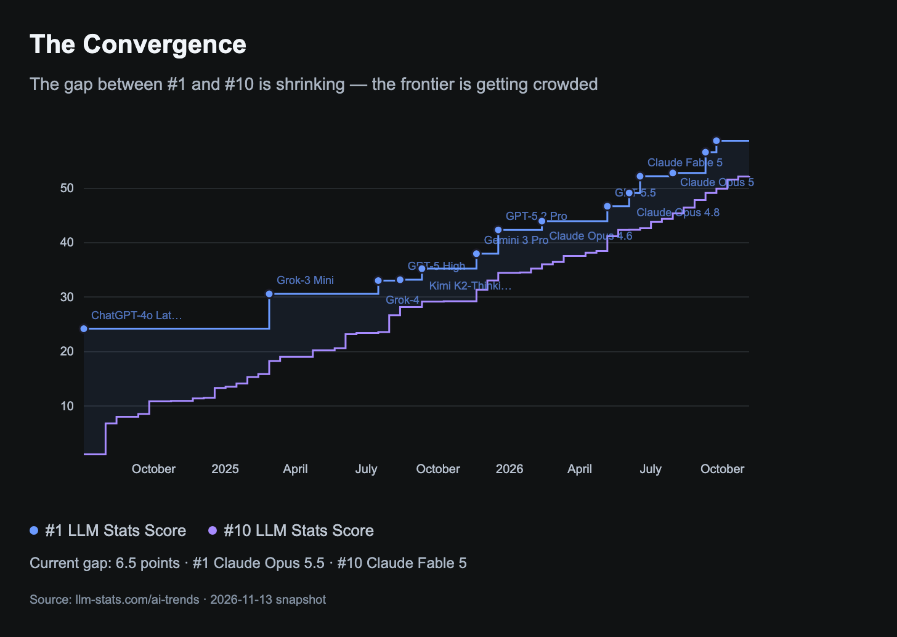

**怎么看：** 蓝线与紫线分别记录综合分第 1 和第 10 名；来源从 2023 年 3 月 1 日起每 14 天采样，两线间距表示该时点的头部差距。

**图表显示：** 前沿抬升与后续追赶交替发生，差距并非持续缩小。图卡最新采样停在 11 月 4 日，榜首 Opus 5.5 与第 10 名相差 6.5 分，尚未覆盖 11 月 9 日发布的 Fable 5.2。

**关键模型 / 数据点：**

- Claude Opus 5.5：2026 年 9 月首次登顶采样综合分 58.7，当时领先第 10 名 8.8 分。
- GPT-6 Astra：2026 年 9 月登顶采样综合分 56.6，当时领先 7.5 分。
- 图卡最新采样：Claude Opus 5.5 与第 10 名 Claude Fable 5 相差 6.5 分。

**解读边界：** 圆点显示榜首首次更替，Current gap 对应最后一个采样点；因此首次登顶时的 8.8 分与最新差距 6.5 分并不矛盾，本图也不是抓取当日实时排名。

证据依据

- **直接证据：**本图交互提示 列出 Opus 5.5 的 58.7、8.8 与 GPT-6 Astra 的 56.6、7.5。
- **直接证据：**图卡文字 标注 Current gap: 6.5 points，#1 Claude Opus 5.5，#10 Claude Fable 5。
- **视觉推断：**两条阶梯之间的间距随榜首更新扩大、随追赶缩小。
- **直接证据：**当前公开绘图代码以 14 天步长产生快照；按同一公开 trends API 复算，末次采样为 2026-11-04，Opus 5.5 为 58.72、第十名 Fable 5 为 52.2；Fable 5.2 发布于 11-09。

## 图 03｜实验室进展：先排除倍率与基线误读

*原始标题：Lab Progress*

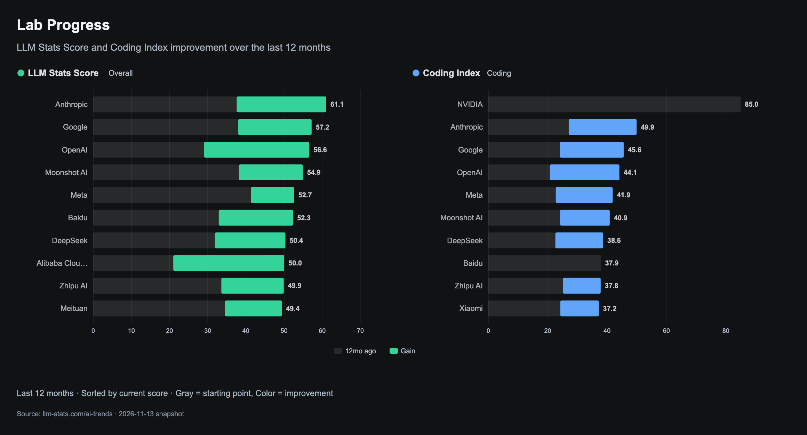

**怎么看：** 左栏是综合分，右栏是 Coding Index。源码先筛过去 12 个月发布的模型，再用各组织首个合格纪录作灰色起点、后续最高值作终点；灰色并非严格的 12 个月前成绩。

**图表显示：** 综合分栏由 Anthropic 领先，Google 与 OpenAI 随后。编程栏 NVIDIA 的 85.0 则源于代码把 Nemotron 3 Nano 的原始 0.85 乘以 100，不能把它解释为真实的编程领先。

**关键模型 / 数据点：**

- Anthropic：图示综合分起点 37.6、当前 61.1；Coding Index 起点 27.1、当前 49.9。
- Google：当前综合分 57.2、Coding Index 45.6；OpenAI 分别为 56.6、44.1。
- NVIDIA：图示 Coding Index 起点与当前均为 85.0；公开数据中 Nemotron 3 Nano (30B A3B) 的 index_code 实为 0.85。

**解读边界：** 来源对不大于 1 的正分数自动乘 100，造成 NVIDIA 异常；起点也只是筛选窗口内的首个合格纪录。保留原图以展示问题，不据柱长计算年度真实进步。

证据依据

- **直接证据：**本图 SVG 与 交互提示 给出 Anthropic、Google、OpenAI 的两项指数。
- **直接证据：**当前 交互提示 给出 NVIDIA 12mo ago 85.0、Current 85.0、Gain +0.0；公开 trends API 中 Nemotron 3 Nano (30B A3B) 的 index_code=0.85，release_date=2025-12-15。
- **直接证据：**当前公开绘图代码 function u 使用 r<=1?100*r:r，并先筛过去 12 个月发布日期，再取按日期排序后的首个合格纪录作 startScore。

## 图 04｜组织前沿：发布数量与能力排名并不相同

*原始标题：Organization Progress*

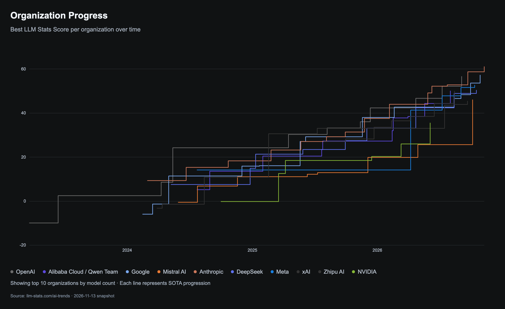

**怎么看：** 横轴为时间，纵轴为综合分；每条阶梯记录一家组织迄今最高分。图中组织按模型发布数量筛选。

**图表显示：** 多家组织的前沿都在抬升，但曲线起点、更新频率和最终高度不同。这张图适合观察供给较多的组织如何更新能力纪录，不能当成全部实验室的能力前十。

**关键模型 / 数据点：**

- 10 个组织：来源按模型数量筛选。
- 2025 年 4 月悬浮位置：OpenAI 30.3、xAI 29.7、Zhipu AI 27.1。
- 同一位置：Anthropic 23.2、DeepSeek 21.3、Qwen 团队 20.4。

**解读边界：** 各曲线提示可取邻近记录，悬浮日期不保证所有值来自同一天；综合分也不是正确率，负值不能解释成负的答题准确率。

证据依据

- **直接证据：**图卡文字 写明 Showing top 10 organizations by model count。
- **直接证据：**本图交互提示 在 Apr 2025 位置给出上述组织分数。
- **视觉推断：**多条阶梯在后期上移，但组织之间仍有明显高度差异。

# 实验室与国家：供给扩展伴随历史补录

> **本组结论：** 热力图累计收录446个模型，国家图统计441个，其中美国234、中国151。两国仍主导收录供给；9月记录被回补，11月只有阶段数据，总量净增不能当作本月发布量。

## 图 05｜中美综合分前沿：追赶并非单向收敛

*原始标题：US vs China Gap*

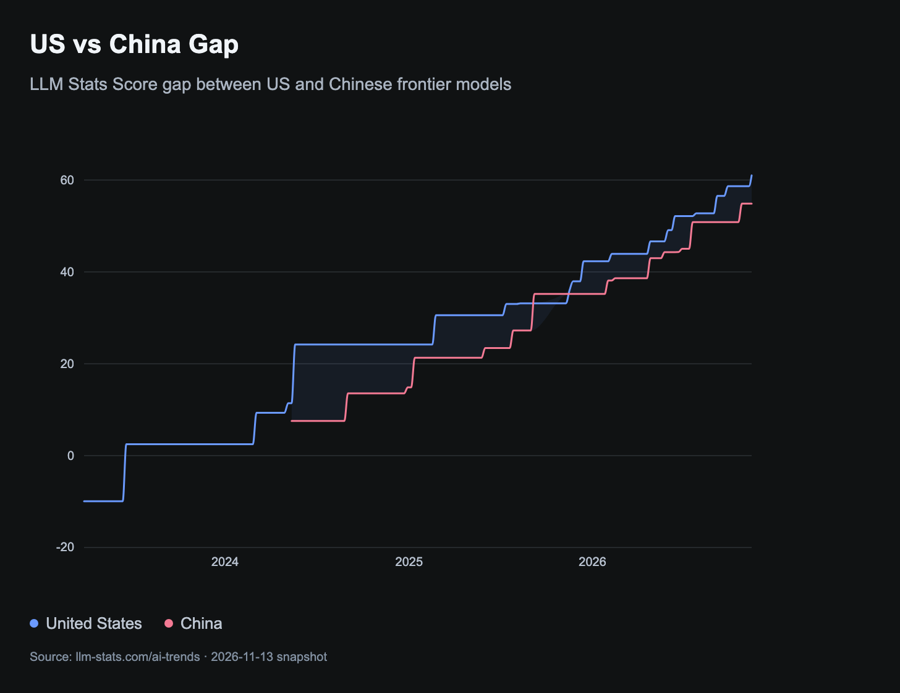

**怎么看：** 横轴为时间，纵轴为综合分；蓝色为美国、粉色为中国，分别跟踪各国最好模型。

**图表显示：** 两国前沿总体上移，中国在中段曾接近或短暂越过美国；完整图的末端仍由美国领先。国家层面的领先差距随新模型发布反复变化。

**关键模型 / 数据点：**

- 2025 年 1 月悬浮位置：美国 24.2，中国 21.3。
- 比较对象是两国各自的最高综合分，不是模型平均分。

**解读边界：** 未取得最新端点的精确提示值，末端领先方向来自图形。悬浮提示可取各曲线邻近记录，不据其日期计算精确日级差距或追赶天数。

证据依据

- **直接证据：**本图交互提示 的 Jan 2025 提示为 US 24.2、China 21.3。
- **视觉推断：**完整 PNG 末端蓝线高于粉线，中段存在交叉。

## 图 06｜累计模型收录：中美占据主要份额

*原始标题：Cumulative AI Model Releases*

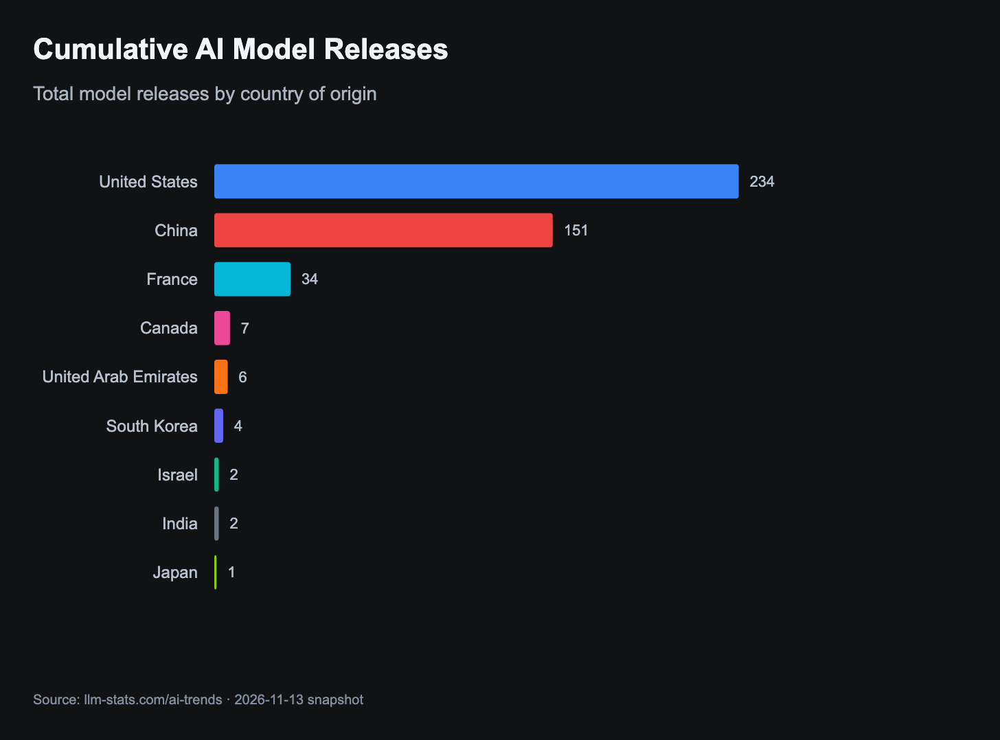

**怎么看：** 横向条形按组织所属国家统计累计收录模型数，条形越长表示该分组的模型越多。

**图表显示：** 美国与中国合计 385 个，占本图 441 个的约 87%；法国随后，阿联酋成为可见分组。国家图衡量收录供给，不衡量能力、营收或实际使用量。

**关键模型 / 数据点：**

- 美国 234 个，中国 151 个。
- 法国 34 个，加拿大 7 个，阿联酋 6 个。
- 韩国 4 个；以色列与印度各 2 个，日本 1 个；标签合计 441 个。

**解读边界：** 国家图排除国家或发布日期缺失等记录。按当前公开数据复核，446 个自 2023 年起的模型中有 5 个缺少国家字段，因此本图为 441；不能混用两图分母。

证据依据

- **直接证据：**SVG 列出九个国家与 234、151、34、7、6、4、2、2、1 的对应数值；前六国也由 交互提示 核实。
- **直接证据：**按上述标签相加得 441；(234+151)/441 约为 87%。
- **直接证据：**当前公开 canonical API 中，2023 年起有效发布日期样本为 446，其中 5 个 organization_country 为空；按国家图筛选规则复算各国计数，与 SVG 完全一致。

## 图 07｜月度发布：历史回补与当月新增分别看

*原始标题：The Release Heatmap*

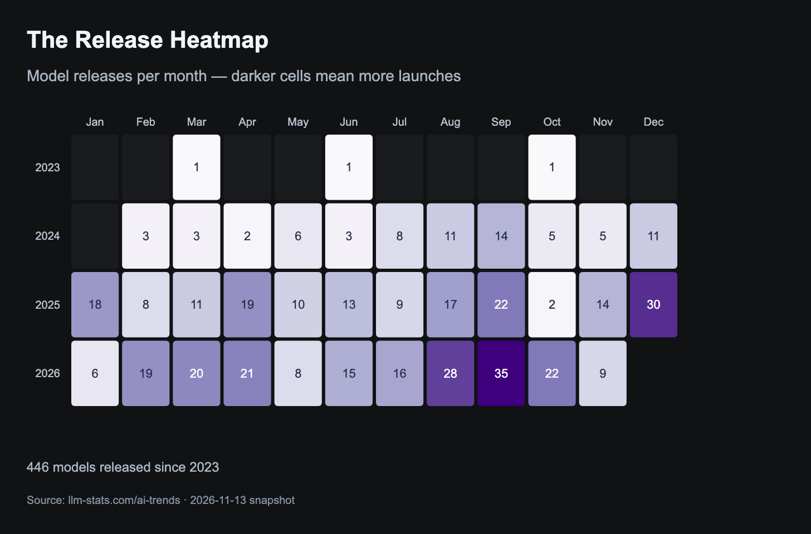

**怎么看：** 行表示年份，列表示月份；格子数字是来源按发布日期统计的模型数，颜色越深表示数量越多。

**图表显示：** 2026 年 9 月在当前收录中达到 35 个，是可见最高月份；10 月为 22 个，11 月目前为 9 个。历史月份会被回补，总量增加不能全部算作最近新发布。

**关键模型 / 数据点：**

- 来源总量：自 2023 年以来 446 个。
- 2026 年 7、8、9 月：16、28、35 个。
- 2026 年 10 月 22 个；11 月截至 11 月 13 日为 9 个。

**解读边界：** 11 月与全年尚未结束，不能直接用 9 与完整月份比较发布速度；9 月由上一期 22 改为 35，体现来源历史收录修订。

证据依据

- **直接证据：**图卡文字 标注 446 models released since 2023。
- **直接证据：**PNG 与 SVG 列出 2026 年 7–11 月 16、28、35、22、9；交互提示 核实到 9 月。
- **直接证据：**上一期图 7 记载 2026 年 9 月 22 个，本期同月显示 35。

## 图 08｜国家累计份额：扩展来源不等于平均分布

*原始标题：Model Releases by Country*

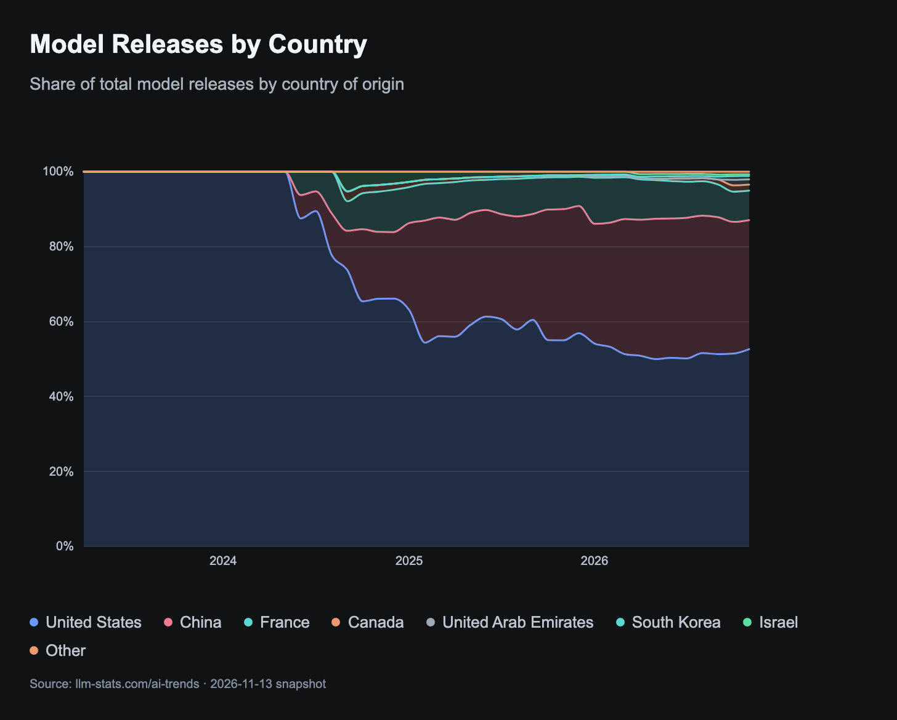

**怎么看：** 堆叠面积显示各国在累计收录中的份额，每一时点合计为 100%；区域厚度是份额，不是当月发布量。

**图表显示：** 美国由早期几乎独占降至后期约一半，中国成为第二大来源，其他国家仍占较小区域。累计结构在扩展，但没有变成各国均衡分布。

**关键模型 / 数据点：**

- 2023 年 4 月悬浮位置：美国 100%。
- 2025 年 1 月位置：美国 63%、中国 23%、法国 10%。
- 同一位置：以色列 3%、加拿大 1%，其余显示为 0%。

**解读边界：** 累计份额受早期基数、国家标签与历史补录影响；未取得末端精确份额，后期“约一半”为视觉判断，不与相邻总量图拼接计算。

证据依据

- **直接证据：**本图交互提示 提供 Apr 2023 与 Jan 2025 的国家份额。
- **视觉推断：**完整 PNG 末端美国区域略多于一半，中国占据次大面积。

## 图 09｜实验室累计发布：数量轴存在百分号误标

*原始标题：Cumulative Releases by Lab*

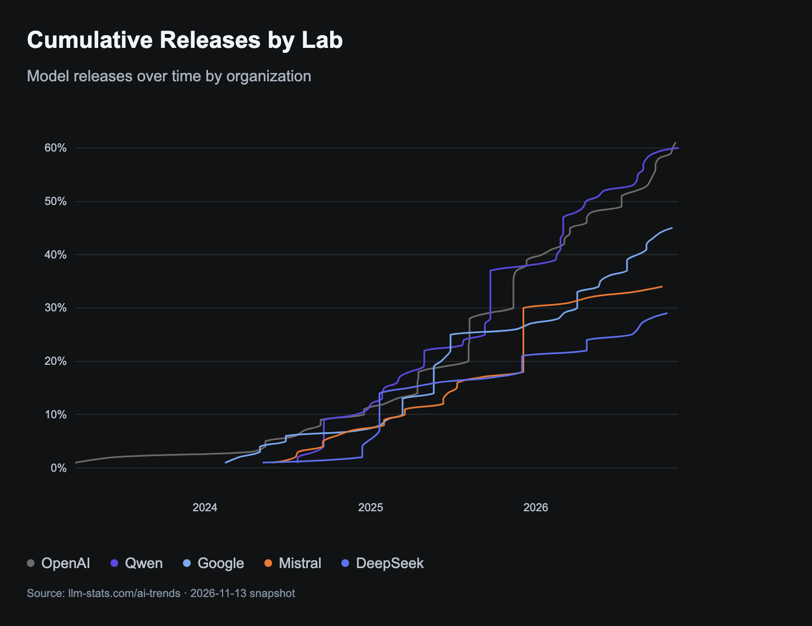

**怎么看：** 横轴为时间，五条曲线分别跟踪 OpenAI、Qwen、Google、Mistral 与 DeepSeek 的累计发布数量；纵轴虽然附百分号，本图标题与提示值表达的是个数。

**图表显示：** 按本期公开数据与图表计数规则复算，OpenAI 61 个、Qwen 60 个，数量接近，Google 随后。发布频率可以反映供给节奏，但不代表能力领先或市场份额。

**关键模型 / 数据点：**

- 按本图规则复算当前累计：OpenAI 61、Qwen 60。
- Google 45、Mistral 34、DeepSeek 29。
- 2025 年 1 月悬浮位置：Qwen 13、OpenAI 12、Google 8、Mistral 8、DeepSeek 6。

**解读边界：** 绘图代码对模型逐个累加，却沿用通用纵轴的百分比格式；正文按个数理解。末端整数来自对当期公开数据按同图规则复算，不是从刻度估读。

证据依据

- **直接证据：**当前源码 CumulativeModelsPerLab 筛选 organization_id、有效发布日期且日期不早于 2020-01-01，对每组执行 value:++n。
- **直接证据：**对当前公开 canonical API 按同一规则复算，前五家为 OpenAI 61、Qwen 60、Google 45、Mistral 34、DeepSeek 29。
- **直接证据：**SVG 纵轴附百分号；本图交互提示 在 Jan 2025 位置给出 13、12、8、8、6 的累计计数。

# 开放模型：能力追赶与发布比例是两件事

> **本组结论：** 开放权重模型的前沿持续抬升，但图末闭源仍领先。第四季度目前31个模型中开放11个，约35%；这描述供给结构，不能从该比例推断开放模型能力退步。

## 图 10｜开放发布比例：最新季度仍是阶段样本

*原始标题：Open vs Proprietary Releases*

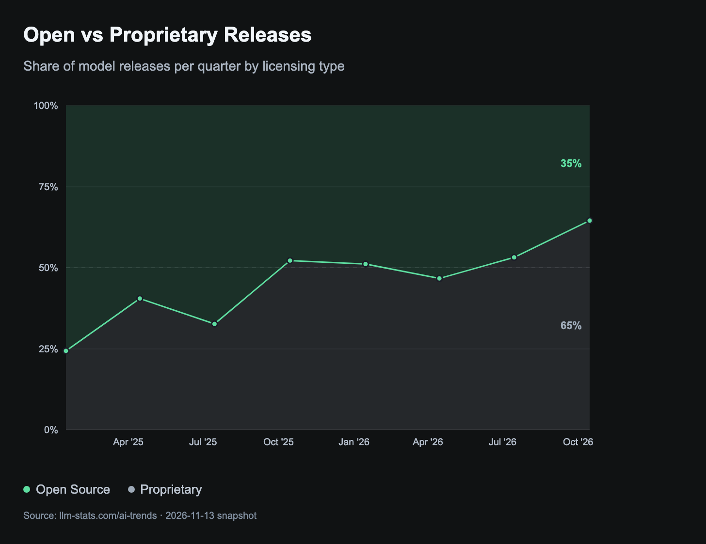

**怎么看：** 横轴按季度排列，上方绿色区域是开放模型，下方灰色为专有模型；两类合计 100%，分界线的纵坐标对应下方专有份额。

**图表显示：** 本期第三季度开放模型为 37/79，约占 47%；第四季度目前为 11/31，约占 35%。最新季度专有模型占多数，但样本尚未收齐，不能据此认定开放发布长期转弱。

**关键模型 / 数据点：**

- 2026 年第二季度：开放 24/45（53%），专有 21/45（47%）。
- 第三季度：开放 37/79（47%），专有 42/79（53%）。
- 第四季度截至抓取时：开放 11/31（35%），专有 20/31（65%）。

**解读边界：** 图例的 Open Source 沿用来源分类，并不保证训练数据、训练代码与许可均完整开放；季度统计也会随历史补录改变。

证据依据

- **直接证据：**本图交互提示 给出 2026 年 Q2、Q3、Q4 的总数、两类数量和四舍五入比例。
- **直接证据：**PNG 末端上方区域标注 35%，下方区域标注 65%。

## 图 11｜开放与闭源前沿：追赶中仍有差距

*原始标题：The Closing Gap*

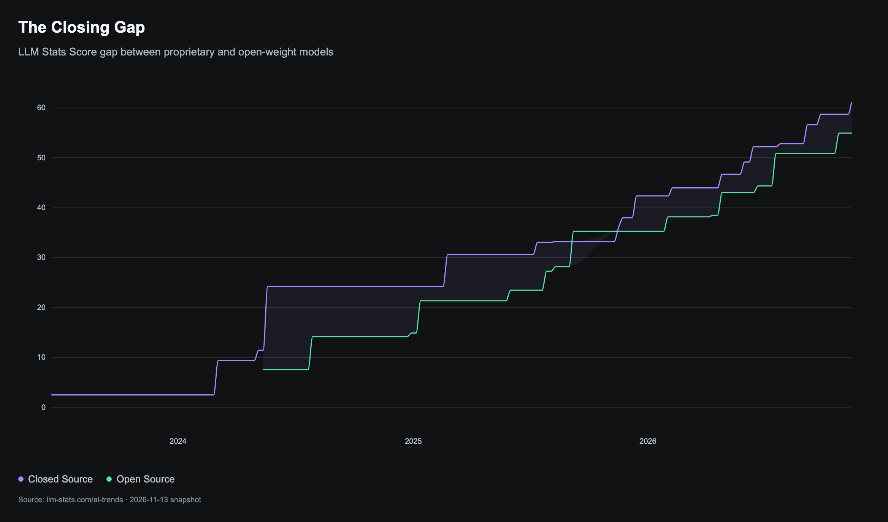

**怎么看：** 紫色与绿色曲线分别记录闭源和开放权重模型的最高综合分，横轴为时间；两线间距表示前沿差距。

**图表显示：** 开放权重前沿持续抬升，并在中段短暂超过闭源；末端闭源再次领先。追赶包含接近、交叉与拉开，图名不能被理解为差距始终缩小。

**关键模型 / 数据点：**

- 2025 年 3 月悬浮位置：闭源 30.6、开放权重 21.3。
- 图例比较 Closed Source 与 Open Source 两类的最高综合分。

**解读边界：** 最新端点未取得精确 tooltip，末端方向来自完整图形；提示日期可能配合各曲线邻近记录，不能据其计算精确追赶天数。

证据依据

- **直接证据：**本图交互提示 的 Mar 2025 返回 Closed Source 30.6、Open Source 21.3。
- **视觉推断：**完整 PNG 中段绿色曾越过紫色，末端紫色仍较高。

## 图 12｜国家与开放方式：四条不同的能力前沿

*原始标题：Open Weights Race: US vs China*

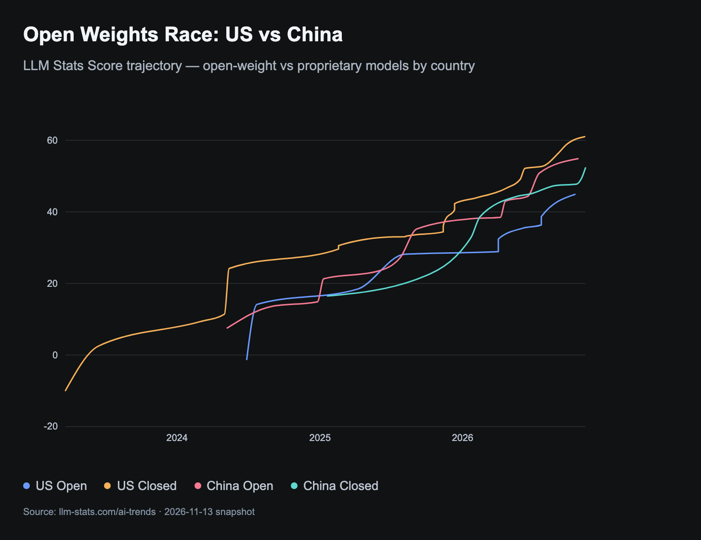

**怎么看：** 四条曲线分别表示美国开放、美国闭源、中国开放与中国闭源模型的综合分前沿，横轴为时间。

**图表显示：** 图末美国闭源最高，中国开放高于中国闭源与美国开放。国家归属与权重开放方式共同刻画竞争格局，单看一个维度会掩盖组内差异。

**关键模型 / 数据点：**

- 2025 年 4 月悬浮位置：美国闭源 29.7，中国开放 21.3。
- 同一位置：美国开放 18.5，中国闭源 16.5。

**解读边界：** 平滑连接不代表两次发布之间能力连续改善；悬浮日期与邻近记录也不保证是严格同一天，不能把这些值拼成日级国家排名。

证据依据

- **直接证据：**本图交互提示 的 Apr 2025 返回四类分数 29.7、21.3、18.5、16.5。
- **视觉推断：**完整 PNG 末端依次为美国闭源、中国开放、中国闭源、美国开放。

# 模型能力形态：多模态常见，高分开放模型集中于MoE

> **本组结论：** 第四季度目前25/31个模型支持视觉或多模态；开放模型高分区以MoE点为主。功能标签与架构可以筛选候选，仍需分别检验任务质量、许可和实际推理开销。

## 图 13｜多模态覆盖：功能普及仍需质量验收

*原始标题：The Multimodal Shift*

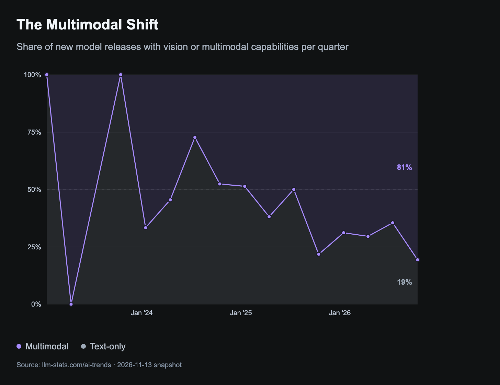

**怎么看：** 横轴按季度排列，上方紫色面积表示支持视觉或多模态的模型，下方灰色面积表示纯文本；分界线越低，多模态占比越高。

**图表显示：** 第三季度多模态模型占 51/79，约 65%；第四季度目前为 25/31，约 81%。多模态在近期供给中常见，但支持某类输入不等于相应任务质量达标。

**关键模型 / 数据点：**

- 2025 年第四季度：多模态 36/46（78%）。
- 2026 年第三季度：多模态 51/79（65%），纯文本 28/79（35%）。
- 2026 年第四季度截至抓取时：多模态 25/31（81%），纯文本 6/31（19%）。

**解读边界：** 第四季度尚未结束；多模态标签不能证明模型同时具备成熟的图像、音频与视频能力。与开放比例是不同属性，应分别统计。

证据依据

- **直接证据：**本图交互提示 给出上述季度总数与两类数量；末端 SVG 标注 81% 与 19%。

## 图 14｜开放模型的 MoE 分布：高分区与架构标签

*原始标题：MoE Adoption Over Time*

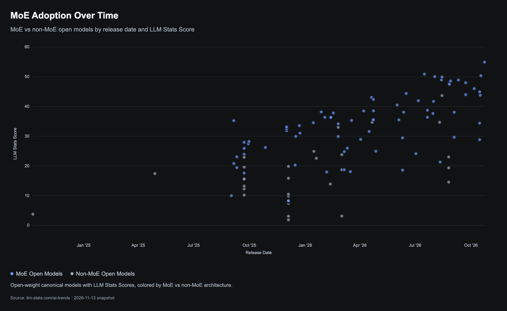

**怎么看：** 横轴为发布日期，纵轴为综合分；蓝点为 MoE，灰点为非 MoE，样本限于有评分的开放权重 canonical 模型。

**图表显示：** 当前高分区以 MoE 点为主，Kimi K3.1 Pro 已出现在 10 月末的较高位置；同为 MoE 的模型仍有很大的分数差异。架构标签只能提供筛选线索，不能单独解释能力。

**关键模型 / 数据点：**

- Kimi K3.1 Pro：2026-10-23 发布，综合分 54.9。
- DeepSeek-V4.1-Flash-1017：2026-10-17 发布，50.4。
- Qwen3.8 Max：2026-08-02 发布，50.0；Qwen3.8-27B：08-14 发布，43.7。

**解读边界：** 这不是全行业架构普查，缺少评分或架构信息的模型可能缺席；总参数量与单次激活参数仍需分别判断。

证据依据

- **直接证据：**本图交互提示 提供上述模型名、发布日期和综合分。
- **直接证据：**图卡文字 将样本限定为 Open-weight canonical models with LLM Stats Scores。
- **视觉推断：**完整 PNG 的较高分区域主要由蓝色 MoE 点构成，同色点仍纵向分散。

# 价格与价值：同一能力门槛出现更低报价

> **本组结论：** 40分门槛的最低混合报价为每百万token约0.08美元，50分门槛也出现0.42美元候选；中国样本价格中位数仍为0.45美元。但不同图的混合权重、样本与单位不同，报价不能直接代替任务成本。

## 图 15｜国家价格分布：中位数不能替代同能力比较

*原始标题：Price by Country*

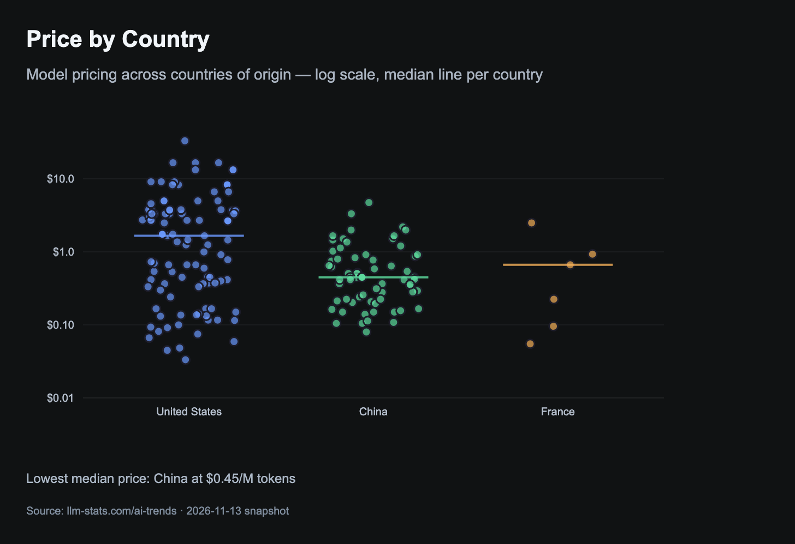

**怎么看：** 横轴按模型所属组织的国家分组，纵轴是每百万 token 的 API 价格并采用对数刻度；散点为模型，横线为组内中位数。

**图表显示：** 中国样本中位数仍最低，美国样本价格覆盖范围更宽。同一国家内部差异很大，国家中位数无法代替同能力、同任务条件下的价格比较。

**关键模型 / 数据点：**

- 中国价格中位数：每百万 token 0.45 美元。
- DeepSeek-V4-Flash-0731：每百万 token 0.08 美元，综合分 41.7。
- Kimi K3.1 Pro：每百万 token 3.3 美元，综合分 54.9。
- Claude Fable 5.2：每百万 token 13.3 美元，综合分 61.1。

**解读边界：** 不同国家可见样本数量与模型能力组合不一致；价格是 API 报价，不能直接解释为基础设施成本或完成一次任务的费用。

证据依据

- **直接证据：**图卡文字 标注 Lowest median price: China at $0.45/M tokens。
- **直接证据：**本图交互提示 列出上述三个模型的价格与综合分。
- **视觉推断：**完整 PNG 中美国价格分布跨度更大，三个国家的点数明显不均衡。

## 图 16｜单位得分价格：固定门槛下的历史低价

*原始标题：The Price of Intelligence*

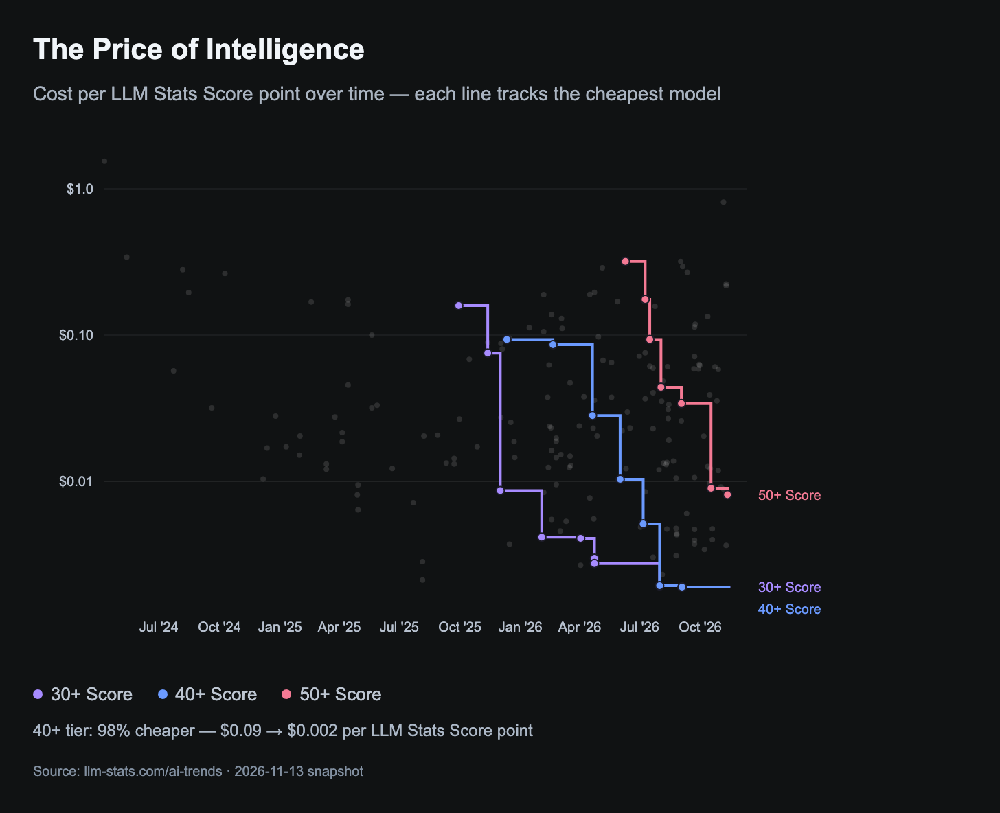

**怎么看：** 横轴为发布日期，纵轴是混合 API 价格除以综合分，采用对数刻度；三条阶梯分别跟踪达到 30、40、50 分门槛的最低比值。

**图表显示：** 按当前分数重建的三条门槛曲线整体下移，较高能力门槛也出现更便宜的候选。40 分门槛的最低单位得分价格约为 0.002 美元，50 分门槛仍更贵。

**关键模型 / 数据点：**

- 40+ 门槛：图卡显示单位得分价格约从 0.09 降至 0.002 美元，下降 98%。
- Ling 3.0 Flash Fin：综合分 42.6，提示单位得分价格 0.002 美元，API 价 0.08 美元/百万 token。
- ERNIE 5.5 Flash Preview：综合分 52.3，单位得分价格 0.008 美元，API 价 0.42 美元/百万 token。

**解读边界：** 98% 是当前口径下的历史回溯，不是 10 月至 11 月的降幅；综合分不是正确率，价格除以分数也不能替代每次成功任务的总费用。

证据依据

- **直接证据：**图卡文字 标注 40+ tier: 98% cheaper — $0.09 → $0.002 per LLM Stats Score point。
- **直接证据：**本图交互提示 返回 Ling 3.0 Flash Fin 的 42.6、0.002、0.08 及 ERNIE 5.5 Flash Preview 的 52.3、0.008、0.42。
- **视觉推断：**完整 PNG 的 30、40、50 分门槛最低比值曲线均出现下行阶梯。

## 图 17｜40 分以上模型的最低 API 价格

*原始标题：Cheapest 40+ LLM Stats Score Model*

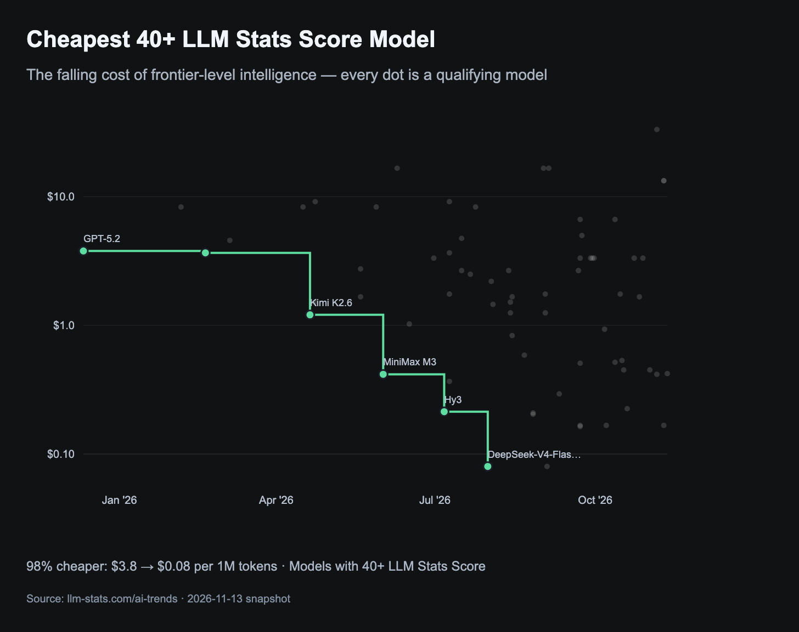

**怎么看：** 横轴为发布日期，纵轴为对数刻度的每百万 token 混合报价；灰点是达到 40 分的模型，绿色阶梯连接历次最低价。

**图表显示：** 达到 40 分门槛的最低报价在历史回溯中明显下降，但同一时期仍有大量高价模型。能力可用的价格下限与整个市场的平均报价应分开观察。

**关键模型 / 数据点：**

- GPT-5.2：综合分 40.6，每百万 token 3.8 美元。
- Kimi K2.6：综合分 43.0，每百万 token 1.2 美元。
- DeepSeek-V4-Flash-0731：综合分 41.7，每百万 token 0.08 美元；图卡标注相较历史起点便宜约 98%。

**解读边界：** 40 分是本期综合分门槛，不是正确率，也不是固定不变的前沿标准；98% 是本图历史起点到终点的变化，不是 11 月环比。

证据依据

- **直接证据：**本图悬浮提示核对的代表性数据：GPT-5.2：综合分 40.6，每百万 token 3.8 美元；Kimi K2.6：综合分 43.0，每百万 token 1.2 美元；DeepSeek-V4-Flash-0731：综合分 41.7，每百万 token 0.08 美元；图卡标注相较历史起点便宜约 98%。
- **直接证据：**图卡标出历史最低价从 3.8 降至 0.08 美元/百万 token，约便宜 98%。
- **视觉推断：**绿色最低价阶梯下降，后期灰色样本仍分布在多个价格层级。

## 图 18｜编程能力上限与季度平均价格

*原始标题：Capability vs Price*

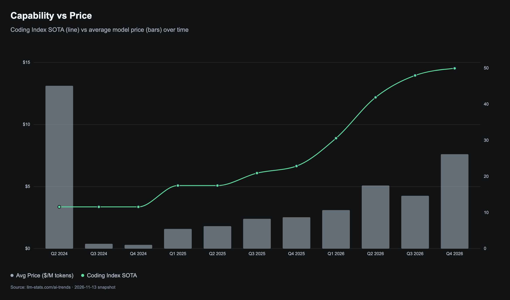

**怎么看：** 横轴按季度排列，灰柱对应左轴的平均 API 价格，绿线对应右轴的最佳 Coding Index；两组纵轴需要分别读取。

**图表显示：** 本图编程前沿继续上升，但平均报价并未单调下降；最新季度的可见均价反而高于第三季度，说明最低可用价格与发布组合的平均价格会朝不同方向变化。

**关键模型 / 数据点：**

- 2026 年第二季度：Claude Fable 5 的 Coding Index 为 41.9，当季均价为 5.1 美元/百万 token。
- 2026 年第三季度：Claude Opus 5.5 的 Coding Index 为 48.0，当季均价为 4.3 美元/百万 token。
- 2026 年第四季度截至抓取日：Claude Fable 5.2 的 Coding Index 为 49.9，当季均价为 7.6 美元/百万 token。

**解读边界：** 第四季度尚未结束，均价受有效报价样本的组合影响；图 3 将 NVIDIA 的 0.85 放大为 85，属于显示倍率问题，不能据此否定本图 49.9 的前沿或宣称能力突破。

证据依据

- **直接证据：**本图悬浮提示核对的代表性数据：2026 年第二季度：Claude Fable 5 的 Coding Index 为 41.9，当季均价为 5.1 美元/百万 token；2026 年第三季度：Claude Opus 5.5 的 Coding Index 为 48.0，当季均价为 4.3 美元/百万 token；2026 年第四季度截至抓取日：Claude Fable 5.2 的 Coding Index 为 49.9，当季均价为 7.6 美元/百万 token。
- **直接证据：**当前绘图源码要求正编程指数、有效日期和正价格；优先使用 blended_price，否则使用输入输出均价或可用的一侧价格。
- **视觉推断：**绿线继续抬升，最新季度灰柱也明显高于上一季度。
- **直接证据：**已核对图 3 的处理会把不大于 1 的指数乘以 100，图 18 直接使用原始 index_code；两者对 NVIDIA 0.85 的显示不一致。

## 图 19｜综合能力与 API 价格的分散关系

*原始标题：Performance vs Price*

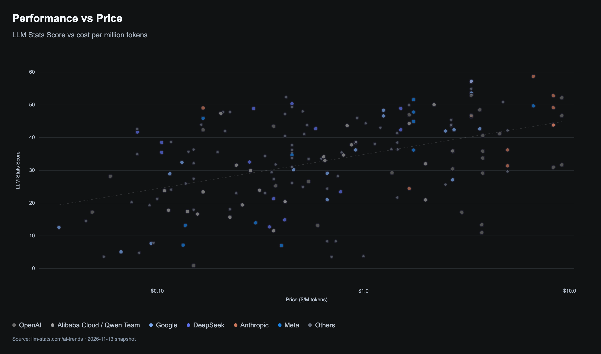

**怎么看：** 横轴是对数刻度的混合 API 价格，纵轴是 LLM Stats Score；颜色区分组织，虚线表示样本的总体拟合趋势。

**图表显示：** 样本整体呈现较高报价与较高分数共同出现的趋势，但同价位分数分散很大，低价区也有高分模型。价格只能帮助筛选预算范围，不能替代能力验证。

**关键模型 / 数据点：**

- Claude Haiku 5.5：0.17 美元/百万 token，综合分 49.0。
- ERNIE 5.5 Flash Preview：0.42 美元/百万 token，综合分 52.3。
- Claude Opus 5.5：6.7 美元/百万 token，综合分 58.7。

**解读边界：** 本图剔除价格最高约 5% 的样本，通常按输入输出 5∶1 混合报价，输出价缺失时可回退到输入价；不能直接与图 22 的 1∶1 价格混算，也不能据相关性推断因果。

证据依据

- **直接证据：**本图悬浮提示核对的代表性数据：Claude Haiku 5.5：0.17 美元/百万 token，综合分 49.0；ERNIE 5.5 Flash Preview：0.42 美元/百万 token，综合分 52.3；Claude Opus 5.5：6.7 美元/百万 token，综合分 58.7。
- **直接证据：**当前源码通常以 (5 × 输入价 + 输出价) / 6 计算报价，并在价格第 95 百分位截断样本。
- **视觉推断：**趋势线向右上倾斜，但同价位点云纵向分布很宽。

## 图 20｜不同参数档位的归一化能力价格

*原始标题：Cost Efficiency by Tier*

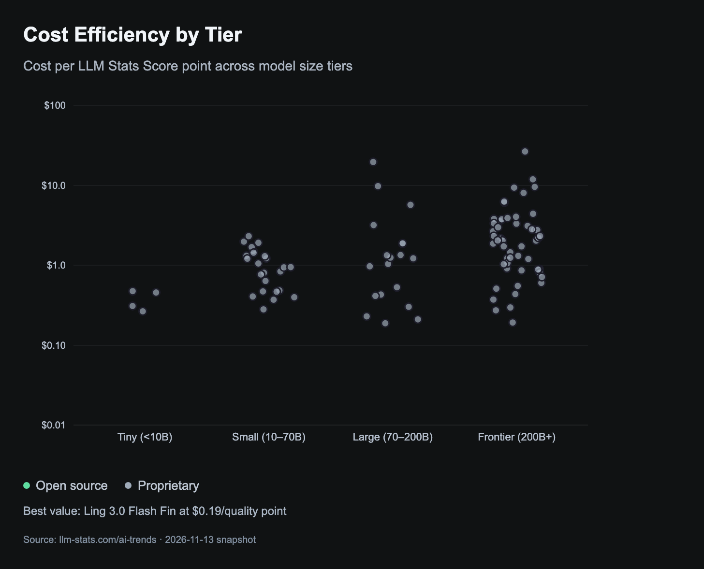

**怎么看：** 横轴按总参数量分成四档，纵轴是图示价格与综合分的比值，采用对数刻度；数值越低表示该图口径下越划算。

**图表显示：** 各个参数档位内部的价格效率差异都很大，参数更多并不保证每单位能力更便宜。图卡把 Ling 3.0 Flash Fin 标为本图最佳值。

**关键模型 / 数据点：**

- Ling 3.0 Flash Fin：综合分 42.6，图示归一化能力价格 0.19 美元，被图卡列为最佳值。
- DeepSeek-V4-Flash-0731：综合分 41.7，图示比值四舍五入后同为 0.19 美元。
- Gemma 4 31B：综合分 32.5，图示归一化能力价格 0.41 美元。

**解读边界：** 源码实际计算为价格 ÷ Score × 100，标题却称每得分点价格，比图 16 多 100 倍；散点均为灰色，本文不据图例判断开放与专有属性。

证据依据

- **直接证据：**本图悬浮提示核对的代表性数据：Ling 3.0 Flash Fin：综合分 42.6，图示归一化能力价格 0.19 美元，被图卡列为最佳值；DeepSeek-V4-Flash-0731：综合分 41.7，图示比值四舍五入后同为 0.19 美元；Gemma 4 31B：综合分 32.5，图示归一化能力价格 0.41 美元。
- **直接证据：**当前源码的 costPerPoint 为价格 ÷ Score × 100；价格优先取 blended_price，否则回退为输入输出 5∶1。
- **直接证据：**图卡将 Ling 3.0 Flash Fin 列为最佳值，显示 0.19 美元。
- **视觉推断：**各档内部的散点分散，点色均为灰色，不能据图例比较许可属性。

## 图 21｜按发布季度观察模型价格效率

*原始标题：Value Evolution*

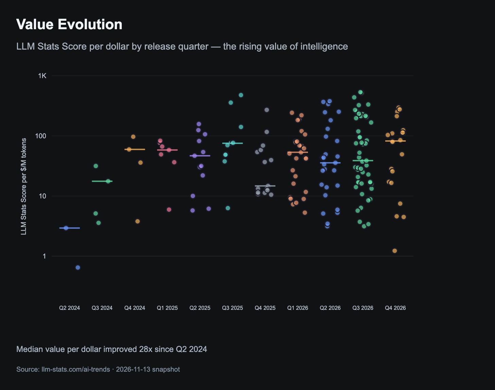

**怎么看：** 横轴为发布季度，纵轴为综合分除以每百万 token 报价，采用对数刻度；散点代表模型，横线代表季度中位数，越高表示这一比值越好。

**图表显示：** 相较早期季度，当前价格效率中位数明显提高，但各季度有反复，同一季度内部差异也很大。更新的模型不一定在本图定义下更划算。

**关键模型 / 数据点：**

- 图卡标注：最新季度的能力价格比中位数是 2024 年第二季度的 28 倍。
- Ling 3.0 Flash Fin：能力价格比 532.8，综合分 42.6，价格 0.08 美元/百万 token。
- Claude Fable 5.2：能力价格比 4.6，综合分 61.1，价格 13.3 美元/百万 token。

**解读边界：** 28 倍是当前口径回溯出的跨季度比值，不是本月增幅；第四季度未结束，价格优先取数据源的 blended_price，缺失时回退为输入输出 5∶1。

证据依据

- **直接证据：**本图悬浮提示核对的代表性数据：Ling 3.0 Flash Fin：能力价格比 532.8，综合分 42.6，价格 0.08 美元/百万 token；Claude Fable 5.2：能力价格比 4.6，综合分 61.1，价格 13.3 美元/百万 token。
- **直接证据：**图卡标注相较 2024 年第二季度的中位数比值为 28 倍；源码优先采用 blended_price。
- **视觉推断：**各季中位数并非单调上升，同期模型之间也有很大差异。

## 图 22｜综合能力与价格的帕累托前沿

*原始标题：LLM Stats Score vs Price ($/1M tokens)*

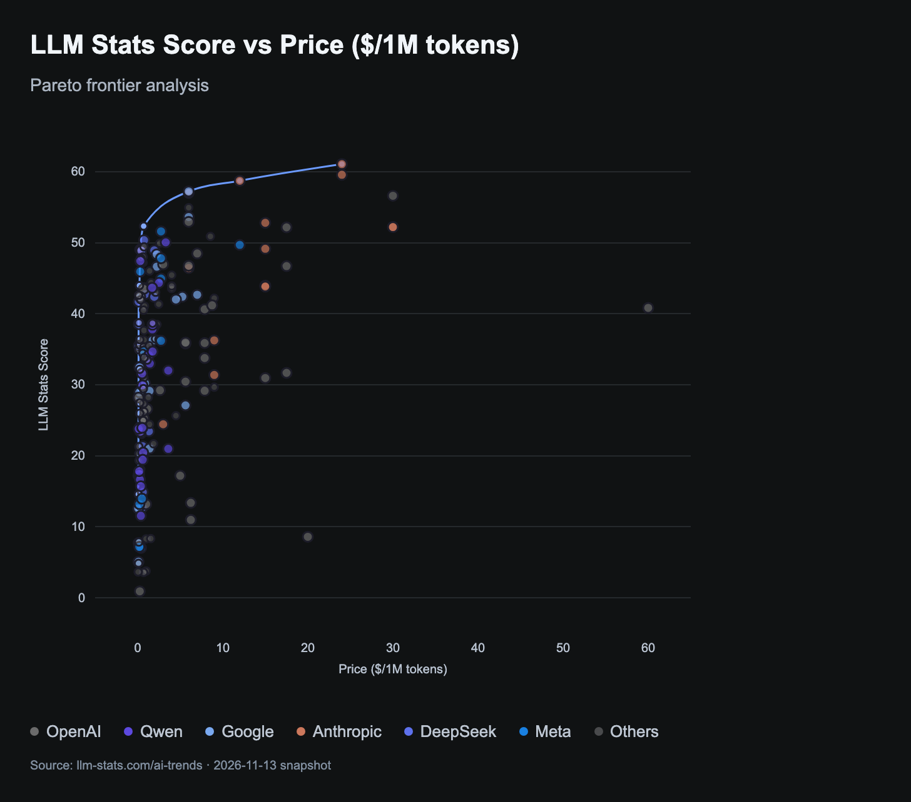

**怎么看：** 横轴为线性刻度的每百万 token 报价，输入输出按 1∶1 混合；纵轴为 LLM Stats Score，蓝线连接在价格和能力两个维度上的非劣候选。

**图表显示：** 多数模型集中在低价区，少数高能力模型把前沿向右上延伸。进入前沿的高分段后，继续提高综合分需要接受明显更高的报价。

**关键模型 / 数据点：**

- ERNIE 5.5 Flash Preview：每百万 token 0.70 美元，综合分 52.3。
- Claude Opus 5.5：每百万 token 12 美元，综合分 58.7。
- Claude Fable 5.2：每百万 token 24 美元，综合分 61.1。

**解读边界：** 本图单价按输入输出 1∶1 混合，与图 19 的 5∶1 不同；帕累托前沿只对当前样本和两项指标成立，尚未纳入吞吐、上下文、任务成功率与重试费用。

证据依据

- **直接证据：**本图悬浮提示核对的代表性数据：ERNIE 5.5 Flash Preview：每百万 token 0.70 美元，综合分 52.3；Claude Opus 5.5：每百万 token 12 美元，综合分 58.7；Claude Fable 5.2：每百万 token 24 美元，综合分 61.1。
- **直接证据：**当前通用前沿绘图代码把价格定义为 (input_price + output_price) / 2。
- **视觉推断：**前沿进入高分区后趋缓，许多更贵点位仍处于前沿之下。

## 图 23｜编程能力与价格的帕累托前沿

*原始标题：Coding Index vs Price ($/1M tokens)*

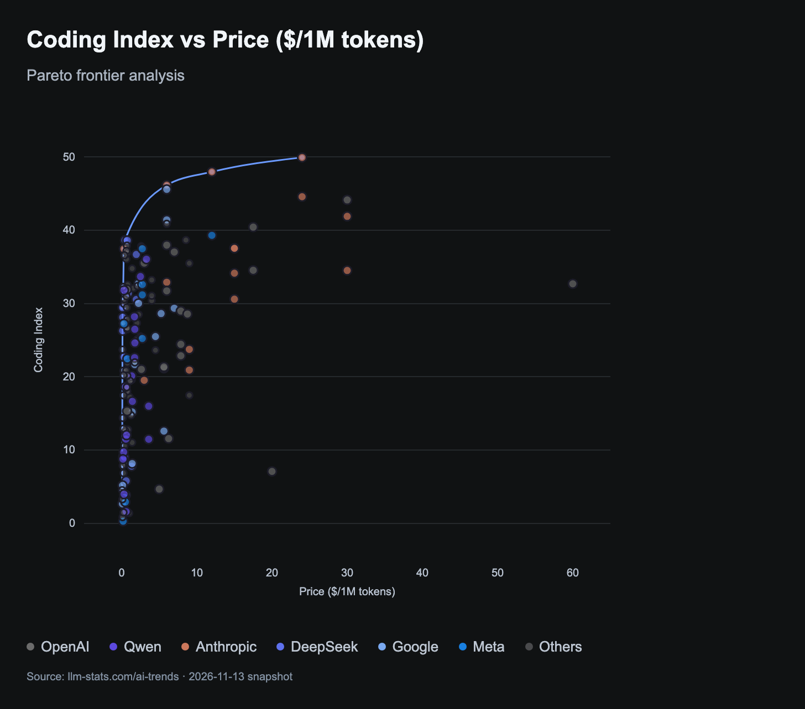

**怎么看：** 横轴为输入输出 1∶1 混合的线性价格，纵轴为 Coding Index，蓝线是两者的帕累托前沿；左上方向代表较低价格和较高编程指数。

**图表显示：** 最高报价并不保证最高编程指数，多数高价点仍处在前沿之下。前沿在高分区趋缓，体现逼近最强候选时的价格取舍。

**关键模型 / 数据点：**

- DeepSeek-V4.1-Flash-1017：每百万 token 0.75 美元，Coding Index 38.6。
- Claude Opus 5.5：每百万 token 12 美元，Coding Index 48.0。
- Claude Fable 5.2：每百万 token 24 美元，Coding Index 49.9。

**解读边界：** Coding Index 不是测试通过率，实际开发仍需核验任务完成率、输出长度和重试费用；本图输入输出 1∶1 的报价不能直接与采用 5∶1 的图表混算。

证据依据

- **直接证据：**本图悬浮提示核对的代表性数据：DeepSeek-V4.1-Flash-1017：每百万 token 0.75 美元，Coding Index 38.6；Claude Opus 5.5：每百万 token 12 美元，Coding Index 48.0；Claude Fable 5.2：每百万 token 24 美元，Coding Index 49.9。
- **直接证据：**当前通用前沿绘图代码把价格定义为 (input_price + output_price) / 2，并要求两项价格有效。
- **视觉推断：**更高报价的模型未必具有更高的编程指数。

## 图 24｜人类偏好与价格的帕累托前沿

*原始标题：Arena Rating vs Price ($/1M tokens)*

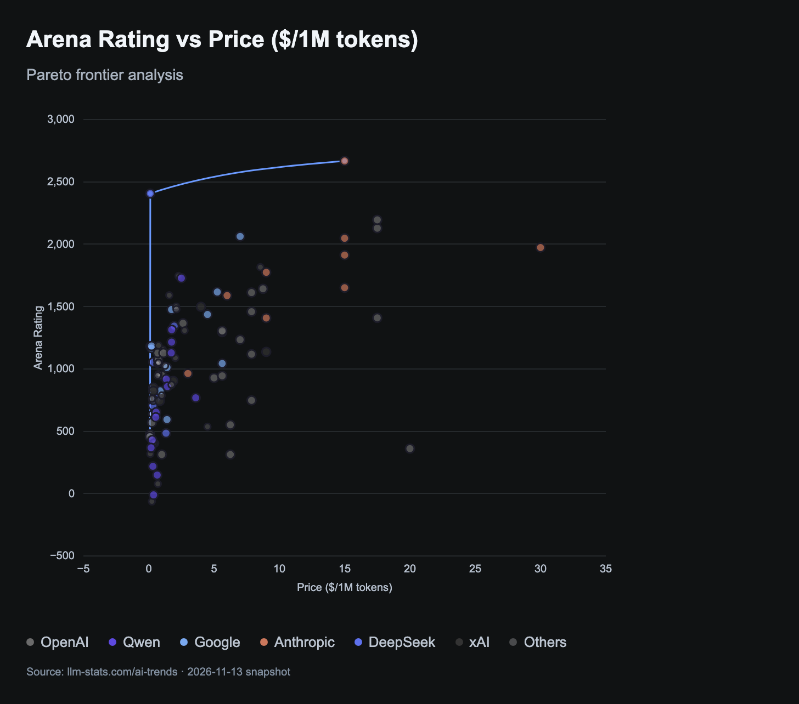

**怎么看：** 横轴为输入输出 1∶1 混合的线性 API 价格，纵轴为本图 Arena Rating；蓝线连接价格与人类偏好指标的非劣候选，颜色区分组织。

**图表显示：** 低价端也存在很高的偏好评分，很多更昂贵模型反而位于前沿下方。以偏好为目标得到的前沿，与综合分或编程指数的前沿并不相同。

**关键模型 / 数据点：**

- DeepSeek-V4-Flash-0731：每百万 token 0.12 美元，Arena Rating 2407。
- Claude Opus 5：每百万 token 15 美元，Arena Rating 2668。
- Claude Fable 5：每百万 token 30 美元，Arena Rating 1974。

**解读边界：** 本图数千分的 Arena 尺度与后续约二三十分的标准化偏好尺度不同，不能混算；该指标也不能直接当作任何其他 Arena 榜单的同期原始 Elo。

证据依据

- **直接证据：**本图悬浮提示核对的代表性数据：DeepSeek-V4-Flash-0731：每百万 token 0.12 美元，Arena Rating 2407；Claude Opus 5：每百万 token 15 美元，Arena Rating 2668；Claude Fable 5：每百万 token 30 美元，Arena Rating 1974。
- **直接证据：**当前通用前沿绘图代码把价格定义为 (input_price + output_price) / 2，纵轴为本图 Arena Rating。
- **视觉推断：**低价高评分模型与更高价的偏好领先模型共同构成前沿。

# 规模与效率：门槛下移，总参数不能单独解释能力

> **本组结论：** ERNIE 5.5 Flash Preview以280B总参数进入50分以上，刷新本期图内的最小规模纪录；训练数据量与分数拟合R²仅0.10。架构和规模共同影响候选范围，不能由这些横截面图单独证明某种架构更高效。

## 图 25｜MoE 与稠密模型的能力价格分布

*原始标题：Performance vs Price, Colored by MoE*

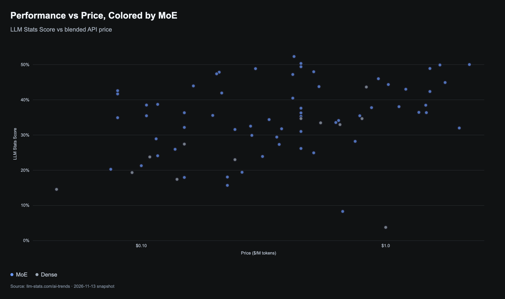

**怎么看：** 横轴为按输入输出 5∶1 混合的 API 价格，采用对数刻度；纵轴为 LLM Stats Score，蓝点代表 MoE，灰点代表稠密模型。

**图表显示：** 在本图披露架构且有报价的样本中，MoE 覆盖了更多高分和低价组合。两类模型数量不均，较强的样本表现不能单独归因于架构。

**关键模型 / 数据点：**

- ERNIE 5.5 Flash Preview（MoE）：0.42 美元/百万 token，综合分 52.3。
- Qwen3.8 Flash（MoE）：0.20 美元/百万 token，综合分 47.4。
- Qwen3.8-27B（稠密）：0.83 美元/百万 token，综合分 43.7。

**解读边界：** 纵轴刻度误添百分号，正文按综合分读取；图中剔除了价格最高约 5% 的样本，架构比较也没有控制训练方式和服务商定价。

证据依据

- **直接证据：**本图悬浮提示核对的代表性数据：ERNIE 5.5 Flash Preview（MoE）：0.42 美元/百万 token，综合分 52.3；Qwen3.8 Flash（MoE）：0.20 美元/百万 token，综合分 47.4；Qwen3.8-27B（稠密）：0.83 美元/百万 token，综合分 43.7。
- **直接证据：**当前绘图代码按输入输出 5∶1 混合报价，筛去最高约 5% 价格样本；图例区分 MoE 与 Dense。
- **直接证据：**轴名为 LLM Stats Score，但可见刻度附有百分号。
- **视觉推断：**蓝色 MoE 点覆盖更多高分、低价组合。

## 图 26｜达到能力门槛的最低混合报价

*原始标题：Minimum Cost to Reach Capability*

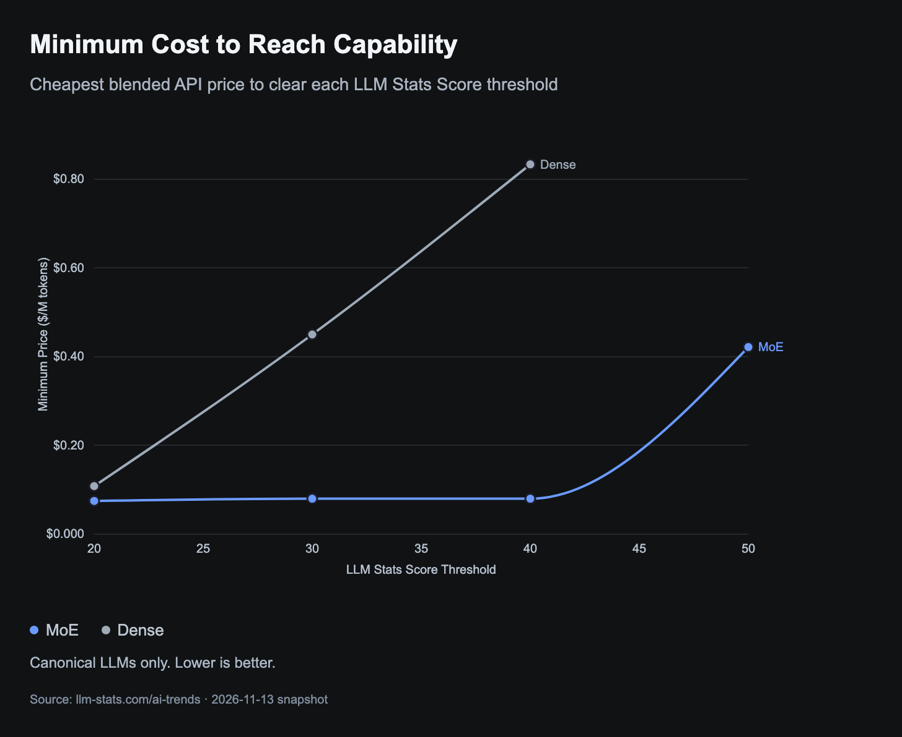

**怎么看：** 横轴为 20、30、40、50 分能力门槛，纵轴为符合门槛的最低混合报价；蓝线对应 MoE，灰线对应稠密模型，越低越便宜。

**图表显示：** 在双方都有样本的门槛上，MoE 曲线低于稠密曲线；MoE 还能延伸至 50 分门槛。更高能力的最低报价不是随分数均匀增加的。

**关键模型 / 数据点：**

- 40+ 分门槛，MoE 最低为 DeepSeek-V4-Flash-0731：0.08 美元/百万 token。
- 40+ 分门槛，稠密模型最低为 Qwen3.8-27B：0.83 美元/百万 token。
- 50+ 分门槛，MoE 最低为 ERNIE 5.5 Flash Preview：0.42 美元/百万 token。

**解读边界：** 图注限定为 canonical LLM 样本，价格采用输入输出 5∶1；稠密曲线在 40 分后缺失，只说明当前筛选样本没有合格点，不能推出架构理论上无法达到更高能力。

证据依据

- **直接证据：**本图悬浮提示核对的代表性数据：40+ 分门槛，MoE 最低为 DeepSeek-V4-Flash-0731：0.08 美元/百万 token；40+ 分门槛，稠密模型最低为 Qwen3.8-27B：0.83 美元/百万 token；50+ 分门槛，MoE 最低为 ERNIE 5.5 Flash Preview：0.42 美元/百万 token。
- **直接证据：**图注限定 canonical LLMs；当前源码使用输入输出 5∶1 混合价，并按各门槛选择最低报价。
- **视觉推断：**共同门槛处蓝色 MoE 曲线低于灰色稠密曲线。

## 图 27｜达到能力门槛所需的最小总参数量

*原始标题：The Efficiency Curve*

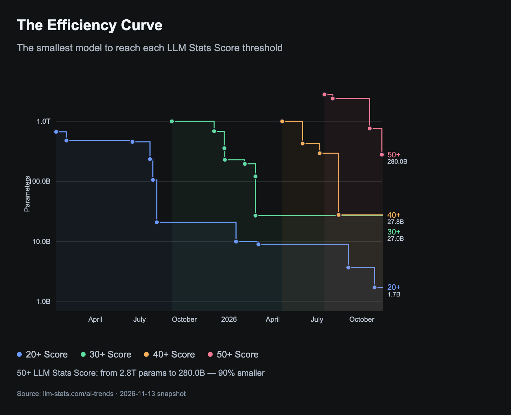

**怎么看：** 横轴为发布日期，纵轴为对数刻度的总参数量；四条阶梯分别记录达到 20、30、40、50 分门槛的最小模型。

**图表显示：** 本期回溯中，20 分和 50 分门槛的最小模型继续下探；但不同门槛的最小规模仍相差很大，较小模型尚未覆盖全部高能力区域。

**关键模型 / 数据点：**

- 20+ 分门槛的最小总参数量为 1.7B；30+ 分为 27.0B，40+ 分为 27.8B。
- 50+ 分门槛：ERNIE 5.5 Flash Preview 为 280.0B，综合分 52.3，提示发布日期为 2026 年 11 月。
- 图卡回溯：50+ 门槛最小规模从 2.8T 降至 280.0B，缩小约 90%。

**解读边界：** 这里是总参数量而非每次推理激活参数；90% 是当前评分口径下的历史轨迹，不是与上一期之间的计算效率增幅。

证据依据

- **直接证据：**本图悬浮提示核对的代表性数据：50+ 分门槛：ERNIE 5.5 Flash Preview 为 280.0B，综合分 52.3，提示发布日期为 2026 年 11 月。
- **直接证据：**曲线终点显示 20+ 为 1.7B、30+ 为 27.0B、40+ 为 27.8B、50+ 为 280.0B。
- **直接证据：**图卡标注 50+ 最小参数量从 2.8T 降至 280.0B，缩小 90%。

## 图 28｜不同参数档位的综合能力分布

*原始标题：LLM Stats Score by Tier*

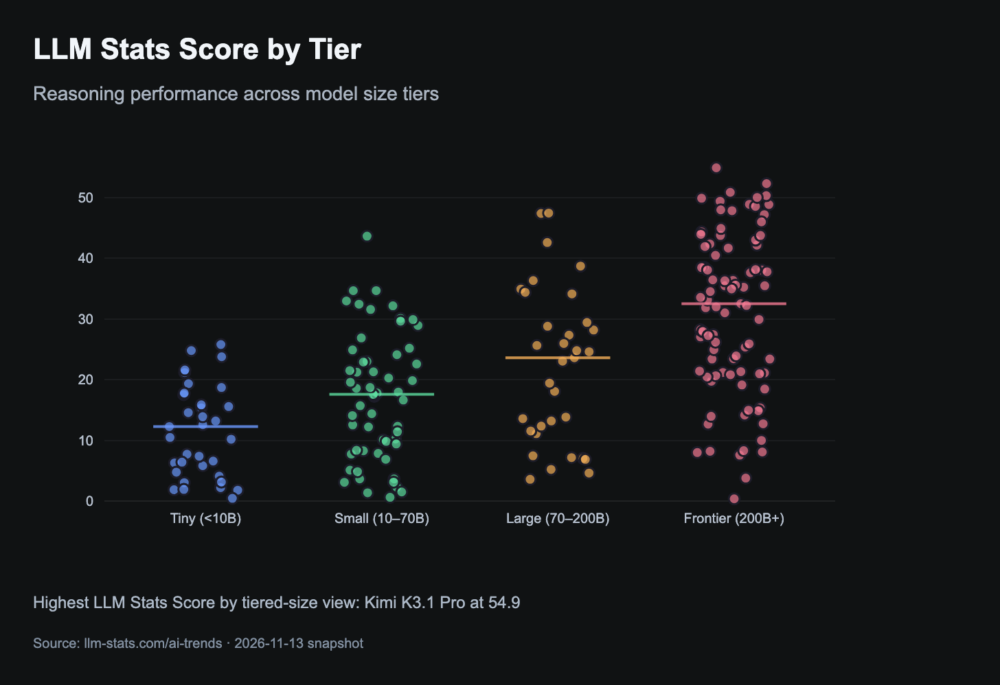

**怎么看：** 横轴将总参数量分为四档，纵轴为 LLM Stats Score；散点是模型，横线表示各档中位数。

**图表显示：** 各档中位数随参数规模整体上移，但分布明显重叠，某些较小模型超过大量大模型。最高分仍来自最大参数档，参数量却不能决定单个模型的分数。

**关键模型 / 数据点：**

- LFM3-1.7B：总参数 1.7B，综合分 24.8。
- Qwen3.8-27B：总参数 27.8B，综合分 43.7。
- Qwen3.8 Flash：总参数 125.0B，综合分 47.4。
- Kimi K3.1 Pro：总参数 2800.0B，本图最高综合分为 54.9。

**解读边界：** 该图只纳入披露参数且有评分的模型，不能据此推断全站最高分；总参数量也不能直接换算激活算量、显存或推理费用。

证据依据

- **直接证据：**本图悬浮提示核对的代表性数据：LFM3-1.7B：总参数 1.7B，综合分 24.8；Qwen3.8-27B：总参数 27.8B，综合分 43.7；Qwen3.8 Flash：总参数 125.0B，综合分 47.4；Kimi K3.1 Pro：总参数 2800.0B，本图最高综合分为 54.9。
- **直接证据：**图卡将 Kimi K3.1 Pro 的 54.9 列为本图最高分。
- **视觉推断：**各档中位线整体上移，但模型分数分布明显重叠。

## 图 29｜已披露训练数据规模的增长

*原始标题：The Training Data Race*

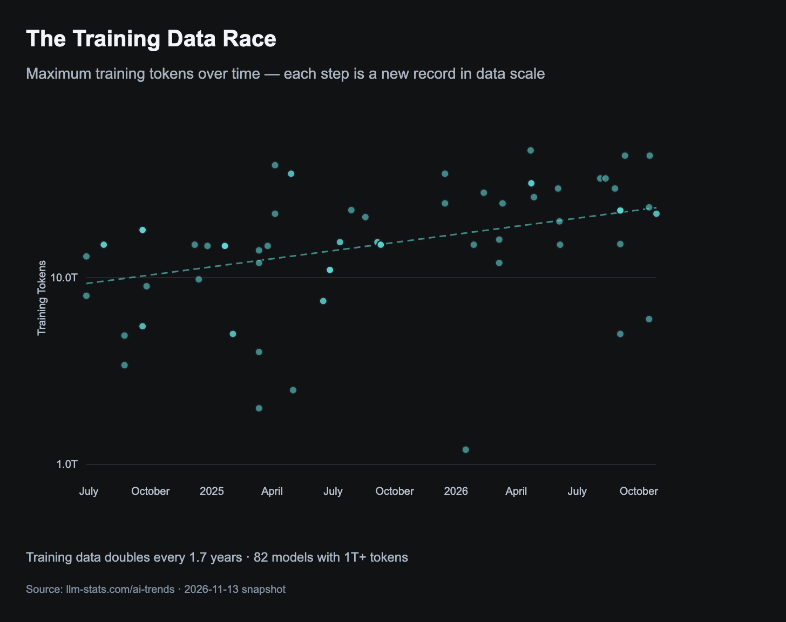

**怎么看：** 横轴为发布日期，纵轴为对数刻度的训练 token 数；实际图形由各模型散点和一条拟合趋势虚线组成。

**图表显示：** 披露样本的训练数据规模总体增大，但同一时期的数据量差异仍很大。训练数据扩张是可见现象，不能单独解释具体模型的能力。

**关键模型 / 数据点：**

- 图卡摘要：82 个模型披露至少 1T 训练 token，拟合规模约每 1.7 年翻倍。
- GLM-5.3-Flash：2026 年 8 月发布，训练数据 30.0T token。
- DeepSeek-V4.1-Flash-1017：2026 年 10 月发布，训练数据 45.0T token。

**解读边界：** 副标题称最大值纪录阶梯，实际却是散点回归，本文按可见图形解读；披露训练量的模型也不是行业全量样本。

证据依据

- **直接证据：**本图悬浮提示核对的代表性数据：GLM-5.3-Flash：2026 年 8 月发布，训练数据 30.0T token；DeepSeek-V4.1-Flash-1017：2026 年 10 月发布，训练数据 45.0T token。
- **直接证据：**图卡标注 82 个 1T+ 样本和每 1.7 年翻倍。
- **直接证据：**PNG 是离散模型点与拟合虚线，与副标题的最大值阶梯描述不同。

## 图 30｜训练数据量与综合能力的弱相关

*原始标题：The Data Appetite*

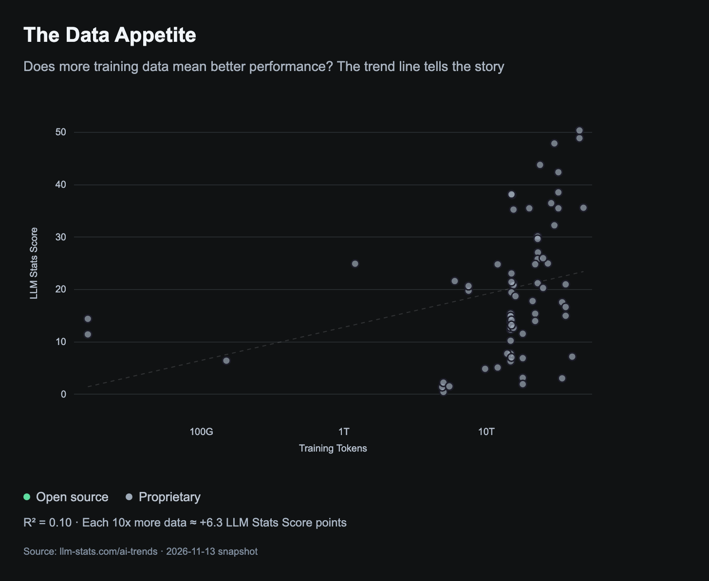

**怎么看：** 横轴是对数刻度的训练 token 数，纵轴是 LLM Stats Score；虚线为拟合趋势，图例试图区分开放与专有模型。

**图表显示：** 训练数据量与综合分只有较弱的拟合关系，同一数据规模的模型仍可能有很大能力差异。只看训练 token 数不足以预测任务表现。

**关键模型 / 数据点：**

- 拟合决定系数 R² = 0.10；训练 token 数增至 10 倍，对应拟合综合分约增加 6.3 分。
- LFM3-1.7B：训练数据 22.0T token，综合分 24.8。
- DeepSeek-V4.1-Flash-1017：训练数据 45.0T token，综合分 50.4。

**解读边界：** R² 描述样本拟合而非因果效应，不能预测加数据必然获得同等增益；散点全灰，许可分类未可靠呈现，悬浮提示误添的百分号也统一按综合分读取。

证据依据

- **直接证据：**本图悬浮提示核对的代表性数据：拟合决定系数 R² = 0.10；训练 token 数增至 10 倍，对应拟合综合分约增加 6.3 分；LFM3-1.7B：训练数据 22.0T token，综合分 24.8；DeepSeek-V4.1-Flash-1017：训练数据 45.0T token，综合分 50.4。
- **直接证据：**图卡给出 R² = 0.10，以及训练数据每增至 10 倍对应约 6.3 分拟合差异。
- **直接证据：**悬浮提示在综合分后附加百分号；本报告按轴名将其解释为分值。
- **视觉推断：**相近训练数据规模处，分数仍有很大的纵向离散；散点均为灰色。

## 图 31｜总参数量与综合能力的效率前沿

*原始标题：Efficiency Frontier*

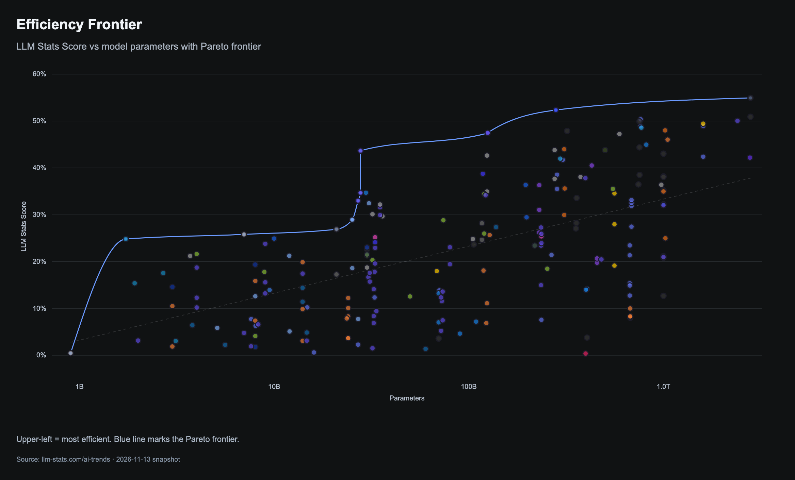

**怎么看：** 横轴为对数刻度的总参数量，纵轴为 LLM Stats Score；蓝线连接参数规模与综合分的非劣模型，左上方在这两个维度更有效率。

**图表显示：** 两个约 28B 的 Qwen 模型分别得到 34.7 与 43.7 分，表明规模接近并不保证能力接近。280B 的 ERNIE 得到 52.3 分，而 2.8T 的 Kimi 为 54.9 分，总参数与分数并非成比例变化。

**关键模型 / 数据点：**

- Qwen3.6-27B：图示总参数约 28B，综合分 34.7。
- Qwen3.8-27B：图示总参数约 28B，综合分 43.7。
- ERNIE 5.5 Flash Preview：总参数 280B，综合分 52.3。
- Kimi K3.1 Pro：总参数 2.8T，综合分 54.9。

**解读边界：** 纵轴百分号是来源格式问题，Score 按分值读取；总参数量不是每 token 的激活计算量，该前沿也不是显存或推理成本榜。

证据依据

- **直接证据：**本图悬浮提示核对的代表性数据：Qwen3.6-27B：图示总参数约 28B，综合分 34.7；Qwen3.8-27B：图示总参数约 28B，综合分 43.7；ERNIE 5.5 Flash Preview：总参数 280B，综合分 52.3；Kimi K3.1 Pro：总参数 2.8T，综合分 54.9。
- **直接证据：**轴名为 LLM Stats Score，但刻度附有百分号；本报告按综合分读取。
- **视觉推断：**蓝色前沿在约 28B 处有明显纵向上移，参数近似不代表能力近似。

## 图 32｜MoE 与稠密模型的能力价格前沿

*原始标题：Reasoning vs Price*

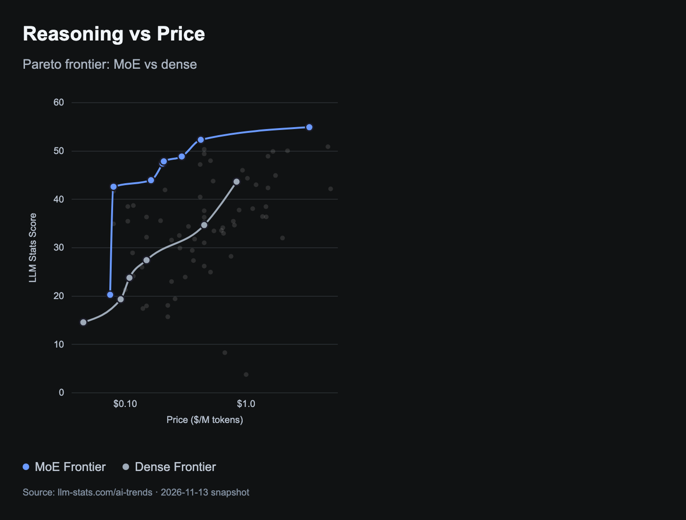

**怎么看：** 横轴是输入输出 5∶1 混合的 API 报价，采用对数刻度；纵轴为 LLM Stats Score，蓝线与灰线分别连接 MoE、稠密模型各自的非劣候选。

**图表显示：** 当前披露架构与报价的样本中，MoE 前沿总体高于稠密前沿，并延伸到更高分区域。架构可帮助缩小候选范围，具体选择仍取决于任务和报价。

**关键模型 / 数据点：**

- Ling 3.0 Flash Fin（MoE）：0.08 美元/百万 token，综合分 42.6。
- ERNIE 5.5 Flash Preview（MoE）：0.42 美元/百万 token，综合分 52.3。
- Qwen3.8-27B（稠密）：0.83 美元/百万 token，综合分 43.7。

**解读边界：** 标题沿用 Reasoning，但能力轴实际是综合分；前沿差异受样本、训练与服务定价共同影响，不能作为架构优劣的独立因果证据。

证据依据

- **直接证据：**本图悬浮提示核对的代表性数据：Ling 3.0 Flash Fin（MoE）：0.08 美元/百万 token，综合分 42.6；ERNIE 5.5 Flash Preview（MoE）：0.42 美元/百万 token，综合分 52.3；Qwen3.8-27B（稠密）：0.83 美元/百万 token，综合分 43.7。
- **直接证据：**当前源码使用输入输出 5∶1 混合价；标题虽为 Reasoning，纵轴实际是 LLM Stats Score。
- **视觉推断：**当前有架构和报价的样本内，MoE 前沿总体在稠密前沿上方。

## 图 33｜吞吐量与能力：架构比较受样本限制

*原始标题：Reasoning vs Throughput*

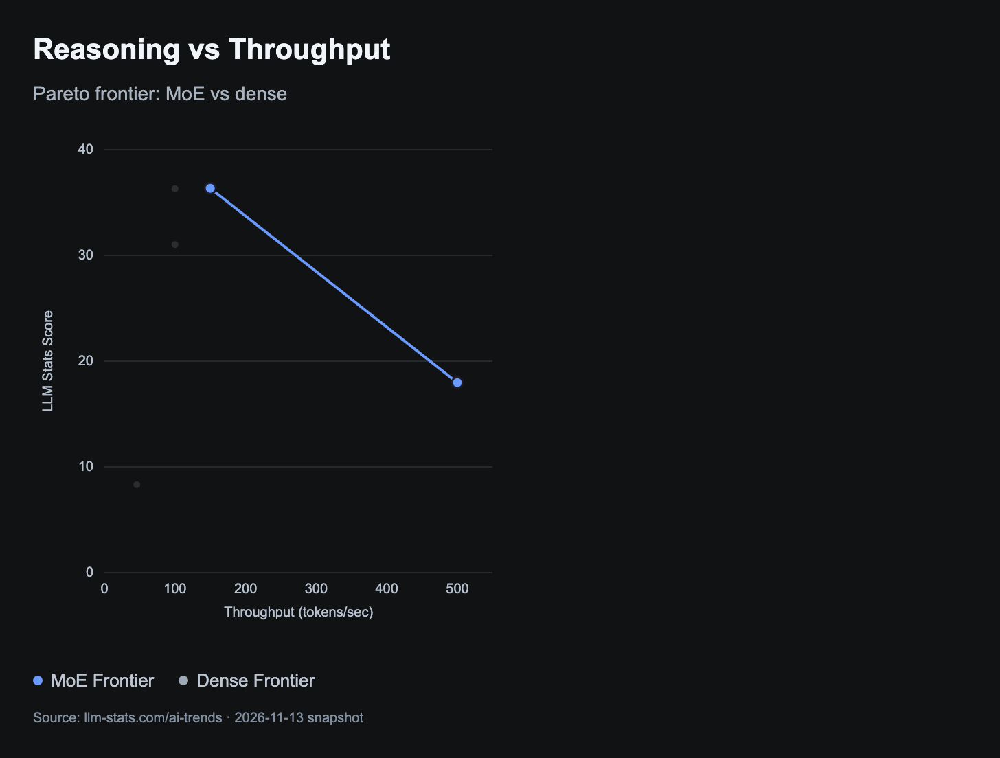

**怎么看：** 横轴为每秒生成 token 数，纵轴为 LLM Stats Score；越靠右上越理想，蓝线与灰线分别表示 MoE 和稠密模型的非支配前沿。

**图表显示：** 本次可读取的 5 个模型均标为 MoE，不能据此判定两类架构的优劣。Step-3.5-Flash 与 MiniMax M2.5 分数接近，前者图示吞吐更高；500 token/s 的端点则对应较低综合分。

**关键模型 / 数据点：**

- Step-3.5-Flash：150 token/s，综合分 36.4，MoE。
- MiniMax M2.5：100 token/s，综合分 36.3，MoE。
- LongCat-Flash-Lite：500 token/s，综合分 18.0，MoE。

**解读边界：** 标题中的 Reasoning 在本图实际以整体综合分表示。硬件、服务商和推理配置未固定；这里只能解释本图有限样本，不能把前沿差异归因于架构。

证据依据

- **直接证据：**本图 5 条不同模型的交互提示均标 Architecture MoE；Step-3.5-Flash 为 150 tok/s、36.4，MiniMax M2.5 为 100 tok/s、36.3，LongCat-Flash-Lite 为 500 tok/s、18.0。
- **视觉推断：**蓝色前沿在较高吞吐一端下降，显示本组模型的速度与综合分取舍。

## 图 34｜参数量与能力：不同架构各有前沿

*原始标题：Reasoning vs Size*

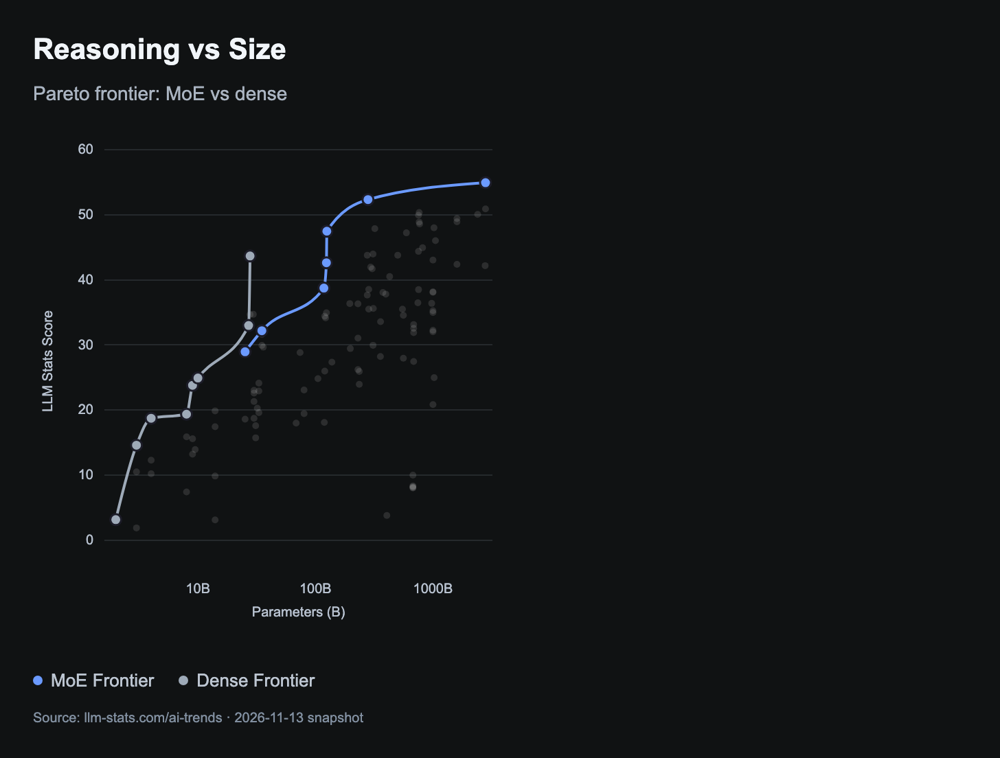

**怎么看：** 横轴为对数刻度的总参数量，纵轴为整体综合分；左上方向表示以更少总参数取得更高分，曲线分别连接两类架构的非支配点。

**图表显示：** 小规模稠密模型与大规模 MoE 模型各自形成前沿。相近总参数量的模型仍有明显分数差异，参数规模只能帮助筛选候选，不能单独解释能力。

**关键模型 / 数据点：**

- Qwen3.8-27B：图示 28B 总参数，综合分 43.7，稠密架构。
- Qwen3.8-Flash-Next：125B，综合分 47.5，MoE。
- Kimi K3.1 Pro：2800B，综合分 54.9，MoE。

**解读边界：** 本图使用总参数量，不能直接换算每 token 激活计算量、显存或延迟；参数值按悬浮提示的取整精度保留。

证据依据

- **直接证据：**交互提示分别列出 Qwen3.8-27B 28B/43.7/Dense、Qwen3.8-Flash-Next 125B/47.5/MoE、Kimi K3.1 Pro 2800B/54.9/MoE。
- **视觉推断：**稠密前沿集中于较小规模，MoE 前沿向更高总参数与更高综合分延伸。

## 图 35｜综合分与参数量：280B 模型进入高分前沿

*原始标题：LLM Stats Score vs Parameters (Billions)*

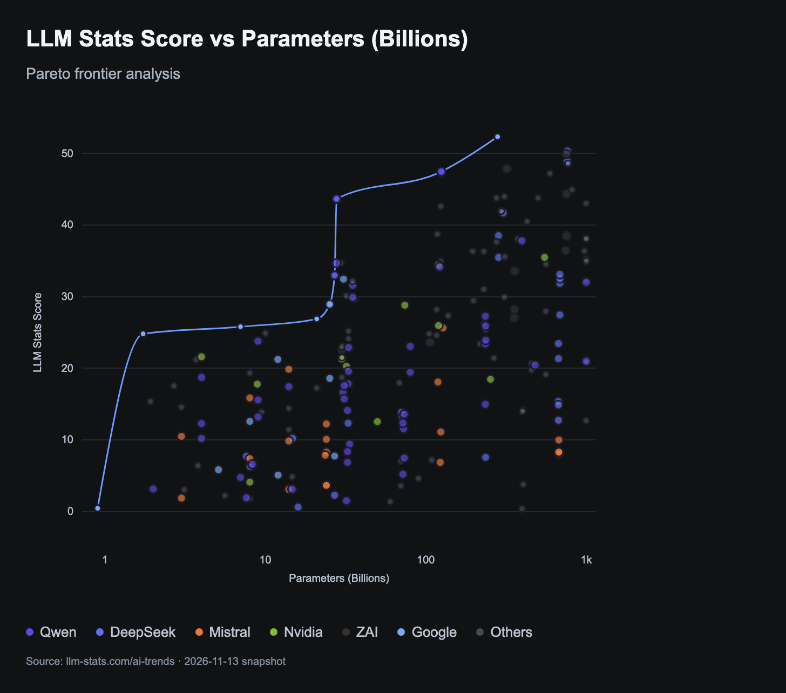

**怎么看：** 横轴以对数刻度表示十亿总参数数（B），纵轴为综合分；颜色区分机构，蓝线连接当前筛选样本中的参数—能力前沿。

**图表显示：** ERNIE 5.5 Flash Preview 以 280B 总参数取得 52.3 分，位于本图前沿高端；更大的参数规模并不自动带来更高综合分。

**关键模型 / 数据点：**

- Qwen3.8-27B：图示 28B 总参数，综合分 43.7。
- Qwen3.8-Flash-Next：125B，综合分 47.5。
- ERNIE 5.5 Flash Preview：280B，综合分 52.3。

**解读边界：** 来源将参数上限设为样本第 99 百分位与 1000B 中的较小值，因此不包含图 34 的 2800B 模型；本图上限不能代表全体模型的能力上限。参数值采用提示的取整精度。

证据依据

- **直接证据：**本图交互提示给出 Qwen3.8-27B 28B/43.7、Qwen3.8-Flash-Next 125B/47.5、ERNIE 5.5 Flash Preview 280B/52.3。
- **直接证据：**当前公开绘图代码在 params 轴分支取排序后 floor(0.99×n) 位置，并过滤 x > min(该值,1000B) 的点。

## 图 36｜编程指数与参数量：代码能力另有前沿

*原始标题：Coding Index vs Parameters (Billions)*

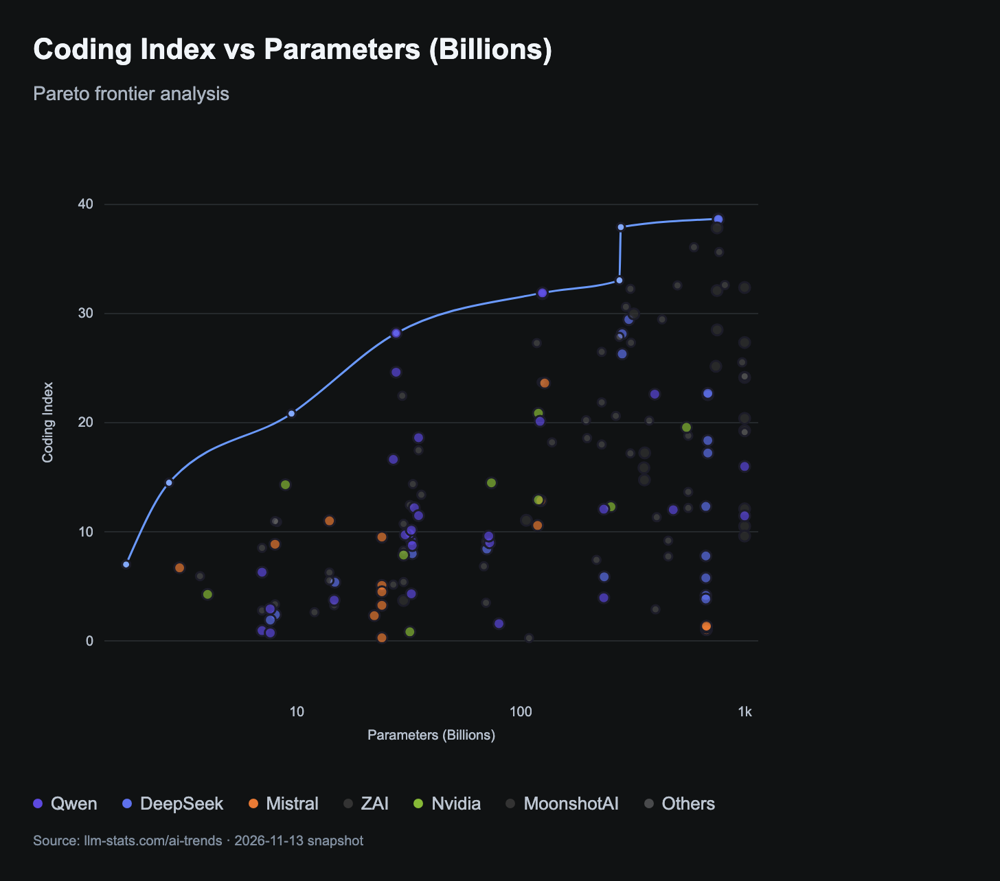

**怎么看：** 横轴为对数刻度的总参数量，纵轴为 Coding Index；左上方向更优，蓝线展示不同规模下尚未被其他模型同时超越的候选。

**图表显示：** 280B 的 ERNIE 5.5 Flash Preview 与 763B 的 DeepSeek-V4.1-Flash-1017 编程分相近，规模差异远大于分数差异。代码任务应单独验收，不能直接沿用综合分排序。

**关键模型 / 数据点：**

- Qwen3.8-27B：图示 28B 总参数，编程指数 28.2。
- ERNIE 5.5 Flash Preview：280B，编程指数 37.9。
- DeepSeek-V4.1-Flash-1017：763B，编程指数 38.6。

**解读边界：** 本图同样使用第 99 百分位与 1000B 的参数上限；编程指数不包含业务工作流中全部构建、测试和重试成本。参数值采用提示的取整精度。

证据依据

- **直接证据：**本图交互提示给出 Qwen3.8-27B 28B/28.2、ERNIE 5.5 Flash Preview 280B/37.9、DeepSeek-V4.1-Flash-1017 763B/38.6。
- **直接证据：**参数视图共用公开绘图代码中的 min(第99百分位,1000B) 过滤逻辑。

## 图 37｜偏好与参数量：大规模不保证高偏好

*原始标题：Arena Rating vs Parameters (Billions)*

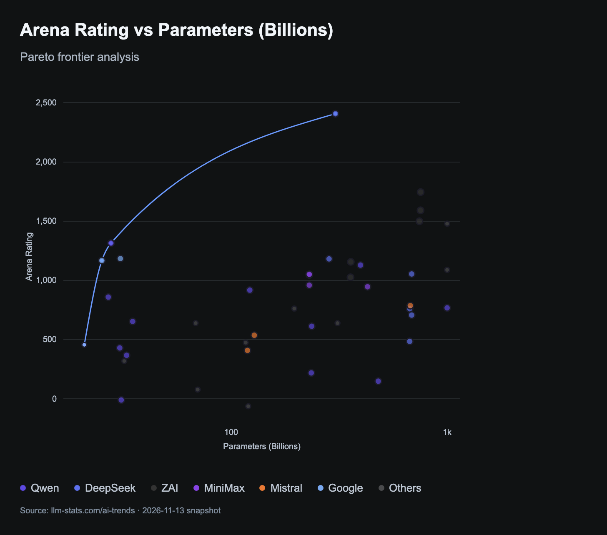

**怎么看：** 横轴为对数刻度的总参数量，纵轴为本图的原始 Arena rating；机构由颜色区分，蓝线偏向左上方向。

**图表显示：** 偏好分在相近规模之间明显分散，中等规模模型也能高于更大模型。按偏好选出的前沿与综合分前沿不同，需要分开解释。

**关键模型 / 数据点：**

- Gemma 4 26B-A4B：图示 25B 总参数，Arena rating 1167。
- Qwen3.6-27B：图示 28B，Arena rating 1314。
- DeepSeek-V4-Flash-0731：304B，Arena rating 2407。

**解读边界：** 本图仍应用第 99 百分位与 1000B 的参数上限。这里的数千分尺度与后文约 20 分的 Arena 图不同，不能混算或解释为正确率；参数值按提示取整。

证据依据

- **直接证据：**本图交互提示给出 Gemma 4 26B-A4B 25B/1167、Qwen3.6-27B 28B/1314、DeepSeek-V4-Flash-0731 304B/2407。
- **直接证据：**参数视图共用公开代码中的 min(第99百分位,1000B) 过滤逻辑。
- **视觉推断：**部分中等规模点位于更大模型上方，偏好并非随总参数单调增长。

# 速度与上下文：最高吞吐、最高能力分属不同候选

> **本组结论：** 上下文纪录仍为200万token；Mercury 3达到1068 token/s、综合分35.7，Sonnet 5.5为42 token/s、57.0分。吞吐、能力和长文利用质量应分开验收，不能用最大窗口或token/s代表整项任务体验。

## 图 38｜上下文纪录仍为 200 万 token

*原始标题：The Context Race*

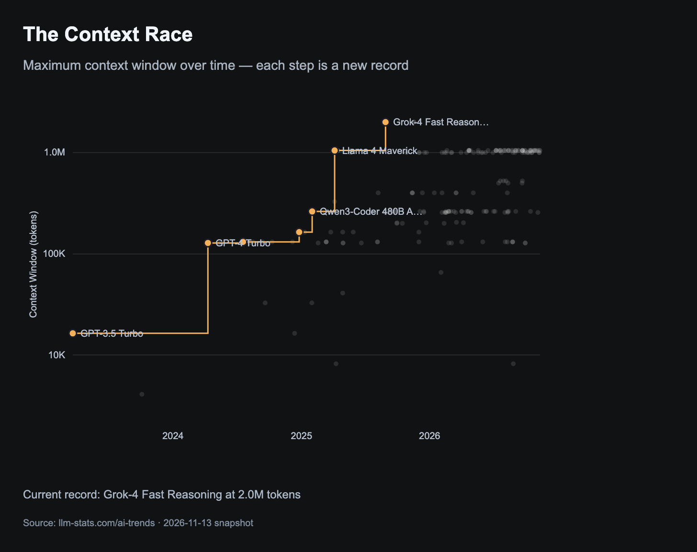

**怎么看：** 横轴为发布日期，纵轴为对数刻度的标称上下文窗口；灰点代表模型，橙色阶梯连接该样本历次最大窗口纪录。

**图表显示：** 来源的最大窗口纪录仍为 200 万 token，与 10 月报告一致；百万级窗口已有多款模型。容量上限与长文利用质量需要分别验证。

**关键模型 / 数据点：**

- Grok-4 Fast Reasoning：2.0M token，提示发布日期为 2025 年 8 月。
- Llama 4 Maverick：1.0M token，提示发布日期为 2025 年 4 月。
- Kimi K3.1 Pro：1.0M token，提示发布日期为 2026 年 10 月。

**解读边界：** 这是来源收录的标称窗口，不能证明每个服务商均开放同样长度，也不能证明长文检索、推理准确性或实际延迟达标。

证据依据

- **直接证据：**图卡标注 Current record: Grok-4 Fast Reasoning at 2.0M tokens；交互提示给出三个模型的窗口和发布日期。
- **直接证据：**10 月报告同名图也记录 Grok-4 Fast Reasoning 的 2.0M token 最大窗口。

## 图 39｜速度与能力：多个前沿点承担不同需求

*原始标题：The Speed Tax*

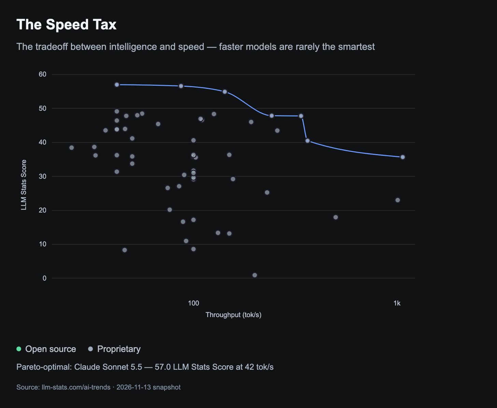

**怎么看：** 横轴为对数刻度的输出吞吐，纵轴为综合分；越靠右上越理想，蓝线连接同图样本中互不支配的模型。

**图表显示：** 本图高分端为 Claude Sonnet 5.5，最快端为 Mercury 3；Kimi K3.1 Pro 位于两者之间。单一最快或最高分模型无法同时覆盖所有延迟与能力目标。

**关键模型 / 数据点：**

- Claude Sonnet 5.5：42 token/s，综合分 57.0。
- Kimi K3.1 Pro：142 token/s，综合分 54.9。
- Mercury 3：1068 token/s，综合分 35.7。

**解读边界：** 本图许可分色失效：代码读取的 open_source 字段在当前公开趋势数据中缺失，因此不能按灰点判断为专有模型。吞吐也不包含首 token、推理和工具等待的全部时间。

证据依据

- **直接证据：**交互提示给出 Claude Sonnet 5.5 42/57.0、Kimi K3.1 Pro 142/54.9、Mercury 3 1068/35.7；Mercury 的简短横轴值显示 1K，但同一提示副标题明确为 1068 tok/s。
- **直接证据：**当前 The Speed Tax 公开绘图逻辑依据 e.open_source 选颜色；公开趋势 API 的 448 条记录均无该字段，只有 license 字段。
- **视觉推断：**前沿将较高综合分与较高吞吐分别放在不同模型上。

## 图 40｜综合分与吞吐量：高速候选的能力差异

*原始标题：LLM Stats Score vs Throughput (tokens/sec)*

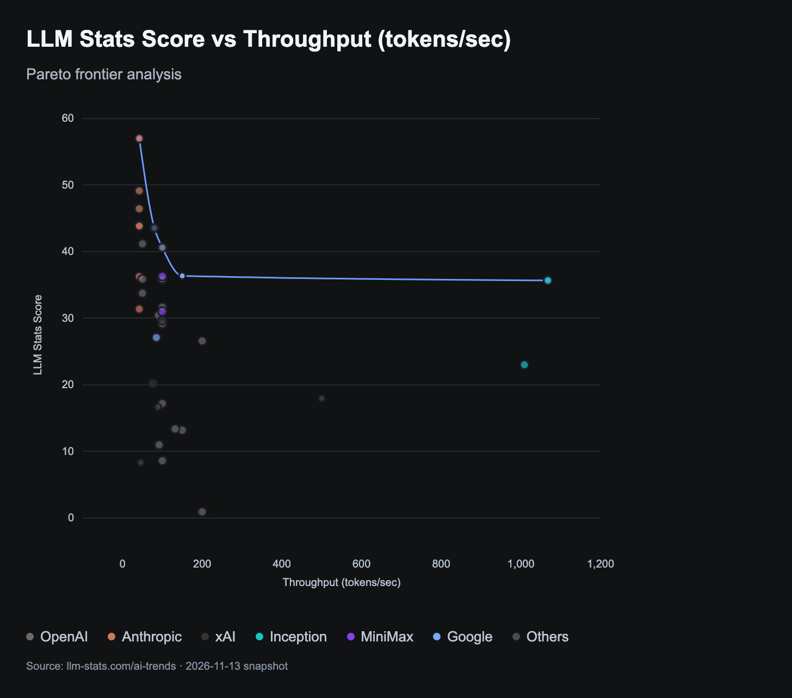

**怎么看：** 横轴为线性吞吐量，纵轴为综合分；颜色表示机构，蓝线展示当前筛选样本的能力—速度前沿。

**图表显示：** Mercury 3 与 Mercury 2 都处于每秒千 token 的区域，但前者综合分更高；最高综合分的 Sonnet 5.5 则处于较低吞吐端。候选选择应同时设定最低能力和速度要求。

**关键模型 / 数据点：**

- Claude Sonnet 5.5：42 token/s，综合分 57.0。
- Mercury 3：1068 token/s，综合分 35.7。
- Mercury 2：1009 token/s，综合分 23.0。

**解读边界：** 本图与图 39 的样本及吞吐来源不同，例如 Grok 4.5 分别显示 80 与 37 token/s；两图不能当作同一服务配置的复测，也不能据缺失点判断模型能力为零。

证据依据

- **直接证据：**本图交互提示给出 Sonnet 5.5 42/57.0、Mercury 3 1068/35.7、Mercury 2 1009/23.0。
- **直接证据：**Grok 4.5 在本图提示为 80 tok/s，在图 39 提示为 37 tok/s。

## 图 41｜编程指数与吞吐量：快速输出仍需质量验收

*原始标题：Coding Index vs Throughput (tokens/sec)*

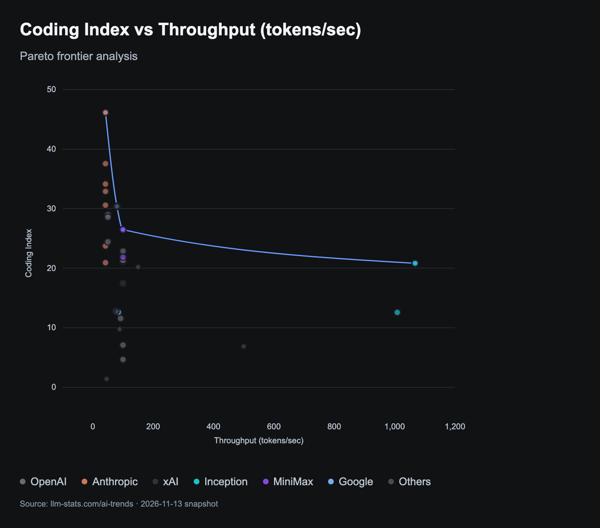

**怎么看：** 横轴为每秒生成 token 数，纵轴为编程指数；蓝线为右上方向的非支配前沿，展示该样本中速度和代码能力的取舍。

**图表显示：** Mercury 3 在每秒千 token 区间比 Mercury 2 有更高编程分，但仍低于低吞吐端的 Sonnet 5.5。代码工作流需把输出速度、测试通过率和修复轮数一起记录。

**关键模型 / 数据点：**

- Claude Sonnet 5.5：42 token/s，编程指数 46.2。
- Mercury 3：1068 token/s，编程指数 20.8。
- Mercury 2：1009 token/s，编程指数 12.6。

**解读边界：** 这些数据未控制全部硬件与服务条件，也未统计构建、测试、工具执行及多轮重试时间；编程分与 token/s 都不能单独代表完成任务的效率。

证据依据

- **直接证据：**本图交互提示给出 Sonnet 5.5 42/46.2、Mercury 3 1068/20.8、Mercury 2 1009/12.6。
- **视觉推断：**高吞吐端的编程分与最高分端仍分离，前沿对应不同使用目标。

## 图 42｜偏好与吞吐量：高速不等于更受偏爱

*原始标题：Arena Rating vs Throughput (tokens/sec)*

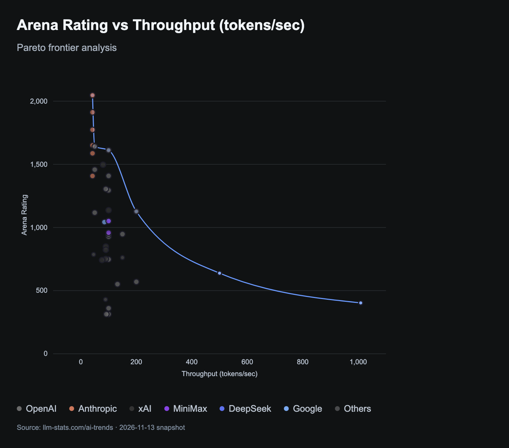

**怎么看：** 横轴为线性吞吐量，纵轴为此图的原始 Arena rating；蓝线连接同样本中更快输出与更高偏好评分的非支配点。

**图表显示：** 最高偏好点与最高吞吐点相距很远，生成速度不能替代偏好评测。不同前沿位置可作为任务实验的候选，但需要统一服务条件再比较。

**关键模型 / 数据点：**

- Claude Opus 4.6：42 token/s，Arena rating 2048。
- LongCat-Flash-Lite：500 token/s，Arena rating 639。
- Mercury 2：1009 token/s，Arena rating 403。

**解读边界：** 本图的原始 rating 与后文标准化偏好分尺度不同。它也没有通过控制实验测量等待体验，不能把偏好差异直接归因于速度。

证据依据

- **直接证据：**本图交互提示给出 Claude Opus 4.6 42/2048、LongCat-Flash-Lite 500/639、Mercury 2 1009/403。
- **视觉推断：**当前样本的高偏好端与高吞吐端分离。

# 人类偏好：分数有参考价值，价格解释力较弱

> **本组结论：** 综合分与一般偏好的相关系数为0.50，而价格与偏好的拟合R²仅4%。不同偏好图的样本与尺度不同，末图八项榜单又与上期完全一致，因此不能把页面月份当作每张偏好图的更新时间。

## 图 43｜评测相关性：综合分与偏好不等价

*原始标题：Benchmark Correlation*

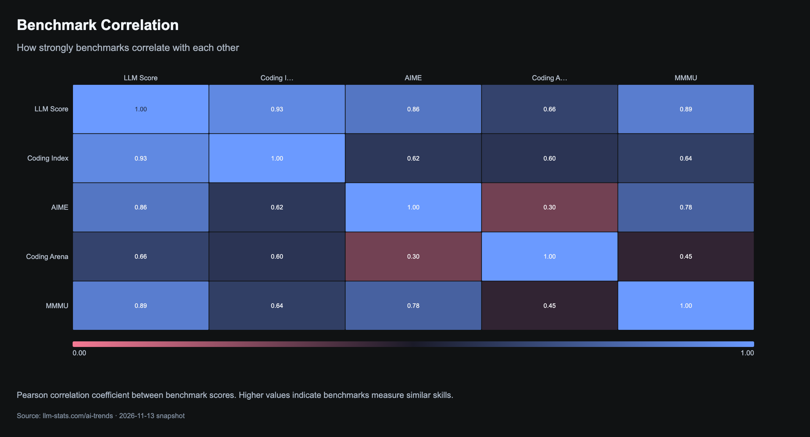

**怎么看：** 行列各是一项指数或评测，单元格为 Pearson 相关系数；对角线恒为 1，颜色表示相关强弱，数值越高意味着样本内线性关系越强。

**图表显示：** 综合分与编程指数关联较强，与 Coding Arena 的关联较弱；AIME 与 Coding Arena 的相关性更低。偏好视角提供了能力指标没有完全覆盖的信息。

**关键模型 / 数据点：**

- 综合分与 Coding Index：Pearson r = 0.93。
- 综合分与 Coding Arena：r = 0.66；综合分与 MMMU：r = 0.89。
- AIME 与 Coding Arena：r = 0.30。

**解读边界：** 综合指数可能共享底层评测，相关性不等于独立验证；不同单元格未必使用相同完整样本，也不能据此证明两个任务测量相同技能。

证据依据

- **直接证据：**当前 PNG 和 SVG 矩阵直接标注上述 0.93、0.66、0.89、0.30。
- **视觉推断：**矩阵中能力指数之间的相关值高于若干能力指标与 Coding Arena 的相关值。

## 图 44｜综合分与编程偏好：有关联，也有离散

*原始标题：Do Humans Agree With the Indexes?*

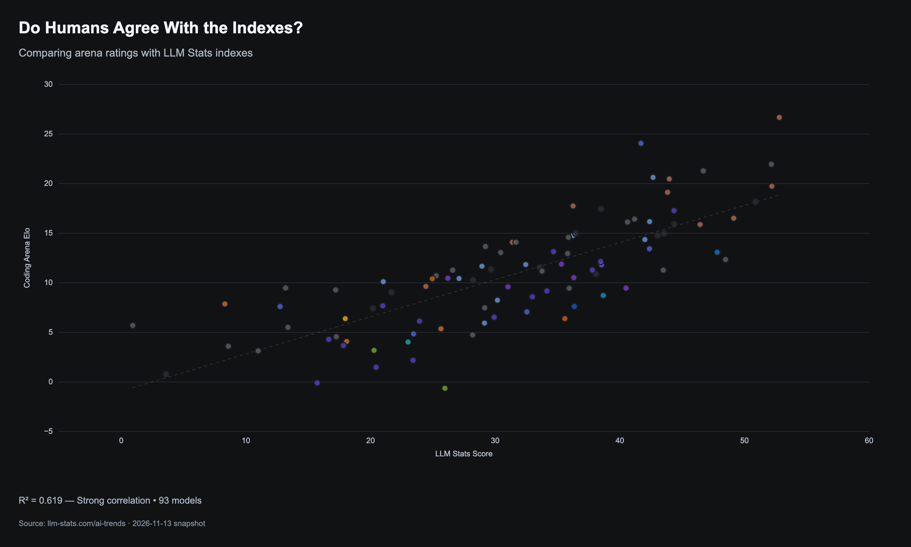

**怎么看：** 当前默认视图以综合分为横轴、Coding Arena Elo 为纵轴；散点代表模型，虚线为该样本的线性拟合。

**图表显示：** 93 个模型的拟合 R² 为 0.619，显示综合分与编程偏好存在较强关联；相近综合分的模型仍有不同偏好分，指数不能完全替代用户比较。

**关键模型 / 数据点：**

- 样本量为 93 个，拟合 R² = 0.619。
- Claude Opus 5：综合分 52.8，Coding Arena Elo 提示为 27。
- GPT-5.6 Sol：综合分 52.2，Coding Arena Elo 提示为 22。

**解读边界：** 这里只分析默认综合分视图，未切换 Coding Index；纵轴按本图的显示尺度引用。R² 不是预测准确率，也不能与不同样本的 Pearson r 直接比较。

证据依据

- **直接证据：**图卡标注 R² = 0.619、93 models；交互提示给出 Claude Opus 5 52.8/27、GPT-5.6 Sol 52.2/22。

## 图 45｜综合分与一般偏好：正相关仍不足以决定选型

*原始标题：LLM Stats Score vs Arena*

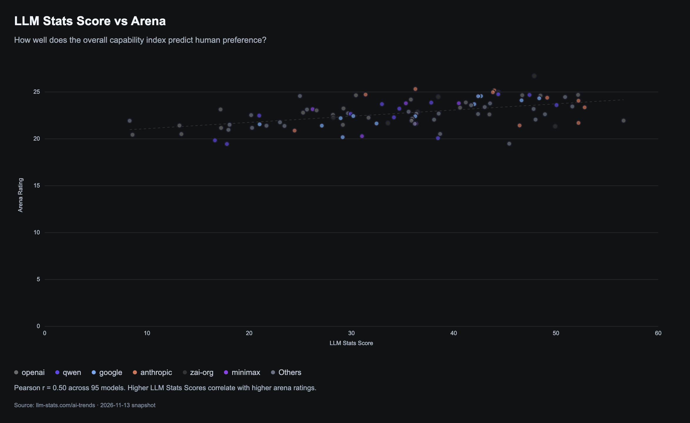

**怎么看：** 横轴是综合分，纵轴为本图标准化的 Arena rating；机构由颜色区分，虚线为样本内线性拟合。

**图表显示：** 95 个模型的 Pearson r 为 0.50，综合分与一般偏好呈正向关系，但同一综合分区间仍有明显偏好差异。可以用指数缩小范围，再按实际交互任务筛选。

**关键模型 / 数据点：**

- 样本量为 95 个，Pearson r = 0.50。
- GLM-5.3-Flash：综合分 47.9，Arena rating 26.7。
- GPT-6 Astra：综合分 56.6，Arena rating 21.9。

**解读边界：** 本图的 r 与图 44、46 的 R² 不是同一统计量，样本与偏好口径也不同。两个月评分方法和覆盖范围可能改变，不能将相关系数变化解释成模型体验退步。

证据依据

- **直接证据：**图卡标注 Pearson r = 0.50 across 95 models；交互提示给出 GLM-5.3-Flash 47.9/26.7、GPT-6 Astra 56.6/21.9。

## 图 46｜另一组用户评分：样本范围改变解释边界

*原始标题：User Ratings vs LLM Stats Score*

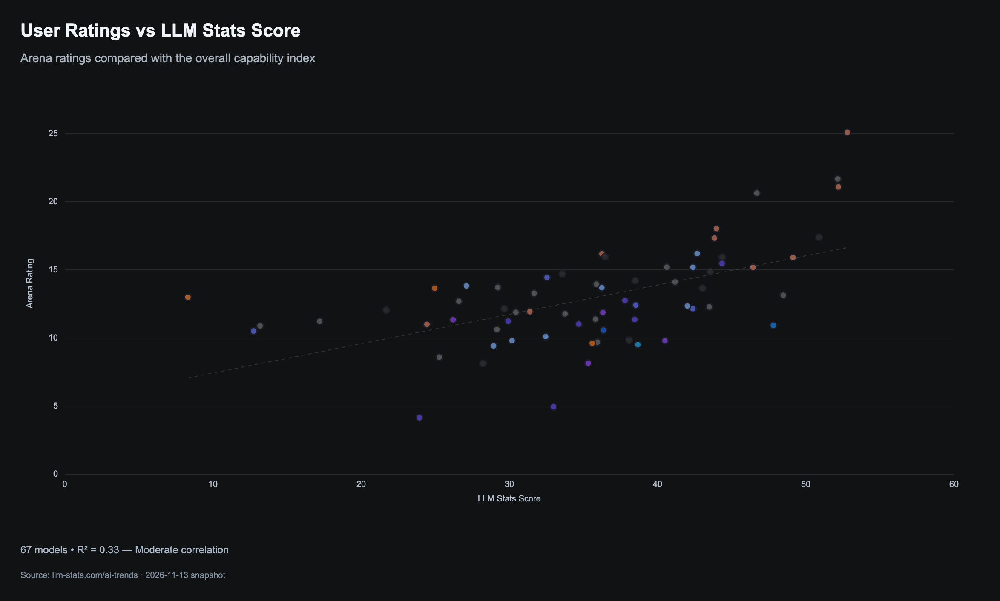

**怎么看：** 横轴为综合分，纵轴为本图的 Arena rating；散点与回归线展示 67 个模型的关系。

**图表显示：** 这组样本的拟合 R² 为 0.33，综合分能解释部分偏好差异，但多数差异仍未被这一条线性关系解释。用户评分应作为独立验收维度。

**关键模型 / 数据点：**

- 样本量为 67 个，拟合 R² = 0.33。
- Claude Opus 5：综合分 52.8，Arena rating 提示为 25。
- GPT-5.6 Sol：综合分 52.2，Arena rating 提示为 22。

**解读边界：** 本图与图 45 的 95 模型样本和评分处理不同，不能将两组回归合并成一个结论；相关也不支持能力分导致偏好变化的因果解释。

证据依据

- **直接证据：**图卡标注 67 models、R² = 0.33；交互提示给出 Claude Opus 5 52.8/25、GPT-5.6 Sol 52.2/22。

## 图 47｜价格与偏好：高单价无法保证好体验

*原始标题：Cost vs Arena Rating*

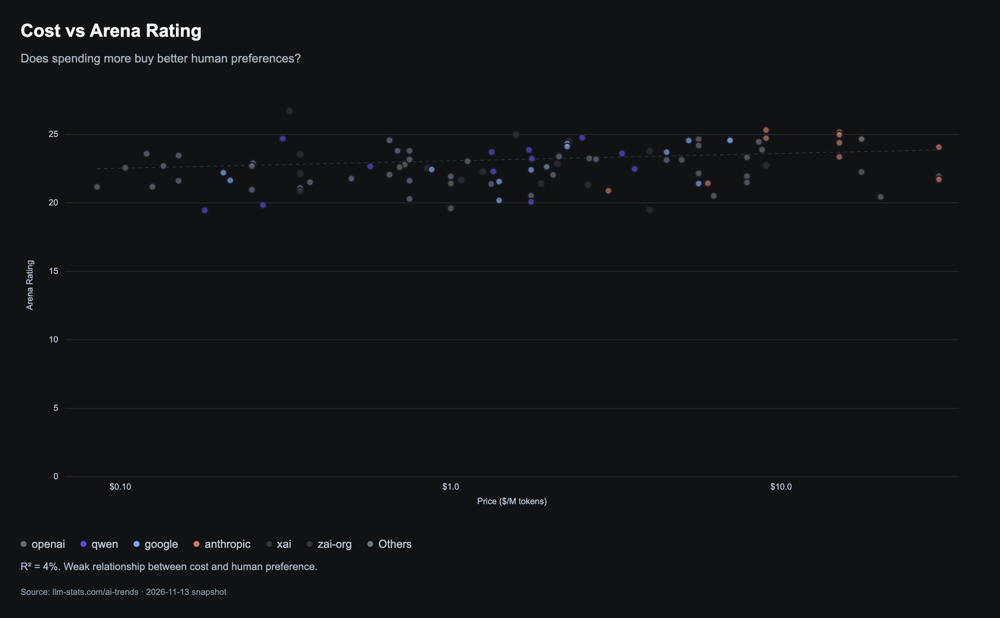

**怎么看：** 横轴为对数刻度的每百万 token 价格，纵轴为本图的 Arena rating；虚线表示价格与偏好的样本内拟合。

**图表显示：** 不同价位的偏好分高度重叠，拟合 R² 仅为 4%。API 单价对这组偏好差异的解释力很弱，选型不能把更贵视为体验更好的保证。

**关键模型 / 数据点：**

- 价格与 Arena rating 的拟合 R² = 4%。
- GLM-5.3-Flash：每百万 token 0.33 美元，Arena rating 26.7。
- Claude Fable 5：每百万 token 30.0 美元，Arena rating 24.1。

**解读边界：** 这是不同模型的横截面，不是降价实验；单价不等于一次成功任务的费用，也不能代表训练或基础设施成本。不同价格图的混合规则需另行核对。

证据依据

- **直接证据：**图卡标注 R² = 4%；交互提示给出 GLM-5.3-Flash $0.33/26.7、Claude Fable 5 $30.0/24.1。

## 图 48｜偏好榜的更新边界：八个条目与上期相同

*原始标题：Human Preference Map*

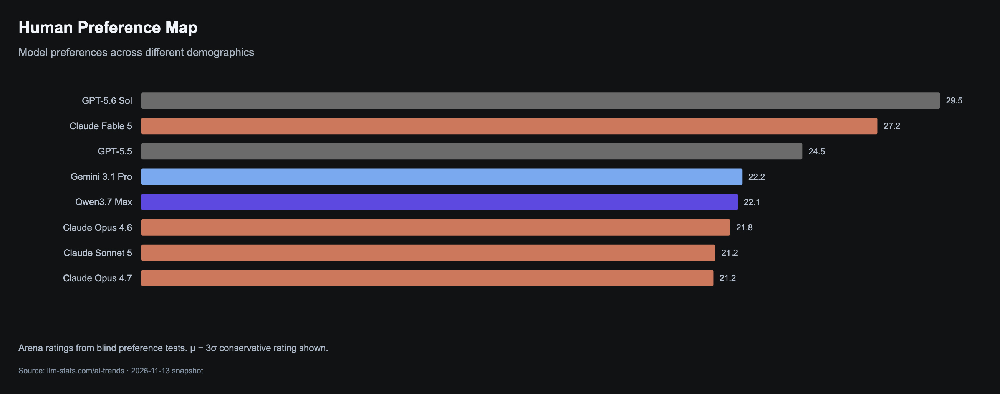

**怎么看：** 图中展示默认 Top Models 视图，横条越长表示保守偏好分越高；来源采用 $\mu-3\sigma$，其中 $\mu$ 为估计均值，$\sigma$ 表示不确定性尺度。

**图表显示：** 八个模型的顺序与分数均与 10 月快照一致，榜首仍显示 GPT-5.6 Sol。这个结果说明该卡没有呈现新的榜单变化，不能据页面月份把它视为所有 11 月新模型的最新偏好排名。

**关键模型 / 数据点：**

- GPT-5.6 Sol：保守偏好分 29.5。
- Claude Fable 5：27.2；GPT-5.5：24.5。
- Gemini 3.1 Pro：22.2；Qwen3.7 Max：22.1。
- 全部 8 个条目的模型、顺序和分数与 2026 年 10 月报告一致。

**解读边界：** 页面月份不代表各图同步更新。本文只分析默认模型榜，未切换国家或年龄标签；悬浮提示中的 Count 在这里是通用标签，不是投票人数。

证据依据

- **直接证据：**PNG、SVG 及交互提示显示 GPT-5.6 Sol 29.5、Claude Fable 5 27.2、GPT-5.5 24.5、Gemini 3.1 Pro 22.2、Qwen3.7 Max 22.1、Claude Opus 4.6 21.8、Claude Sonnet 5 21.2、Claude Opus 4.7 21.2。
- **直接证据：**10 月报告同名图列出的八个模型及分数逐项相同；当前图脚注明确为 μ−3σ conservative rating。

