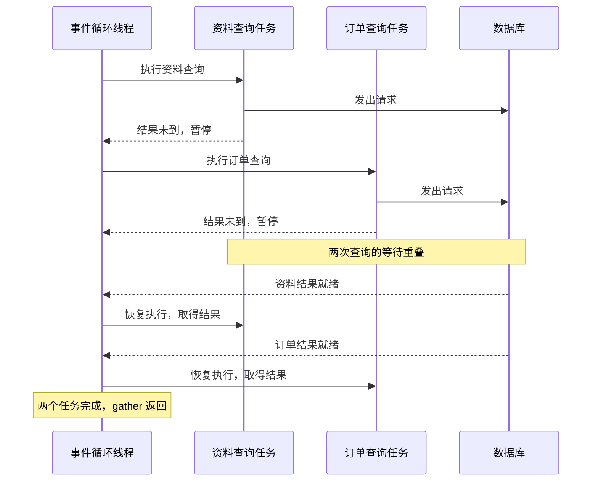
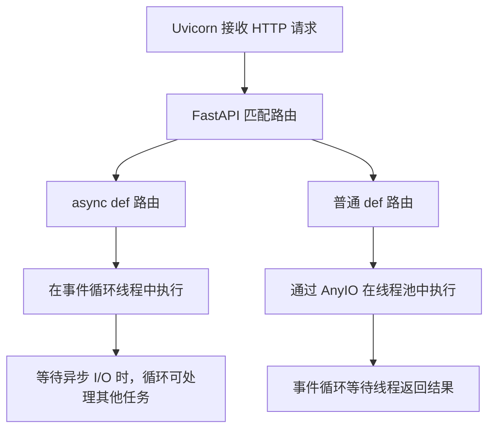

1. Table of Contents, ordered
{:toc}

理解 Python 并发，可以先分成两个层次。下面讨论日常常用的 CPython，并且先限定在**启用 GIL 的同一个解释器里**。

1. **执行能力：可以并发，但纯 Python 计算不能靠普通线程并行。** GIL 让同一时刻只有一条线程执行 Python 代码。从这个执行效果看，可以把它类比成“许多 Java 虚拟线程，只共用一条操作系统线程”：多个任务可以轮流推进，但不能在多个核上同时计算。这里共用的那条线程，就是 Java 虚拟线程的承载线程（carrier）。
2. **等待方式：在单条事件循环里，任务必须能让出线程，才能重叠等待。** `asyncio` 提供了这样的并发方式：搭配异步 I/O 库，一个任务等结果时先暂停，让同一条线程去处理其他任务。如果直接调用同步阻塞库，这条线程就被占住，同一循环里的其他任务也只能跟着等。

这两个层次分别决定**能不能同时计算**，以及**等待时能不能让别人继续**。Java 类比说的是执行效果；CPython 实际上仍然可以创建多条操作系统线程。因此，同步库也可以通过线程池并发使用，受影响的是把同步阻塞调用直接放进单条事件循环的写法。

接下来用一个具体例子展开：一个接口要查用户资料，还要查订单。两次查询互不依赖，各花 1 秒，其中绝大部分时间都在等数据库回复。

先查完资料再查订单，总共约 2 秒。如果先把两个查询都发出去，再等结果，总耗时就可能接近 1 秒。**数据库没有算得更快，只是两段等待重叠了。**

Python 可以用线程池或 `asyncio` 来重叠这两次等待。先看 GIL 对计算的限制，再沿着示例看异步库和 `await` 怎样安排等待。

## 先分清：时间花在计算，还是等待

查数据库的 1 秒，和用 CPU 计算的 1 秒，对程序来说很不一样。

| 任务 | 这 1 秒里，本机 CPU 在做什么 | 怎样减少总耗时 |
|---|---|---|
| 等数据库、HTTP 响应 | 大部分时间可以去做别的事 | 提前发出多个独立请求，把等待重叠起来 |
| 用 Python 循环处理大量数据 | 一直在执行计算 | 减少计算量，或把工作分到多个 CPU 核上 |

这里对应两个词：**并发**指多个任务在同一段时间内推进；**并行**指多个任务在同一时刻执行。一个线程轮流处理多个请求，可以做到并发。多颗 CPU 核同时计算，才是这里关心的并行。

两个查询各等 1 秒，不需要两颗核一直忙着。线程只要发出查询，就可以让数据库处理，稍后再接收结果。让等待重叠，是 I/O 并发的主要收益。

### GIL 限制的是同一解释器中的 Python 计算

**CPython** 是执行 Python 语言的程序，类似 Java 与 JVM 的区别。无 GIL 构建和多解释器的并行方式放在文末，这里先看 GIL 怎样影响普通线程。

[GIL（全局解释器锁）](https://docs.python.org/3.14/c-api/threads.html)让同一时刻只有一个线程执行 Python 代码。所以，两个线程都在跑 Python 循环时，只能轮流算，不能各占一个核一起算。开更多线程通常不会加速这种计算。

但线程在等待网络等阻塞 I/O 时，通常会释放 GIL，其他线程可以继续运行。因此，**Python 的线程仍然可以把两个查询的等待重叠起来**。执行会释放 GIL 的原生扩展代码，例如部分 NumPy 运算，也不受“只能有一个线程计算”的限制。

CPython 采用这把锁，是为了简化对象和内存管理的并发安全。它带来的代价是纯 Python 多线程计算难以利用多核。这不等于 Python 进程只有一条线程，也不等于所有工作都必须逐个完成。

对 Java 程序员来说，可以先记住这一处区别：Java 线程池可以把独立计算分到多个核；带 GIL 的单个 CPython 解释器里，普通线程池主要适合重叠 I/O 等待。业务代码涉及共享状态时，两边都仍然需要正确同步。

## asyncio：一个任务等结果时，先做另一个任务

线程是一种安排并发的方式：每条线程执行自己的函数，操作系统负责调度。大量任务都在等 I/O 时，还可以让许多任务共用一条线程，减少线程数量和调度开销。

`asyncio` 就提供了这样的方式。先认识两个概念：

- **协程**：执行到一半可以暂停、之后继续执行的函数。暂停时保留执行位置和局部变量，恢复后接着往下执行。
- **事件循环**：负责安排任务执行。任务需要等结果时，先运行其他已经可以继续的任务；结果就绪后，再安排原来的任务继续。

一条事件循环在一条线程里运行。它能管理很多等待中的任务，但同一时刻只执行其中一个任务的 Python 代码。**这套方式适合处理大量等待；即使没有 GIL，它也有价值。**

下面用一个能直接运行的程序，看清楚 `async def` 和 `await` 分别做什么。把代码保存为 `demo.py`，执行 `python3 demo.py`：

```python
import asyncio
import time


async def query(name):
    print(f"开始查{name}")
    # 模拟等数据库返回 1 秒；这里没有真的连接数据库。
    await asyncio.sleep(1)
    print(f"查完{name}")
    return f"{name}结果"


async def load_user():
    profile = await query("资料")
    orders = await query("订单")
    return [profile, orders]


if __name__ == "__main__":
    started = time.perf_counter()
    # 启动事件循环，运行 load_user，完成后拿到返回值并关闭循环。
    result = asyncio.run(load_user())
    print(result)
    print(f"耗时：{time.perf_counter() - started:.2f} 秒")
```

输出大致如下：

```text
开始查资料
查完资料
开始查订单
查完订单
['资料结果', '订单结果']
耗时：2.00 秒
```

`async def` 声明一个协程函数。调用 `query("资料")` 时，得到的是**协程对象**，函数体还没有开始执行。代码需要通过 `await` 执行它，或把它交给任务调度 API。

`await query("资料")` 表示：执行这次查询，拿到结果后，才继续当前函数的下一行。如果查询过程中需要等待，当前任务可以暂停，把事件循环线程让给其他任务。

在上面的程序里，`load_user` 要等资料返回，才会执行查询订单的那一行。**虽然用了异步函数，两次查询仍然先后发生，所以总耗时约 2 秒。**

[`asyncio.run()`](https://docs.python.org/3.14/library/asyncio-runner.html#asyncio.run)负责启动整个程序所需的事件循环。它返回时，`load_user` 已经完成，`result` 就是普通列表。

## 用 gather 把两个独立查询一起安排出去

要让两次等待重叠，必须在第一个查询结束之前，把第二个查询也安排出去。保留上面的其他代码，只替换 `load_user`：

```python
async def load_user():
    # 把两个查询都安排为任务，再一起等待结果。
    return await asyncio.gather(
        query("资料"),
        query("订单"),
    )
```

再次运行，输出大致变成：

```text
开始查资料
开始查订单
查完资料
查完订单
['资料结果', '订单结果']
耗时：1.00 秒
```

关键变化是：**订单查询不再等资料查询结束才开始。** 两个查询分别等待自己的结果，1 秒左右都可以完成。返回的先后顺序可能不同，`gather` 的结果列表始终按传入顺序排列。

在真实数据库请求中，可以把这个过程画成下面的时序。图中的“等待”阶段，事件循环可以继续处理其他任务；如果暂时没有任务可做，它就等待新的事件。



[`gather`](https://docs.python.org/3.14/library/asyncio-task.html#asyncio.gather)在这里把两个协程分别安排成 **Task（任务）**。Task 是 asyncio 用来调度协程、记录结果和异常的对象。只有调用 `query(...)` 得到一个协程对象，还不等于已经安排了一个独立任务。

也可以自己用 `create_task` 创建任务，再等结果：

```python
async def load_user():
    profile_task = asyncio.create_task(query("资料"))
    orders_task = asyncio.create_task(query("订单"))

    # 两个任务都已安排执行，等待第一个时，第二个也可以推进。
    profile = await profile_task
    orders = await orders_task
    return [profile, orders]
```

这里虽然又出现了两个连续的 `await`，耗时仍然约 1 秒。判断是否并发，要看**两个查询是否都已经安排执行**，不能只数代码里有几个 `await`。

这些例子假设查询互不依赖，也没有被连接池容量等条件限制。如果第二次查询必须用第一次的结果，就应该先后等待。

错误处理还要留意：`gather` 默认会把第一个异常交给等待者，但**不会因此自动取消其他任务**。需要“一项失败就取消同组其余任务”时，可以使用 [`TaskGroup`](https://docs.python.org/3.14/library/asyncio-task.html#task-groups)。

## await 等的是结果，暂停的是当前任务

现在回到这一行：

```python
profile = await query("资料")
```

它的执行过程是：先进入 `query`，打印“开始查资料”；执行到 `await asyncio.sleep(1)` 时，需要等待，当前任务才暂停。1 秒后，事件循环安排它恢复，打印“查完资料”，返回字符串，最后把字符串赋给 `profile`。

这里没有创建新的线程。直接 `await query(...)` 也没有自动创建一个独立 Task：调用方沿着这次协程调用继续执行，直到内部确实需要暂停。官方的 [asyncio 概念教程](https://docs.python.org/3.14/howto/a-conceptual-overview-of-asyncio.html#await)专门解释了直接等待协程与创建任务的区别。

**当前任务暂停时，其他任务可以继续；当前函数里写在 `await` 后面的代码，仍然要等结果。** 这就是为什么第一个示例的订单查询不会提前开始。

另外，`await` 不保证每次都让出控制权。例如：

```python
async def cached_name():
    return "Alice"


async def show_name():
    # 函数直接返回，不需要暂停当前任务。
    name = await cached_name()
    print(name)
```

`cached_name` 没有需要等待的操作，这次 `await` 就可以直接得到结果。给一段计算套上 `async def`，也不会让它自动分段执行，更不会让它自动使用多个 CPU 核。

从语法上说，`await` 后面必须是[可等待对象](https://docs.python.org/3.14/reference/expressions.html#await-expression)，常见的有协程、Task 和 Future。它不是“凡是耗时操作都能加上去”的前缀。

## 同步阻塞调用会占住事件循环线程

下面两行都要等 1 秒，但对其他任务的影响不同：

| 写法 | 等待期间发生什么 |
|---|---|
| `await asyncio.sleep(1)` | 当前任务暂停，事件循环线程可以运行其他任务 |
| `time.sleep(1)` | 当前线程睡眠，这条线程上的其他任务也无法执行 |

如果把示例 `query` 里的 `await asyncio.sleep(1)` 换成 `time.sleep(1)`，即使用了 `gather`，两次查询仍然要约 2 秒。第一个任务直接占住线程 1 秒，第二个任务只能等它执行完。

**释放 GIL 和让事件循环执行别的任务，是两回事。** `time.sleep` 会释放 GIL，别的操作系统线程可以运行；但事件循环所在的这条线程正在睡眠，同一循环里的协程仍然无法推进。

同步 HTTP 客户端、同步数据库驱动，也可能产生同样的问题。`async def` 不会自动改造它们。在异步函数中，通常有两种处理方式：使用对应的异步库；或者把已有的同步 I/O 函数放进线程池。

例如，已有一个同步函数 `query_sync(name)`，可以这样调用：

```python
async def load_user():
    return await asyncio.gather(
        asyncio.to_thread(query_sync, "资料"),
        asyncio.to_thread(query_sync, "订单"),
    )
```

这里 `query_sync` 在其他线程执行，事件循环等待它的结果。线程池里的阻塞 I/O 不再直接占住事件循环线程。对于耗时的纯 Python 计算，普通线程池仍受 GIL 限制，还会和事件循环竞争执行时间，应考虑进程池等方式。[asyncio 的开发指南](https://docs.python.org/3.14/library/asyncio-dev.html#running-blocking-code)也明确要求避免在事件循环里直接运行阻塞代码。

## 从脚本到 Web：函数染色怎样接到框架

示例中，`query` 需要写 `await`，所以它是 `async def`；`load_user` 要等待查询结果，所以它也是 `async def`。这种异步写法沿调用链向上传递的现象，常被称为“函数染色”。

它的边界很明确：在普通 `.py` 文件里，**函数内部要写 `await`，该函数就必须是 `async def`**。只做普通计算、不需要等待的辅助函数，照常写成 `def` 即可。最外层则通过 `asyncio.run(load_user())` 进入异步代码。

Web 服务的入口由服务器负责。以 FastAPI 配合 Uvicorn 为例，Uvicorn 运行事件循环、接收请求，FastAPI 根据路径找到路由函数，再调用它。业务代码通常不用自己写 `asyncio.run()`。

### FastAPI 怎样执行 async def 和 def 路由

保留 `demo.py` 中使用 `gather` 的 `load_user`，再创建一个 `app.py`：

```python
import time

from fastapi import FastAPI
from demo import load_user

app = FastAPI()


@app.get("/user")
async def user():
    return await load_user()


@app.get("/legacy")
def legacy():
    # 模拟旧的同步 SDK：FastAPI 会把这个路由放在线程池里执行。
    time.sleep(1)
    return {"status": "ok"}
```

安装 FastAPI 和 Uvicorn 后，可以用 `uvicorn app:app` 启动服务。冒号前的 `app` 是文件名，后面的 `app` 是文件里的应用对象。也可以在 `app.py` 末尾加上启动入口，然后执行 `python3 app.py`：

```python
if __name__ == "__main__":
    import uvicorn

    # 同步入口：Uvicorn 负责启动服务器和事件循环。
    uvicorn.run("app:app", host="127.0.0.1", port=8000)
```

### 框架怎样从路由表找到并调用业务函数

加载 `app.py` 时，`@app.get("/user")` 把路径 `/user` 和函数 `user` 登记到路由表；`/legacy` 和 `legacy` 同理。**登记时只保存函数，不会执行查询。**

请求到达后，Uvicorn 把 HTTP 请求交给 FastAPI 应用，FastAPI 再按方法和路径找函数。两者通过 ASGI 这套服务器与应用之间的调用接口连接。下面把这个过程缩成教学代码，只保留路由匹配和函数调用；真实框架还要处理 HTTP 收发、参数校验、依赖注入等。

```python
import inspect

from fastapi import HTTPException
from starlette.concurrency import run_in_threadpool
from app import user, legacy


# 教学示意：真实路由表由 @app.get 等装饰器注册。
routes = {
    ("GET", "/user"): user,
    ("GET", "/legacy"): legacy,
}


def lookup(method, path):
    handler = routes.get((method, path))
    if handler is None:
        raise HTTPException(status_code=404)
    return handler


# 教学示意：框架处理请求时，最终会执行这样的分派逻辑。
# 这里也需要 await，所以框架这一层同样是 async def。
async def dispatch(method, path):
    handler = lookup(method, path)

    if inspect.iscoroutinefunction(handler):
        # GET /user 时，handler 就是上面定义的 user 函数。
        return await handler()

    # GET /legacy 时，把 legacy 函数交给线程池执行。
    # 这里只传函数，不能写成 handler()，否则会先在当前线程执行。
    return await run_in_threadpool(handler)
```

收到 `GET /user` 时，`handler` 就是 `user`，所以 `await handler()` 实际上就是 `await user()`。进入用户代码后，`user` 再 `await load_user()`，后者通过 `gather` 安排资料和订单查询。查询等待时，这次请求的任务暂停，事件循环可以处理其他请求；两次查询完成后，结果逐层返回，最后成为 HTTP 响应。

收到 `GET /legacy` 时，`handler` 就是普通函数 `legacy`。框架把这个函数放进线程池，事件循环中的请求任务等待线程的结果。`legacy` 里的 `time.sleep(1)` 睡的是工作线程，因此事件循环仍能处理 `/user` 等其他请求。

两种路由的调用关系如下：



[FastAPI 的规则](https://fastapi.tiangolo.com/async/#path-operation-functions)就是代码里的这个分支：异步路由直接等待执行，同步路由交给线程池。示例中的 `run_in_threadpool` 来自 Starlette，底层通过 [`anyio.to_thread.run_sync`](https://starlette.dev/threadpool/)执行同步函数。

这条规则只适用于框架代为调用的路由、依赖等。**你在异步路由中直接调用普通辅助函数，FastAPI 不会替你把它移到线程池。** 例如，在 `async def user()` 里直接写 `time.sleep(1)`，仍然会卡住当前 worker 的事件循环。

`async def` 路由所在的线程已经在运行事件循环，直接 `await load_user()` 即可，不要再调用 `asyncio.run()`。

### 函数染色会沿着调用链进入框架

把前面的例子从查询函数往上看，就能看见“函数染色”怎样发生：

| 函数 | 为什么要写成 `async def` |
|---|---|
| `query` | 要用 `await asyncio.sleep(1)` 模拟等待数据库 |
| `load_user` | 要用 `await asyncio.gather(...)` 等待两个查询的结果 |
| 路由函数 `user` | 要用 `await load_user()` 得到业务结果 |
| 框架分派函数 `dispatch`（教学示意） | 要用 `await handler()` 得到路由函数的返回值 |

**下层提供异步操作，上层想用 `await` 取得结果，就也要写成 `async def`。** 因此，函数染色会从查询函数传到业务函数，再传到路由函数。调用路由的框架代码同样要支持异步调用；FastAPI 已经提供了这一层，所以业务开发者通常写到路由就可以了。

再往外，服务器负责启动和运行事件循环。脚本里我们自己调用 `asyncio.run(...)`，Web 服务里这件事由 Uvicorn 管理。**`uvicorn.run()` 是同步启动入口，它负责让异步代码运行起来，自己不需要写成异步函数。** 这次同步调用通常持续到服务停止，而不是处理完一次请求就返回。

染色也不会把所有被调用的函数都变成异步。示例里的 `lookup` 只查一次路由表，不需要 `await`，所以仍然是普通 `def`；异步的 `dispatch` 可以直接调用它。`legacy` 则是另一种情况：它会阻塞，因此框架用 `await run_in_threadpool(legacy)` 把执行安排到工作线程。需要等待的是框架这一层，`legacy` 本身保持同步写法。

### 多 worker 怎样利用多个核

如果请求需要做大量纯 Python 计算，可以让服务使用多个进程。Uvicorn 的一个 worker 就是一个服务进程，例如：

```bash
uvicorn app:app --workers 4
```

这会启动 4 个 worker，各有自己的解释器、GIL 和事件循环，因而不同进程可以在不同 CPU 核上同时计算。[Uvicorn 的进程管理器使用 `spawn`](https://uvicorn.dev/deployment/#built-in)启动 worker。

多 worker 分摊的是请求负载，不会把某一次请求中的计算自动拆成四份。某个 worker 的异步路由直接做长时间计算，仍会耽误这个 worker 中的其他请求。计算很重时，可以进一步交给进程池或独立计算服务。

代价是每个进程都有自己的内存和应用状态。连接池通常也各建一份；在一个 worker 里修改全局变量，其他 worker 不会同步看到。如果要跨进程传递对象，进程池等工具通常要把对象序列化后再传输，不能像普通线程一样直接共享可变对象。

## 和 Java 对照时，分别比较这几件事

了解了执行顺序，再对照 Java，就不必把协程硬套成某一种线程。

| Python 中的概念 | 可以联系的 Java 概念 | 需要保留的区别 |
|---|---|---|
| `threading`、普通线程池 | 平台线程、线程池 | 带 GIL 的同一 CPython 解释器不能并行执行纯 Python 计算 |
| `asyncio` 的事件循环 | NIO、Netty 的事件循环 | 都要避免阻塞事件循环线程；业务计算如何分配，要另外安排 |
| `gather` | 把多个异步操作组合起来等待 | `gather` 调度协程，不会为每个协程开线程 |
| 协程与 `await` | 虚拟线程在等待 I/O 时让出执行资源 | Python 要显式使用异步 API 和 `await`；Java 虚拟线程通常保留同步调用写法 |

[Java 虚拟线程](https://openjdk.org/jeps/444)也是为了让大量任务不必各占一条操作系统线程。它们由 JVM 调度到平台线程上运行，遇到支持卸载的阻塞操作时，可以把平台线程让给其他虚拟线程。多个平台线程也可以并行计算。

Python 的单条 asyncio 事件循环则在一条线程上调度任务。两者都能减少等待时占用的线程资源，但编程接口和调度方式不同。

协程对象也不宜直接理解成“一个已经提交执行的 `CompletableFuture`”。单独调用 `query("资料")`，函数体还没开始；要直接等待它，或者安排成 Task，执行才会推进。

## 补充：yield 也是暂停，但用途不同

理解 `await` 不需要先学 `yield`。如果在 Python 代码里见到它，可以从“逐个产生值”来理解：

```python
def countdown(n):
    while n > 0:
        yield n
        n -= 1


# 调用含 yield 的函数，得到生成器，函数体尚未执行。
values = countdown(3)
# 执行到 yield，交出 3，然后暂停。
print(next(values))
# 从上次暂停的位置继续，交出 2。
print(next(values))
```

这里的 `countdown` 是生成器函数。调用方每次执行 `next(values)`，它就继续运行到下一个 `yield`，交出一个值并暂停。`for` 循环也可以替我们反复取值。

[`yield`](https://docs.python.org/3.14/reference/expressions.html#yield-expressions)用于向调用方逐个产出值；`await` 用于等待可等待对象的结果。二者都涉及暂停和恢复，但普通生成器不会因此自动成为 asyncio 中的并发任务，也与 Java 的 `Thread.yield()` 不是同一回事。

## 补充：纯 Python 计算还有哪些并行方式

前文限定了启用 GIL 的单个 CPython 解释器。需要多核计算时，可以改变这个条件：

| 方式 | 为什么可以并行 | 主要代价 |
|---|---|---|
| 多进程、进程池 | 各进程有自己的解释器和 GIL | 内存、进程间数据传输与管理开销 |
| Free-threaded CPython | 运行时可以关闭 GIL，普通线程能够并行执行 Python | 需要选择相应构建，并检查线程安全和扩展兼容性 |
| `InterpreterPoolExecutor` | 每个工作线程使用独立解释器和 GIL | 解释器状态隔离，不能像普通线程那样直接共享可变对象 |

[Free-threaded CPython](https://docs.python.org/3.14/howto/free-threading-python.html)从 Python 3.13 开始提供，到 3.14 [进入正式支持阶段](https://peps.python.org/pep-0779/)，仍然是可选构建。部分未适配的扩展可能重新启用 GIL，因此要确认实际运行状态。程序本身也要拆分工作、安排线程，单个循环不会自动并行。

[`InterpreterPoolExecutor`](https://docs.python.org/3.14/library/concurrent.futures.html#interpreterpoolexecutor)在 Python 3.14 加入标准库。它的工作线程在同一进程里，但各自使用独立解释器；模块和全局状态隔离，提交的函数、参数及结果通过 `pickle` 序列化传递。

选择时仍然回到开头那个判断：**慢在等结果，就想办法把独立等待重叠；慢在 CPU 计算，就考虑减少计算量或使用多核。** `await` 帮我们表达怎样等待，`gather` 帮我们安排多个任务，GIL 决定特定解释器中的普通线程能否并行执行 Python。这三件事各有各的作用。
