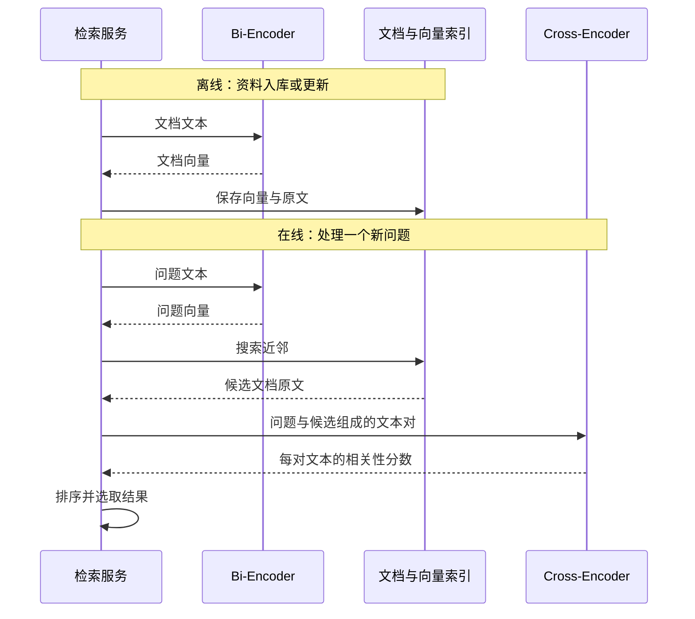

1. Table of Contents, ordered
{:toc}

在上百万篇手机资料里搜索“某款手机的续航怎么样”，逐篇带着问题读太慢，提前把文档压缩成语义向量又可能丢掉细节。Bi-Encoder 与 Cross-Encoder 的区别，就在于**问题和文档何时交互，以及哪些计算可以提前完成**。

## 先看三种打分路径

下面这张 [vLLM 官方 Score Types 图](https://docs.vllm.ai/en/stable/models/pooling_models/scoring/#score-types)把三种路径放在了一起：左侧分别编码后比较单向量，中间联合编码后打分，右侧分别编码后比较多个向量。

{: .w-100 style="background-color: #fff;" }
_来源：[vLLM Scoring Usages](https://docs.vllm.ai/en/stable/models/pooling_models/scoring/#score-types)，原始 SVG 保存于本站，按项目 Apache-2.0 许可引用。_

**从下往上读图**：黄色和蓝色表示问题与文档，模型先把文本变成内部表示。文本会拆成 **Token**，即模型处理的文本单位，可以是词或词的片段；模型为这些单位计算包含上下文信息的向量。图中的 LLM 在这里负责产生表示，不意味着必须生成一段回答。

中间的 **Pooling 层**把这些表示整理成打分所需的形式：Sequence Pooling 得到整段输入的单个向量，Token Pooling 保留 Token 级的多个向量；顶部的 Score Function 再将表示变成分数。沿着这三层看，关键区别是：**两段文本是在模型内部一起处理，还是各自编码后再比较。** 这决定了文档表示能否提前算好、反复使用。

## Bi-Encoder：分别编码，让文档向量可以复用

同一篇文档会被不同用户反复搜索。要避免每次重新读它，可以提前生成一份固定长度的数字向量，也就是 **Embedding**；搜索时再把问题变成向量，比较两者的相似度。

把文本转换成表示的网络称为 **Encoder（编码器）**。`Bi-` 表示两路：问题和文档分别编码，之后才比较向量。**两路可以共享同一个模型的参数**，不一定是两个不同模型；`Bi` 也不是“双向注意力”的意思。[Sentence-BERT 原论文](https://aclanthology.org/D19-1410.pdf)展示的就是共享权重的两路编码。

这可以概括为：

$$
s(q,d)=\operatorname{sim}\bigl(f_q(q),f_d(d)\bigr)
$$

其中，$q$ 是问题，$d$ 是文档；$f_q$、$f_d$ 分别输出一个 $m$ 维向量，$\operatorname{sim}$ 用余弦相似度或点积等方式得到分数。关键在于：**文档编码 $f_d(d)$ 不依赖当前问题 $q$。**

因此，文档向量可以提前计算、建立索引，供许多查询复用。在线搜索主要承担新问题的编码和向量检索，这正是 Bi-Encoder 适合大型知识库搜索的原因。

代价也来自独立编码。一篇同时介绍电池、相机和屏幕的评测，必须在不知道用户关心什么时就形成表示，某些细节可能被压缩掉。改问拍照后，问题向量会变，结果也可以变；**保持不变的是文档向量**。

## Cross-Encoder：把问题和文档放在一起判断

当搜索已经缩小到几十篇候选，就可以多花一些计算，检查每篇文章究竟能不能回答当前问题。

Cross-Encoder 把问题与候选文档联合输入，让两段文本在编码时就发生交互，再输出相关性分数。`Cross` 指的正是这种**跨文本交互**。[Sentence Transformers 官方架构说明](https://www.sbert.net/examples/cross_encoder/applications/README.html)用这条路径与前面的独立编码作对照。

例如，一篇手机评测同时介绍续航测试、夜景表现和充电功能。问续航时，模型可以结合问题关注电池与测试时长；问拍照时，则结合问题利用相机与成像信息。它的内部表示会受到这一次文本配对的影响。

这很像**“带着问题读文档，在心里高亮相关内容”**。不过，高亮只是比喻：典型模型不会先明确挑出几句话，再只对这些句子打分，而是在多层计算中整合信息。以 BERT 实现为例，拼接后的两段文本通过 Self-Attention 交互，并不需要一个独立的 Cross-Attention 模块。[BERT 原论文](https://aclanthology.org/N19-1423.pdf)

这种交互有助于检查局部细节，但需要为每个问题—文档对计算。如果全库有一百万篇，就要处理一百万对；先筛到 100 篇，则只需联合判断这 100 对。这些配对可以批量处理，并不要求逐条发起请求。

还有一个直观边界：问“支持无线充电吗”，文档写“不支持无线充电”，仍然高度相关。**相关性看它是否有助于回答问题，不要求答案是肯定的。**

## Late Interaction：保留多个向量，把细粒度匹配放到最后

单向量压缩可能损失细节，联合编码又需要反复计算。若希望复用文档表示，同时保留更多局部信息，可以采用 **Late Interaction（晚交互）**。

以 [ColBERT](https://arxiv.org/abs/2004.12832) 为例，问题和文档仍分别编码，但保留的是 **Token 级的多个向量**，而不是把整段文本汇聚成一个向量。每个向量已经包含各自文本内部的上下文。

编码结束后，才让两组向量做细粒度匹配。典型的 **MaxSim** 做法是：对每个问题 Token，找出与它最相似的文档 Token，再把这些最大相似度加起来。这里匹配的是语义向量，不要求字面相同。

晚交互仍能预计算文档表示，代价是存储和匹配更多向量。它既可用于精排，也可结合多向量索引做检索。**MaxSim 不会让文档重新编码**，因此它与 Cross-Encoder 的联合编码仍有本质区别；也不能仅凭“晚交互”这个名字，就认定其速度或质量一定处于另外两者之间。

## 架构怎样决定适用场景

选择哪种方式，取决于候选规模、表示能复用多少次，以及任务需要多细的匹配。

| 场景 | 常见选择 | 为什么适合 |
|---|---|---|
| 大型知识库、商品或文章搜索 | Bi-Encoder 召回 | 文档向量预计算，索引支持高效近邻搜索 |
| 文本聚类、相似内容发现 | Bi-Encoder Embedding | 每段文本都有可复用的向量，方便分组和比较 |
| 已召回候选的精排 | Cross-Encoder | 候选较少，可以投入联合计算检查具体相关性 |
| 只搜索十几个段落或判断已知文本对 | 可直接用 Cross-Encoder | 配对数量有限，未必需要先建立向量索引 |
| 希望保留局部匹配能力，又要预计算文档 | Late Interaction | 多向量保留更细表示，编码后再匹配，但需承担额外存储与计算 |

大型知识库常把前两种架构组合成 **Retrieve & Re-Rank：先召回，再精排**。[Sentence Transformers 官方流程](https://sbert.net/examples/sentence_transformer/applications/retrieve_rerank/README.html)展示的就是这种分工：

精排接收的是**问题与候选原文**，可以重新检查细节；它只能调整候选顺序，不能找回未被召回的文档。召回也可以使用关键词或混合检索，不必绑定 Bi-Encoder。

vLLM 把三种路径都纳入 scoring，也说明了一个实用区别：**“输入两段文本、输出分数”并不能证明底层是 Cross-Encoder；Rerank 描述的是重新排序的任务，架构描述的是分数怎样算出来。** 模型质量还取决于训练与数据，分数的范围和含义也应按具体模型理解，不能一律当作概率。

如果还需要生成答案，就把选出的证据交给生成模型。向量用于检索，分数用于排序，生成模型负责组织回答；三者在 [RAG 工作流](/ai/2026/06/13/rag-core-knowledge/)中协作。相关知识的整体关系见[AI 知识地图](/wiki/ai-llm-agent/)。
