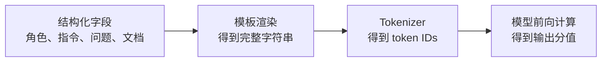
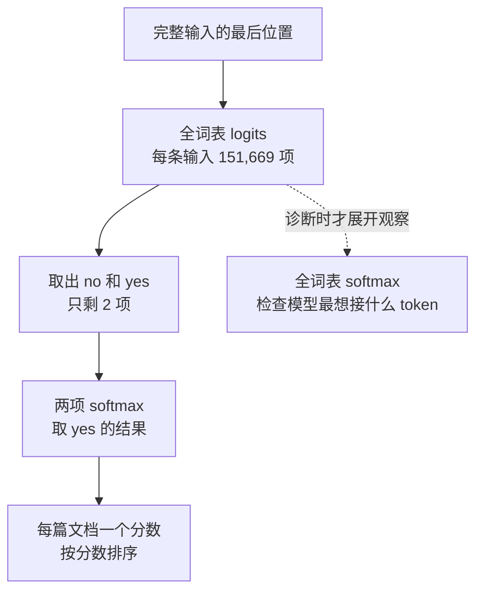
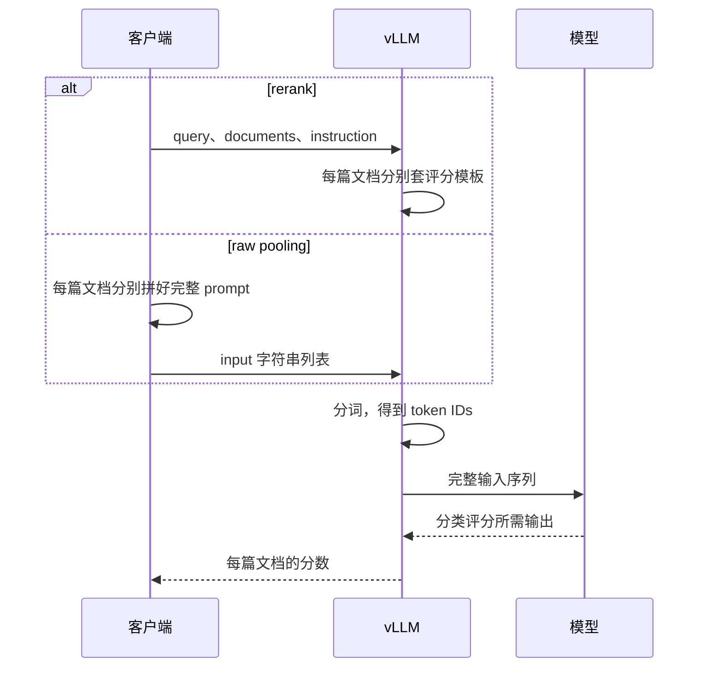

1. Table of Contents, ordered
{:toc}

向 reranker 发送一个问题和几篇文档，拿回每篇文档的相关性分数，再按分数排序。这是调用方看到的全部过程。

这个浮点数从哪里来？是两个向量的相似度，是分类器的输出，还是语言模型生成了一个数字？如果只看 API 响应，很难分辨。

一次服务迁移让这个问题变得具体起来。模型仍然是 Qwen3-Reranker-0.6B，问题、文档和指令都没有改，只是更换推理实例、升级 vLLM，并将 `/pooling` 换成 `/v1/rerank`，证据召回率的宏平均却从 **88.92% 降到了 83.80%**。请求没有报错，分数仍然落在正常范围内。

最后定位到的差别，是模型输入末尾少了一个换行符。要理解它为什么影响排序，需要把这个浮点数一路拆回去：**输入怎样组织，模型在预测哪个位置，预测结果又怎样变成相关性分数。**

## 打分模型为什么沿用了聊天格式

Qwen3 Reranker 的打分方法，建立在语言模型的下一 token 预测能力之上。理解这件事，才能理解名字里带着 Chat 的模板为什么会出现在检索系统里。

### 模型接收的是序列，角色需要编码进序列

应用层可以用 JSON 区分 `system`、`user` 和 `assistant`，语言模型处理的却是一串 token ID。它不会在读取张量时，另外收到一个名叫“这句话来自用户”的 JSON 属性。角色、消息边界和当前轮到谁说话，都需要体现在序列中。

[Hugging Face 的 Chat Template 文档](https://huggingface.co/docs/transformers/chat_templating)从这个角度解释聊天模型：因果语言模型始终在续写 token 序列；聊天微调让它学会按带有角色和边界的格式续写。即便模型来自相同基座，微调采用的控制标记也可能不同。

例如，应用里保存的是这样的消息：

```json
[
  {"role": "user", "content": "中国的首都是哪里？"}
]
```

采用 Qwen 风格的消息标记，可以把它表示成下面这段文本。这里只演示角色和边界，尚未加入 reranker 的任务格式：

```text
<|im_start|>user
中国的首都是哪里？<|im_end|>
<|im_start|>assistant
```

开头表示用户消息开始，中间的结束标记关闭用户消息，最后的 assistant 前缀把接续位置放到助手回答中。如果输入只停在用户问题末尾，模型面对的续写条件就不同了：它可能接着补全那段话，而不是开始回答。

**模板的作用，是把应用的数据结构序列化成模型所使用的输入格式。** 它既放入内容，也明确边界和接续位置。格式需要与模型训练和推理约定相匹配，不能因为两套格式表达了相似的人类语义，就假定它们对模型等价。

这层转换也适用于通用聊天服务。[OpenAI API 与模型输入](/posts/2026/10/19/openai-api-context-chat-template-serving/)对照 Qwen3、Llama 3.1 和 DeepSeek V3 的消息格式，并进一步区分 API 接口、上下文管理、Chat Template 与 vLLM/SGLang 的职责；本文继续聚焦转换完成之后的 reranker 评分。

### 相关性判断，被训练成了 yes/no 回答

这仍然没有解释，为什么一个打分模型要安排“助手回答”。原因在于 Qwen3 Reranker 对任务的定义：把问题和文档放在同一上下文中，让模型判断文档是否符合指令要求，用 `yes` 或 `no` 表达结果。

[Qwen3 Embedding 技术报告的模型与训练章节](https://arxiv.org/html/2506.05176v1)明确采用这种二分类形式：正例的标签是 `yes`，负例的标签是 `no`，训练目标提高正确标签在对应输入条件下的概率。因此，读取这两个 token 的偏好，才具有相关性判断的意义。**并不是随便拿一个语言模型、取两个单词的概率，就自动得到可靠的 reranker。**

对问题“中国的首都是哪里？”和文档“中国的首都是北京。”，本次基线实际采用的完整输入如下：

```text
<|im_start|>system
Judge whether the Document meets the requirements based on the Query and the Instruct provided. Note that the answer can only be "yes" or "no".<|im_end|>
<|im_start|>user
<Instruct>: 给定一个问题，检索知识库中能够直接回答该问题的段落。
<Query>: 中国的首都是哪里？
<Document>: 中国的首都是北京。<|im_end|>
<|im_start|>assistant
<think>

</think>
```

这段输入在 `</think>` 后还有 **一个换行**。代码块不容易辨认末尾空白，精确的尾部表示是：

```python
'<|im_start|>assistant\n<think>\n\n</think>\n'
```

这里的 Chat 描述的是输入组织形式。对外提供评分 API，并不妨碍内部沿用语言模型的消息结构；服务也不需要真的返回一段聊天记录。这个解释针对 Qwen3 Reranker 的这套用法，其他 reranker 可以使用不同的模型结构与输入规范。

### 三层格式约定，分别提供边界、回答位置和任务字段

完整输入里有不少长得像标签的文字，但它们的来源和作用并不相同。理解“谁加的”需要分开两个问题：**谁设计了这种格式，以及本次推理是谁把这些字符写进输入。** 训练时由数据构造流程组织样本，模型学习它们的含义；推理时则由客户端或服务端的格式化代码重建相应输入，不是模型先偷偷运行一次、替请求补上标签。

从用途看，这段输入叠加了三层约定：

| 层次与标记 | 格式约定来自哪里 | 在这段输入中的作用 |
|---|---|---|
| 消息边界<br><code>&lt;&#124;im_start&#124;&gt;</code><br><code>&lt;&#124;im_end&#124;&gt;</code> | Qwen 聊天序列格式<br>基座 tokenizer 已有 | 开启、关闭消息<br>区分消息头和正文 |
| 消息角色<br>`system` / `user`<br>`assistant` | Qwen 聊天格式<br>角色名称约定 | 标识规则、材料<br>以及助手回答的位置 |
| 思考区段<br>`<think>`<br>`</think>` | Qwen3 思考与回答格式<br>reranker 官方输入沿用 | 本次预填空思考块<br>关闭它后准备读取判断 |
| 任务字段<br>`<Instruct>:`<br>`<Query>:` / `<Document>:` | Qwen3 Reranker<br>任务输入约定 | 在 user 消息内部<br>区分要求、问题、文档 |

前两行属于同一层聊天结构。`<|im_start|>system\n` 可以拆成“消息开始标记 + 角色名称 + 换行”，换行后才是这条消息的正文；`<|im_end|>` 关闭这条消息。本例最后只有 assistant 的开头和预填内容，没有把它关闭，因为要读取的正是这条助手消息接下来会输出什么。

三个角色也不代表三个独立模型。`system` 后面的正文提供“只能回答 yes/no”的总规则；`user` 后面放的是程序打包的问题和文档，不一定是人逐字输入的聊天消息；`assistant` 指定模型的回答位置。**角色名负责说明正文属于谁，具体指令仍在正文里**，单独写一个 `system` 不会自动得到相关性判断规则。

这些消息标记确实能追溯到 Qwen 的既有格式。[Qwen3-0.6B-Base 的 tokenizer 配置](https://huggingface.co/Qwen/Qwen3-0.6B-Base/blob/main/tokenizer_config.json)已经包含消息边界和 think 标记；Qwen3 Reranker 的模型卡也将它列为基座。但“基座词表里已有这个符号”不等于“基座已经学会了本次 reranker 判断任务”，后者还依赖专门的训练。

`<think>` 也不是本次请求临时发明的标签。[Qwen3 通用模型的模板](https://huggingface.co/Qwen/Qwen3-0.6B/blob/main/tokenizer_config.json)就使用这对标记组织思考内容，并能在关闭 thinking 时预填空思考块。本次 reranker 的官方 `suffix` 直接包含空块：**`<think>…</think>` 在模型前向计算之前已经存在，没有实际生成一段思考再丢弃。** 这说明的是输入和输出格式，不能据此断言神经网络内部完全没有进行推理计算。

最内层的三个字段则是 reranker 任务特有的组织方式。`<Instruct>:` 回答“按什么要求判断”，`<Query>:` 放检索问题，`<Document>:` 放当前候选文档。官方示例的 `format_instruction()` 明确拼接这三项；技术报告也把相应格式用于重排训练。所以可以说它们由 **reranker 的开发者在任务格式和训练样本构造中约定**，模型学习如何使用；不能说是模型自己创造或自动添加了这些字段。

推理时的具体执行者与它们的历史来源是两个维度。本次两条接口的责任划分如下：

| 调用方式 | 调用方提供什么 | 谁写入上述所有标记与角色 |
|---|---|---|
| `/v1/rerank` | `query`、`documents`、`instruction` 等业务字段 | vLLM 执行配置好的评分模板，按模板拼接 |
| raw `/pooling` | 已包含全部格式的 `input` 字符串 | 客户端在发请求前拼接，服务不再套一遍评分模板 |

例如，中文 instruct 的内容由调用方选择；`<Instruct>:` 这个字段名由评分格式固定；外面的 user 消息和消息边界则来自聊天格式。三者出现在同一段输入中，分别承担不同职责。

### 看起来像标签，不代表都是特殊 token

上面的分类是按用途划分，还需要和 tokenizer 的分类区别开。使用本次固定 revision 的 tokenizer，对各段文本单独执行 `encode(..., add_special_tokens=False)`，并核对 `added_tokens_decoder` 和特殊 token 列表，得到以下结果：

| 文本 | 单独编码的 token ID | tokenizer 中的性质 |
|---|---|---|
| <code>&lt;&#124;im_start&#124;&gt;</code><br><code>&lt;&#124;im_end&#124;&gt;</code> | 151644<br>151645 | 独立的特殊 token<br>`special=true` |
| `system` / `user`<br>`assistant` | 8948 / 872<br>77091 | 普通文本，各占一个 token<br>不是特殊 token |
| `<think>` / `</think>` | 151667 / 151668 | 独立的 added token<br>该版本配置为 `special=false` |
| `<Instruct>:` | 27、641、1235、26818 | 普通文本，拆成 4 个 token |
| `<Query>:` | 27、2859、26818 | 普通文本，拆成 3 个 token |
| `<Document>:` | 75692、26818 | 普通文本，拆成 2 个 token |

相关标记配置可以在[本次 Reranker 的 tokenizer 文件](https://huggingface.co/Qwen/Qwen3-Reranker-0.6B/blob/e61197ed45024b0ed8a2d74b80b4d909f1255473/tokenizer_config.json)核对。表中的 ID 针对固定版本和单独编码的字符串；普通文本放进不同上下文时，仍应检查完整输入的分词结果。

因此，**具有结构含义、编码为单个 token、被 tokenizer 标记为 special，是三件不同的事。** `system` 是普通词，却因为处在消息头里而承担角色含义；`<Query>:` 被拆成多个 token，也仍然可以被模型学成字段边界；think 标记具有独立 ID，但不能因此把它在配置中的 `special` 属性说成 true。

这也解释了为什么 `add_special_tokens=False` 不会删掉 prompt 里已经写好的 `<|im_start|>`：它控制的是 tokenizer 是否额外插入标记，不是要求忽略输入中现有的标记。已有的字符仍会按词表识别为对应 ID。

### 模板输出文本，tokenizer 才把文本变成 ID

Chat Template 通常用 Jinja 编写，其中的变量代表消息内容，固定文本代表边界和提示。模板引擎只是按规则拼接，既不理解文档，也不计算相关性。[Transformers 的模板编写文档](https://huggingface.co/docs/transformers/main/en/chat_templating_writing)介绍了这种写法及空白处理约定。

这条转换可以分成三步：



在 Transformers 中，`apply_chat_template(..., tokenize=False)` 返回渲染后的字符串；`tokenize=True` 则将渲染与分词一起完成，返回 token IDs。若先取得字符串、再单独分词，通常要用 `add_special_tokens=False`，避免重复添加模板已经包含的特殊标记。

用一条“你好”消息就可以观察这两个步骤。下面仅演示 API 的转换行为，使用随该 tokenizer 发布的**通用聊天模板**；完整的 reranker 评分仍使用后文包含指令、问题、文档的专用模板。

```python
from transformers import AutoTokenizer

tokenizer = AutoTokenizer.from_pretrained(
    "Qwen/Qwen3-Reranker-0.6B",
    revision="e61197ed45024b0ed8a2d74b80b4d909f1255473",
)
messages = [{"role": "user", "content": "你好"}]

# 只渲染，不分词；返回值是 Python 字符串。
# 添加 assistant 开头，并让这份模板预填空思考块。
text = tokenizer.apply_chat_template(
    messages,
    tokenize=False,
    add_generation_prompt=True,
    enable_thinking=False,
)
print(text)
print(repr(text))
```

`print(text)` 的输出是：

```text
<|im_start|>user
你好<|im_end|>
<|im_start|>assistant
<think>

</think>

```

`repr(text)` 则把不可见换行也展示出来，实际结果为：

```text
'<|im_start|>user\n你好<|im_end|>\n<|im_start|>assistant\n<think>\n\n</think>\n\n'
```

此时没有加载语言模型权重，也没有发生模型推理。“你好”还是调用方提供的内容，assistant 前缀和空思考块都是模板按参数拼出的文本。这份通用模板在 `</think>` 后输出两个换行；本次 pooling 基线使用的一个换行来自另外的评分输入构造，不能把不同模板的尾部格式混用。

接着，把相同调用改为 `tokenize=True`，或者对刚才的字符串单独分词：

```python
# 模板渲染和分词一次完成；本例返回整数列表。
ids = tokenizer.apply_chat_template(
    messages,
    tokenize=True,
    add_generation_prompt=True,
    enable_thinking=False,
)

# 分两步完成：text 已有边界标记，不再额外添加。
ids_in_two_steps = tokenizer.encode(text, add_special_tokens=False)
print(ids)
print(ids == ids_in_two_steps)
print(tokenizer.decode(ids, skip_special_tokens=False) == text)
```

实际输出：

```text
[151644, 872, 198, 108386, 151645, 198, 151644, 77091, 198, 151667, 271, 151668, 271]
True
True
```

其中 151644 对应消息开始，872 对应 `user`，108386 对应“你好”，271 对应两个连续换行。这里的 `decode` 只是把 ID 转回可读文本，也没有调用模型。**`apply_chat_template` 负责准备模型输入；字符串和 ID 列表都还是输入，相关性分数要等后面的模型计算。**

也可以完全不用 Jinja，直接用 Python 拼出相同字符串。模型无法知道这串 token 是模板引擎产生的还是手写的；它只处理最终序列。**需要保持的是输入格式，不是必须调用某个名为 template 的函数。**

有了格式正确的输入，下一步才轮到模型：它如何把准备输出的判断，变成一个连续分数？

## 从下一 token 的 logits，到一篇文档的分数

Qwen3 Reranker 不需要先生成 `yes` 或 `no` 再解析文本。一次前向计算，已经包含了它对这两个选择的偏好。

### 最后一个输入位置，预测的是紧接着的 token

假设一条输入被分成 $T$ 个 token。因果语言模型在位置 $t$ 只能使用截至该位置的上下文，并据此预测下一个 token。最后一个输入位置已经读到完整的问题、文档和回答前缀，因而它的输出用于预测**紧接完整输入之后**的那个 token。

例如，输入末尾已经包含 `</think>\n`，要读的是这个换行后面最可能出现什么。最后位置的输出并不是“这个换行自身有多相关”，也不是把前面各个 token 的分数取平均。

概念上，Transformer 先为最后位置得到一个隐藏向量 $h_T$，语言模型的输出层再把它映射到整个词表。词表中每个 token 都有一个原始分值，称为 **logit**。它可以是正数或负数，还没有经过概率归一化。

按 [Transformers 的 `CausalLMOutputWithPast` 定义](https://huggingface.co/docs/transformers/v4.57.1/en/main_classes/output#transformers.modeling_outputs.CausalLMOutputWithPast)，通常的 logits 张量形状是：

$$
\underbrace{B}_{\text{批大小}}
\times
\underbrace{T}_{\text{输入长度}}
\times
\underbrace{V}_{\text{词表大小}}
$$

其中 $B$ 是一次处理的问题—文档对数量，$T$ 是序列长度，$V$ 是词表大小。本次原始模型的 $V$ 为 **151,669**。

于是，`logits[:, -1, :]` 可以逐项读成：

| 索引 | 选择的内容 | 选择后的含义 |
|---|---|---|
| 第一个 `:` | 批次中的每个样本 | 每个问题—文档对都保留 |
| `-1` | 最后一个序列位置 | 使用读完完整输入后的预测 |
| 最后一个 `:` | 全部词表项 | 保留每个候选下一 token 的 logit |

结果的形状是 `[B, V]`。**它仍然是整个词表的预测，并不是相关性分数。**

这里还有一个前提：最后一个数组位置必须对应最后一个有效输入 token。官方示例使用左侧 padding，使每条输入的末尾对齐；单条输入不需要 padding。如果使用右侧 padding，就不能不加区分地把 `-1` 当成最后一个有效位置。

### 选出 no 和 yes，再在两项之间归一化

[Qwen 官方 Transformers 示例](https://huggingface.co/Qwen/Qwen3-Reranker-0.6B/blob/e61197ed45024b0ed8a2d74b80b4d909f1255473/README.md#using-transformers)接下来只保留小写 `no`、`yes` 的 logits，然后做两项 softmax。把这段计算按维度展开，可以写成：

```python
# outputs 来自原始 AutoModelForCausalLM 的一次前向计算。
# [B, T, V] -> [B, V]：每个样本只读最后位置。
last_logits = outputs.logits[:, -1, :]

# 本模型中 no、yes 分别对应一个 token。
no_id = tokenizer.convert_tokens_to_ids("no")
yes_id = tokenizer.convert_tokens_to_ids("yes")

# [B, V] -> [B, 2]：列顺序固定为 no、yes。
pair_logits = last_logits[:, [no_id, yes_id]]

# 只在这两个选择内归一化，再取 yes 所在的第二列。
# [B, 2] -> [B]：每个问题—文档对得到一个分数。
scores = torch.softmax(pair_logits.float(), dim=-1)[:, 1]
```

若完整输入为 $x$，取出的两个分值分别是 $z_{\text{yes}}(x)$ 和 $z_{\text{no}}(x)$，则：

$$
s(x)=\frac{e^{z_{\text{yes}}(x)}}{e^{z_{\text{yes}}(x)}+e^{z_{\text{no}}(x)}}
=\operatorname{sigmoid}\!\left(z_{\text{yes}}(x)-z_{\text{no}}(x)\right)
$$

比如，纯粹为了演示计算，假设 `yes` 的 logit 为 4，`no` 为 2，那么分数就是 $\operatorname{sigmoid}(2)\approx0.881$。模型不曾生成字符“0.881”，这个浮点数由评分代码算出。



这里有两种不同的归一化范围。常规重排只关心 `yes/no` 两项；后面的实验会观察全词表。即使两项分数落在 0～1，它也不能直接解释为“这篇文档有这么大的概率回答正确”：它是给定这段输入、限定在这两个 token 之间的相对偏好，业务正确率还需要独立评测。

### 生成可以省略，但评分位置不能省略

对一个问题的多篇候选文档，模型分别处理每个问题—文档对，算出一列分数，服务再排序。它无需等到生成一个 `yes` 才知道 `yes` 的概率，也无需在一个上下文中塞入全部候选进行比较。

本次 vLLM 使用 Qwen3 的分类适配方式，配置 `classifier_from_token=["no", "yes"]` 和 `is_original_qwen3_reranker=true`，以分类路径提供这类评分。服务不必向调用方暴露完整词表；前面的完整语言模型计算是理解分数来源的方式。相关配置见 [vLLM 0.26.0 的 Qwen3 Reranker 示例](https://docs.vllm.ai/en/v0.26.0/models/pooling_models/scoring/#cross-encoder-models)。

但无论怎样优化计算，**评分都依赖当前输入末尾所对应的预测位置**。如果模型此刻更想接一个格式字符，评分代码仍然会取这个位置的 `yes/no`；它不会自动先走到更适合回答的位置。这正是需要核对两条 API 输入的原因。

## rerank 与 pooling，分别把什么交给 vLLM

两条路径可以完成相同的重排任务，主要差别在于谁负责构造完整输入。下面用相同的公开问题和文档，把请求、模板和最终文本接起来。

### rerank 发送业务字段，服务端渲染评分模板

下面是完整请求。地址使用本机示例地址，`model` 必须与服务的模型名称一致；这里约定启动时使用 `--served-model-name Qwen3-Reranker-0.6B`。

```bash
curl --request POST 'http://127.0.0.1:8055/v1/rerank' \
  --header 'Content-Type: application/json' \
  --data-binary @- <<'JSON'
{
  "model": "Qwen3-Reranker-0.6B",
  "query": "中国的首都是哪里？",
  "documents": [
    "中国的首都是北京。"
  ],
  "instruction": "给定一个问题，检索知识库中能够直接回答该问题的段落。",
  "top_n": 1
}
JSON
```

这里没有发送 `<|im_start|>` 等标记。对本文使用的 vLLM 0.26.0 路径，[`get_score_prompt` 的实现](https://github.com/vllm-project/vllm/blob/v0.26.0/vllm/entrypoints/pooling/scoring/io_processor.py#L661)会将每对问题和文档整理成 `query`、`document` 两种角色，交给显式配置的评分模板；`instruction` 作为模板参数传入。这个中间消息列表用于模板取值，并不表示模型最终会看到名叫 query 的聊天角色。

下面是一份**针对上述请求的完整最小模板**，保存为 `qwen3_reranker_compat.jinja`。它省去了兼容其他指令字段的回退分支，要求请求提供 `instruction`；渲染结果按本次 pooling 基线保留一个末尾换行。


```jinja
<|im_start|>system
Judge whether the Document meets the requirements based on the Query and the Instruct provided. Note that the answer can only be "yes" or "no".<|im_end|>
<|im_start|>user
<Instruct>: {{ instruction }}
<Query>: {{ messages | selectattr("role", "eq", "query") | map(attribute="content") | first }}
<Document>: {{ messages | selectattr("role", "eq", "document") | map(attribute="content") | first }}<|im_end|>
<|im_start|>assistant
<think>

</think>{{ '\n' }}
```


服务启动时使用 `--chat-template ./qwen3_reranker_compat.jinja` 加载它。为了直接查看模板的输出，也可以在本地做相同的渲染：

```python
from pathlib import Path
from transformers import AutoTokenizer

tokenizer = AutoTokenizer.from_pretrained("Qwen/Qwen3-Reranker-0.6B")
template = Path("qwen3_reranker_compat.jinja").read_text(encoding="utf-8")

# 这里的角色名与 vLLM 评分模板接收的中间数据一致。
messages = [
    {"role": "query", "content": "中国的首都是哪里？"},
    {"role": "document", "content": "中国的首都是北京。"},
]
prompt = tokenizer.apply_chat_template(
    messages,
    chat_template=template,
    instruction="给定一个问题，检索知识库中能够直接回答该问题的段落。",
    tokenize=False,
)

# repr 把末尾不可见的换行显示出来。
print(repr(prompt))
token_ids = tokenizer.encode(prompt, add_special_tokens=False)
print(token_ids[-12:])
```

这会得到前面展示的完整 system、user、assistant 输入。它不是把请求 JSON 原样贴进模型，也不是在用户问题外再套一段含义不明的聊天历史，而是按确定规则把字段转换成评分任务。

### pooling 直接接收已经拼好的完整输入

本次使用的 `/pooling` 路径把格式化工作放在客户端。下面的 `input` 是完整字符串，JSON 中的 `\n` 会在解码后成为真实换行：

```bash
curl --request POST 'http://127.0.0.1:8055/pooling' \
  --header 'Content-Type: application/json' \
  --data-binary @- <<'JSON'
{
  "model": "Qwen3-Reranker-0.6B",
  "input": [
    "<|im_start|>system\nJudge whether the Document meets the requirements based on the Query and the Instruct provided. Note that the answer can only be \"yes\" or \"no\".<|im_end|>\n<|im_start|>user\n<Instruct>: 给定一个问题，检索知识库中能够直接回答该问题的段落。\n<Query>: 中国的首都是哪里？\n<Document>: 中国的首都是北京。<|im_end|>\n<|im_start|>assistant\n<think>\n\n</think>\n"
  ],
  "task": "classify",
  "use_activation": true,
  "add_special_tokens": false
}
JSON
```

`task="classify"` 选择分类任务，`use_activation=true` 请求激活后的分数，`add_special_tokens=false` 避免在已经完整的输入上再次添加特殊标记。`input` 有多项时，每项都是一个完整的问题—文档对；客户端要为每篇文档分别拼接。

在这条 raw `input` 路径里，服务不会再套一次评分 Chat Template。**pooling 同样使用了模板所规定的格式，只是 HTTP 请求发出前就已经构造好了。** 此处的 pooling 是 vLLM 的接口名称，不能仅凭名称推断它在计算文档向量的平均值。



本次接入从 rerank 的 `results[i].relevance_score`、pooling 的 `data[i].data[0]` 读取分数，并通过各项的 `index` 对应原文档。两种响应包装不同，但格式和评分规则对齐时，没有理由仅因接口名称变化就出现大幅质量退化。

反过来，如果去掉自定义模板，仍然发出同样的 rerank JSON，也不能推断服务器会自动补出上述格式。这个版本的评分源码会按模型能力选择默认处理路径；显式评分模板和普通聊天模型的默认模板并非总能互换。验收对象应是**最终渲染文本和 token 序列**。

## 同样的任务语义，为何会读到不同的判断信号

现在可以回到那个换行：它没有改变问题或文档，却改变了评分正在读取的下一 token 分布。

### 对照实验把差异缩小到输入末尾

本次评测固定了 **83 道题、140 条必要证据**，每条证据可以关联多个等价 chunk，任意一个命中即算覆盖。关键词候选 30 个、向量候选 30 个，RRF 参数与权重不变，重排上限 60 个，最终取 Top 10。文档标题、章节标题、正文和中文指令均保持一致。

两组初始 trace 的候选池、RRF 顺序和 RRF 分数相同，也没有重排失败回退；变化发生在重排之后。继续比较最终输入，发现了如下差异：

```python
# 原 pooling 的实际输入尾部。
'<|im_start|>assistant\n<think>\n\n</think>\n'

# 退化 rerank 的实际输入尾部。
'<|im_start|>assistant\n<think>\n\n</think>'
```

在本次 tokenizer 下，`</think>` 的 ID 是 151668，单个换行 `\n` 是 198，两个连续换行 `\n\n` 则可以整体编码为 271。删掉末尾换行，最后一个输入 token 确实变了。

为判断这是不是主要原因，在同一新实例上继续做控制实验：让 pooling 原样处理完整输入，再分别删除、补回末尾换行。后两项使用保存的候选进行重放，不重新检索。

| 实验 | 运行方式 | 输入结尾 | 宏平均 Recall@10 | 微平均 Recall@10 |
|---|---|---|---:|---:|
| 原实例 pooling | 完整评测 | `</think>\n` | 88.92% | 117/140＝83.57% |
| 新实例 rerank | 完整评测 | `</think>` | 83.80% | 108/140＝77.14% |
| 新实例 pooling | 完整评测 | `</think>\n` | 88.71% | 116/140＝82.86% |
| 新实例 pooling，去掉换行 | 固定候选重放 | `</think>` | 83.80% | 108/140＝77.14% |
| 新实例 pooling，加回换行 | 固定候选重放 | `</think>\n` | 88.92% | 117/140＝83.57% |

宏平均是先算每题的证据召回率，再对 83 题平均；微平均是总命中证据数除以 140。两者都列出，避免把汇总口径差异误当成实验变化。

最有解释力的是最后两行：去掉换行后，140 条证据的命中状态全部复现退化版本；补回后，全部对齐原基线。新实例 pooling 完整评测少命中的那一条处在第 9～11 名边界，精度或批处理差异是候选解释，尚未单独证明；这与缺换行时该证据降至第 33 名的变化不同。

这组消融证明，**仅改变这个输入末尾，已经足以复现本次主要退化和恢复**。不过，它还没有直接证明模型为什么这样变化。

### 输入停在格式中间，模型可能先补格式

一种可检验的机制解释是：输入停在 `</think>`，模型更倾向先接换行；输入已经给出换行，它才更倾向接判断词。

从人类任务语义看，两段输入都要求判断相关性。但模型计算的条件概率分别是：

$$
p(\text{下一个 token}\mid \text{前缀以 }\texttt{</think>}\text{ 结束})
$$

和：

$$
p(\text{下一个 token}\mid \text{前缀以 }\texttt{</think>}+\text{换行结束})
$$

它们问的是同一个任务在**不同序列位置**的续写。可以类比一个要求输出 JSON 的模型：当输入停在冒号后，下一步可能先出现引号；引号已经给出时，下一步才更可能出现字符串内容。人知道最终要填什么，不代表任意中间位置都适合读取那个内容 token 的概率。

如果让模型自由生成，它或许能先补格式再回答；评分代码却只读一次当前位置的 `yes/no`，没有这个自动前进过程。因此，不能用“它最后应该还是知道答案”来保证两项分数不变。

还需要区分两件事：换行的概率高，不会仅通过“挤占概率”就必然改变重排分数。因为：

$$
\frac{p(\text{yes}\mid x)}{p(\text{yes}\mid x)+p(\text{no}\mid x)}
=\operatorname{sigmoid}(z_{\text{yes}}-z_{\text{no}})
$$

全词表归一化的共同分母会消掉。**只有 yes 与 no 的相对 logit 差发生变化，分数才会变化；不同文档变化不一致，排序才可能改变。** 模板改变了输入隐藏状态和预测条件，既可能让换行更受偏好，也可能改变两个判断词之间的差值。要观察这两件事，必须打开服务没有返回的完整词表。

## 用原始 0.6B 模型，观察评分背后的完整分布

这一实验的目标非常具体：验证无换行时，模型在当前位置是否真的优先预测换行，以及两项归一化如何把这种状态隐藏在一个正常分数里。

### 先绕开只提供分类分数的观测限制

部署服务采用分类路径。把 `use_activation` 关闭，只会得到分类路径的未激活输出，不会凭空恢复 151,669 维语言模型词表。因此，不能拿这个标量回答“换行排第几”。

实际做法是下载并固定原始 Qwen3-Reranker-0.6B 权重，以 `AutoModelForCausalLM` 在 CPU 上运行，保留原始语言模型输出层。选择 CPU 是因为这台本地机器可以直接执行诊断；使用 float32 便于观察，不意味着 CPU 结果就是部署 GPU 的逐位真值。

| 实验项 | 实际设置 | 目的 |
|---|---|---|
| 权重 | revision `e61197ed45024b0ed8a2d74b80b4d909f1255473` | 固定模型版本，避免把权重变化混进来 |
| 运行环境 | CPU、float32、SDPA；PyTorch 2.8.0、Transformers 4.57.1 | 用完整语言模型观察原始词表输出 |
| 公开对照 | 同一首都问题，分别配北京答案和重力描述 | 检查明显正例、负例下是否都有格式偏好 |
| 业务样本 | 5 个实际问题—证据对 | 检查现象是否也出现在退化涉及的输入上 |
| 唯一改动 | `</think>` 后分别加 0、1、2 个换行 | 隔离输入末尾，兼顾既有基线和官方示例格式 |
| 输出记录 | 7×3＝21 次前向，每次完整 151,669 维 logits | 允许之后复核任意 token，而不只保存选定词 |

两个换行也纳入实验，是因为 **Qwen 官方 Transformers 示例的末尾是两个换行，本次既有 pooling 基线是一个**。实验不能预先假定这两种格式等价，更不能把“恢复一个换行”的修复结论写成所有实现唯一正确的格式。

### 固定前缀，一次前向就能回答下一 token 的问题

每个样本先构造一份截至 `</think>` 的共同前缀，再分别追加 0、1、2 个换行。三个版本都单条分词，不截断、不 padding，避免引入另一个位置选择问题。

随后只执行 `model(...)`，不调用 `generate`。这样做并非少测了一步：**生成的第一个 token 本来就要根据这次前向得到的分布选择。** 查看全词表最大值，就知道无额外约束、贪心选择时的第一个 token；查看完整分布，则比只生成一个字符提供更多证据。

这里没有 `allowed_token_ids`、采样、logit bias 或强制 yes/no 的解码限制。如果先限制输出词表，模型即使原本想输出换行，也会被迫在剩余选项里回答，恰好掩盖待验证的现象。

下面是可独立运行的**公开两样本复现版**。它与实际 7 样本实验采用相同的模型版本和核心计算，但不包含业务文档；它会执行 6 次前向，并把全部 logits 保存到当前目录。

```bash
python -m pip install 'torch==2.8.0' 'transformers==4.57.1' numpy
python probe_reranker.py
```

将以下内容保存为 `probe_reranker.py`。首次运行需要下载模型权重；脚本明确使用 CPU：

```python
import numpy as np
import torch
from transformers import AutoModelForCausalLM, AutoTokenizer

MODEL = "Qwen/Qwen3-Reranker-0.6B"
REVISION = "e61197ed45024b0ed8a2d74b80b4d909f1255473"
INSTRUCTION = "给定一个问题，检索知识库中能够直接回答该问题的段落。"

# 固定任务格式，末尾暂时停在 </think>，不带换行。
PREFIX = (
    '<|im_start|>system\n'
    'Judge whether the Document meets the requirements based on '
    'the Query and the Instruct provided. Note that the answer '
    'can only be "yes" or "no".<|im_end|>\n<|im_start|>user\n'
)
SUFFIX = '<|im_end|>\n<|im_start|>assistant\n<think>\n\n</think>'
SAMPLES = [
    ("positive", "中国的首都是哪里？", "中国的首都是北京。"),
    ("negative", "中国的首都是哪里？", "重力是一种使物体相互吸引的力。"),
]

torch.set_num_threads(4)
torch.set_num_interop_threads(1)
tokenizer = AutoTokenizer.from_pretrained(MODEL, revision=REVISION)
model = AutoModelForCausalLM.from_pretrained(
    MODEL,
    revision=REVISION,
    dtype=torch.float32,
    attn_implementation="sdpa",
).to("cpu").eval()

# 明确验证两个标签都是单 token，而不是一个多 token 单词。
no_ids = tokenizer.encode("no", add_special_tokens=False)
yes_ids = tokenizer.encode("yes", add_special_tokens=False)
assert len(no_ids) == len(yes_ids) == 1
no_id, yes_id = no_ids[0], yes_ids[0]

# 找出整个词表中只由回车、换行组成的 token。
# 不能只检查 ID 198，因为两个换行可能是另一个独立 token。
decoded = tokenizer.batch_decode(
    [[i] for i in range(model.config.vocab_size)],
    skip_special_tokens=False,
    clean_up_tokenization_spaces=False,
)
newline_ids = [
    i for i, text in enumerate(decoded)
    if text and all(char in "\r\n" for char in text)
]
saved = {}

for name, query, document in SAMPLES:
    body = f"<Instruct>: {INSTRUCTION}\n<Query>: {query}\n<Document>: {document}"
    stem = PREFIX + body + SUFFIX
    for count in (0, 1, 2):
        prompt = stem + "\n" * count
        encoded = tokenizer(
            prompt,
            add_special_tokens=False,
            truncation=False,
            return_tensors="pt",
        )

        # 只保留最后一个序列位置，仍然保留完整词表。
        # logits_to_keep=1 不是只保留概率最高的一个 token。
        with torch.inference_mode():
            out = model(**encoded, use_cache=False, logits_to_keep=1)
        z = out.logits[0, -1].float().cpu()
        assert z.numel() == model.config.vocab_size

        # 第一种观察：全词表分布，回答“当前最想续接什么”。
        p = torch.softmax(z.double(), dim=-1)
        order = torch.argsort(z, descending=True, stable=True)
        print("\n", name, "trailing_newlines=", count)
        print("tail=", encoded.input_ids[0, -12:].tolist())
        for token_id in order[:5].tolist():
            print(token_id, repr(decoded[token_id]), float(z[token_id]), float(p[token_id]))

        # 第二种观察：两项分数，重现 reranker 的评分公式。
        score = torch.softmax(z[[no_id, yes_id]].double(), dim=-1)[1]
        print("P(newline-only)=", float(p[newline_ids].sum()))
        print("P(yes)+P(no)=", float(p[yes_id] + p[no_id]))
        print("yes/no score=", float(score))

        # 保存全量原始分值，避免只留下挑选过的几个 token。
        saved[f"{name}_newline_{count}"] = z.numpy().copy()

np.savez_compressed("full-vocabulary-logits.npz", **saved)
```

`logits_to_keep=1` 将输出从保留全部序列位置，改为只保留最后位置；本实验的输出形状是 `[1, 1, 151669]`，词表维度完整保留。对每个输入同时计算全词表分布和 yes/no 分数，正是为了看到 API 通常隐藏的那部分信息。

### 从 Top 1 到完整概率，检验格式续接猜想

实际 7 个样本在**没有末尾换行**时，全词表 Top 1 全部是 `\n\n`；所有仅由回车或换行构成的 token，其概率总和为 **99.12%～99.98%**。这里并没有约束模型输出换行，而是直接读取它的原始分布。

公开正例“中国的首都是北京。”也呈现这个现象：无末尾换行时，模型给换行类 token 的概率合计约 99.98%；加一个换行后，Top 1 变成 `yes`，它的全词表概率约 95.27%。明显正确的内容没有阻止模型在格式未接完时优先补换行。

下面是一条匿名业务样本 A 的关键输出。概率列统一按**完整词表**归一化，而不是两项归一化：

| 输入结尾 | token | 原始 logit | 全词表概率 | 全词表排名 |
|---|---|---:|---:|---:|
| `</think>` | `\n\n` | 19.8131 | 0.783089 | 1 |
| `</think>` | `\n` | 18.5209 | 0.215086 | 2 |
| `</think>` | `yes` | 5.1433 | 3.33×10⁻⁷ | 198 |
| `</think>` | `no` | 3.7811 | 8.53×10⁻⁸ | 816 |
| `</think>\n` | `yes` | 18.0121 | 0.818736 | 1 |
| `</think>\n` | `no` | 14.5780 | 0.026408 | 3 |
| `</think>\n` | `\n` | 6.6702 | 9.71×10⁻⁶ | 640 |
| `</think>\n` | `\n\n` | 5.7809 | 3.99×10⁻⁶ | 1449 |

这里有两条同时可见的证据。其一，无换行时，模型确实优先预测换行。其二，`yes-no` 的 logit 差从约 **1.3623** 变为 **3.4341**，两项评分也因此变化；不能把它简化成只有换行抢走了概率。

7 个样本补一个换行后，Top 1 为 5 个 `yes` 和 2 个大写 `No`。大写 `No` 与小写 `no` 是不同 token，评分代码仍取小写的那一个。因此，证据支持的是“下一步偏好从格式字符转向判断类回答”，并不意味着全词表概率必然全部落到评分所选的两个精确 token 上。

再回看样本 A 的服务分数，就能解释为什么 API 没有报错：

| 观察量 | 没有末尾换行 | 有一个末尾换行 |
|---|---:|---:|
| 全词表中 `yes` 与 `no` 的概率总和 | 约 0.000000419 | 约 0.845144 |
| 只在 `yes/no` 内归一化的分数 | **0.796130** | **0.968753** |

没有换行时，两个判断词在完整分布里都极不可能，但把其他词表项舍去后，仍然能算出一个正常的 0.796。**两项归一化保留了相对偏好，也丢掉了“模型此刻究竟想不想输出这两个词”的信息。** 这就是标量响应能够正常、判断质量却退化的原因。

### CPU 结果与部署结果，需要交叉核对

上述 logits 来自独立加载的原始权重，**不是从 D6000 进程直接导出的输出**。为检查诊断是否与服务对应，又把 21 组输入与新服务核对：token 序列全部一致，两边 yes/no 分数的最大绝对差约 0.0080，平均绝对差约 0.00129。它支持同一输入机制的分析，但不能据此宣称 CPU 与 GPU 的计算逐位一致。

这些实验分别回答了不同问题：固定候选消融说明换行变化足以导致本评测退化；全词表实验说明模型在缺换行时确实优先接换行；标量对照说明这种状态会被两项归一化隐藏。

进一步解释为“模型从训练数据中学到了这种格式续接习惯”是合理推断，模型本来就在学习序列分布；但这里没有检查原始训练语料，不能证明具体是哪批样本或哪一阶段训练造成的。7 个样本也不是所有输入的统计保证。**被直接验证的是这个模型、这些输入的下一 token 行为。**

## 把输入格式视为评分方法的一部分

既然分数依赖于精确的输入和读取位置，修复就应该恢复已经验证过的评分条件，再检查业务效果是否恢复。

### 验收渲染结果，不能只看模板文件

模板文件末尾看起来有空行，不保证渲染后还在。[Jinja 的空白处理规则](https://jinja.palletsprojects.com/en/stable/templates/#whitespace-control)默认移除模板源码末尾的一个换行；其他代码的 `.strip()`、模板空白裁剪标记或复制时遗漏，也可能造成相似结果。

前面的兼容模板使用显式表达式输出末尾换行：


```jinja
</think>{{ '\n' }}
```


它把需要的字符写成渲染产物，而不是依赖文件最后恰好留下一行空白。本次能确认的是最终输入缺少换行、修复后恢复；Jinja 默认行为可以本地复现这种丢失，但不能单凭结果反推出部署文件究竟经历过哪次编辑或裁剪。

检查时要同时查看字符串的 `repr` 和最终 token IDs，再用固定候选比较分数、排名与命中状态。只检查模板文件，或者只确认接口返回 HTTP 200，都没有检查到评分真正使用的输入。

### 最终评测验证，分数重新服务于同一组证据

修复模板、重新部署并切回 `/v1/rerank` 后，完整评测结果如下：

| 完整评测版本 | 宏平均 Recall@10 | 微平均 Recall@10 |
|---|---:|---:|
| 原实例 pooling | 88.92% | 117/140＝83.57% |
| 修复前新实例 rerank | 83.80% | 108/140＝77.14% |
| **修复后新实例 rerank** | **88.92%** | **117/140＝83.57%** |

相对退化版本，修复救回 10 条证据、失去 1 条，净增 9 条；宏平均增加 **5.12 个百分点**，微平均增加 **6.43 个百分点**。相对原 pooling，140 条证据的命中/漏召状态全部一致。这里的一致是证据覆盖一致，不代表每个分数和排名逐位相同。

GT、731 个语料 chunk、候选池、RRF 顺序及分数均保持一致，83 题全部完成重排，没有回退。这让最终恢复能够与前面的输入消融、模型机制实验互相印证。

对于 Qwen3 这类从语言模型指定 token 读取分类分数的 reranker，评分方法包括一整条链路：**任务与文档的序列化 → 最后有效位置的预测 → 指定标签的 logits → 两项归一化 → 文档排序**。Chat Template 决定前两步的输入条件；`yes/no` 的训练赋予输出含义；评分代码决定从中保留什么信息。

理解这条链路后，接口里的一个浮点数就不再是无法解释的黑盒。模型名称相同、业务字段相同，只覆盖了链路的一部分；要保持同一种评分行为，还需要对齐最终 token 序列、读取位置与归一化规则。
