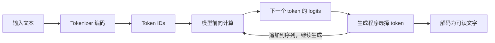
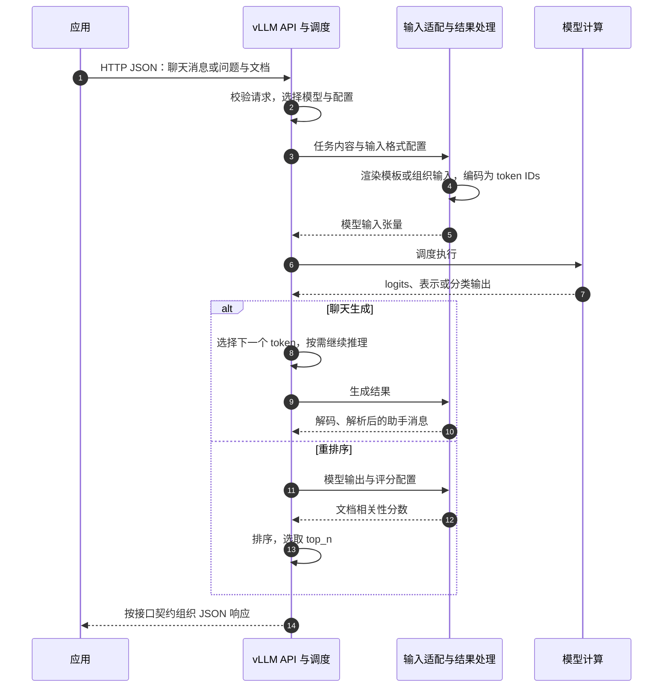

1. Table of Contents, ordered
{:toc}

下载一份 Qwen 模型，用 Python 就能让它回答问题；部署成服务后，又能通过 `/v1/chat/completions` 调用。换成 Qwen Reranker，同样可以在本地算分，也可以通过 `/rerank` 请求排序。HTTP 接口与模型计算之间，多了一层服务软件。

> **模型本身没有 HTTP 路由。下载的模型权重里，不会自带一个 `/rerank` 服务；这个接口由 vLLM 等服务软件提供。**
{: .prompt-info }

理解这层关系，可以从模型实际接收的输入开始，再逐步把它包装成一个供应用调用的服务。下面以纯文本模型为例；多模态模型还会接收图像等输入对应的张量，但同样需要外围软件处理网络请求。

## 模型先接收 Token 序列，再执行计算

在本地使用一个因果语言模型，最基本的过程是：准备文本，把文本编码成整数序列，让模型计算，再把生成的整数序列解码成文字。

例如，人能读懂的输入可以是：

```text
中国的首都是
```

Tokenizer 按自己的词表和编码规则，把它转换成 token IDs。模型读取这些 ID 对应的向量，计算下一个 token 的 logits，也就是尚未归一化的分数。生成程序据此选择一个 token，加入已有序列，再继续计算，直到满足停止条件。



这里有两个不同的对象：**模型执行张量计算，生成程序负责调用模型并组织生成过程。** Transformers 的 `model.generate(...)` 把生成循环封装成了一个方便调用的方法；它不需要先启动 HTTP 服务。

同样的计算也可以用于打分。Qwen3 Reranker 接收包含问题与文档的输入，在指定位置读取 `yes` 和 `no` 的 logits，再计算两者之间的归一化分数。这个路径不必把 `yes` 或 `no` 真正生成成一段文字。[Qwen 官方示例](https://huggingface.co/Qwen/Qwen3-Reranker-0.6B/blob/e61197ed45024b0ed8a2d74b80b4d909f1255473/README.md#using-transformers)就是直接调用模型并提取 logits。

**模型能够执行什么任务，取决于结构、训练、输入组织与输出读取方式。URL 名字不参与这次张量计算。**

## 聊天需要把角色与边界写进序列

普通续写只需要一段前文。聊天还需要告诉模型：哪些是应用规则，哪些是用户的话，哪些是此前的回答，以及现在应该从哪里开始回复。

如果把所有正文直接拼在一起，这些边界就丢失了。聊天模型的训练数据会按一定格式组织角色和消息；推理时也需要提供与训练相匹配的格式。**Chat Template 的工作，是把结构化对话转换成模型熟悉的序列。**

### 从消息列表到可读文本，再到整数 ID

下面是一个可以独立运行的输入准备示例。它只加载 Qwen3-0.6B 的 tokenizer，不加载模型权重，也不调用任何 HTTP 推理服务。固定版本与运行环境来自[输入实测记录](/posts/2026/10/19/transformers-direct-chat-template-tokenizer/)。

```python
from transformers import AutoTokenizer

# 固定 tokenizer 版本；不需要下载模型权重。
tokenizer = AutoTokenizer.from_pretrained(
    "Qwen/Qwen3-0.6B",
    revision="c1899de289a04d12100db370d81485cdf75e47ca",
)
messages = [
    {"role": "system", "content": "用中文简洁回答。"},
    {"role": "user", "content": "你好。"},
]

# 先执行模板，只生成字符串。
text = tokenizer.apply_chat_template(
    messages,
    tokenize=False,
    add_generation_prompt=True,
    enable_thinking=False,
)
print(repr(text))

# 再编码。模板已放入消息边界，不再自动追加特殊标记。
ids = tokenizer.encode(text, add_special_tokens=False)
print(ids)
```

第一个输出是字符串，`repr()` 把换行明确显示出来：

```python
'<|im_start|>system\n用中文简洁回答。<|im_end|>\n<|im_start|>user\n你好。<|im_end|>\n<|im_start|>assistant\n<think>\n\n</think>\n\n'
```

展开后是：

```text
<|im_start|>system
用中文简洁回答。<|im_end|>
<|im_start|>user
你好。<|im_end|>
<|im_start|>assistant
<think>

</think>

```

`<|im_start|>` 与 `<|im_end|>` 划定消息边界，`system`、`user` 和 `assistant` 表示角色。末尾开启助手消息；在这份 Qwen 模板中，关闭 thinking 还会预填空思考块。**此时模型尚未运行，这些标记都是软件根据模板添加的。**

第二个输出是 24 个整数 ID：

```python
[151644, 8948, 198, 11622, 104811, 110485, 102104, 1773,
 151645, 198, 151644, 872, 198, 108386, 1773, 151645, 198,
 151644, 77091, 198, 151667, 271, 151668, 271]
```

例如，`151644` 对应 `<|im_start|>`，`198` 对应一个换行，`271` 对应两个换行。把 IDs 和 attention mask 等信息组织成张量后，才是通常传给模型前向计算的输入。

[Transformers 的 `apply_chat_template`](https://huggingface.co/docs/transformers/chat_templating#using-apply_chat_template)也可以通过 `tokenize=True` 一次完成渲染与编码。它是本地库函数：输入 Python 消息列表，执行模板与 tokenizer。**使用 `role/content` 数据结构，并不意味着调用了 OpenAI API。**

### 不同模型使用不同的输入格式

上面的格式属于所选 Qwen 模型。其他模型可能用完全不同的标记表达同样的两条消息：

| 模型与格式 | 如何表示角色和消息边界 |
|---|---|
| Qwen3 | <code>&lt;&#124;im_start&#124;&gt;system</code> 开启消息，<code>&lt;&#124;im_end&#124;&gt;</code> 结束消息 |
| Llama 3.1 | <code>&lt;&#124;start_header_id&#124;&gt;system&lt;&#124;end_header_id&#124;&gt;</code> 包住角色，<code>&lt;&#124;eot_id&#124;&gt;</code> 结束消息 |
| DeepSeek V3-0324 | system 正文放在序列开头，用户和助手分别用 `<｜User｜>`、`<｜Assistant｜>` 标识 |

这些格式可以从 [Qwen tokenizer 配置](https://huggingface.co/Qwen/Qwen3-8B/blob/b968826d9c46dd6066d109eabc6255188de91218/tokenizer_config.json)、[Meta 官方格式](https://github.com/meta-llama/llama-models/blob/0e0b8c519242d5833d8c11bffc1232b77ad7f301/models/llama3_1/prompt_format.md)和 [DeepSeek tokenizer 配置](https://huggingface.co/deepseek-ai/DeepSeek-V3-0324/blob/e9b33add76883f293d6bf61f6bd89b497e80e335/tokenizer_config.json)核对。[格式对照脚本](/assets/code/openai-chat-templates/compare_templates.py)保留了完整输出的复核方式：Qwen 与 DeepSeek 渲染固定版本模板，Llama 按 Meta 参考格式重建。

**Chat Template 对齐的是模型的输入约定。** 它通常随 tokenizer 配置发布，由客户端库或服务端软件执行；模型不会自己读取 Jinja 模板文件。相同的 `messages` 因而可以转换为不同的 token 序列，交给不同模型。

## 把本地计算变成 HTTP 服务：OpenAI 聊天 API

本地脚本已经能完成输入准备与生成。但其他应用想调用这个能力时，不适合每个应用都加载一份权重、管理设备、处理生成循环。提供者可以把这些工作放进一个常驻服务，通过网络接收任务，再把结果返回。

这时才需要定义：请求发到哪个地址、如何认证、正文包含哪些字段、结果怎样表示。**这些是 HTTP API 的契约，属于服务软件。**

### 用 messages 表达聊天任务

OpenAI 的 [Chat Completions API](https://developers.openai.com/api/reference/resources/chat/subresources/completions/methods/create)就是这样的服务接口。下面展示请求方法、地址、相关请求头与完整 JSON 正文；模型 ID 和密钥需要替换为实际值：

```http
POST https://api.openai.com/v1/chat/completions
Authorization: Bearer <API_KEY>
Content-Type: application/json

{
  "model": "<支持该接口的模型 ID>",
  "messages": [
    {"role": "system", "content": "用中文简洁回答。"},
    {"role": "user", "content": "你好。"}
  ],
  "stream": false
}
```

这里用 `system` 与前面的本地示例对照；具体模型支持哪些角色和参数，要按文档核对，部分模型使用 `developer` 表达应用指令。

服务端解析 JSON、选择模型、准备输入、执行生成，并组装响应。响应中与本例有关的部分如下，文字只是示意，省略了 ID、时间与 usage 等字段：

```json
{
  "choices": [
    {
      "index": 0,
      "message": {
        "role": "assistant",
        "content": "你好！有什么可以帮你的？"
      },
      "finish_reason": "stop"
    }
  ]
}
```

`choices`、`message` 和 `finish_reason` 由服务软件组织。模型本身没有生成这整个 HTTP 响应。`Authorization` 用来认证，`model` 用来路由请求，`stream` 控制交付方式；它们也不需要原样拼进模型的提示词。

**API 让调用方表达“要完成什么任务”，输入适配让服务知道“怎样把任务交给这个模型”。** API 不必要求用户手写 `<|im_start|>`，更不必暴露整套 tokenizer。

OpenAI 自身也需要把公开请求转换为内部计算所需的输入，但其闭源服务的具体格式和实现不能由这里的 Qwen 示例推断。Qwen 的 Jinja 模板展示的是一条可观察的开源实现路径。这里按技术依赖关系展开，也不代表 OpenAI 内部研发的历史先后顺序。

### 会话历史也是外围软件管理的

一次回答之后再问“我刚才说了什么”，下一次推理需要取得前文。模型权重不会因为一次普通聊天就自动保存这段对话；模板也只能排列交给它的内容。

Chat Completions 通常由应用选取历史，连同新问题一起放入 `messages`。[Responses 的会话状态机制](https://developers.openai.com/api/docs/guides/conversation-state)则可以让服务承担一部分历史保存与恢复工作：

| 方式 | 调用方提交什么 | 如何取得本轮历史 |
|---|---|---|
| 手动组织上下文 | 所需历史和新输入 | 应用组织 |
| `previous_response_id` | 上一次响应 ID 和新输入 | 服务根据响应关系恢复 |
| `conversation` | 会话 ID 和新输入 | 服务从会话容器中取得 |

例如，下面是 `POST /v1/responses` 的请求正文：

```json
{
  "model": "<支持该接口的模型 ID>",
  "previous_response_id": "resp_上一轮响应",
  "instructions": "用中文简洁回答。",
  "input": "我刚才说了什么？"
}
```

这里重新传入 `instructions`，因为通过 `previous_response_id` 接续时，上一次的顶层指令不会自动继承。这些 ID 可以帮助服务找回状态，但不会让模型拥有一个用户专属的 Session。KV cache 用来复用计算，也不等于持久对话记录。

工具调用同理：服务接口可以表达函数名、参数和执行结果。对于[自定义函数调用](https://developers.openai.com/api/docs/guides/function-calling)，应用仍需执行函数，再把结果交回。**API 可以提供比一次模型前向计算更丰富的功能；丰富的是外围工作流。**

## 把相关性计算变成 HTTP 服务：Rerank API

搜索应用通常已经召回了一批文档，接下来需要判断哪些最能回答问题。它希望提交“问题 + 候选文档”，拿回分数和顺序，而不必了解模型内部怎样打分。

这正是 [Cohere Rerank API](https://docs.cohere.com/reference/rerank)和 [Jina Reranker API](https://jina.ai/reranker/)提供的抽象。两者核心字段相近，版本路径、可选参数与元数据并不完全相同。

### 用 query 与 documents 表达重排序任务

以下以本地已部署好的兼容服务为例。`model` 必须匹配服务公布的名称；这里假设它加载的是 Qwen3-Reranker-0.6B：

```http
POST http://127.0.0.1:8000/v1/rerank
Content-Type: application/json

{
  "model": "Qwen/Qwen3-Reranker-0.6B",
  "query": "中国的首都是哪里？",
  "documents": [
    "上海是中国的一座城市。",
    "中国的首都是北京。"
  ],
  "top_n": 1
}
```

服务返回排序结果，核心字段如下。分数是示意值，省略了其他元数据：

```json
{
  "results": [
    {
      "index": 1,
      "relevance_score": 0.98
    }
  ]
}
```

`index: 1` 指输入列表的第二篇文档；`top_n: 1` 表示只返回排在最前面的一条。在这个逐对打分的例子中，服务仍需比较候选文档，`top_n` 不是只让模型看一篇。

接入代码只需处理这一套请求与响应。模型内部却可以不同：BERT 类 Cross-Encoder 可以通过分类头计算相关性，Qwen3 Reranker 则可以从 `yes/no` logits 得到分数。**相同的 `relevance_score` 字段，不保证不同模型使用相同的计算方式、数值分布或判断阈值。**

### API 字段还要转换成评分输入

对于 Qwen3 Reranker，问题和每篇文档会按评分任务的格式组织。任务正文形如：

```text
<Instruct>: 给定一个问题，检索知识库中能够直接回答该问题的段落。
<Query>: 中国的首都是哪里？
<Document>: 中国的首都是北京。
```

这只是中间的任务正文；外围还需要系统指令、消息边界和指定的助手回答起点。模型在完整输入后计算 logits，评分代码提取 `yes/no`，服务再把分数组装成 `results` 并排序。[完整的评分模板与计算实验](/posts/2026/10/15/qwen3-reranker-scoring-chat-template/)展示了这条路径。

因此，Cohere/Jina 风格的 API 不会规定所有模型都使用 Qwen 模板，也不会要求所有模型都读 `yes/no`。任务指令可以由部署配置给定；某些实现还提供 `instruction` 等扩展参数，不能把扩展字段直接当作所有提供者的通用协议。

这些接口也不是重排序技术的起点。2019 年已有 [BERT 段落重排序研究](https://arxiv.org/abs/1901.04085)；Cohere 在 [2023 年的发布文章](https://cohere.com/blog/rerank)中介绍了自己的 Rerank endpoint。能确定的是，厂商把能力包装成 API，其他软件可以选择兼容这些约定；不能由此推断某家公司发明了所有 rerank 接口。

## vLLM 将接口、输入适配和模型计算接起来

自部署时，除了下载权重，还需要实现 HTTP 入口、请求调度、输入转换、推理执行和响应组装。vLLM 提供了这些服务能力，避免每个应用从头实现。

它在两端承担不同的适配：**对外接受应用熟悉的 API，对内使用所部署模型需要的输入与计算方式。**

| 服务入口 | 外部接口约定 | 内部工作示例 |
|---|---|---|
| `/v1/chat/completions` | OpenAI-compatible 聊天 API | 渲染所选模型的聊天模板，生成并解析回答 |
| `/rerank`、`/v1/rerank`、`/v2/rerank` | Cohere/Jina 兼容重排序 API | 准备评分输入，运行模型，返回排序结果 |
| raw `/pooling` 输入路径 | vLLM 的通用 pooling 接口 | 接收客户端已准备的输入，执行配置的 pooling 任务 |

[vLLM 的聊天接口文档](https://docs.vllm.ai/en/v0.26.0/serving/online_serving/openai_compatible_server/)说明了对 OpenAI API 的兼容范围；[评分接口文档](https://docs.vllm.ai/en/v0.26.0/models/pooling_models/scoring/#cohere-rerank-api)明确说明，兼容 Jina 与 Cohere 的目的是便于接入已有开源工具。支持哪些入口仍取决于模型、配置与 vLLM 版本。

### 兼容请求格式，就能复用客户端代码

假设一个应用已经会向聊天服务提交 `messages`、从 `choices` 中取出答案。它接入另一个 OpenAI-compatible 服务时，在所用功能均兼容的前提下，通常只需调整地址、认证与模型名称。

同理，原本会调用 Cohere/Jina 风格 rerank API 的应用，也可以把请求发给加载了 Qwen 或 BGE 的本地服务。**这里复用的是接口契约，不需要调用 Cohere、Jina 或 OpenAI 的远程模型。**

一次调用的逻辑职责可以画成下面的时序。格式准备与结果处理属于软件，图中不要求它们是独立进程：



不同实现可能把部分后处理融合进模型执行流程；这里强调的是职责边界，而不是某个版本的类调用顺序。

### 接口兼容之后，仍要验证模型输入

聊天 JSON 被正确解析，只说明调用格式通过了这一关。Qwen 仍需要 Qwen 的输入约定，Llama 仍需要 Llama 的输入约定；一个接口名称不能消除这些差别。

[Qwen3 Reranker 的换行故障](/posts/2026/10/15/qwen3-reranker-scoring-chat-template/)就是具体例子：切换入口后，请求仍能成功，分数仍然正常返回，但服务端模板少了末尾换行，最终模型输入发生变化，排序效果随之下降。

当时的 raw `/pooling` 路径由客户端拼好完整评分输入；`/v1/rerank` 路径则由服务端模板完成这一步。**更换接口时，输入格式的责任从客户端移到了服务端。** 如果两边最终输入与评分处理一致，接口的名字本身不会改变相关性计算。

迁移服务时可以据此分别检查：

- **请求与响应**：应用使用的字段、流式事件和状态能力是否兼容。
- **模型输入与评分方式**：实际上下文、模板、tokenizer、截断和输出读取位置是否匹配。
- **任务效果**：在相同业务材料上，答案、排序或工具选择是否达到预期。

模型权重提供计算能力，模板与 tokenizer 准备输入，服务软件负责远程调用和外围状态。把这几层分清楚，才能判断一次变化究竟发生在接口、格式、模型，还是任务工作流中。
