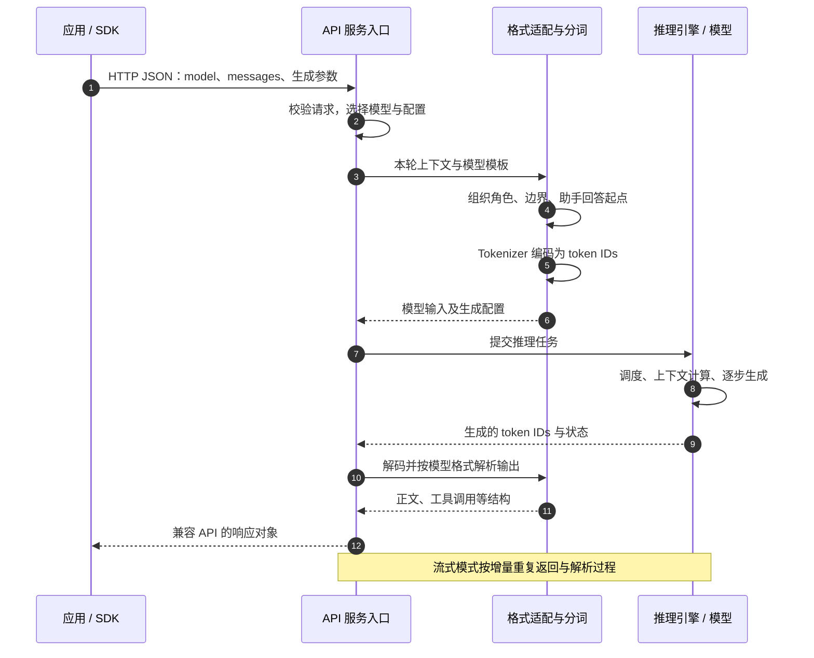

1. Table of Contents, ordered
{:toc}

聊天应用接入多个模型、支持连续追问后，既要适配接口和输入格式，又要保存历史。这些工作分属不同层，统一 API 只解决其中一部分。

## 接入多个模型：用统一 API 复用调用代码

如果每个平台的请求字段、响应结构和流式格式都不同，换模型就要重写接入代码。OpenAI-compatible 服务通过兼容这些约定，让应用在双方支持的能力范围内，只调整服务地址、认证信息和模型名称即可复用调用代码。

早期 Completions 接收一段 `prompt`，返回续写。聊天还需要区分应用规则、用户提问和助手回答，Chat Completions 因此使用带角色的 `messages`。例如，向 `POST /v1/chat/completions` 提交：

```json
{
  "model": "<模型 ID>",
  "messages": [
    {"role": "system", "content": "用中文简洁回答。"},
    {"role": "user", "content": "你好。"}
  ]
}
```

`model` 选择模型，`role` 表示消息身份，`content` 是内容。这里用 `system` 对照后面的三个开源模型；实际支持的角色和参数应按[接口文档](https://developers.openai.com/api/reference/resources/chat/subresources/completions/methods/create)核对。

从 OpenAI 的公开发布顺序看，**先有区分用户与助手的对话模型，再有公开的聊天 API**：[2022 年 11 月 30 日发布 ChatGPT 时](https://openai.com/index/chatgpt/)，已介绍由训练人员分别扮演用户和助手提供对话数据；[2023 年 3 月 1 日](https://community.openai.com/t/introducing-chatgpt-and-whisper-apis/80485)才开放 ChatGPT API。公开时间线不能证明内部设计的先后，也不意味着当时的模型直接接收今天的 `role/content` JSON。

## 同一份 messages，需要不同的模型输入

HTTP 服务能解析这份 JSON，不代表模型能直接读取它。**常见的因果语言模型计算的是 token 序列；聊天微调让模型学会按序列中的角色与边界继续生成。** 不同模型的训练格式不同，服务必须据此转换输入。

[Chat Template](https://huggingface.co/docs/transformers/chat_templating)负责把消息正文、角色、边界和助手回答起点排列成模型熟悉的格式，再由 tokenizer 编码为 token IDs。

Transformers 的 `tokenizer.apply_chat_template(messages, ...)` 就能在本地完成模板渲染，并可继续分词。**它复用 `role/content` 数据结构，不需要经过 OpenAI HTTP API，也不依赖 vLLM 或模型权重。** 模板通常随 tokenizer 配置发布，由软件执行；模型学习的是对应序列的含义，不会直接解析 Python 字典。vLLM 等服务则把这套输入准备流程接到 HTTP 请求和推理执行上。

下面将前面相同的两条消息交给三个模型的格式。代码块展示可读拼写，不是整数 ID；本次只检查输入，没有运行模型生成回答。Qwen 与 DeepSeek 使用固定版本模板实际渲染，Llama 按官方参考实现重建。

### Qwen3：消息边界加角色名称

使用[固定版本的 Qwen3-8B 模板](https://huggingface.co/Qwen/Qwen3-8B/blob/b968826d9c46dd6066d109eabc6255188de91218/tokenizer_config.json)，传入 `add_generation_prompt=True`、`enable_thinking=False`：

```text
<|im_start|>system
用中文简洁回答。<|im_end|>
<|im_start|>user
你好。<|im_end|>
<|im_start|>assistant
<think>

</think>

```

`<|im_start|>` 开启消息，后接角色名称；`<|im_end|>` 结束消息。末尾开启 assistant 消息，让模型接着生成。关闭 thinking 时出现的空思考块是**模板预填的输入**，精确尾部为：

```python
'<|im_start|>assistant\n<think>\n\n</think>\n\n'
```

### Llama 3.1：角色头与正文分别定界

按 [Meta 官方格式](https://github.com/meta-llama/llama-models/blob/0e0b8c519242d5833d8c11bffc1232b77ad7f301/models/llama3_1/prompt_format.md)和 [ChatFormat 实现](https://github.com/meta-llama/llama-models/blob/0e0b8c519242d5833d8c11bffc1232b77ad7f301/models/llama3/chat_format.py)重建：

```text
<|begin_of_text|><|start_header_id|>system<|end_header_id|>

用中文简洁回答。<|eot_id|><|start_header_id|>user<|end_header_id|>

你好。<|eot_id|><|start_header_id|>assistant<|end_header_id|>

```

`<|begin_of_text|>` 开始序列，两个 header 标记包住角色名称，之后两个换行引出正文，`<|eot_id|>` 结束消息。末尾只留下助手头和两个换行。

这是**官方参考格式的重建，不是 Hugging Face 模板实测**；具体部署可能额外加入日期、工具说明等内容。

### DeepSeek V3：system 正文直接置于开头

[DeepSeek-V3-0324 的固定版本模板](https://huggingface.co/deepseek-ai/DeepSeek-V3-0324/blob/e9b33add76883f293d6bf61f6bd89b497e80e335/tokenizer_config.json)在 `add_generation_prompt=True` 时输出一整行：

```text
<｜begin▁of▁sentence｜>用中文简洁回答。<｜User｜>你好。<｜Assistant｜>
```

system 正文直接放在序列起点后面，没有单独的 `<｜System｜>`；用户和助手使用各自的标记。这里的 `｜` 是全角竖线，`▁` 也不是普通下划线。

### 格式差异会影响模型行为

这些例子中，角色名称可能是普通文本；有独立 ID 的标记，也不一定在 tokenizer 元数据中标为 `special`。**应检查实际模板与编码，不能凭符号外观判断。** [格式复核脚本](/assets/code/openai-chat-templates/compare_templates.py)固定了上述来源，可用 `uv run compare_templates.py` 打印完整结果。

[Qwen3 Reranker 的评分实验](/posts/2026/10/15/qwen3-reranker-scoring-chat-template/)展示了这种差异的后果：输入末尾少一个换行，就会改变预测与排序。那里的评分输入只保留一个末尾换行，不能套用上面的通用聊天模板。HTTP 请求成功，只证明外部接口接受了请求，不能证明模型输入正确。

## 自部署：由 vLLM/SGLang 接通整条链路

模板只能准备输入。要把模型提供给多个应用，还需要接收 HTTP 请求、加载权重、调度计算、生成结果并组装响应。[vLLM](https://docs.vllm.ai/en/stable/serving/online_serving/openai_compatible_server/) 和 [SGLang](https://docs.sglang.io/docs/basic_usage/openai_api_completions)提供这些能力，包括 OpenAI-compatible 服务与模型格式适配。

分工是：**模型开发者约定训练格式，框架执行转换与推理，部署者选择匹配的 tokenizer、模板和解析器。** [SGLang](https://docs.sglang.io/docs/references/custom_chat_template)例如默认使用 Hugging Face tokenizer 的 chat template，也允许覆盖。平台可以复用这些实现，但仍需验证配置是否与模型匹配。

### 一次纯文本聊天请求的完整时序

以下假设应用已提供本轮完整上下文；图中是逻辑职责，不要求分属独立进程：



OpenAI 自身也需把公开接口转换为内部输入，但其闭源实现不能据此推定为相同的 Jinja 模板或组件。要直接观察本地转换过程，可看[用一个程序看清 LLM 的输入](/posts/2026/10/19/transformers-direct-chat-template-tokenizer/)：打印消息、模板文本、token IDs 和最终输入张量，并对比参数变化。

**转换由谁执行，取决于入口。** Reranker 实验中，`/v1/rerank` 接收问题与文档，由服务套用评分模板；raw `/pooling` 路径接收已拼好的输入，格式责任就在客户端。

## 多轮对话需要保存和恢复历史

用户先说“你好”，再问“我刚才说了什么”，第二次调用就需要前文。聊天界面显示着历史，不代表模型已取得它；模板也只能排列收到的内容。

使用 Chat Completions 时，通常由应用保存先前消息，把选定的历史和新问题一起放进下一次 `messages`。应用可以先删减、摘要或补入检索材料。**上下文管理决定提供哪些信息，Chat Template 决定这些信息怎样排列。**

### Responses 可以接手一部分历史管理

如果每次都只想继续上轮对话，手动保存、组装和重传历史会增加应用负担。Responses 提供可选的状态托管，同时保留手动控制方式。[会话状态文档](https://developers.openai.com/api/docs/guides/conversation-state)介绍了三种用法：

| 方式 | 下一轮提交什么 | 历史由谁组织 |
|---|---|---|
| 手动回传 | 所需历史记录和新输入 | 应用 |
| `previous_response_id` | 某次响应 ID 和新输入 | 服务按响应关系取得上下文 |
| `conversation` | 会话 ID 和新输入 | 服务维护持续使用的会话容器 |

例如，向 `POST /v1/responses` 提交：

```json
{
  "model": "<模型 ID>",
  "previous_response_id": "resp_上一轮响应",
  "instructions": "用中文简洁回答。",
  "input": "我刚才说了什么？"
}
```

这里重新传入 `instructions`，因为使用 `previous_response_id` 时，上一次请求的顶层指令不会自动继承。

### 类似 Session，但状态保存在 API 服务层

这可以类比 Servlet Session：调用方提交标识，服务端找回状态。`conversation` ID 更像持续使用的 Session ID；`previous_response_id` 指向一次具体响应，也可以从旧响应接续出分支。它们是显式 API 参数，不是自动发送的浏览器 Cookie。

**历史由模型外围的服务系统保存，再组织成本轮上下文。** 历史没有写进模型权重，用户也不需要独占一份常驻模型。KV cache 用于复用推理计算，同样不等于持久对话记录。

少传历史只减少客户端的传输和管理工作：上下文窗口仍有限，使用 `previous_response_id` 时，历史输入仍参与 token 计费。托管状态也不替应用决定所有业务信息该不该进入上下文。

## Responses 还要表达工具与多步任务

用户要求“查询订单并解释延迟原因”时，模型需要请求查询、取得结果，再生成回答。历史里需要保存的不只是聊天正文，还有调用名称、参数和执行结果。

Chat Completions 已通过 `tool_calls` 和 `role: tool` 支持这种往返。Responses 则把不同记录表示为独立的 **Items**：

| Item 类型 | 用途 |
|---|---|
| `message` | 用户或助手消息 |
| `function_call` | 请求调用函数，携带名称、参数和 `call_id` |
| `function_call_output` | 回传执行结果，用 `call_id` 匹配调用 |

对于[自定义函数](https://developers.openai.com/api/docs/guides/function-calling)，模型返回调用请求，由应用执行并把结果交回；平台托管工具可由平台执行。`call_id` 只负责配对，接续任务仍需状态引用或所需历史。自行管理上下文时，还应按[模型要求](https://developers.openai.com/api/docs/guides/reasoning)保留必要的推理状态 Items，不能只存界面上显示的文字。

因此，[Chat Completions 到 Responses 的演进](https://developers.openai.com/api/docs/guides/migrate-to-responses)有两条主线：**用状态引用减少历史管理工作，用有类型的 Items 和事件表达多步任务。** 它没有让模型本身变成管理用户 Session 的服务器。

更换模型或平台时，也应分别检查这三件事：

- **接口兼容**：请求、响应、流式事件和所用状态能力能否继续使用。
- **输入对齐**：tokenizer、模板、生成起点和输出解析器是否匹配模型。
- **任务有效**：相同业务材料下，答案、工具选择或评分结果是否仍符合要求。

OpenAI-compatible 降低的是接入成本；它本身不保证模型行为一致，也不保证平台提供相同的会话存储和恢复能力。
