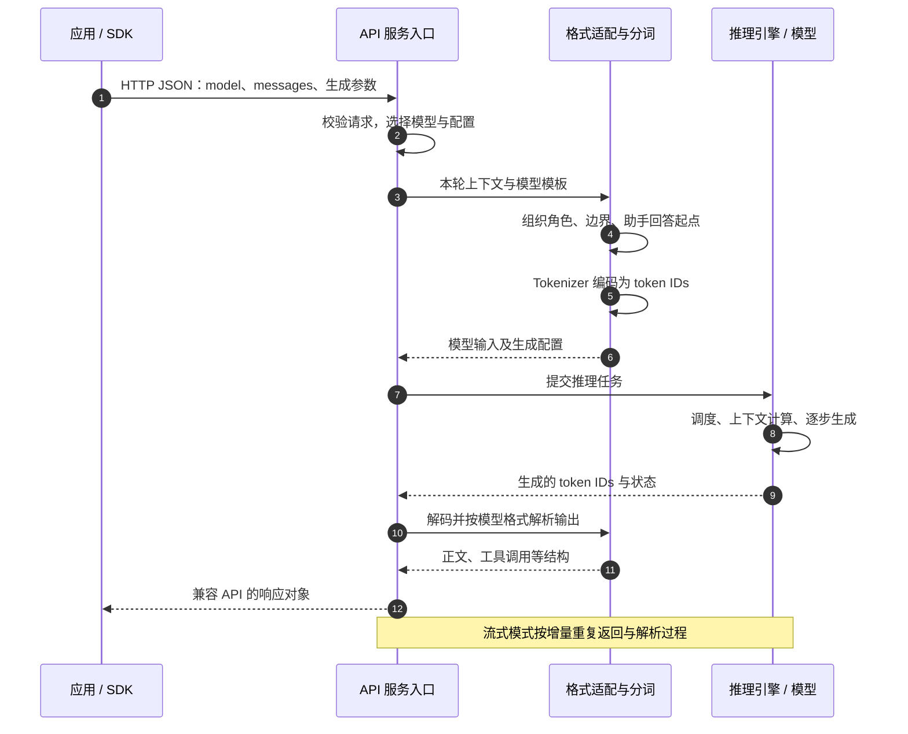
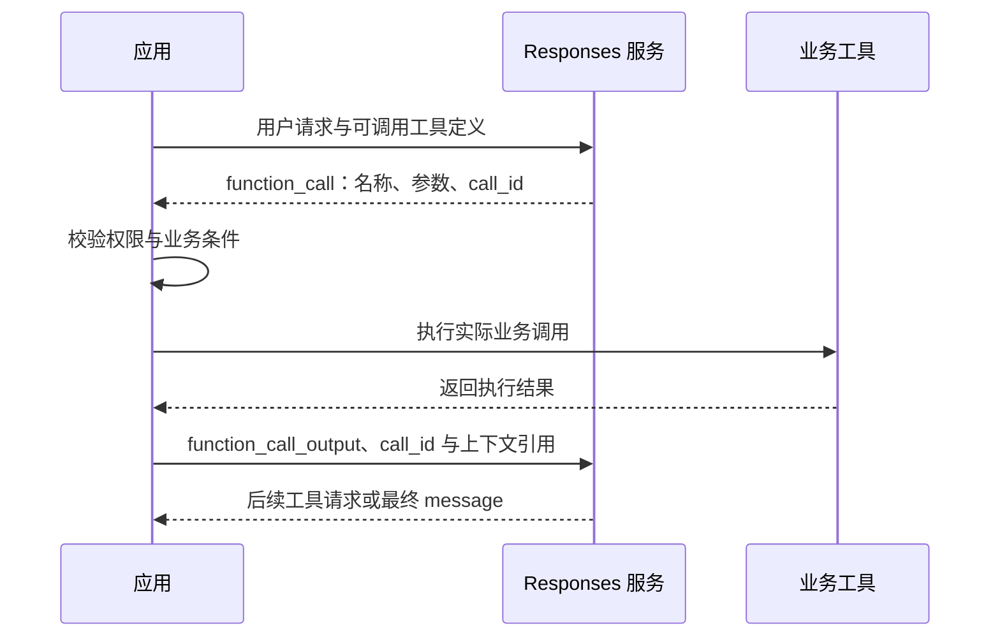

1. Table of Contents, ordered
{:toc}

给应用加一个聊天功能，第一次实验可能只需要把用户的问题交给模型，再把生成的文字显示出来。但产品很快会增加要求：回答要遵守固定规则，用户要能连续追问，还想比较不同模型的效果，或者将其中一个模型部署在自己的服务器上。

这些要求会让一次简单调用逐渐变复杂。同一段对话，换个服务可能就要重写请求和响应处理；即使请求字段一致，不同模型也可能要求不同的输入排列；等用户开始追问，应用还要找回历史。如果助手进一步需要查询订单，返回值里又会出现需要程序执行的动作。

这些工作分别发生在哪里，决定了应用更换模型时要改多少代码，也决定了自部署到底需要搭建哪些组件。可以从最先遇到的重复接入开始，沿着问题逐层向下看。

## 接入多个模型时，重复代码开始增加

假设聊天界面已经能使用一个模型，现在要加入第二个。如果两个服务的输入字段、输出位置、流式片段都不同，应用就要维护两套调用逻辑。第三个模型到来时，相同工作还会重复，而用户要做的仍然只是发送问题、读取回答。

### 对话需要表达角色，不能只依赖一段文本

在统一调用方式之前，先要明确应用实际需要提交什么。早期 Completions 将输入表示为一段 `prompt`，模型返回续写。这适合文本补全；用于聊天时，应用还得在这段文本里安排规则、用户问题和先前回答，并让它们的边界保持清楚。

例如，“用中文简洁回答”是应用的固定要求，“你好”是用户刚发送的内容。若接口只接收一段文字，这两种身份只能通过调用方约定的文本格式表达。**把对话直接建模为带角色的消息，可以让应用显式提交这些区别。** Chat Completions 采用的就是这种交互方式。[OpenAI 对接口演进的说明](https://developers.openai.com/blog/responses-api)将文本续写与角色化对话作为两个不同阶段的抽象。

### 用兼容接口复用请求与响应处理

有了消息结构，再让不同服务接受相同的请求约定，应用就可以复用接入代码。Chat Completions 的典型入口是 `POST /v1/chat/completions`，例如：

```json
{
  "model": "<模型 ID>",
  "messages": [
    {"role": "system", "content": "用中文简洁回答。"},
    {"role": "user", "content": "你好。"}
  ]
}
```

`model` 选择服务端部署的模型，`messages` 提供本次生成所需的对话。消息还有 `assistant`、`tool` 等角色，分别承载先前的助手输出和工具结果；内容也可按模型能力扩展为图片、音频等有类型的部分。[OpenAI 的接口参考](https://developers.openai.com/api/reference/resources/chat/subresources/completions/methods/create)定义了这些字段。

这里使用 `system`，是为了给后面的三个开源模型提供同一组可比较的输入。OpenAI 当前文档对 o1 及更新模型推荐使用 `developer` 承载开发者指令；具体服务支持哪些角色，仍需按模型和接口核对。

**应用依赖的是接口契约：请求怎么组织、输出怎么读取、流式片段怎么处理。** OpenAI-compatible 表示另一个服务实现了其中一部分兼容契约。对于双方都支持的普通聊天能力，应用就可能只调整服务地址、认证信息和模型名称，继续使用 OpenAI SDK。

这解决的是重复接入问题：谁在说话、说了什么，可以用一套结构提交。它还没有解决另一个问题——部署在服务后面的模型，是否也使用同一套输入格式。

## 接口统一后，模型仍要求各自的输入格式

现在把同一份 `messages` 分别发给三个模型。HTTP 服务都能解析这份 JSON，并不意味着模型已经获得了符合其训练约定的输入：模型需要知道规则在哪里结束、用户内容从哪里开始，以及接下来应该由谁回答。

### 用 Chat Template 对齐模型训练时的格式

对常见的因果语言模型而言，计算的对象是 token 序列。[Hugging Face 的 Chat Template 文档](https://huggingface.co/docs/transformers/chat_templating)指出：聊天微调后的模型仍然续写序列，只是训练数据使用了带角色和边界的格式。即便来自同一基座，不同微调模型也可能采用不同标记。

因此，服务不能仅凭 `{"role": "user"}` 这个 JSON 属性，就假定所有模型都已正确获得用户角色。它需要把这层应用语义写进每个模型熟悉的输入结构。**Chat Template 承担的就是这项序列化工作：放入消息正文，同时确定角色、消息边界和接下来从哪里继续生成。**

### 用相同消息观察三种转换结果

保持前面的 system 和 user 两条消息不变，分别代入 Qwen3、Llama 3.1 和 DeepSeek V3 的格式，就能看到适配层究竟补了什么。本次选取以下具体版本：Qwen 和 DeepSeek 使用固定提交中的官方 Jinja 模板进行本地渲染；Llama 使用 Meta 官方简单对话格式与序列化实现重建可见拼写。

| 模型样本 | 格式依据 | 本次处理 |
|---|---|---|
| `Qwen/Qwen3-8B` | 官方配置 `b968826d…` | 真实渲染模板，显式 `enable_thinking=False` |
| Llama 3.1 Instruct | Meta `llama-models` 提交 `0e0b8c51…` | 按官方参考格式重建；不是 Hugging Face 模板实测 |
| `deepseek-ai/DeepSeek-V3-0324` | 官方配置 `e9b33add…` | 真实渲染模板 |

两份 Jinja 模板都传入 `add_generation_prompt=True`，表达开始助手回答的意图；实际如何实现，由模板决定。本次只检查输入准备过程，**没有加载模型权重，也没有让模型生成回答**。

代码块展示的是控制 token 的可读拼写和普通文本，并不是整数 ID 列表。通常可以先渲染字符串，再由 tokenizer 编码；有的实现也会直接把控制 token ID 与正文编码拼接起来，不必先构造完整字符串。两种实现都需要满足模型的格式约定。

### Qwen3：消息边界加角色名称

[固定版本的 Qwen3-8B 配置](https://huggingface.co/Qwen/Qwen3-8B/blob/b968826d9c46dd6066d109eabc6255188de91218/tokenizer_config.json)把相同消息渲染成：

```text
<|im_start|>system
用中文简洁回答。<|im_end|>
<|im_start|>user
你好。<|im_end|>
<|im_start|>assistant
<think>

</think>

```

`<|im_start|>` 开启消息，后面是角色名称与换行；`<|im_end|>` 关闭已有消息。最后开启 assistant 消息，却不关闭它，模型将从这里接着生成。

本例关闭 thinking 后，模板还在输入末尾放入一个空的思考块。这些标签是**模板预填的输入**，不能理解为模型先思考了一遍，然后把思考内容清空了。精确的尾部是：

```python
'<|im_start|>assistant\n<think>\n\n</think>\n\n'
```

在 [Qwen3 Reranker 的评分实验](/posts/2026/10/15/qwen3-reranker-scoring-chat-template/)中，对齐后的评分输入只保留一个末尾换行，而本例使用通用 Qwen3 聊天模板。模型家族相同，也不能混用不同任务的输入构造。

### Llama 3.1：角色头与正文分别定界

按 [Meta 官方的 Llama 3.1 格式说明](https://github.com/meta-llama/llama-models/blob/0e0b8c519242d5833d8c11bffc1232b77ad7f301/models/llama3_1/prompt_format.md)和 [ChatFormat 参考实现](https://github.com/meta-llama/llama-models/blob/0e0b8c519242d5833d8c11bffc1232b77ad7f301/models/llama3/chat_format.py)，同一组消息表示为：

```text
<|begin_of_text|><|start_header_id|>system<|end_header_id|>

用中文简洁回答。<|eot_id|><|start_header_id|>user<|end_header_id|>

你好。<|eot_id|><|start_header_id|>assistant<|end_header_id|>

```

`<|begin_of_text|>` 标记序列起点；`<|start_header_id|>` 与 `<|end_header_id|>` 包住角色头，之后的两个换行才引出正文；已有消息以 `<|eot_id|>` 结束。最后只追加助手头和两个换行：

```python
'<|start_header_id|>assistant<|end_header_id|>\n\n'
```

`system`、`user`、`assistant` 仍然是普通角色名称文本，结构由周围的控制标记建立。这和 Qwen 的头部布局不同，但可以表达相同的应用消息。

**这是 Meta 官方参考格式的示例，不代表每个部署的完整默认 prompt。** 本次未取得 gated Hugging Face 仓库中的模板；具体分发模板可能额外插入日期、工具说明等内容。部署验收应检查实际加载的模板，而不是仅凭“Llama 3.1”这个名字推定完整输入。

### DeepSeek V3：system 正文直接置于序列开头

[DeepSeek-V3-0324 的固定版本模板](https://huggingface.co/deepseek-ai/DeepSeek-V3-0324/blob/e9b33add76883f293d6bf61f6bd89b497e80e335/tokenizer_config.json)输出更紧凑，以下内容是一整行，没有换行：

```text
<｜begin▁of▁sentence｜>用中文简洁回答。<｜User｜>你好。<｜Assistant｜>
```

这里没有 `<｜System｜>`：system 正文直接放在序列起点后面。用户和助手分别由 `<｜User｜>`、`<｜Assistant｜>` 标识。本次输入没有 `<think>`，不能把 DeepSeek R1 或其他版本的行为套到这个 V3 模板上。

这组拼写中的 `｜` 是全角竖线，`▁` 也不是普通下划线，替换成外观相似的 ASCII 字符就改变了输入。该固定模板的 user 分支已经追加助手标记，因此这组输入即使传入 `add_generation_prompt=False`，结果也相同；参数名表达意图，具体效果仍由模板实现。

### 格式差异需要按实际编码核对

三种结果表明，相同的对话语义需要不同的消息边界与生成起点。部署时如果只复制肉眼看起来相似的符号，就可能改变输入：有的标记有独立 token ID，有的角色名称是普通文本；即便有独立 ID，也不一定被 tokenizer 元数据标为特殊 token。

| 模型 | 独立标记的例子 | 配置或实现中的性质 |
|---|---|---|
| Qwen3 | 消息开始、结束标记，ID 为 151644、151645 | `special: true` |
| Qwen3 | `<think>`、`</think>`，ID 为 151667、151668 | 各有独立 ID，但 `special: false` |
| Llama 3.1 | 序列起点、角色头边界、消息结束标记 | Meta tokenizer 列出的特殊 token |
| DeepSeek V3 | 序列起点，ID 为 0 | `special: true` |
| DeepSeek V3 | User、Assistant 角色标记，ID 为 128803、128804 | 各有独立 ID，但 `special: false` |

这些属性来自上述固定 Qwen 配置、[Meta tokenizer 定义](https://github.com/meta-llama/llama-models/blob/0e0b8c519242d5833d8c11bffc1232b77ad7f301/models/llama3/tokenizer.py)及 [DeepSeek tokenizer 配置](https://huggingface.co/deepseek-ai/DeepSeek-V3-0324/blob/e9b33add76883f293d6bf61f6bd89b497e80e335/tokenizer.json)。**结构作用、是否编码为一个 ID、是否标为 `special`，应分别检查。** 普通正文的分词结果也会因 tokenizer 而异，不只是这些边界标记不同。

这种细节会影响模型行为。在 [Qwen3 Reranker 的评分实验](/posts/2026/10/15/qwen3-reranker-scoring-chat-template/)中，输入末尾少一个换行，就足以改变接下来的预测与排序。HTTP 请求被成功接收，只说明外部结构能够解析，不能证明内部输入已经对齐。

为便于逐字符核对，本文的[格式复核脚本](/assets/code/openai-chat-templates/compare_templates.py)固定了来源提交和配置哈希，打印完整字符串与 `repr`。下载后使用 `uv run compare_templates.py`，或在安装 `jinja2==3.1.6` 的 Python 环境中执行。它只下载两份小型配置文件；Llama 部分明确是参考格式重建，不会尝试访问受限模型文件。

## 自部署还要接通输入、推理与输出

有了三份模板，是否就可以把格式代码分别复制进每个应用？这样虽然能构造输入，却会让所有接入方都承担模型升级的适配工作。而一次可用的服务还需要加载权重、调度并发请求、执行计算，再把输出还原成统一响应，模板只完成了其中一段。

把这些工作集中在部署模型的服务侧，应用就可以保持相同的调用方式，由平台维护模型特定的配置和执行流程。vLLM、SGLang 这类推理框架为自部署提供了这样的基础。

### 由推理框架承接服务入口与模型计算

使用 `vllm serve` 时，框架提供 OpenAI-compatible HTTP 服务，并根据模型配置应用聊天模板。其 [V1 架构](https://docs.vllm.ai/en/stable/design/arch_overview/)进一步区分：API Server 处理 HTTP、输入和流式结果；Engine Core 调度请求、管理 KV cache、协调计算；GPU Worker 加载权重并执行模型前向计算。

SGLang 也提供 [OpenAI-compatible Chat Completions](https://docs.sglang.io/docs/basic_usage/openai_api_completions)。其[模板文档](https://docs.sglang.io/docs/references/custom_chat_template)说明，服务默认使用 Hugging Face tokenizer 的 chat template，并允许通过 `--chat-template` 覆盖。

这样，应用可以继续通过 OpenAI SDK 提交消息，由 SDK 将请求发送到配置的 `base_url`；模型格式适配放在服务端。框架还承担运行模型的工作，因此需要进一步区分谁定义格式、谁执行转换、谁负责计算：

| 责任 | 主要承担者 |
|---|---|
| 决定本次任务、业务规则和需要提供的材料 | 应用 |
| 约定模型的角色、边界与输出格式 | 模型开发者，通过训练和发布配置确定 |
| 执行模板、分词、解码与模型特定解析 | 框架的服务与适配组件 |
| 调度请求、复用计算、运行模型 | 推理引擎与执行组件 |
| 选择正确模板、解析器与部署参数，并验证结果 | 推理平台或自行部署者 |

服务平台可以复用模型配置和框架实现，不必从零编写这些步骤。但平台仍需保证加载的模板与模型匹配。OpenAI 自身也需要将公开接口转换为内部模型输入；其闭源服务的具体实现，不能由这张开源服务示意图推定为同一套 Jinja 或组件布局。

### 一次纯文本聊天请求的完整时序

将这些职责放回一次实际请求，就能看清应用的消息在哪里变成模型输入，模型结果又在哪里变回 API 响应。图中的参与者是逻辑职责，不要求分别运行在独立进程中；本例先假设应用已经提供了完整上下文。



模板渲染通常是确定性的格式处理，不需要先运行一次模型。tokenizer 将内容编码成模型输入；随后引擎组织模型计算。输出还要经历反向适配：生成的 token 被解码，并按模型格式解析成正文、工具调用等字段。多模态会额外涉及图片、音频等预处理，这张纯文本图没有展开。

[vLLM 的 Renderer 文档](https://docs.vllm.ai/en/stable/serving/online_serving/renderer/)直接展示了这种分层：预处理和后处理可以与引擎分离，甚至不使用 GPU；引擎可以提供接收和返回 token 的服务。HTTP JSON 因而不是神经网络的原生调用格式。

### 调用原始输入端点时，格式责任会回到调用方

服务端适配减少了应用的工作，但这个便利以端点接收结构化消息为前提。如果为了控制精确输入而改用接受原始 prompt 或 token IDs 的路径，调用方就需要提前组织模型格式。

[Qwen3 Reranker 文章中的两条路径](/posts/2026/10/15/qwen3-reranker-scoring-chat-template/#rerank-与-pooling分别把什么交给-vllm)就是具体例子：`/v1/rerank` 接收问题和文档，由服务执行评分模板；该实验中的 raw `/pooling` 接收已经拼好的输入，客户端负责格式构造。两条路径最终都要到达模型要求的输入序列，只是转换发生的位置不同。

这套分工已经能让助手完成一次回答。不过，下一轮用户如果只发来“我刚才说了什么”，格式再正确也无法补出缺失的前文。单次调用跑通之后，对话的连续性成为下一项需要解决的工作。

## 第二轮请求需要找回第一轮的信息

聊天界面保留着旧消息，不代表本次模型调用已经取得它们。用户先说“你好”，再问“我刚才说了什么”，如果后端只提交后一条消息，模型就缺少回答所需的依据。模板能够排列收到的历史，却不会凭空找回没有提交的内容。

### 由应用保存并回传历史，让对话接续

使用 Chat Completions 时，一个直接的办法是由应用保存先前消息，再把它们加入下一次请求：

```json
[
  {"role": "system", "content": "用中文简洁回答。"},
  {"role": "user", "content": "你好。"},
  {"role": "assistant", "content": "你好，有什么可以帮你？"},
  {"role": "user", "content": "我刚才说了什么？"}
]
```

这里的助手回答只是示例历史，不是前面模板实验的生成结果。应用可以在提交前删除无关记录、摘要旧内容，或加入检索材料。服务拿到这份上下文后，再执行前面的格式转换。

这两项职责应分别理解：**上下文管理决定本轮使用哪些信息，模型适配决定这些信息怎样变成模型输入。** 应用手动维护历史，也不意味着 API 平台完全不保存请求日志；推理所用上下文与平台的数据留存策略属于不同问题。

### 历史维护增加后，可以把状态交给 API 服务

手动回传让应用拥有直接控制权，但对话越长，需要维护的工作也越多：保存每轮输入与输出、决定本轮带上哪些内容、将它们重新组装并传输。即便应用只想继续上一轮，也需要完成这些步骤。

如果平台已经保存了上一轮，应用就可以只说明“从这里继续”，让服务找到前序内容。**Responses 提供了这种可选的状态接续能力，将历史保存与恢复的一部分工作交给 API 服务层。** 它仍然允许应用自行控制历史，并没有强制把全部上下文决策交给平台。

[OpenAI 的迁移指南](https://developers.openai.com/api/docs/guides/migrate-to-responses)与[会话状态文档](https://developers.openai.com/api/docs/guides/conversation-state)介绍了三种常见方式。Responses 将输入输出中的记录表示为 Items（条目），后续请求既可以直接携带这些记录，也可以引用平台保存的状态：

| 方式 | 应用下一轮主要提供什么 | 上下文由谁组织 |
|---|---|---|
| 手动回传 | 已选择的历史 Items 和新输入 | 应用显式组织 |
| `previous_response_id` | 前一个响应 ID 和新输入 | 平台按前序响应关系取得上下文 |
| `conversation` | 持续使用的会话 ID 和新输入 | 平台维护该会话容器的内容 |

以下是接续请求的示意，省略其他业务配置：

```json
{
  "model": "<模型 ID>",
  "previous_response_id": "resp_上一轮响应",
  "instructions": "用中文简洁回答。",
  "input": "我刚才说了什么？"
}
```

应用不必再通过网络重传整份历史，但历史仍需要在本次推理中发挥作用。这里特意重新提供 `instructions`：通过 `previous_response_id` 接续时，上一次请求的顶层 `instructions` 不会自动继承。

### 状态托管改变服务分工，不改变模型的输入需求

应用只传一个引用后，历史并没有消失：服务仍需取得相关记录，为当前推理组织上下文。这与 Servlet 容器管理 Session 有相似之处：客户端提交标识，服务端找到对应状态，再处理本次请求。

| Servlet 体系 | 模型 API 中可类比的对象 |
|---|---|
| 调用方携带 Session ID | 应用传入 `conversation` ID |
| 服务端保存会话数据 | 平台保存消息、工具调用与结果等 Items |
| 容器取得状态后调用业务逻辑 | 平台组织上下文后调用模型推理 |

`conversation` ID 更像持续使用的 Session ID；`previous_response_id` 则指向一次具体响应，表达从哪一步继续，也能从旧响应产生分支。它们通过 API 参数显式传入，不是浏览器自动发送的 Cookie，更不是用户身份凭证的替代物。

**会话状态由模型外围的服务系统维护。** 这并不意味着用户的历史被写进模型权重，或者每位用户占有一份常驻的专属模型。引擎里的 KV cache 又是另一类状态：它用于复用推理计算，不能直接充当持久对话记录的业务语义。

[会话状态文档](https://developers.openai.com/api/docs/guides/conversation-state)同时明确了两个限制：上下文窗口仍有上限；使用 `previous_response_id` 时，链中的历史输入仍参与输入 token 计费。**减少客户端传输和编排工作，不等于消除上下文长度与使用成本。**

接口兼容、格式转换与会话托管因此是三个独立承诺。一个服务能接受 Chat Completions 请求，不能据此推断它也具备与 OpenAI 相同的 Conversation 持久化、响应引用期限和恢复语义。

## 多步任务需要保存的不只是聊天正文

历史能够接续后，助手还可以继续增加能力。假设用户要求“查一下我的订单，告诉我为什么还没送到”，模型需要先取得订单与物流信息，再根据结果回答。此时，上一轮记录中需要保留的已经不只是用户和助手说过的话。

### 查订单需要区分展示内容与执行动作

助手返回“正在查询订单”，不能代替真正的业务查询。应用需要知道调用哪个函数、传什么参数、结果对应哪次调用，以及什么时候把结果交回模型。如果把执行结果只展示给用户而没有放入后续上下文，模型仍然无法据此回答。

Chat Completions 已经通过助手消息中的 `tool_calls` 和 `role: tool` 消息支持这种往返。应用可以基于它实现工具任务，但同时要管理调用、执行结果和后续消息；加入推理状态、平台托管工具和多种输出后，还要处理更多不同性质的记录。

因此，演进的目标不只是少传几条历史，还包括让接口更直接地表达一次任务中的不同动作。前面讨论的状态托管解决“怎样接续”，接下来的类型设计则解决“接续的记录各自表示什么”。

### 用 Items 表达消息、调用和结果

Responses 将 `message`、`function_call`、`function_call_output` 等作为不同类型的 Item。每类记录拥有自己的结构，应用可以按类型决定展示文本、执行函数或提交结果，并将它们组合成连续过程。工具请求与回传结果通过 `call_id` 关联；模型输出位于 `output`，应用将工具执行结果作为后续 `input` 提交。



图中的 `call_id` 只负责匹配工具请求与结果；接续任务仍需传入 `previous_response_id`、使用 `conversation`，或由应用回传所需历史。这个例子使用的是应用自定义函数：模型返回调用请求，应用执行代码。平台托管的搜索、代码解释器等工具，可以由平台完成相应执行。两种方式的执行责任不能混为一谈。[Function calling 文档](https://developers.openai.com/api/docs/guides/function-calling)给出了自定义函数的完整往返流程。

任务继续执行时，仅保存聊天气泡里的文字也可能遗漏必要状态。推理模型可能产生需要保留的推理状态条目；按模型和接口约定传递它们，可以让后续步骤使用已有状态。这不等于向开发者返回原始内部思维全文。自行维护 Responses 上下文时，也不能只保留可见文本而随意丢弃其他需要回传的 Items，应遵循[推理模型的状态传递要求](https://developers.openai.com/api/docs/guides/reasoning)。

界面也需要区分“文字还在输出”和“当前响应已经结束”。Responses 的流式返回因而采用语义事件：例如 `response.output_text.delta` 表达文本增量，`response.completed` 表达当前响应完成，客户端可以按事件类型处理进展。整个业务任务是否结束，还取决于响应中是否有待执行的工具调用等后续工作。[流式文档](https://developers.openai.com/api/docs/guides/streaming-responses)说明了这些事件的消费方式。

### 接口演进跟随需要表达的工作增加

从文字续写到多轮对话，再到带工具的连续任务，应用需要表达的内容不断增加。[OpenAI 对 Responses 设计动机的说明](https://developers.openai.com/blog/responses-api)也将这条演进与模型的推理、多模态和工具能力联系起来。按前面遇到的问题，可以这样理解各阶段的设计意义：

| 遇到的问题 | 接口提供的抽象 | 减少的应用工作 |
|---|---|---|
| 程序需要调用文本续写能力 | Completions：prompt 与补全文本 | 通过 API 使用服务端生成能力 |
| 对话中要区分规则、用户和助手，还希望复用接入代码 | Chat Completions：角色化消息与响应契约 | 不必让每个调用方在接口外自行约定消息结构 |
| 任务要接续历史，并处理消息、工具、推理等不同记录 | Responses：状态引用、有类型的 Items 和事件 | 可选择减少历史回传，并按类型组织任务过程 |

**Chat Completions 到 Responses 的变化包含状态接续与任务表达两条线。** 会话托管将一部分管理工作移到 API 服务；Items 和事件则让多步过程更直接地体现在接口中。这些能力并不要求模型本身变成一个保存用户 Session 的服务器。

## 迁移模型时，需要检查每一层是否仍然成立

助手已经能聊天、追问和查订单，现在再次更换模型或平台，最初的接入问题就有了新的范围。普通聊天代码可能仍能复用，但原平台的会话 ID 未必能在新平台恢复历史，用到的工具、角色与推理参数也未必全部兼容。服务返回成功，无法单独证明整个助手仍能完成原来的任务。

[vLLM 的兼容文档](https://docs.vllm.ai/en/stable/serving/online_serving/openai_compatible_server/)明确列出了支持范围和参数差异。检查迁移时，应沿着前面建立的分工，分别确认外部接口、内部适配和实际任务：


1. **接口是否兼容**：请求、响应、流式事件以及用到的状态能力能否被正确处理。
2. **适配是否正确**：模型、tokenizer、模板、生成起点和输出解析器是否匹配，最终输入是否符合预期。
3. **任务是否仍然完成**：在相同业务材料与验收标准下，答案、工具选择或评分结果是否达到要求。

Qwen3 Reranker 的换行问题落在第二层，却最终表现为第三层的证据召回下降。请求成功和分数范围正常，都没有证明模型正在读取相同位置的判断信号。这也是关联两篇文章的实际价值：统一 API 帮助复用接入代码，具体输入和任务回归则保证这种复用仍然有效。

截至本文核查，OpenAI 仍支持 Chat Completions，并推荐新项目优先使用 Responses。选择时应结合需要的模型与工具能力，同时决定哪些上下文由应用显式控制、哪些状态交给平台托管。**调用代码能够复用、上下文能够接续、业务结果能够保持，是需要分别验证的三个目标。**
