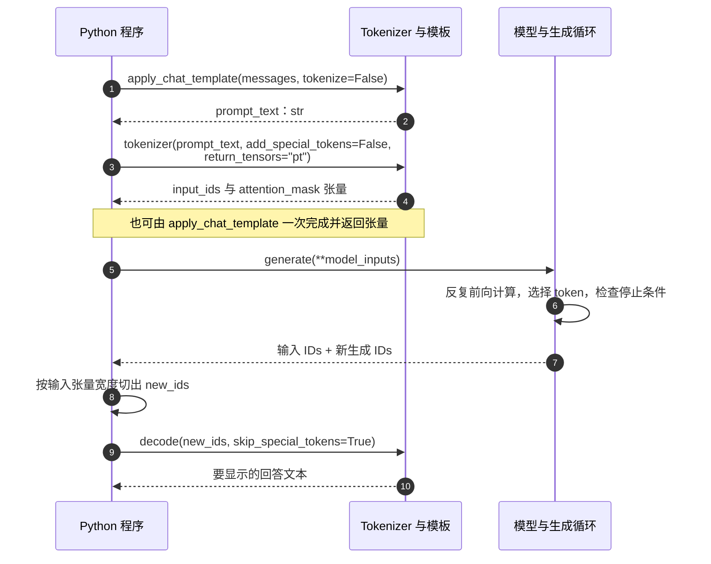

1. Table of Contents, ordered
{:toc}

通过聊天 API 调用模型时，应用提交 `messages`，再读取服务返回的回答。但如果希望确认模型实际收到了哪些 token，或者检查一处换行为什么改变结果，HTTP 请求中的消息列表还不够：需要沿着输入准备和模型计算继续向下看。

把模型直接加载到 Python 进程里，可以逐步检查这条链路。新的困难也随之出现：消息字典不能直接交给神经网络，模板返回的字符串还不是张量，而模型生成的整数序列也不是最终要显示的回答。这些转换都需要调用方明确完成。

[OpenAI API 与模型输入](/posts/2026/10/19/openai-api-context-chat-template-serving/)介绍了 API 服务、模板和推理框架的分工。本篇将其中一次纯文本调用展开成实际代码，以 Hugging Face 的 [Chat templates](https://huggingface.co/docs/transformers/main/en/chat_templating) 和 [Writing a chat template](https://huggingface.co/docs/transformers/main/en/chat_templating_writing) 为起点，再用固定版本的库、模型配置与运行结果核对函数行为。

## 不启动 API 服务，输入准备就由本地程序承担

要在本地回答一句“你好”，程序至少需要两类材料：一类规定文字怎样编码，以及对话怎样排列；另一类是执行预测的模型配置与权重。只有权重，不能据此猜出所有输入细节；只有 tokenizer，也不会生成回答。

### 先加载 tokenizer，检查输入时不需要模型权重

`AutoTokenizer.from_pretrained()` 根据模型仓库或本地目录加载分词相关配置、词表与聊天模板。`AutoModelForCausalLM.from_pretrained()` 则加载适合因果语言建模的模型实现与权重。这里的“因果”表示生成当前位置时只能使用它之前的内容。

两者都叫 `from_pretrained`，但返回的对象和承担的工作不同：

| 调用 | 输入 | 输出 | 此时发生的工作 |
|---|---|---|---|
| `AutoTokenizer.from_pretrained(...)` | 仓库 ID 或本地路径、版本等 | tokenizer 对象 | 加载分词器与模板；尚未运行模型 |
| `AutoModelForCausalLM.from_pretrained(...)` | 仓库 ID 或本地路径、版本、精度等 | PyTorch 模型对象 | 加载模型结构与权重；尚未生成回答 |

本篇固定模型为 `Qwen/Qwen3-0.6B`，使用普通聊天模型，区别于专门用于评分的 Qwen3 Reranker。模型与 tokenizer 均固定到同一个[官方提交](https://huggingface.co/Qwen/Qwen3-0.6B/tree/c1899de289a04d12100db370d81485cdf75e47ca)，避免仓库更新后悄悄改变模板。

```bash
# 在独立环境中安装本篇使用的主要依赖。
python -m pip install 'torch==2.8.0' 'transformers==5.20.1' 'jinja2==3.1.6'
```

```python
from transformers import AutoTokenizer

MODEL_ID = "Qwen/Qwen3-0.6B"
REVISION = "c1899de289a04d12100db370d81485cdf75e47ca"

# 这里只加载 tokenizer，后面的模板与编码实验都不需要模型权重。
tokenizer = AutoTokenizer.from_pretrained(
    MODEL_ID,
    revision=REVISION,
)

messages = [
    {"role": "system", "content": "用中文简洁回答。"},
    {"role": "user", "content": "你好。"},
]
```

`revision` 可以是分支、标签或提交；需要复现时使用提交 ID。`local_files_only=True` 则只允许使用本地已有文件，缺失时不会自动联网补齐。`cache_dir` 可以指定下载缓存目录。完整生成需要下载权重，单独检查模板和编码只需要 tokenizer 文件。

### 固定库版本，才能判断参数的真实默认值

本篇运行环境使用 Transformers **5.20.1**。前面引用的两篇指南指向持续变化的 `main` 文档，文档中的示例不能当作所有历史版本的共同接口。

一个直接影响代码的变化是：`apply_chat_template` 在 [4.57.1 源码](https://github.com/huggingface/transformers/blob/8cb5963cc22174954e7dca2c0a3320b7dc2f4edc/src/transformers/tokenization_utils_base.py)中默认 `return_dict=False`，在 [5.20.1 源码](https://github.com/huggingface/transformers/blob/0ea877911a11499053df677befd4b35b172ff502/src/transformers/tokenization_utils_base.py#L3003)中默认 `return_dict=True`。同样不写这个参数，得到的就可能从 ID 列表变成带字段的 `BatchEncoding`。下面需要指定返回结构的地方都会显式写出参数。

可以在自己的环境中检查，而不靠记忆推断：

```python
import inspect
import transformers

print(transformers.__version__)
print(inspect.signature(tokenizer.apply_chat_template))
```

## 消息需要先确定角色边界与回答起点

`messages` 里已经写了 `system` 和 `user`，为什么还不能直接送进模型？这些是 Python 字典中的字段。模型接收的是数字序列，因此程序要先把角色与消息边界表达成该模型训练时使用的格式。

### 用 apply_chat_template 得到可检查的字符串

先只做格式转换，可以清楚看到模型即将读取的文本：

```python
prompt_text = tokenizer.apply_chat_template(
    messages,
    tokenize=False,
    add_generation_prompt=True,
    enable_thinking=False,
)

# repr 会把换行显示为 \n，便于核对末尾究竟有几个换行。
print(repr(prompt_text))
```

这里的输入是消息列表，输出是 `str`。`tokenize=False` 表示到模板渲染为止，不继续分词；这一步不需要运行模型。

实际得到的输入如下。末尾空思考块来自模板，模型此时还没有执行：

```text
<|im_start|>system
用中文简洁回答。<|im_end|>
<|im_start|>user
你好。<|im_end|>
<|im_start|>assistant
<think>

</think>

```

固定同一组消息，只改变两个开关，结果为：

| `add_generation_prompt` | `enable_thinking` | 在两条已有消息之后追加的内容（`repr`） | token 总数 |
|---|---|---|---|
| `False` | `False` | `''` | 17 |
| `False` | `True` | `''` | 17 |
| `True` | `False` | `'<|im_start|>assistant\n<think>\n\n</think>\n\n'` | 24 |
| `True` | `True` | `'<|im_start|>assistant\n'` | 20 |

可见本版本开启 thinking 时，模板只追加 assistant 头；关闭时反而预填空的 `<think>` 块。不能仅凭开关名称猜测字符串，更不能把预填内容误认为模型实际执行过的思考。

`add_generation_prompt=True` 的作用是让模板为一条新的 assistant 消息准备起点。它既不是“开始调用模型”的开关，也不会自动生成回答。`enable_thinking=False` 则是这个 Qwen 模板读取的额外变量，用来安排输入中的思考块；它不是所有模型通用的 Transformers 参数。

### 开始新回答与续写已有回答是两种输入

如果希望模型接着 `{"city": "` 写下去，就已经给出了 assistant 回答的开头。这时再追加一条新的 assistant 消息，会改变原本想让模型续写的位置。

`continue_final_message=True` 用于保留最后一条消息的未完成状态：

```python
prefill_messages = messages + [
    {"role": "assistant", "content": '{"city": "'},
]

prefilled_text = tokenizer.apply_chat_template(
    prefill_messages,
    tokenize=False,
    add_generation_prompt=False,
    continue_final_message=True,
    enable_thinking=False,
)
print(repr(prefilled_text))
```

两种设置得到的最后一条 assistant 消息尾部如下（省略相同的前两条消息）：

```python
# continue_final_message=True
'<|im_start|>assistant\n<think>\n\n</think>\n\n{"city": "'

# continue_final_message=False
'<|im_start|>assistant\n<think>\n\n</think>\n\n{"city": "<|im_end|>\n'
```

前者在预填内容末尾停住，后者追加消息结束标记。模型接下来续写的位置因此不同。

**`add_generation_prompt=True` 与 `continue_final_message=True` 不能同时使用。** 前者要求开始一条新消息，后者要求继续最后一条；本篇运行中同时传入会抛出 `ValueError`。预填只控制续写起点，也不保证模型最后一定输出合法 JSON。

5.20.1 还允许将 `continue_final_message` 指定为字段名字符串，例如 `"reasoning_content"`。字段必须存在于最后一条消息中，并被实际模板使用；这与布尔值 `True` 默认续写 `content` 不同。是否适用，取决于模型的消息字段与模板。

这里也能解释高层 `pipeline("text-generation")` 与直接调用的差别：[pipeline 的聊天预处理](https://github.com/huggingface/transformers/blob/0ea877911a11499053df677befd4b35b172ff502/src/transformers/pipelines/text_generation.py#L310)默认会检查最后一条角色，遇到 assistant 时按预填处理，否则准备新回答；`apply_chat_template()` 自身的两个开关默认都为 `False`，不会替调用者做这项选择。

### 哪些参数改变格式，哪些只改变返回方式

同一个函数同时负责渲染与可选的编码，所以参数不能混成一类理解：

| 参数 | 作用位置与默认值（5.20.1） | 对结果的影响 |
|---|---|---|
| `conversation` | 输入；一段消息列表，或多段对话组成的批次 | 决定要格式化的消息及批次数量 |
| `chat_template=None` | 模板选择 | 默认用加载的模板，也可选择命名模板或传入 Jinja 字符串；改变它可能改变整个输入格式 |
| `add_generation_prompt=False` | 模板变量 | 请求追加 assistant 起点；实际效果取决于模板是否及如何使用它 |
| `continue_final_message=False` | 渲染结果的接续位置 | 继续最后一条消息；也可用字段名指定预填字段 |
| `tokenize=True` | 是否继续编码 | `False` 返回格式化文本，`True` 继续得到 token IDs |
| `return_dict=True` | 编码结果的容器 | 返回带 `input_ids` 等字段的对象；显式 `False` 只取 ID 序列 |
| `return_tensors=None` | 编码结果的数据类型 | 不指定则保留 Python 列表；`"pt"` 返回 PyTorch 张量，`"np"` 返回 NumPy 数组 |
| `padding=False`、`truncation=False`、`max_length=None` | 编码后的长度处理 | 填充或裁剪 token 序列，后文用批次实测展开 |
| `tokenizer_kwargs=None` | 传给 tokenizer 编码步骤的额外参数 | 例如请求 `return_special_tokens_mask`，只在执行编码时有意义 |
| `**kwargs` | 传给模板的额外变量 | 本例 `enable_thinking=False`；未被模板读取的变量不保证产生效果 |

`tokenize=False` 时，5.20.1 会关闭字典返回并输出字符串；`return_tensors="pt"` 也不会把这条纯字符串路径变成模型输入。需要张量时必须执行编码。工具、文档、控制标记清理和 assistant mask 等扩展参数，放在后面的模板检查部分讨论。

## 字符串还要变成整数序列与模型输入张量

模板里的 `<|im_start|>` 是 token 的可读拼写，模型实际使用的是整数 ID；普通中文也要经过分词。只打印字符串可以检查边界，但还无法判断它编码后有多长、包含哪些 ID，或者能否组成一个批次。

### encode 返回 IDs，tokenizer 调用还可以返回配套字段

先把聊天结构暂时放在一边，观察一句普通文本：

```python
text = "你好，世界！"

# encode 主要返回这段文本对应的 ID 序列。
ids = tokenizer.encode(text, add_special_tokens=False)

# 调用 tokenizer 对象，实际进入 __call__，返回带字段的 BatchEncoding。
encoded = tokenizer(text, add_special_tokens=False)

print(ids)
print(dict(encoded))
print(tokenizer.decode(ids))
```

本次实际输出：

```text
[108386, 3837, 99489, 6313]
{'input_ids': [108386, 3837, 99489, 6313], 'attention_mask': [1, 1, 1, 1]}
你好，世界！
```

同一句文字共有 4 个 token，并非一个中文字符必然对应一个 token。

这里的 `attention_mask` 用于标识有效输入位置与 padding 位置。它不区分 `system` 与 `user`，也不是“哪些文字更重要”的业务评分；因果模型不能看未来位置的限制，是另一层注意力规则。

`tokenizer.tokenize(text)` 可以查看分词后的 token 字符串；`convert_ids_to_tokens(ids)` 可以查看已有 IDs 对应的词表表示。这些表示有时带有字节编码或空格标记，**不能用字符串拼接代替 `decode`**。本次 `convert_ids_to_tokens(ids)` 返回：

```python
['ä½łå¥½', 'ï¼Į', 'ä¸ĸçķĮ', 'ï¼ģ']
```

看起来不像原中文，正说明词表表示与最终解码文本属于不同层次。

`convert_tokens_to_ids()` 只是将已有的词表 token 查成 ID，不负责给任意句子做完整分词。因此，查看 `<|im_start|>` 的 ID 可以用它；编码一句中文应使用 `encode()` 或 `tokenizer(...)`。

### 模板已经加过边界，编码时避免再次追加

把格式化与编码拆成两步时，应明确禁止 tokenizer 再自动加入一套通用边界：

```python
ids_two_steps = tokenizer.encode(
    prompt_text,
    add_special_tokens=False,
)

ids_one_step = tokenizer.apply_chat_template(
    messages,
    tokenize=True,
    return_dict=False,
    add_generation_prompt=True,
    enable_thinking=False,
)

assert ids_two_steps == ids_one_step
```

`add_special_tokens=False` 的意思是“不再自动追加 tokenizer 规定的 BOS/EOS 等外围标记”，不是“把文本里已有的控制标记删除”。模板中的 `<|im_start|>` 仍然会被编码成对应 ID。

是否真的追加 BOS/EOS，由具体 tokenizer 决定。本篇 Qwen 实测中，`add_special_tokens=True` 与 `False` 得到的结果相同，因此不能用它演示“双 BOS”；其他 tokenizer 可能会自动追加。这里显式写 `False`，是为了让格式责任保持清楚，不依赖某个模型恰好没有追加行为。

### 用 return_dict 与 return_tensors 组成可传给模型的输入

模型计算需要批次张量。下面把格式化、编码和张量构造合并成一次调用：

```python
model_inputs = tokenizer.apply_chat_template(
    messages,
    tokenize=True,
    return_dict=True,
    return_tensors="pt",
    add_generation_prompt=True,
    enable_thinking=False,
)

print(model_inputs["input_ids"].shape)
print(model_inputs["attention_mask"].shape)
print(model_inputs["input_ids"].dtype)
```

实测输出为：

```text
torch.Size([1, 24])
torch.Size([1, 24])
torch.int64
```

其中一行 `input_ids` 的完整内容是：

```python
[
    151644, 8948, 198, 11622, 104811, 110485, 102104, 1773,
    151645, 198, 151644, 872, 198, 108386, 1773, 151645,
    198, 151644, 77091, 198, 151667, 271, 151668, 271
]
```

`151644` 是消息开始标记，`151645` 是消息结束标记；同一序列中 `198` 表示单个换行，`271` 表示两个换行。空白也会占用输入位置。

第一维是批次数量，第二维是每条输入的 token 数。即使只有一段对话，`return_tensors="pt"` 也会保留批次维度。

| 调用方式 | 单段对话的结果 |
|---|---|
| `tokenize=False` | 格式化后的 `str` |
| `tokenize=True, return_dict=False` | `list[int]` |
| `tokenize=True, return_dict=True` | `BatchEncoding`，字段中保存 ID、mask 等列表 |
| 再加 `return_tensors="pt"`，保留 `return_dict=True` | `BatchEncoding`，字段值变为形状 `[B, L]` 的张量 |
| `return_dict=False, return_tensors="pt"` | 仅返回形状 `[B, L]` 的 ID 张量 |

批量输入会使字符串结果变为字符串列表、无张量的 IDs 变为嵌套列表。`return_dict=False` 在当前版本仍可用于观察纯 IDs，但正常推理优先使用带字段的结果，方便将 mask 一起传入模型。

### 编码参数要按是否改变序列来区分

`encode` 与 `tokenizer(...)` 共享许多编码选项，但后者更适合批量输入和配套字段。以下覆盖直接文本推理中常用的选项：

| 参数 | 用途 | 是否改变模型输入 |
|---|---|---|
| `text` | 待编码文本；批量时是文本列表 | 决定正文内容 |
| `text_pair` | 与第一段共同编码的第二段文本 | 会按模型约定组织成一对序列；不等于第二条聊天消息 |
| `add_special_tokens=True` | 让 tokenizer 自动加它规定的外围标记 | 可能增加 token；对已套模板文本通常设为 `False` |
| `padding=False`、`max_length=None`、`pad_to_multiple_of=None` | 对齐批次长度 | 增加 padding，需同时使用相应 mask；最后一项可补到指定倍数 |
| `padding_side=None` | 为本次调用指定 `"left"` 或 `"right"` | 决定填充在哪一侧；不传则沿用 tokenizer 配置 |
| `truncation`、`max_length` | 限制编码长度 | 会丢弃 token，不理解消息是否完整 |
| `return_tensors` | 将结果转为张量 | 改变容器与批次维度，不负责选择聊天格式 |
| `return_attention_mask=None` | 请求有效位置标记；默认按 tokenizer 配置决定 | 增加配套字段，便于模型忽略填充位置 |
| `return_token_type_ids=None` | 请求模型所需的序列分段 ID；默认按 tokenizer 配置决定 | 不等于通用的 system/user/assistant 角色编号 |
| `return_special_tokens_mask` | 请求特殊位置标记 | 增加诊断字段；不能直接当角色标签或 assistant 标签 |
| `return_offsets_mapping` | 返回 token 与原文本字符区间的对应关系，需 fast tokenizer 支持 | 便于定位文本，不改变正文 |
| `return_length` | 返回编码长度 | 增加统计字段 |
| `is_split_into_words=True` | 表示输入列表是预先分好的词，而非批量句子 | 改变输入解释；不表示列表已是最终模型 token |
| `return_overflowing_tokens`、`stride` | 截断时保留溢出片段及重叠窗口 | 可能把输入拆成多个片段；不是聊天历史管理 |
| `text_target`、`text_pair_target` | 编码训练目标文本；与输入一起提供时可返回 `labels` | 主要用于训练或序列到序列任务，不会立即生成回答 |
| `verbose=True` | 控制部分提示信息 | 不改变模型输入 |

这些选项的完整定义见 [Tokenizer API](https://huggingface.co/docs/transformers/main/en/main_classes/tokenizer)。其中 `return_special_tokens_mask`、`return_offsets_mapping`、`return_length`、`return_overflowing_tokens` 和 `is_split_into_words` 默认均为 `False`，`stride` 默认为 `0`。

配套字段通常通过 `tokenizer(...)` 获取；`encode()` 最终只返回 IDs。诊断字段不一定是 `model.generate` 接受的参数，传给模型时只保留所需输入字段，不能把所有调试信息都直接用 `**encoded` 展开。

## 模型生成的是续写序列，显示前还要选对范围

输入已经准备成张量，接下来才轮到权重参与计算。另一个常见困惑随之出现：为什么解码后连 system 指令和用户问题也一起打印出来了？因为对本篇这种 decoder-only 模型，默认生成结果包含原输入及其后续 token。

### generate 负责重复预测，而不是再次套模板

下面接着使用前面构造的 `model_inputs`，在 CPU 上运行真实模型：

```python
import torch
from transformers import AutoModelForCausalLM

# 使用 CPU 和 float32，便于在普通机器上复核。
# 完整推理会加载权重，需要比 tokenizer 实验更多的内存和下载空间。
model = AutoModelForCausalLM.from_pretrained(
    MODEL_ID,
    revision=REVISION,
    dtype=torch.float32,
    attn_implementation="eager",
).to("cpu").eval()

# 输入张量必须与模型位于兼容设备上。
model_inputs = model_inputs.to(model.device)

# 关闭梯度记录；eval() 与 inference_mode() 分别处理模型模式和梯度机制。
with torch.inference_mode():
    output_ids = model.generate(
        **model_inputs,
        max_new_tokens=24,
        do_sample=False,
        pad_token_id=tokenizer.pad_token_id,
        eos_token_id=tokenizer.eos_token_id,
    )

# 从输入张量宽度之后开始，才是本轮新生成的部分。
input_width = model_inputs["input_ids"].shape[-1]
new_ids = output_ids[:, input_width:]

answer = tokenizer.decode(
    new_ids[0],
    skip_special_tokens=True,
    clean_up_tokenization_spaces=False,
)
print(answer)
```

本次实际运行使用 Python 3.11.15、PyTorch 2.8.0、CPU float32 与 eager attention。结果如下：

| 观测量 | 实际结果 |
|---|---|
| 输入形状 | `[1, 24]` |
| 完整输出形状 | `[1, 32]` |
| 新增部分形状 | `[1, 8]` |
| 新增 IDs | `[108386, 6313, 104139, 111728, 103929, 101037, 11319, 151645]` |
| 保留特殊 token 的解码 | `你好！有什么可以帮助你的吗？<|im_end|>` |
| 跳过特殊 token 的解码 | `你好！有什么可以帮助你的吗？` |

设置了最多新增 24 个 token，但模型在第 8 个 token 生成了 `<|im_end|>`，所以提前结束。切片按 token 位置进行，不按字符数，也不按解码后字符串长度进行。

`model(**model_inputs)` 是一次模型前向计算，通常返回各位置的 logits 等结果；`generate()` 则负责反复计算、选择下一个 token、检查停止条件，直到满足终止条件。它不会从自然语言中自动构造 `messages`，也不会替调用方维护历史。

这一条链路可以按实际调用顺序表示为：



### 生成参数决定续写方式，不负责修补输入格式

| 参数 | 作用 | 容易混淆的边界 |
|---|---|---|
| `max_new_tokens` | 限制新增 token 数量 | 不包含 prompt 长度；达到上限时回答可能尚未完整 |
| `max_length` | 限制输入与生成合计的长度 | 与 tokenizer 编码阶段的同名参数作用不同；通常优先用 `max_new_tokens` 控制输出预算 |
| `do_sample=False` | 本例在单 beam 下使用贪心选择 | 便于观察固定流程，不代表回答质量最优或跨硬件逐位一致 |
| `temperature` | 采样时调整分布的尖锐程度 | 不应把它当作 tokenizer 参数；关闭采样时不用于本例的贪心选择 |
| `top_p`、`top_k` | 采样时限制候选 token 集合 | 改变如何选择后续 token，不改变输入角色格式 |
| `eos_token_id` | 指定生成遇到哪些 token 时可结束 | 只是打印时删掉 EOS，不能改变模型何时停止 |
| `pad_token_id` | 指定填充使用的 ID | 配合批次形状与 mask，不表示“空白文字”的语义 |
| `use_cache` | 复用生成中的中间计算状态 | KV cache 不等于自动保存下一轮业务对话 |
| `return_dict_in_generate=True` | 返回带 `sequences` 等字段的生成结果对象 | 改变输出容器；这时从 `outputs.sequences` 取序列 |
| `output_scores=True` | 请求每步生成的分数等诊断信息 | 需要配合相应返回配置，会增加内存消耗；不要仅为显示回答开启 |

这张表只覆盖本篇调用相关的生成选项；更多策略见 [Generation API](https://huggingface.co/docs/transformers/main/en/main_classes/text_generation)。`dtype`、`device`、`attn_implementation` 则属于加载或执行配置，影响数值表示、运行设备与计算实现，不会替代模板边界。为了比较某个参数的作用，应固定其余条件，而不是同时更换模板、精度和采样策略。

### decode 与 batch_decode 将 IDs 还原为文本

`decode` 输入一条 ID 序列，输出字符串；5.20.1 还支持输入多条序列并返回字符串列表。`batch_decode` 也逐条解码一批序列；使用它可以直接表达批量意图，老版本示例中也更常见。

```python
# 单条结果。
text_one = tokenizer.decode(new_ids[0], skip_special_tokens=True)

# 批量结果，每条序列对应一个字符串。
texts = tokenizer.batch_decode(new_ids, skip_special_tokens=True)

# 5.20.1 也支持这种批量 decode 写法。
texts_v5 = tokenizer.decode(new_ids, skip_special_tokens=True)
```

| 参数 | 默认行为与用途 | 改变了什么 |
|---|---|---|
| `token_ids` / `sequences` | 单条或多条整数序列，也可传对应张量 | 决定要解码哪一段 |
| `skip_special_tokens=False` | 默认保留特殊 token；设为 `True` 后按 tokenizer 的特殊 token 定义跳过 | 只改变解码显示，不撤销模型已经读过或生成过的 token |
| `clean_up_tokenization_spaces=None` | 默认沿用 tokenizer 设置；可显式关闭清理 | 可能调整标点附近空格，做精确格式核对时使用 `False` |
| `**kwargs` | 由具体 tokenizer 实现支持的额外解码选项 | 不存在对所有 tokenizer 都有效的任意开关，需核对实现 |

解码也不保证是任意编码流程的逐字符逆运算：编码时的归一化、特殊 token 过滤和空格清理都可能改变显示结果。核对输入格式时，应保留控制 token，并用 `repr()` 检查不可见字符。

空格清理还受后端约束：本篇所用 5.20.1 的 [BPE 解码实现](https://github.com/huggingface/transformers/blob/0ea877911a11499053df677befd4b35b172ff502/src/transformers/tokenization_utils_tokenizers.py#L1131)默认会忽略开启清理的请求并提示，因为通用的标点清理可能破坏合法空格。因此，不能假设把它改成 `True` 就一定会改变这组 Qwen 输出。

### skip_special_tokens 不会自动删除所有看似特殊的标签

在本篇 Qwen tokenizer 中，`<|im_start|>`、`<|im_end|>` 标为特殊 token，而 `<think>`、`</think>` 虽有独立 ID，却没有相同的 `special` 属性。于是对整个 prompt 使用 `skip_special_tokens=True`，消息边界会消失，但空思考块仍可能留在文本里。

对完整 24-token 输入解码并跳过特殊 token，本次得到：

```python
'system\n用中文简洁回答。\nuser\n你好。\nassistant\n<think>\n\n</think>\n\n'
```

`system`、`user`、`assistant` 角色名称仍然存在，因为它们是普通文本；`<think>` 标签也仍然存在。这个结果并不是助手回答。

这也是先切出 `new_ids` 再解码的原因：`skip_special_tokens=True` 既不负责移除输入历史，也不是通用的“只保留最终回答”解析器。如果模型新生成的内容包含思考标签或工具格式，还需要按该模型的输出协议解析。


## 对话变长或组成批次后，长度处理必须显式安排

单条短输入跑通，并不意味着任意长度的历史都能直接送进模型。下一轮对话需要找回前文，批次里的不同输入需要对齐长度，而超出预算的内容还需要取舍。这些属于上下文与批次组织，不能依靠模板自动判断。

### 下一轮仍然由程序追加历史

```python
# 保存的是本轮新的回答文本，不是含有整个 prompt 的完整解码结果。
next_messages = messages + [
    {"role": "assistant", "content": answer},
    {"role": "user", "content": "我刚才说了什么？"},
]

# 下一轮重新选择所需历史、应用模板，再执行 generate。
next_inputs = tokenizer.apply_chat_template(
    next_messages,
    return_dict=True,
    return_tensors="pt",
    add_generation_prompt=True,
    enable_thinking=False,
)
```

这个简单例子只涉及普通文本。在包含工具调用、推理字段或多模态内容时，需要按模型约定保存结构化记录，不能只把屏幕上显示的文字拼回去。

### padding 解决批次对齐，attention_mask 标出填充位置

两条输入长度不同，无法直接堆成规则的二维张量。`padding=True` 将短输入补到本批次最长长度；`padding="max_length"` 则按指定长度或模型默认上限填充。

```python
# 对本篇 decoder-only 的批量生成，将真实 prompt 对齐到右端。
# 这是本次生成用法的设置，不是所有模型/任务的统一要求。
tokenizer.padding_side = "left"

batch_messages = [
    [{"role": "user", "content": "你好。"}],
    [{"role": "user", "content": "请用一句话解释什么是 tokenizer。"}],
]

batch_inputs = tokenizer.apply_chat_template(
    batch_messages,
    padding=True,
    return_dict=True,
    return_tensors="pt",
    add_generation_prompt=True,
    enable_thinking=False,
)
print(batch_inputs["input_ids"].shape)
print(batch_inputs["attention_mask"])
```

本次输出形状为 `[2, 19]`，两条输入原本分别长 14 与 19 个 token。较短一条左侧增加 5 个 ID 为 `151643` 的 `<|endoftext|>`：

```text
attention_mask = [
    [0, 0, 0, 0, 0, 1, 1, 1, 1, 1, 1, 1, 1, 1, 1, 1, 1, 1, 1],
    [1, 1, 1, 1, 1, 1, 1, 1, 1, 1, 1, 1, 1, 1, 1, 1, 1, 1, 1]
]
```

填充位置在 mask 中是 `0`，真实输入位置是 `1`。使用左填充做批量生成时，切出新生成部分仍应使用批次输入张量的总宽度 `input_ids.shape[-1]`，不能对每一行改用 `attention_mask.sum()`；后者只统计非填充长度，会让切片起点落回原输入中。

### truncation 只按 token 裁剪，不会维护消息完整性

输入太长时，`truncation=True, max_length=...` 能让长度符合限制，但可能留下半条消息或删掉回答起点。本篇故意把完整输入压到 12 个 token，比较左右截断：

```python
# truncation_side="right"：保留开头 12 个 token，用户正文和 assistant 起点丢失。
'<|im_start|>system\n用中文简洁回答。<|im_end|>\n<|im_start|>user'

# truncation_side="left"：保留末尾 12 个 token，system 与用户头部丢失。
'\n你好。<|im_end|>\n<|im_start|>assistant\n<think>\n\n</think>\n\n'
```

这两种结果都不是经过语义判断后选出的合理上下文。正常聊天应先在消息层面选择历史、压缩或摘要内容，再检查编码长度；还要为新生成 token 预留窗口。

两个入口的默认值也有差别：`apply_chat_template` 的 `truncation=False`，单独传 `max_length` 不会启用截断；直接 `encode()` 或 `tokenizer(...)` 的 `truncation=None` 则保留兼容逻辑，在指定 `max_length` 且不填充时可能自动启用截断。**需要控制长度时，显式写出 `truncation=True` 或 `False`，不要依赖入口之间不同的默认行为。**

另外，`padding=True` 仍是补到批次最长，不能靠同时传 `max_length` 让它变成固定宽度；固定宽度使用 `padding="max_length"`。填充本身不裁剪超长输入。未指定长度时可能读取 `tokenizer.model_max_length`，但它也可能是表示“未知上限”的巨大占位值，不能未经检查就当作模型实际窗口。相关策略见[填充与截断文档](https://huggingface.co/docs/transformers/main/en/pad_truncation)。

## 参数传入后没有效果，需要继续检查模板与参数去向

前面已经能观察到每一步输入，但还有一种问题：函数调用没有报错，实际序列却没有按预期改变。原因可能是参数传错了层，也可能是模板根本没有读取这项信息。此时需要查看模板，而不是继续猜测参数名。

### 模板变量与编码选项走不同路径

`apply_chat_template` 的额外 `**kwargs` 会进入 Jinja 模板；`tokenizer_kwargs` 字典则进入编码步骤。两者虽然都写在同一个 Python 调用中，作用位置却不同：

```python
inputs = tokenizer.apply_chat_template(
    messages,
    tokenize=True,
    return_dict=True,
    return_tensors="pt",
    add_generation_prompt=True,
    # 模板读取这个变量，决定怎样组织思考块。
    enable_thinking=False,
    # 编码器读取这些选项，决定返回哪些字段以及如何填充。
    tokenizer_kwargs={
        "return_attention_mask": True,
        "padding_side": "left",
    },
)
```

把 `return_attention_mask=False` 直接写在最外层，会让它成为模板变量，通常不能关闭编码器的 mask 返回。反过来，把 `enable_thinking` 放进 `tokenizer_kwargs`，模板就读不到它。

函数已经显式处理的 `padding`、`truncation`、`max_length`、`return_tensors` 不要再次放入 `tokenizer_kwargs`。普通编码路径内部还固定传入 `add_special_tokens=False`，重复提供也会触发关键字冲突。参数路由可对照[固定版本实现](https://github.com/huggingface/transformers/blob/0ea877911a11499053df677befd4b35b172ff502/src/transformers/tokenization_utils_base.py#L3144)。

### tools 与 documents 只是模板可用的素材

`apply_chat_template` 剩下几项公开参数适用于扩展场景：

| 参数 | 输入与默认值 | 输出或序列影响 |
|---|---|---|
| `tools=None` | 工具 JSON Schema 列表，或可转换为 Schema 的 Python 函数 | 支持它的模板会写入工具说明；不会执行函数 |
| `documents=None` | 文档字典列表，通常含 `title` 与 `text` | 支持它的模板会将资料写入 prompt；不会自行搜索资料 |
| `return_assistant_tokens_mask=False` | 是否请求 assistant 区域标记 | 返回额外的 `assistant_masks` 字段，需要模板与 tokenizer 支持 |
| `sanitize_control_tokens=False` | 是否将消息等素材内的控制标记按普通文本编码 | 改变素材的 token IDs，保留模板自己写出的控制标记 |

例如向本篇的固定 Qwen 模板传入：

```python
documents = [{"title": "小知识", "text": "熊猫是哺乳动物。"}]
```

实测输出与不传文档时完全相同，因为这个模板没有读取 `documents`。因此，传入一份资料并不等于模型已经看见它。接入检索结果时，需要使用确实支持该字段的模板，或按模型约定明确构造消息内容。

工具也是同样的边界。即使模板能够表达工具定义，模型输出调用请求之后，执行工具、取得结果、追加消息仍由应用完成。Transformers 模板常使用字典形式的工具参数，而 OpenAI 风格接口中有些对应字段是 JSON 字符串，转换时还要检查具体字段形态。

### 特殊标记的可见文字相同，编码结果也可能不同

用户正文也可能包含 `<|im_end|>` 这样的文字，例如要求模型原样输出一个标记。默认编码会将注册的特殊 token 拼写识别为其专用 ID；`sanitize_control_tokens=True` 则让来自消息素材的这段文字按普通子 token 编码。

本篇用用户消息 `请原样输出 <|im_end|> 字样。` 做了对照：

| 观测 | 默认 `False` | 设置为 `True` |
|---|---|---|
| 用户正文中的 `<|im_end|>` | 一个特殊 ID：`151645` | 普通 IDs：`[27, 91, 318, 6213, 91, 29]` |
| 模板添加的消息结束标记 | 特殊 ID：`151645` | 仍是特殊 ID：`151645` |
| 完整序列中 `151645` 的数量 | 2 | 1 |
| 不跳过特殊 token 时的可见解码文字 | 与右侧相同 | 与左侧相同 |

这说明只比较字符串还不够；相同文字可以对应不同的 token 路径。这个选项需要 `tokenize=True`，不能与 assistant mask 同用。它解决的是控制标记如何编码，不会判断一段自然语言指令是否可信。

### 检查 Jinja，才能知道一个变量是否真的被使用

`tokenizer.chat_template` 可以是 Jinja 模板字符串，也可以是命名模板集合。`get_chat_template()` 返回按当前选择规则取得的模板；没有可用模板时会报错，不会自动猜一个适合任意模型的格式。

```python
from pathlib import Path

# 只导出和查看当前模板，不改动模型。
template_text = tokenizer.get_chat_template()
print(template_text)
Path("qwen3-chat-template.jinja").write_text(
    template_text,
    encoding="utf-8",
)
```

命名模板可以通过 `chat_template="模板名称"` 选择，也可以直接传一段 Jinja 源码；这个参数不负责读取文件路径。若使用命名集合，未显式指定名称且传入了 `tools`，库会优先选择存在的 `tool_use`，否则选择 `default`；具体规则见[模板选择实现](https://github.com/huggingface/transformers/blob/0ea877911a11499053df677befd4b35b172ff502/src/transformers/tokenization_utils_base.py#L3302)。



下面是为了说明 Jinja 工作方式编写的简化片段，**不是可替换官方 Qwen 模板的完整版本**：

```jinja

    {{- '<|im_start|>' + message['role'] + '\n' }}
    {{- message['content'] + '<|im_end|>\n' }}


    {{- '<|im_start|>assistant\n' }}

```

`messages` 是传入的对话，`for` 逐条遍历，`if` 决定是否追加助手起点。`{{ ... }}` 输出表达式的值，`` 执行循环或条件，标签中的 `-` 控制邻接空白的裁剪。代码里显式写出的 `\n` 仍是输入的一部分，不能因为模板源码缩进漂亮，就假定渲染后的空白一定正确。

模板还可读取特殊 token 变量和自定义参数，使用 `raise_exception` 拒绝不支持的消息结构。需要跨 Jinja 实现使用时，官方建议用 `|trim`、`|tojson` 等过滤器，避免依赖 Python 对象方法；JSON 序列化也不应依靠 Python 字典的字符串表示。

`return_assistant_tokens_mask=True` 则要求模板用 `...` 标出需要追踪的区域，库再将字符区间映射到 token 位置。它不会仅凭 `role="assistant"` 自动推断所有 assistant token。

本篇另外构造了一条**实际包含 assistant 回答 `你好！`**的记录，得到 28 个输入 token；请求 assistant mask 时，固定 Qwen 模板因缺少 generation 块发出提示，最终返回 28 个 `0`。这不表示对话没有 assistant，而表示该模板没有提供这种标注。

该选项还要求 `tokenize=True`、`return_dict=True` 以及可用的字符到 token 映射，不能同时续写最后一条消息。返回的 `assistant_masks` 主要用于分析或训练，不能未经检查就作为模型生成参数传入。



### 修改模板只改变输入格式，不会改变模型学过的协议

确认模板需要修正时，可以从文件读取 Jinja，再赋给 tokenizer；保存后，下次加载本地目录即可重用：

```python
# 读取经过核对的模板源码；不要把文件路径直接当作模板源码传入。
tokenizer.chat_template = Path("qwen3-chat-template.jinja").read_text(
    encoding="utf-8",
)

# 只保存 tokenizer 及其模板，不保存模型权重。
tokenizer.save_pretrained("./qwen3-tokenizer-local")

reloaded_tokenizer = AutoTokenizer.from_pretrained(
    "./qwen3-tokenizer-local",
)
```

5.20.1 默认将主模板保存为 `chat_template.jinja`，其他命名模板可保存在 `additional_chat_templates/`。旧模型仓库也可能把模板嵌在 `tokenizer_config.json` 中；加载与保存行为要按库版本核对，不能只检查一种文件位置。[官方写作指南](https://huggingface.co/docs/transformers/main/en/chat_templating_writing)说明了这些模板文件与 Jinja 约定。

模板修改只是改变已有文字和 token 的排列。自创 `<|my_user|>` 并写进模板，不会让模型自动学会这个角色；向词表注册新 token 也不会凭空获得相应的训练语义。应以目标模型的训练格式和官方模板为依据，再用实际 IDs 与任务结果验证改动。

这也把本篇与 [Qwen3 Reranker 的评分实验](/posts/2026/10/15/qwen3-reranker-scoring-chat-template/)连在了一起：输入末尾的换行与评分位置属于实际协议，肉眼近似、API 成功或者函数未报错，都不能代替输入序列对齐。

## 复现时，把环境、输入和结果一起保留下来

只保存最终回答，无法判断差异来自模板、分词、模型版本还是生成配置。本篇将实验脚本、依赖版本与原始输出一起保留，便于逐项复核：

- [完整实验脚本 inspect_chat.py](/assets/code/transformers-direct-chat/inspect_chat.py)：包含模板对照、编码与解码、padding、截断和实际生成。
- [固定依赖 requirements.txt](/assets/code/transformers-direct-chat/requirements.txt)：本次环境使用的库版本。
- [实际运行结果 results.json](/assets/code/transformers-direct-chat/results.json)：保存精确字符串、IDs、形状、特殊 token 属性与生成结果。

将前两个文件下载到同一目录后运行：

```bash
# 创建独立环境，安装固定依赖。
python3.11 -m venv .venv
source .venv/bin/activate
python -m pip install -r requirements.txt

# 仅核对模板与编码，不加载模型权重。
python inspect_chat.py --skip-generation --output results-tokenizer.json

# 加载模型，在 CPU 上完整生成一次回答。
python inspect_chat.py --device cpu --output results.json
```

模型需要读取什么信息，由应用选择；这些信息怎样排列，由模板规定；排列后的文本怎样转成 IDs，由 tokenizer 处理；下一步生成哪个 token，由模型与生成策略决定。将每一层的输入输出保存下来，才能在更换模型、升级库或接回 API 服务时，定位究竟是哪一层发生了变化。
