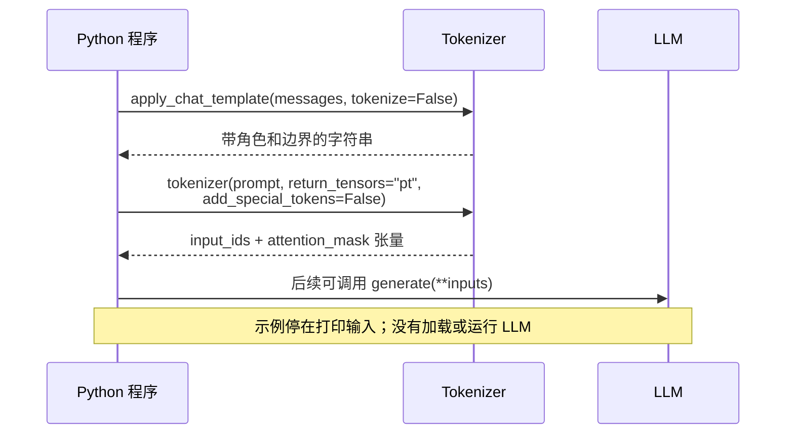

1. Table of Contents, ordered
{:toc}

提交给聊天 API 的 `messages` 是一组带角色的消息，但模型最终收到的是什么？要看清这件事，可以用 Transformers 把同一份消息的转换过程逐步打印出来，再改几个参数，比较输入哪里发生了变化。

## 一个程序，把转换过程打印出来

下面使用 **Qwen3-0.6B、Transformers 5.20.1**。只加载 tokenizer 就能检查输入，不需要下载模型权重。安装依赖后，可直接运行[完整程序 show_input.py](/assets/code/transformers-direct-chat/show_input.py)：

```bash
python -m pip install 'transformers==5.20.1' 'torch==2.8.0' 'jinja2==3.1.6'
python show_input.py
```

```python
from transformers import AutoTokenizer

# 固定模型版本；这里只下载 tokenizer，不加载模型权重。
tokenizer = AutoTokenizer.from_pretrained(
    "Qwen/Qwen3-0.6B",
    revision="c1899de289a04d12100db370d81485cdf75e47ca",
)
messages = [
    {"role": "system", "content": "用中文简洁回答。"},
    {"role": "user", "content": "你好。"},
]
print("1. 原始消息：", messages)

# 消息字典 → 模板字符串：加入角色边界与 assistant 回答起点。
prompt = tokenizer.apply_chat_template(
    messages,
    tokenize=False,
    add_generation_prompt=True,
    enable_thinking=False,
)
print("2. 模板文本：", repr(prompt))

# 字符串 → 整数 ID 列表。模板已经处理边界，不再自动追加特殊标记。
ids = tokenizer.encode(prompt, add_special_tokens=False)
print("3. token IDs：", ids)

# 同一字符串 → 可传给模型的张量字典，同时带上 attention_mask。
inputs = tokenizer(prompt, add_special_tokens=False, return_tensors="pt")
assert inputs["input_ids"][0].tolist() == ids
print("4. 最终模型输入：", dict(inputs))
print("   input_ids 形状：", tuple(inputs["input_ids"].shape))

# IDs → 字符串：反解只是为了检查输入，没有让模型生成回答。
print("5. 反解检查：", repr(tokenizer.decode(ids, skip_special_tokens=False)))

# 固定 messages，只改变模板开关；这次直接让 apply_chat_template 编码。
for generation, thinking in [(False, True), (True, True), (True, False)]:
    changed = tokenizer.apply_chat_template(
        messages,
        tokenize=True,
        return_dict=True,
        add_generation_prompt=generation,
        enable_thinking=thinking,
    )
    changed_ids = changed["input_ids"]
    print(f"\ngeneration={generation}, thinking={thinking}, tokens={len(changed_ids)}")
    print(repr(tokenizer.decode(changed_ids, skip_special_tokens=False)))

# 模板不变，仅把编码后的序列从右侧截到 12 个 token。
tokenizer.truncation_side = "right"
short = tokenizer.apply_chat_template(
    messages,
    tokenize=True,
    return_dict=True,
    add_generation_prompt=True,
    enable_thinking=False,
    truncation=True,
    max_length=12,
)
print("\n截到 12 个 token：", repr(tokenizer.decode(short["input_ids"])))
```

程序里的几个调用分别完成一步转换：

| 调用 | 输入 → 输出 |
|---|---|
| `apply_chat_template(..., tokenize=False)` | 消息列表 → 按模型格式排列的字符串 |
| `encode(text)` | 字符串 → 整数 ID 列表 |
| `tokenizer(text, return_tensors="pt")` | 字符串 → 包含 `input_ids`、`attention_mask` 的 PyTorch 张量字典 |
| `decode(ids)` | ID 序列 → 可读字符串，用于检查，**不是模型生成** |

其中 `encode()` 与 `tokenizer(...)` 是两种编码入口；后者还能组织模型需要的配套字段。程序都调用一次，是为了看到相同 IDs 怎样装进张量。

## 最终喂给模型的是这两个张量

程序第 2 步得到的字符串如下。`repr()` 会把换行显示为 `\n`，这里展开显示它的结构：

```text
<|im_start|>system
用中文简洁回答。<|im_end|>
<|im_start|>user
你好。<|im_end|>
<|im_start|>assistant
<think>

</think>

```

模板把角色和消息边界写进文本，并在末尾放入 assistant 起点和空思考块。**这些内容是模板拼出来的，模型还没有运行。**

第 3 步将整段字符串编码成 24 个 token IDs：

```python
[151644, 8948, 198, 11622, 104811, 110485, 102104, 1773,
 151645, 198, 151644, 872, 198, 108386, 1773, 151645, 198,
 151644, 77091, 198, 151667, 271, 151668, 271]
```

例如，`151644` 对应 `<|im_start|>`，`151645` 对应 `<|im_end|>`，`198` 是一个换行，`271` 是两个换行。角色名称与正文也都被编码进同一条序列。

第 4 步得到真正可以传给 `model.generate(**inputs)` 的输入：

```python
{
    "input_ids": tensor([
        [151644, 8948, 198, 11622, 104811, 110485, 102104, 1773,
         151645, 198, 151644, 872, 198, 108386, 1773, 151645, 198,
         151644, 77091, 198, 151667, 271, 151668, 271]
    ]),
    "attention_mask": tensor([
        [1, 1, 1, 1, 1, 1, 1, 1, 1, 1, 1, 1,
         1, 1, 1, 1, 1, 1, 1, 1, 1, 1, 1, 1]
    ])
}
```

两个张量的形状都是 **`[1, 24]`：一条输入，24 个位置**。`input_ids` 决定模型读取哪些 token；`attention_mask` 中的 `1` 表示有效位置，本例没有填充，所以全是 `1`。模型内部再将 IDs 查成向量，进行后续计算。

此时，原始的 Python 消息字典已经完成转换。调用顺序可以画成：



## 改参数，输入会怎样变化

程序末尾始终使用同一份 `messages`，只调整开关。三组实际结果如下；表中省略相同的 system 和 user 部分，只列它们之后追加的文本：

| `add_generation_prompt` | `enable_thinking` | 追加的文本（`repr`） | 总 token 数 |
|---|---|---|---|
| `False` | `True` | `''` | 17 |
| `True` | `True` | `'<|im_start|>assistant\n'` | 20 |
| `True` | `False` | `'<|im_start|>assistant\n<think>\n\n</think>\n\n'` | 24 |

- **`add_generation_prompt=True`**：让模板加上助手回答的起点，模型接下来从这里续写。它本身不调用模型。
- **`enable_thinking=False`**：在这个 Qwen 模板中预填一个空思考块，因此比开启 thinking 时多 4 个 token。它是模型模板读取的变量，不是所有模型统一的开关。

最后一组保持模板不变，开启 `truncation=True, max_length=12`。输入从右侧被裁成：

```python
'<|im_start|>system\n用中文简洁回答。<|im_end|>\n<|im_start|>user'
```

用户正文和 assistant 起点都没了。**截断只按 token 数裁剪，不会自动保留完整消息。** 这里的 `max_length` 限制输入长度，不是允许模型回答多少 token。

程序中的另外几个参数控制转换方式，而非消息内容：

| 参数 | 在这个程序中的作用 |
|---|---|
| `tokenize=False` / `True` | 前者停在模板字符串；后者继续编码。程序前半段拆开观察，后半段直接得到 IDs |
| `add_special_tokens=False` | 编码已套模板的文本时，不再自动追加 BOS/EOS 等标记；不会删除文本里已有的标记。本例 Qwen 改成 `True` 结果也相同，其他 tokenizer 可能不同 |
| `return_tensors="pt"` | 把列表装成 PyTorch 张量，并带上批次维度；这一步不选择聊天格式 |
| `return_dict=True` | 直接编码时返回带 `input_ids` 等字段的对象；设为 `False` 则只返回 IDs |
| `skip_special_tokens=False` | 反解时保留特殊标记，方便核对输入。设为 `True` 只影响显示，不改变已经准备好的输入 IDs |

`skip_special_tokens=True` 也不是“只显示助手回答”：它按 tokenizer 的注册信息过滤标记，本例中的角色名称和 `<think>` 仍会保留。因此，观察最终输入时先保留特殊 token，再用 `repr()` 检查换行。

关于 API 服务在哪一层完成这些转换，见 [OpenAI API 与模型输入](/posts/2026/10/19/openai-api-context-chat-template-serving/)。模板规则参考 Hugging Face 的 [Chat templates](https://huggingface.co/docs/transformers/main/en/chat_templating) 与 [Writing a chat template](https://huggingface.co/docs/transformers/main/en/chat_templating_writing)；本文的[完整实验记录](/assets/code/transformers-direct-chat/results.json)保留了实际 IDs 和参数对照结果。
