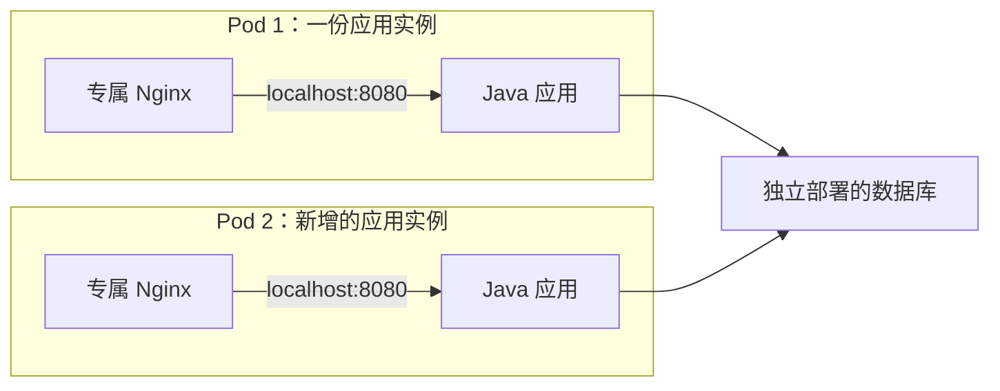

1. Table of Contents, ordered
{:toc}

部署一个网站，需要运行 Java 应用、处理请求的 Nginx，以及保存数据的数据库。把它们放进容器之后，还需要决定：哪些组件应当单独管理，哪些组件应当配套部署，访问量增加时又该复制哪一部分。

容器、Kubernetes 的 Pod 和 Docker Compose 都参与这个过程，但它们组织程序的层次不同。先看一个程序怎样在容器里运行，再看多个容器怎样组成应用实例和完整系统。

## 一个容器可以运行多个进程

Nginx 通常由一个 master 进程管理多个 worker 进程。即使只运行一个 Nginx 容器，里面也可以有多个进程；容器提供的是程序运行所需的隔离环境，并不限定进程数量。

**每个容器有一条初始启动命令，这条命令启动的程序可以继续创建子进程。** Docker 通过镜像中的 `ENTRYPOINT`、`CMD` 以及运行时参数确定这条命令。以已经安装 Nginx 的镜像为例，启动配置可以写成：

```dockerfile
# 指定要执行的程序，使用 exec 形式直接启动它。
ENTRYPOINT ["nginx"]

# 为该程序提供默认参数，让 Nginx 保持前台运行。
CMD ["-g", "daemon off;"]
```

两者组合后，相当于执行 `nginx -g 'daemon off;'`。Nginx master 留在前台运行，同时管理后台的 worker。`ENTRYPOINT` 也可以不设置，此时 `CMD` 可以直接指定程序和参数；exec 形式不会自动插入 shell。具体组合规则见 [Dockerfile 的 ENTRYPOINT 与 CMD 说明](https://docs.docker.com/reference/dockerfile/#understand-how-cmd-and-entrypoint-interact)。

容器的启动还涉及进程管理：**主进程退出后，容器会停止。** 启动脚本如果把应用放到后台，随后自己退出，后台应用不会让容器继续存活。因此，多进程容器需要正确等待子进程、传递退出信号并回收退出的子进程。默认独立 PID 命名空间下，初始进程通常是容器内的 PID 1；使用 `--init` 时，可以由一个小型 init 进程承担相应职责。Docker 的[多进程容器文档](https://docs.docker.com/engine/containers/multi-service_container/)给出了几种实现方式。

“一个容器负责一个服务”强调职责划分。Nginx 的多个 worker 本来就是同一份应用的组成部分，无须为了减少进程数量把它们拆开。

## 把需要配套运行的组件组成 Pod

Java 应用和 Nginx 则有各自的依赖、配置与版本。把两者拆成容器后，可以分别构建镜像、配置资源限制和健康检查，也可以分别重启。

假设这个网站进一步要求：**每份 Java 应用实例都配备一份专属 Nginx，由它处理该实例的请求。** 部署时必须保证两者在同一节点上，增加实例时也必须同时增加这份配套组件。在 Kubernetes 中，可以用一个 Pod 表达这种组合关系。

**Pod 是 Kubernetes 的最小部署和调度单位，包含一个或多个容器。** 同一 Pod 中的容器被安排在同一个节点上。只有一个容器的 Pod 很常见；多个容器放在一起，通常是因为它们构成一份紧密协作的应用实例。Pod 属于 Kubernetes 的概念，Docker Engine 本身没有原生的 Pod 对象。参见 [Kubernetes 的 Pod 定义](https://kubernetes.io/docs/concepts/workloads/pods/)。

为主应用提供辅助功能的容器通常称为 **Sidecar（边车容器）**。除了专属代理，还可以是处理该实例日志的容器，或者不断向共享目录同步网站文件的容器。Sidecar 让辅助能力拥有独立的镜像和运行配置，同时跟随主应用部署。具体模式见 [Sidecar 容器说明](https://kubernetes.io/docs/concepts/workloads/pods/sidecar-containers/)。

Nginx 与 Java 并非天然属于同一个 Pod。如果 Nginx 是为多份 Java 实例提供服务的公共网关，两者就有独立扩容的需求。**决定边界的是部署关系，而不是软件名称。**

## Pod 像一台应用专用的逻辑主机

专属 Nginx 需要访问与自己配套的 Java 应用。同一 Pod 的容器共享网络命名空间，因此 Nginx 可以直接转发到 `localhost:8080`，不用寻找另一台“机器”的地址。

这里的共享网络，比“接入同一个局域网”更进一步。Docker Compose 用一份配置描述并管理多个容器服务；对比它默认使用的 bridge 网络，可以看出差别：

| 对比项 | Compose 默认网络中的容器 | 同一 Pod 中的容器 |
|---|---|---|
| 网络关系 | 各自拥有网络环境，接入同一个网络 | 共享网络命名空间 |
| 直觉类比 | 几台机器接在同一交换机上 | 同一台机器上的几个程序 |
| 访问 Java 应用 | 通过服务名，如 `app:8080` | 通过 `localhost:8080` |
| 两个程序都监听 `0.0.0.0:8080` | 可以，各自使用容器内部的端口空间 | 会冲突，共享端口空间 |
| 根文件系统 | 各自独立 | 仍然各自独立 |
| 共享文件 | 显式挂载同一个卷 | 同样需要显式挂载同一个卷 |

Compose 默认会为项目建立网络，容器可以通过服务名发现彼此；这些容器通常仍在同一台宿主机上。“几台机器”只是通信方式的类比。参见 [Compose 网络机制](https://docs.docker.com/compose/how-tos/networking/)。

Kubernetes 把 Pod 描述为应用专用的“逻辑主机”。这个类比适合解释 `localhost` 和配套部署，但不能继续推导成完整虚拟机：在普通 Linux 容器运行方式下，Pod 中的程序共享节点的内核；每个容器仍有自己的根文件系统，进程列表默认也不共享。需要互相看到进程时，要显式开启[进程命名空间共享](https://kubernetes.io/docs/tasks/configure-pod-container/share-process-namespace/)。

Pod 也通常按可替换实例管理。节点失效后，控制器可以创建新的 Pod 替代旧实例，新的 Pod 可能获得不同 IP；不是把原来的 Pod 连同运行中的进程原样搬到另一台机器。详见 [Pod 生命周期](https://kubernetes.io/docs/concepts/workloads/pods/pod-lifecycle/)。

## 扩容时，Pod 复制一份实例，Compose 可以分别增加服务

网站访问量增加后，假设数据库还有余量，只需要增加处理请求的能力。此时 Java 应用与专属 Nginx 应当成套增加，数据库保持原来的部署规模：



在 Kubernetes 中，可以由 Deployment 等工作负载资源管理这些 Pod。把 Deployment 的副本数从 1 增加到 2，会新增一整个 Pod，也就新增一组 Java 与 Nginx。**Pod 定义被复制的单位，Deployment 及其管理的 ReplicaSet 等控制器负责维持副本数量。** 单独创建一个 Pod，并不等于配置了自动扩容或故障后的副本补齐。参见 [Deployment 的副本管理](https://kubernetes.io/docs/concepts/workloads/controllers/deployment/)。

“一起扩容”指的是**复制整份 Pod**，并不意味着其中的容器必须同时启动、同时重启，或使用相同的 CPU、内存限制。一个容器故障时可以按策略单独重启；如果需要让 Java 和 Nginx 拥有独立变化的副本数，就应重新考虑 Pod 边界。健康检查如何决定切流与重启，可以继续阅读本站的 [Readiness 与 Liveness 分析]()。

Docker Compose 项目经常覆盖整套应用。Java、Nginx、数据库可以各自定义为服务，每个服务的容器数量可以分别调整。Compose 项目没有规定所有服务必须按同一个比例复制，具体关系取决于应用设计。参见 [Compose 服务定义](https://docs.docker.com/reference/compose-file/services/)。

可以用两个生活中的关系帮助记忆：

- **Pod 像“人和衣服”**：每增加一个人，就要配上一套衣服。对应每增加一份应用实例，也复制它的配套组件。
- **Compose 的常见用途像“人和食堂”**：增加几个人，食堂可能仍有余量；可以只增加人的数量，不扩建食堂。对应各服务按自己的容量需求调整。

这个类比描述的是组织关系，不是 Compose 的能力限制。Compose 同样能部署配套组件，还支持通过 `network_mode: "service:app"` 让另一个容器共享 `app` 的网络环境。但配置网络共享，并不会自动获得 Kubernetes 的 Pod 调度和副本管理语义。参见 [Compose 的 network_mode](https://docs.docker.com/reference/compose-file/services/#network_mode)。

划分部署单元时，先判断两个组件是否需要各自扩容、各自部署。如果需要，通常分开；如果每份应用实例都必须随身携带某个辅助组件，就适合考虑同一个 Pod。放在一起会增加约束：组件必须落在同一节点，复制应用时也会复制辅助容器。仅仅需要相互通信，还不足以决定把它们放进同一个 Pod。
