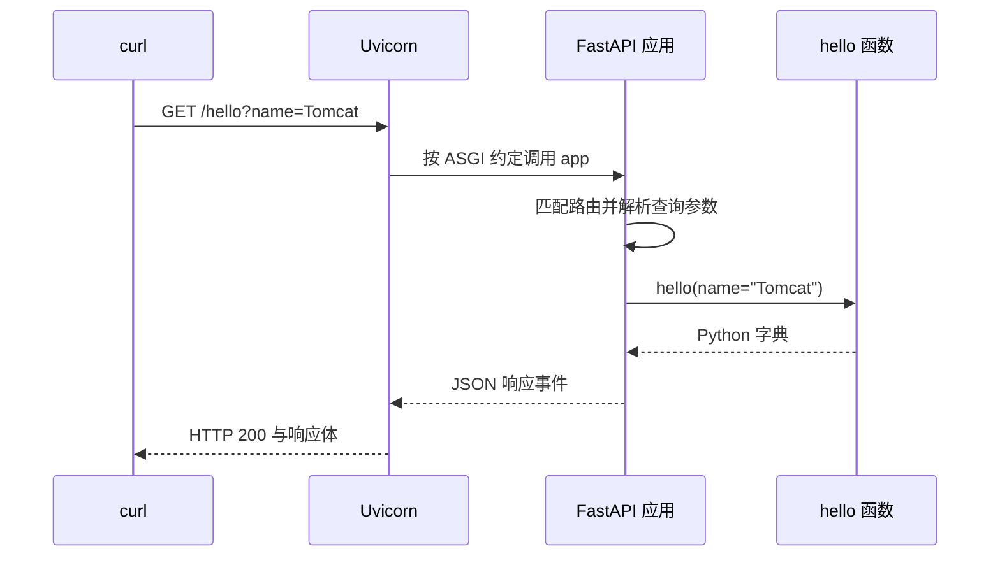
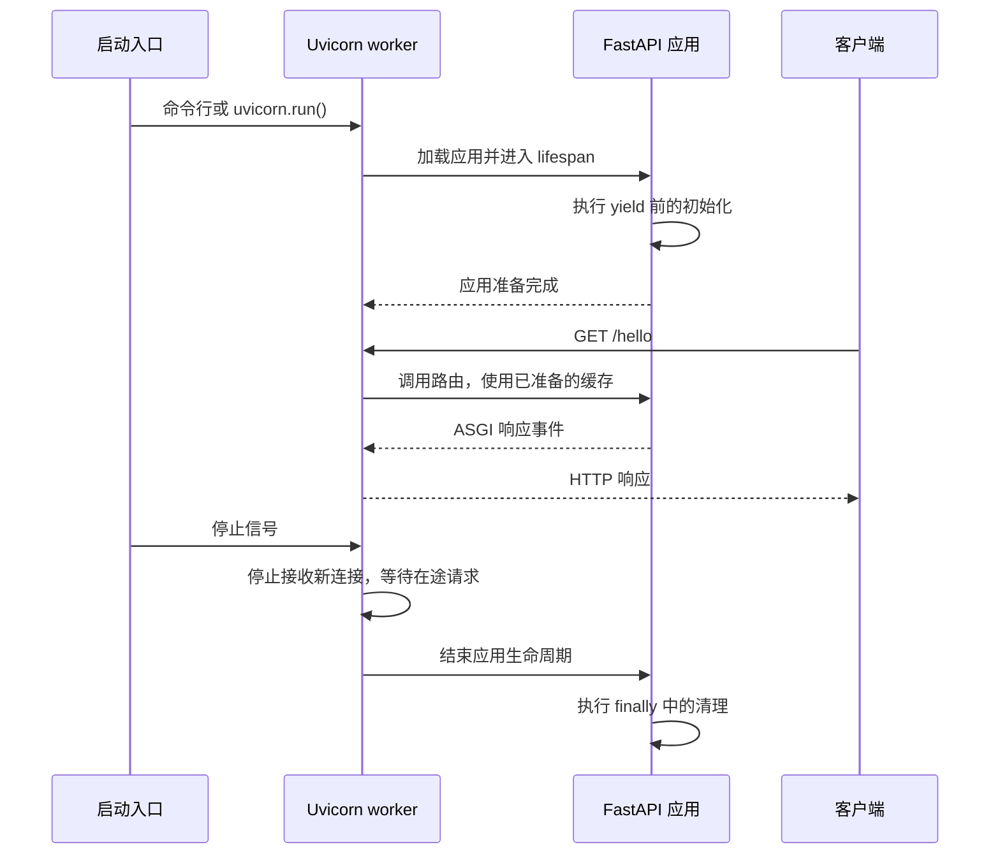

1. Table of Contents, ordered
{:toc}

把一个 Python 函数变成能被 `curl` 调用的接口，需要有人接收网络请求，也需要有人把 URL 和参数交给业务函数。熟悉 Tomcat、Servlet 和 Spring MVC 的开发者，可以沿着这套分工理解 Python Web，再用同一个 Hello World 看清服务怎样启动、初始化和部署。

## 从接收 HTTP 到调用业务函数

一个返回字符串的 Python 函数还不能独立提供 HTTP 服务：它没有监听端口，也不知道怎样解析请求。**Uvicorn 负责服务器这一侧的工作，FastAPI 负责把请求组织成方便编写的业务接口。**

### 服务器与应用之间需要一个调用约定

在 Java Web 中，Tomcat 接收 HTTP 请求，再通过 Servlet API 调用应用。业务开发者不需要自己处理 TCP 字节流。在 Python 中，[Uvicorn](https://uvicorn.dev/)承担相近的服务器职责，使用 **ASGI（Asynchronous Server Gateway Interface，异步服务器网关接口）**与应用协作。

ASGI 规定了应用怎样接收请求信息、读取传入事件和发送响应。它的现代调用形式可以概括为：

```python
# 由服务器提供请求信息和收发事件的方法，再调用应用。
await app(scope, receive, send)
```

| 参数 | HTTP 场景中的作用 |
|---|---|
| `scope` | 提供方法、路径、请求头等请求元数据 |
| `receive` | 异步接收请求体等事件 |
| `send` | 异步发送状态码、响应头和响应体等事件 |

这里的交互通常发生在同一个工作进程内，浏览器与服务器之间仍然使用 HTTP。**ASGI 是服务器与应用之间的接口约定，不是客户端要使用的一种新网络协议。** 对 HTTP 来说，每个请求对应一次应用调用；同一条 Keep-Alive 连接可以承载多个请求。ASGI 也能描述 WebSocket 这类持续交换消息的连接，具体生命周期由相应协议规定，见 [ASGI 规范](https://asgi.readthedocs.io/en/latest/specs/main.html)。

### 框架把接口约定封装成路由函数

如果每个业务接口都自己读取 `scope`、解析参数、发送响应事件，就会有大量重复代码。FastAPI 在这些基础能力上提供路由声明、参数解析与校验、依赖注入和响应处理，让开发者直接编写业务函数。

两套技术的职责可以这样对照：

| 职责 | Java Web | Python Web |
|---|---|---|
| 接收网络请求、运行应用 | Tomcat | Uvicorn |
| 服务器与应用的接口规范 | Servlet | ASGI |
| 框架提供的统一请求入口 | Spring MVC 的 `DispatcherServlet` | `app = FastAPI()` 创建的应用对象 |
| 声明 URL 到业务代码的映射 | `@GetMapping` | `@app.get` |
| 编写接口业务 | Controller 方法 | 路由函数 |

这是一种职责类比。Tomcat 提供 Servlet 容器，Spring MVC 则提供遵循 Servlet API 的 `DispatcherServlet`，再由它协调 Controller 调用；详见 [Spring 官方说明](https://docs.spring.io/spring-framework/reference/web/webmvc/mvc-servlet.html)和站内的[Spring MVC 请求处理全流程]()。

FastAPI 同样对外提供符合 ASGI 规范的应用入口，再在内部调用路由函数。Python 对象可以通过 `__call__` 方法被当作函数调用，因此 `app` 是对象，也可以满足前面的调用约定。**Controller 方法不用亲自实现 Servlet，FastAPI 的业务函数也不用亲自实现 ASGI 的三个参数接口。**

FastAPI 的基础来自两个项目：**Starlette** 提供 ASGI 应用、路由、中间件与请求响应等 Web 能力；**Pydantic** 提供数据解析、模型和校验能力。`FastAPI` 类直接继承 `Starlette`，并在其上组织 API 开发能力，见 [FastAPI 功能说明](https://fastapi.tiangolo.com/features/)。开发体验尤其接近用 `@RestController` 编写 JSON API，但不要求采用传统的 Model、View、Controller 分层。

## 让 Hello World 接收一次真实请求

有了服务器与框架的分工，接下来只需定义应用、声明一个接口，再告诉 Uvicorn 从哪里加载它。

### 创建应用并启动服务器

以下命令用于 macOS / Linux，准备 Python 3.11 或更新版本。在一个新目录中创建独立环境：

```bash
mkdir uvicorn-demo
cd uvicorn-demo

# 让项目依赖安装到自己的环境中。
python3 -m venv .venv
source .venv/bin/activate

# 安装框架、服务器及常用的服务器扩展依赖。
python -m pip install fastapi "uvicorn[standard]"
```

`uvicorn[standard]` 会安装文件监视、WebSocket 等常用依赖，并在适用平台提供性能扩展，具体见[安装文档](https://uvicorn.dev/installation/)。虚拟环境的作用和命令查找关系，可继续阅读[Python venv 核心概念与实战]()。

创建 `main.py`：

```python
from fastapi import FastAPI

# 应用对象由 Uvicorn 加载。
app = FastAPI()


# 将 GET /hello 映射到这个业务函数。
@app.get("/hello")
async def hello(name: str = "World"):
    # name 来自查询参数；省略时使用默认值。
    return {"message": f"Hello, {name}!"}
```

在 `main.py` 所在目录启动：

```bash
python -m uvicorn main:app --host 127.0.0.1 --port 8000 --reload
```

`main:app` 是导入位置：`main` 指 Python 模块，`app` 指其中的应用对象。可以理解为服务器先执行 `from main import app`，再运行应用。它既不是文件路径，也不是 URL。`--reload` 用于本地开发，在代码变化后重启服务，参数定义见 [Uvicorn 配置文档](https://uvicorn.dev/settings/)。

### 从 HTTP 请求走到 JSON 响应

另开一个终端调用：

```bash
curl -i "http://127.0.0.1:8000/hello?name=Tomcat"
```

响应包含以下内容，其他响应头省略：

```http
HTTP/1.1 200 OK
content-type: application/json

{"message":"Hello, Tomcat!"}
```

省略 `name` 时，访问 `/hello` 会得到 `{"message":"Hello, World!"}`。这一次调用经过了几层处理：



Uvicorn 不需要知道 `hello()` 有哪些业务参数。FastAPI 负责提取 `name`、调用函数并把字典转换成 JSON。框架还会生成接口描述和交互文档，可以在浏览器打开[本地文档页面](http://127.0.0.1:8000/docs)，在页面上发起同样的请求，见 [FastAPI 入门文档](https://fastapi.tiangolo.com/tutorial/first-steps/)。

### 请求开始等待 I/O 后，异步才体现出作用

Hello World 几乎没有等待，`async def` 的价值在调用数据库或外部 HTTP 服务时更明显：请求使用异步库并在 `await` 处等待结果，事件循环便有机会推进其他就绪的请求。单个工作进程可以管理许多等待中的请求，而不必为每个请求占用一条一直阻塞的业务线程。

**`async def` 不会自动消除函数里的阻塞调用。** 在其中直接运行同步网络请求、`time.sleep()` 或长时间计算，会占住该 worker 的事件循环。FastAPI 对它调度的普通 `def` 路由提供线程池执行，但不会把业务代码中直接调用的每个普通函数都自动送入线程池，见[并发说明](https://fastapi.tiangolo.com/async/)。这里也不能把 Tomcat 概括成只支持阻塞处理；类比成立的是服务器与应用的分工。

关于协程、事件循环和等待重叠，可以接着阅读[Python 的 GIL、asyncio 和 await]()。这个 Hello World 暂时不需要额外引入并发工具。

## 用 Python 脚本控制启动流程

当启动配置需要从自己的参数或配置文件中读取时，可以先用 Python 完成这些工作，再调用 Uvicorn 的编程式入口。应用文件和业务接口不需要改变。

### 把命令行参数交给自己的启动脚本

保留 `main.py`，在旁边创建 `run_server.py`：

```python
import argparse
import uvicorn


def main():
    # 这里的命令行选项由自己的程序定义。
    parser = argparse.ArgumentParser()
    parser.add_argument("--host", default="127.0.0.1")
    parser.add_argument("--port", type=int, default=8000)
    args = parser.parse_args()

    # 可以在这里读取配置，再将结果交给服务器。
    uvicorn.run(
        "main:app",
        host=args.host,
        port=args.port,
    )


# 导入这个模块时，不执行启动操作。
if __name__ == "__main__":
    main()
```

先在原来的服务终端按 `Ctrl+C`，再运行下面任意一条命令。它们都没有开启自动重载；未设置 `WEB_CONCURRENCY` 环境变量时，默认使用单 worker：

```bash
# 由 Uvicorn 的命令行入口解析参数。
python -m uvicorn main:app --host 127.0.0.1 --port 8000

# 或者，由自己的脚本解析参数，再调用 uvicorn.run()。
python run_server.py --host 127.0.0.1 --port 8000
```

两种方式启动的是同一个服务器。在应用、环境和实际配置一致时，没有由入口形式带来的性能差异。[Uvicorn 官方](https://uvicorn.dev/#uvicornrun)将 `uvicorn.run()` 定义为命令行入口的编程式对应方式。

| 配置或行为 | Uvicorn 命令行 | 编程式入口 |
|---|---|---|
| 监听端口 | `--port 8000` | `port=8000` |
| 开发重载 | `--reload` | `reload=True` |
| 两个工作进程 | `--workers 2` | `workers=2` |
| 自己的命令行参数 | Uvicorn 只解析它支持的选项 | 脚本自行解析，再转成配置或执行逻辑 |

这个脚本只定义了 `--host` 和 `--port`，因此不能直接加上 `python run_server.py --workers 2`；需要先扩展脚本，再把参数传给 `uvicorn.run()`。重载和多 worker 不能同时启用。

`uvicorn.run()` 会运行到服务停止才返回，不会自动把服务器放到后台。

### 让应用模块可以安全导入

Python 直接执行 `python run_server.py` 时，该模块的 `__name__` 是 `"__main__"`；其他模块导入它时，`__name__` 则是模块名。因此，`if __name__ == "__main__"` 把“定义函数”和“执行启动”分开，避免一次普通导入意外启动服务器。启用重载或多 worker 时，也需要遵循这项入口约定，见 [Python 入口文档](https://docs.python.org/3/library/__main__.html)与 [Uvicorn 启动要求](https://uvicorn.dev/settings/#configuration-methods)。

应用和启动器分成两个文件，还有一个直接收益：避免把同一个应用文件以不同名字加载。若在 `main.py` 中定义 `app`，又在其入口保护内调用 `uvicorn.run("main:app")`，那么执行 `python main.py` 时，文件先作为 `__main__` 运行，随后又被 Uvicorn 作为 `main` 导入。

**入口保护能阻止再次启动服务器，却不能阻止保护条件外的顶层代码再次执行。** 顶层创建的 `app`、模型等对象可能因此出现两份；入口保护内对 `__main__.app` 的修改，也不会自动作用到重新导入的 `main.app`。这是 Python 模块加载规则带来的结果。

编程式入口也允许直接传入已创建的应用对象，即 `uvicorn.run(app, ...)`。这适用于不启用重载的单 worker 方式；要使用重载或多个 worker，应传入 `"main:app"` 这样的导入字符串，方便新进程加载应用，见[编程式启动文档](https://uvicorn.dev/deployment/#running-programmatically)。

## 在开始处理请求前初始化应用资源

服务还可能需要先创建连接池、加载模型或准备缓存，然后才能处理第一个请求。这些资源属于应用的生命周期，需要同时安排初始化和关闭时的清理。

### 启动器准备与应用初始化发生在不同阶段

编程式启动可以在 `uvicorn.run()` 之前执行任意 Python 逻辑，例如读取配置、决定监听端口。命令行启动同样会加载应用模块，并调用应用暴露的生命周期入口。因此，**Uvicorn 命令行只限制它能识别哪些命令行选项，不限制应用代码能完成哪些初始化工作。**

对 Java 开发者来说，这类似通过外部 Tomcat 启动应用后，仍然可以执行 Servlet 的 `init()` 或 Spring Bean 的初始化方法。开发者通过容器提供的调用时机执行自己的代码。

在 FastAPI 中，这个应用生命周期入口叫 **`lifespan`**。它把开始处理请求前的准备和应用关闭时的清理放到一起，命令行与编程式启动都适用，见 [FastAPI 生命周期文档](https://fastapi.tiangolo.com/advanced/events/)。

### 把 Hello World 的共享数据放进 lifespan

将 `main.py` 替换为下面的完整内容。示例用一份问候语缓存演示资源准备；真实项目可以在同一位置初始化数据库连接池或模型：

```python
from contextlib import asynccontextmanager
from fastapi import FastAPI, Request


@asynccontextmanager
async def lifespan(app: FastAPI):
    # 此时还没有开始处理请求，先准备应用需要的数据。
    print("初始化问候语缓存", flush=True)
    app.state.messages = {"hello": "Hello"}

    try:
        # 初始化完成；框架在这段生命周期中处理请求。
        yield
    finally:
        # 应用关闭时清理资源。
        app.state.messages.clear()
        print("清理问候语缓存", flush=True)


app = FastAPI(lifespan=lifespan)


@app.get("/hello")
async def hello(request: Request, name: str = "World"):
    # Request 由框架注入，通过它访问当前应用的共享数据。
    greeting = request.app.state.messages["hello"]
    return {"message": f"{greeting}, {name}!"}
```

这里的 `Request` 参数由 FastAPI 提供，客户端仍然只需传 `name`。`app.state` 用于保存这个应用实例的数据，同一实例处理的请求可以访问它。



用 `python -m uvicorn main:app` 启动，会先看到“初始化问候语缓存”；调用 `/hello?name=Tomcat` 仍然得到相同的 JSON；正常按 `Ctrl+C` 关闭时，会看到“清理问候语缓存”。换成 `python run_server.py`，这套初始化与清理同样生效。

两类准备工作的归属由它们服务的对象决定：**启动器负责决定怎样运行服务器，lifespan 负责准备应用处理请求所需的资源。** 后者随应用实例启动和关闭，不依赖操作者选择哪一种入口。

## 将同一个应用放到服务器运行

本地接口和初始化都验证后，可以把 `main.py` 与所需依赖放到服务器上，用同样的虚拟环境流程安装，再调整监听地址和工作进程数。

```bash
# 部署运行时关闭开发重载；这里示范两个工作进程。
python -m uvicorn main:app --host 0.0.0.0 --port 8000 --workers 2
```

`0.0.0.0` 表示监听所有本机 IPv4 网卡。客户端使用服务器的实际 IP 或域名访问；在端口可达的情况下，调用方式为：

```bash
# 将 SERVER_IP 换成服务器实际地址。
curl "http://SERVER_IP:8000/hello?name=Tomcat"
```

**`--workers 2` 表示两个工作进程，不是两个线程。** 每个进程加载自己的应用，并分别执行 `lifespan`。示例中会有两份独立缓存，也会各执行一次初始化；修改一个 worker 的 `app.state` 不会自动同步到另一个 worker。若多个进程需要共享业务数据，应使用数据库、Redis 等进程外存储。每个 worker 的生命周期行为见 [Uvicorn lifespan 文档](https://uvicorn.dev/concepts/lifespan/)。

同样，不能把启动脚本在 `uvicorn.run()` 前创建的连接池，默认视为每个子进程都已经拥有的可用资源。把这类资源放到各自的 `lifespan` 中，才能让初始化、使用和关闭发生在对应的应用进程里。

这条命令提供的是前台运行的服务。长期部署还需要 systemd 或容器平台管理进程的启动与恢复，需要域名和 HTTPS 时可以接入反向代理，具体方案参考 [Uvicorn 部署文档](https://uvicorn.dev/deployment/)。普通服务可以直接使用命令行；需要自定义参数和启动编排时再增加启动脚本，而业务应用继续保留相同的 ASGI 入口与生命周期。
