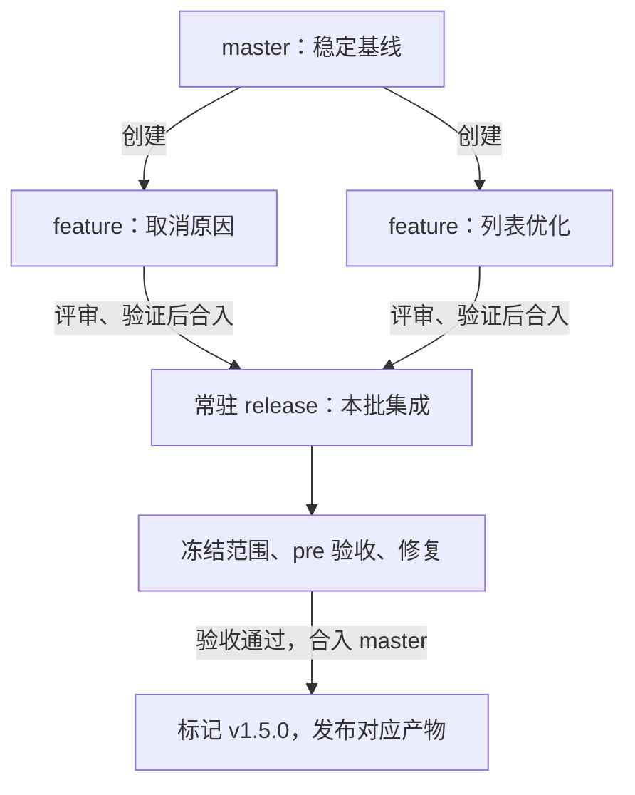
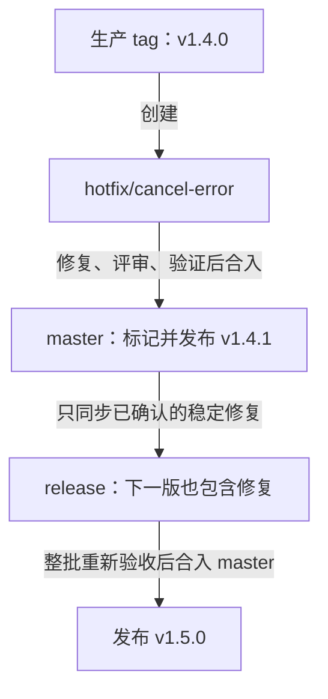
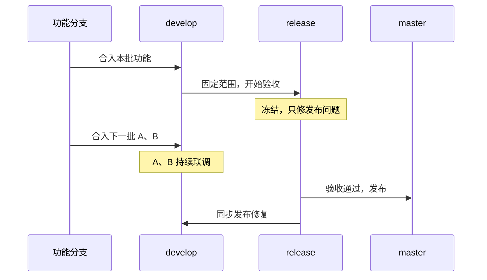
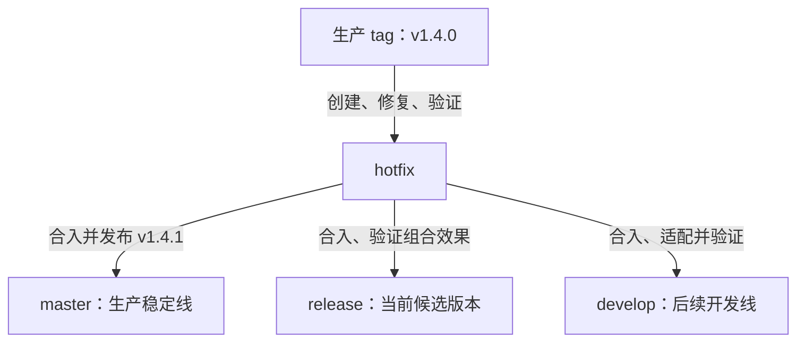
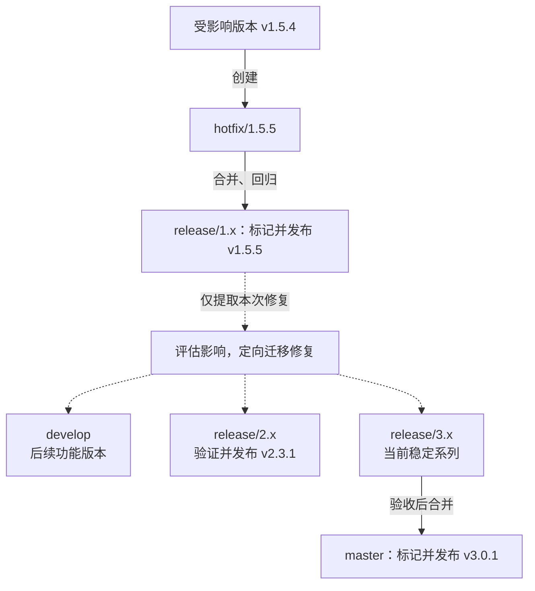
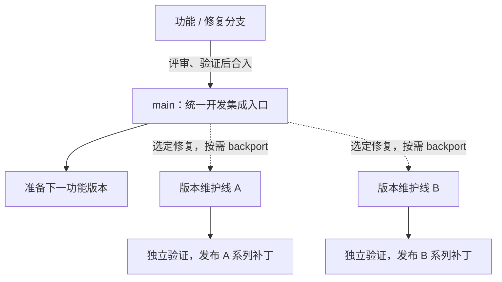

1. Table of Contents, ordered
{:toc}

一个服务端团队每次集中发布一批需求：功能在各自分支开发，合到预发布环境验收，通过后上线。当前版本收尾时，下一版是否需要提前联调；新版上线后，旧版是否还需要独立修补——这些需求决定了团队要保留哪些分支，以及承担多少同步工作。

下面从常驻 master、常驻 release 的最小流程开始，引入 develop 看完整 Gitflow 解决了什么，再看 ParadeDB 和 Spring Data Elasticsearch 如何用统一 main 主线减少另一部分同步。每种方案都在重新安排开发集成、发布验收和稳定版本维护的职责。

## 先用常驻 master 和 release 完成一次发布

当服务只需持续向前迭代、同时只有一个待发布批次时，两条常驻分支就能承担稳定发布和需求集成。

### 把本批需求集中到 release

假设线上运行 `v1.4.0`，本批准备上线“订单取消原因”和“订单列表优化”。团队需要保留线上稳定代码，同时让两个功能组合起来接受验收。

- **`master`** 保存生产稳定线，只接收经过验证、准备发布的版本和线上修复。
- **`release`** 保存当前待发布的一批变更，承担集成、pre 验收和发布收尾。
- **`feature/*`** 是普通开发分支，用来隔离一项功能的开发过程。
- **`hotfix/*`** 用来隔离基于线上版本的紧急修复。

这些在 Git 中都是普通分支。`feature`、`release` 等名称表达的是团队约定，并不会让 Git 自动检查代码是否适合发布。线上实际运行哪个版本，要以部署记录中的 tag、提交和产物为准，不能只看 master 的最新提交。

下面假设 master 对应线上 `v1.4.0`，release 尚无上一批遗留变更。普通功能按以下顺序进入生产：

1. **从 master 的稳定提交创建 feature。** 两个功能分别使用自己的分支，在分支中开发和验证。创建分支只是确定起点，还没有向其他分支合入功能。
2. **`feature → release`。** 各功能通过评审和分支验证后，分别向 release 提交 MR。两个功能在 release 上进行组合验证。
3. **冻结 release，部署 pre。** 本批范围确定后停止接收新需求；下一批仍在各自 feature 中开发。
4. **pre 问题合回 release。** 例如保存取消原因失败，从当前 release 创建 `bugfix/cancel-reason`，修复后通过 MR 合回 release，并重新部署和回归。此时不单独把依赖新功能的修复合入 master。
5. **`release → master`。** 整批验收通过，确认合入结果仍是已验证版本，再将 release 整体合入 master，标记 `v1.5.0`，发布对应产物。



**发布时，功能和 pre 修复通过同一次 `release → master` 进入稳定线。** 不必再把每个 feature、bugfix 单独合一次 master。release 中未修好的问题也会随整体合并进入，Git 不会自动跳过有 bug 的功能。阻断问题必须修复，或者撤出相关变更及其依赖后重新验收，否则延期发布。

尽量让生产使用 pre 已验证的同一份包或镜像，并让验收记录绑定具体提交与产物；候选版本改变后，原来的验收结论不能直接套用。[AWS 的持续交付实践](https://docs.aws.amazon.com/wellarchitected/latest/devops-guidance/anti-patterns-for-continuous-delivery.html)也建议一次构建、多环境部署。

发布完成后，release 保留，下一批继续使用。它不需要清空或重建；只需确认本批已经收尾，没有遗留不该发布的内容。master 与 release 的业务代码通常一致，合并提交的 SHA 则不必相同。

下一批新 feature 从更新后的稳定基线创建；仍在开发的旧 feature 按需同步最新 master，进入 release 后再做组合验证。由于本批代码已经从 release 进入 master，通常不需要为了“走完流程”再把 master 原样合回 release；只有 master 后来出现新的稳定修改，例如 hotfix，才需要继续同步。

### 线上修复独立进入 master，再同步到 release

仍以 `v1.4.0` 为线上版本，假设它出现订单取消故障，而 release 已有 `v1.5.0` 尚未验收完成的新功能。线上不能等待本批需求，就单独准备补丁：

1. **从实际部署的 `v1.4.0` tag 创建 `hotfix/cancel-error`。** 它只继承线上基线，不包含 release 中的新功能。
2. **`hotfix → master`。** 完成最小修复、评审和回归后，合入仍对应该稳定版本的 master，标记 `v1.4.1`，发布经过验证的补丁产物。
3. **`master → release`。** 把新增的稳定修复同步到 release，验证它与 `v1.5.0` 新功能的组合。这里的前提是 master 相对 release 新增的内容都应进入下一版；也可以直接合入该 hotfix 分支，但两种方式选一种，不重复操作。
4. **`release → master`。** 等 `v1.5.0` 整批验收通过，再正常发布。此时它已经包含 `v1.4.1` 的修复。

前两步让线上先恢复，第三步保证下次发布仍保留修复。不能为了发布这一个补丁，提前把整个 release 合入 master。



各类修改的方向可以归纳为：

```text
功能开发：feature → release
pre 修复：从 release 创建 bugfix → release
正常发布：release → master
线上修复：hotfix → master → release
```

如果 master 已包含尚未部署的其他变更，不能直接把最新 master 当作这个补丁的发布源，应从实际生产基线准备独立补丁版本，再安排修复同步。同步到 release 时也要确认范围；如果 release 已经冻结，修复会改变候选版本，需要更新验证结论。

这个最小流程适合一个批次接一个批次推进的团队。它的边界逐渐出现在发布收尾阶段：当前 release 还不能开放，下一批功能却可能已经需要一起验证。

## 完整 Gitflow：分开开发集成、发布收尾与生产稳定线

release 冻结期间，各功能分支仍可独立开发；当下一批功能必须互相配合，才需要一个可以持续接收它们的公共集成位置。

### 当前版本验收，下一版本联合开发

假设 `v1.5.0` 正在 pre 验收，同时下一版有两个需求：A 修改接口，B 的页面依赖 A 的接口。各自在分支上通过测试后，团队还需要持续确认前后端协议、调用时机和异常处理能否配合。

此时把 A、B 合入冻结中的 release，会改变当前版本的发布范围。单独增加一条 **develop 开发集成线**，就可以承接下一批功能，让它们提前联调，而当前 release 继续收尾。

标准 Gitflow 将这三类工作分开：develop 接收日常功能，master 记录生产稳定版本，按批次创建的 release 承担发布收尾。release 验收完成后合入 master，发布修复同时回到 develop。[Gitflow 原始说明](https://nvie.com/posts/a-successful-git-branching-model/#release-branches)采用的就是这种组织方式。保留常驻 release 则是沿用职责分离、复用同一发布分支的变体，下面同时说明两种用法。



图中的“固定本批范围”可以通过更新常驻 release 完成，也可以从 develop 的选定提交创建新的 release 分支。两种方式都允许 develop 继续开发下一版。

**develop 的价值是提供提前集成的时间窗口。** 如果下一批功能互相独立，在自己的分支上就能完成开发，而且不急于联合验证，暂时没有必要维护这条额外集成线。并行分支少、当前批次很快就能发布时，常驻 release 下一轮就能承接它们。

如果发布频繁、下一批准备工作紧接当前批次，或者当前验收时间较长、下一批依赖又密集，develop 的价值会更明显。人数、分支数量和发布频率都是线索，判断依据仍是：**当前版收尾期间，下一版是否需要持续联调。**

### 普通功能先合入 develop，再经 release 发布

先保持“只维护一个线上版本”的前提。假设线上为 `v1.4.0`，准备发布 `v1.5.0`，新增 develop 后，普通功能的完整路径如下：

1. **从最新 develop 创建 `feature/*`，完成后 `feature → develop`。** 功能在自己的分支开发，通过评审和检查后合入 develop，与其他需求联合验证。这里不再默认从 master 创建功能分支，因为 develop 才是当前的开发集成基线。
2. **从 develop 准备本批 release。** 若 release 常驻，将范围已确认的 develop 提交合入 release；若按版本新建，则从该提交创建 `release/1.5.0`。后一种是创建分支，不是把功能再逐个合并一次。两种方式都必须确认候选版本没有夹带不该上线的需求。
3. **冻结 release，pre 修复通过 `bugfix → release` 进入候选版本。** bugfix 从目标 release 创建。冻结期间，下一批 feature 继续合入 develop；此时不能为了同步一个修复，就把 develop 的全部新内容再次合入 release。
4. **整批验收后，`release → master`。** 确认候选版本包含所需的线上修复，且最终合入结果与验收内容一致，再合入 master，打 `v1.5.0` tag，发布对应产物。普通功能不另外从 feature 或 develop 直接合入 master。
5. **`release → develop`，同步发布阶段的修复。** 例如 pre 修好了取消原因保存失败，develop 也必须得到修复，才能用于后续版本。合回时若与新逻辑冲突，需要适配并验证。短期 release 随后可以结束；常驻 release 在本批收尾后进入下一轮。

两种 release 的准备方式不同，但发布去向一致：

```text
功能开发：从 develop 创建 feature → 合回 develop
准备常驻 release：develop → release
准备短期 release：从 develop 的选定提交创建 release/1.5.0
pre 修复：从目标 release 创建 bugfix → 合回该 release
正常发布：目标 release → master
发布修复回流：目标 release → develop
```

**release 合入 master 负责更新生产稳定线，release 合回 develop 负责更新未来开发线。** 这是两个不同的目标，完成前者不会自动完成后者。回流可以在修复完成后提前进行，但发布收尾时要确认没有遗漏。

### 线上 hotfix 同时照顾生产、候选版本和开发线

现在假设线上 `v1.4.0` 出现故障，release 正在验收 `v1.5.0`，develop 已有下一批需求。hotfix 仍从实际生产版本创建，不从 develop 或待发布的 release 创建。

对于 **master、release、develop 都常驻**的情况，本例采用一条明确的及时同步约定：修复分别进入三条线，不等待下一次发布才回到 develop。

1. **从线上 `v1.4.0` tag 创建 hotfix，修复并验证。** 这一步只基于线上代码处理故障，不夹带新需求。
2. **`hotfix → master`，发布 `v1.4.1`。** 前提仍是 master 的合并范围适合这个补丁；如果 master 已超前于生产，要从真实生产基线准备补丁，不能直接发布其最新状态。
3. **`hotfix → release`。** 将本次修复合入当前候选版本，验证它与 `v1.5.0` 的组合，避免下一次上线遗漏修复。若选择从 master 同步，应先确认没有夹带其他变更；两种同步来源选一种即可。
4. **`hotfix → develop`。** 将同一修复合入开发集成线，适配下一批功能的实现并验证，保证随后创建的 feature 和 release 都能继承它。



这三条合并路径更新的是三个目标。release 可以继续验收，develop 也可以继续联调；二者不会因为 master 已经发布补丁而自动获得修复。直接把 hotfix 合到目标分支，还能避免为了给 release 补一个修复，误把 develop 的下一批需求整体带过去。

**如果采用按版本创建的短期 release，标准 Gitflow 还允许利用发布收尾来回流修复：**

| hotfix 发生时的状态 | 当下的合并方向 | develop 何时得到修复 |
|---|---|---|
| 存在正在收尾的 `release/1.5.0` | `hotfix → master`，以及 `hotfix → release/1.5.0` | 随 `release/1.5.0 → develop` 回流；若开发急需，也可提前 `hotfix → develop` |
| 当前没有短期 release | `hotfix → master`，以及 `hotfix → develop` | 当下得到；未来从 develop 创建 release 时自然继承 |

[Gitflow 的 hotfix 规则](https://nvie.com/posts/a-successful-git-branching-model/#finishing-a-hotfix-branch)明确描述了这两种情况。本例常驻方案选择立即更新三个目标，标准短期方案则可以把 develop 的同步合并到发布收尾；因此 hotfix 的同步次数取决于采用的回流时机，不能一概而论。

至此，在只维护一个线上版本的前提下，两套流程可以直接对照：

| 修改 | 没有 develop，release 常驻 | 有 develop，release 常驻，hotfix 及时同步 |
|---|---|---|
| feature 的创建起点 | master 的稳定基线 | develop 的开发集成基线 |
| 功能完成后的合并 | `feature → release` | `feature → develop`，本批准备好后 `develop → release` |
| pre 验收问题 | 从 release 创建 bugfix，`bugfix → release` | 同左 |
| 整批发布收尾 | `release → master` | `release → master`，以及 `release → develop` 回流修复 |
| 线上 hotfix | 从线上 tag 创建，`hotfix → master → release` | 从线上 tag 创建，分别合入 master、release、develop |

额外的同步换来了跨版本的提前联调。没有 develop 时，长期 feature 分支仍可能积累冲突，只是组合验证更晚发生在下一批 release 中。若进一步需要同时支持多个已发布版本，hotfix 的目标还要从“当前生产版本”细分到各条版本维护线。

### release 的生命周期，取决于版本是否需要独立推进

develop 解决提前联调的问题；release 是否常驻，则取决于团队是在复用一条滚动发布线，还是需要维护多条独立的版本线。这是两个可以分别选择的维度。

#### 只向前滚动的服务，可以复用常驻 release

一个自行运营的服务端系统，如果始终集中准备一个批次，发布后不再长期为旧版本单独交付补丁，可以持续复用同一条 release：收集本批需求、冻结、验收修复、发布，再进入下一轮。

这种方式的便利很直接：分支名固定，pre 部署入口容易配置，hotfix 的同步目标固定，也不需要每批创建和关闭发布分支。即使有 develop，只要发布仍然串行推进，也可以继续使用常驻 release。

它依赖清楚的批次交接。假设 A、B 已经进入 release，后来 B 决定延期，就必须处理 B 及其依赖，再验收 A 所在的最终版本。不能让延期需求长期残留，等下一次整体合并时顺带上线。

#### 多个版本各自演进时，建立独立版本分支

客户端和对外发行的软件经常面临另一种情况：新版本已经发布，部分用户仍运行旧版本，旧版还需要安全修复或兼容性补丁。某些服务端系统也会同时支持不同客户、集群或部署版本。

这时，一条不断前进的 release 无法同时表达旧版与新版的修复范围。团队通常会为仍需支持的版本建立独立维护分支，例如 `release/1.x` 和 `release/2.x`。它们分别形成自己的提交历史，允许旧版只接收必要修复，新版继续演进。[GitLab 的分支策略文档](https://docs.gitlab.com/user/project/repository/branches/strategies/)也将同时支持多个生产版本列为长期版本分支的适用场景。

这里要区分**按版本创建**和**短期存在**：

| 分支形式 | 代表什么 | 何时结束 |
|---|---|---|
| 常驻 `release` | 当前这批待发布内容，随批次变化 | 长期复用 |
| 发布候选分支 `release/1.5.0` | 一个特定版本的验收和收尾 | 完成发布、修复同步及必要维护后 |
| 版本维护分支 `release/1.x` | 仍受支持的一条版本线 | 该版本停止支持后 |

**长期维护多个版本需要独立的版本线，但这些分支本身可能长期存在。** 不能把所有按版本创建的 release 都理解为上线后立即删除的临时分支。发布 tag 和产物记录用于追溯固定版本；维护分支用于在该版本基础上继续做修复。

独立 release 也适用于不长期支持旧版、但多个候选版本的验收周期发生重叠的情况。比如 `1.5.0` 延期，而 `1.6.0` 已需要冻结和验收，两条分支可以分别推进。相应代价是修复需要同步到所有受影响的活跃版本，每条线都要独立验证、指定负责人和安排结束时间。

分支隔离不会自动提供环境隔离。即使切出多条 release，只有一个 pre 环境时仍需安排验收顺序；固定的 pre 环境也可以部署指定分支的固定产物，不要求 Git 中必须有一条常驻 release。

#### 新功能经 develop 进入新版本，不灌入旧维护线

下面用一套明确的多版本发行约定说明合并方向。它沿用 develop 做开发集成、master 记录最新稳定系列的做法，同时允许旧维护分支独立发布补丁。假设当前状态如下：

| 分支 | 当前职责 |
|---|---|
| `master` | 最新稳定版本为 `v2.3.0` |
| `develop` | 正在开发下一个功能版本 `v3.0.0` |
| `release/1.x` | 维护仍有用户使用的 1.x，最近发布 `v1.5.4` |
| `release/2.x` | 维护当前稳定的 2.x，最近发布 `v2.3.0` |

假设新增批量导出功能，只计划进入 3.0。它的路径是：

1. **从 develop 创建 `feature/batch-export`，完成后合回 develop。** 新功能先与其他 3.0 功能联调，不直接进入 master，也不进入旧版的 release。
2. **从范围已确认的 develop 提交创建 `release/3.x`。** 在首次发布 3.0 前，它承担发布候选分支的职责；创建时已继承该提交中的功能，后续 develop 的新提交不会自动进入它。
3. **发布收尾修复合回 `release/3.x`。** 可以从该分支创建 `bugfix/3.0-*`，评审后合回，并重新验收。冻结期间不再整体合入 develop 的下一批功能。
4. **`release/3.x → master`。** 验收通过，确认候选版本包含当前所需的稳定修复，再合入 master，标记 `v3.0.0`，发布对应产物。master 此后代表 3.x 的最新稳定状态。
5. **`release/3.x → develop`。** 把发布阶段产生的修复同步到后续开发线。若 3.x 还需持续支持，就保留这条分支作为维护线。

```text
develop ──创建──> feature/batch-export ──合并──> develop
develop ──选定提交并创建──> release/3.x
release/3.x ──验收后合并──> master，标记并发布 v3.0.0
release/3.x ──同步发布修复──> develop
```

`release/1.x`、`release/2.x` 在这次功能发布中保持各自的版本范围。**普通功能迭代默认向新版本前进，旧维护线只接收其支持策略允许的变更。** 若确需向旧版回补某项新功能，要单独评估兼容性并定向引入，不能把整个 develop 或最新 master 合到旧维护线。

#### 旧版 hotfix 在对应维护线发布，再迁移到受影响版本

接着假设 `v3.0.0` 已发布，master 已经代表 3.x，而使用 `v1.5.4` 的用户报告一个必须修复的问题。这个补丁不能从最新 master 构建，因为那会得到 3.x 的代码。

本例先解决旧版故障，再把修复逻辑迁移到其他受影响的版本：

1. **从受影响的 `v1.5.4` tag 创建 `hotfix/1.5.5`。** 修复基于 1.x 的接口和依赖实现，先在这个版本上验证。
2. **`hotfix/1.5.5 → release/1.x`。** 通过 MR 合入对应维护线，确认补丁候选没有夹带其他未验收内容，回归后在该线的确定提交上标记 `v1.5.5`，构建并发布 1.x 的补丁产物。
3. **将修复迁移到受影响的 develop 和其他维护线。** 通常只挑选修复提交，例如通过 cherry-pick 创建各目标分支的修复 MR；如果实现已经变化，就做等价修复。每个目标都需要独立评审和验证，不能照搬旧版版本号、依赖配置或发布元数据。
4. **各条维护线独立发布自己的补丁。** 如果 2.x 同样受影响，在 `release/2.x` 验证后发布例如 `v2.3.1`。它仍是旧系列补丁，不要求合入代表 3.x 的 master。
5. **当前最新稳定系列按自己的流程更新 master。** 如果 3.x 也受影响，将修复迁移到 `release/3.x` 并验收，再由 `release/3.x → master`，标记并发布 `v3.0.1`。这一步只适用于 master 仍代表该稳定系列、合并范围符合发布计划的情况。

下面假设同一问题也影响 2.x、3.x 和 develop；虚线表示只迁移本次修复，实际执行时只处理受影响的版本。



**多版本发行时，master 不再是所有版本补丁的统一发布入口。** `v1.5.5` 从 1.x 维护线发布，最新稳定系列继续向前推进。也不能把 `release/1.x` 整条合入 develop、master 或 3.x，以此代替修复迁移；旧维护线可能包含仅适用于旧版的调整。目标是保留必要的修复逻辑，而不是把各版本重新混成同一份代码。

如果问题只存在于 1.x，修复可以只留在 1.x，并记录其他版本不受影响。若团队选择先在 develop 修复，再向旧版回补，同样需要逐个目标适配和验证。最重要的是明确受影响版本、修复去向和各自的发布提交，避免某个版本在下一次发布时遗漏修复。

两类发布方式的区别，最终体现在发布源和同步范围：

| 修改 | 单一线上版本、无 develop、常驻 release | 多版本发行、保留 develop 和版本维护线 |
|---|---|---|
| 普通新功能 | 从 master 创建 feature，合入 release；整批验收后 release 合入 master | 从 develop 创建 feature，合回 develop；切新版本 release，验收后合入 master，发布修复回到 develop |
| 当前发布候选的问题 | 从 release 创建 bugfix，合回 release；随整批进入 master | 从目标版本 release 创建 bugfix，合回该 release；相关修复同步到受影响的 develop |
| 已发布版本的 hotfix | 从线上 tag 创建，合入 master 发布，再同步到 release | 从受影响版本 tag 创建，合入对应维护线并发布；修复迁移到其他受影响版本及 develop |
| 旧版补丁是否经过最新 master | 不存在长期独立维护的旧版本 | 不要求；最新 master 不能充当所有历史版本的发布源 |

## 另一种简化：用 main 统一开发主线，稳定版本分别维护

多版本发行已经把稳定版本放到了各自的维护线上。每条线可以独立修复、验证和发布补丁；如果仍保留独立的 develop 和生产 master，同一个问题还可能需要分别更新开发线与最新稳定线。

另一种选择是**合并 master 与 develop 的主线职责，用一条 main 接收功能和修复，把稳定版本的维护交给版本分支和 tag**。从职责取舍上，可以将它理解为 Gitflow 的另一种简化方向；这是一种比较方式，并不表示采用者都自称 Gitflow，或都是从 Gitflow 改造而来。

### 两个项目都把 main 用作开发集成入口

截至 2026 年 10 月 29 日，ParadeDB 和 Spring Data Elasticsearch 的公开仓库都使用 main 作为默认开发分支，没有独立 develop，也没有一条所有版本轮流复用的常驻 release。

ParadeDB 的 [RELEASE.md](https://github.com/paradedb/paradedb/blob/main/RELEASE.md)明确规定：功能分支通过 PR 合入 main；从 main 发布一个 minor 版本时，创建对应的 `x.y.x` 稳定分支；后续 patch 从稳定分支发布。比如 main 发布 `0.26.0` 并建立 `0.26.x`，之后 main 继续向前开发，`0.26.x` 接收适用修复。

这条回补路径有实际记录：修复类型映射的 [PR #6767](https://github.com/paradedb/paradedb/pull/6767)先合入 main，随后 [PR #6875](https://github.com/paradedb/paradedb/pull/6875)将它回补到 `0.26.x`。其[自动回补工作流](https://github.com/paradedb/paradedb/blob/main/.github/workflows/cherry-pick.yml)根据 `cherry-pick/<目标分支>` 标签，在原 PR 合入 main 后创建版本分支的回补 PR。

Spring Data Elasticsearch 也将开发与版本维护分开：核查时，[main 的 pom.xml](https://github.com/spring-projects/spring-data-elasticsearch/blob/main/pom.xml)为 `6.2.0-SNAPSHOT`，[6.1.x 的 pom.xml](https://github.com/spring-projects/spring-data-elasticsearch/blob/6.1.x/pom.xml)为 `6.1.3-SNAPSHOT`。前者准备下一功能版，后者准备 6.1 系列的后续补丁。其引用的 [Spring Data 贡献规范](https://github.com/spring-projects/spring-data-build/blob/main/CONTRIBUTING.adoc#advancedgeneral)要求优先在 main 修复，再将适用修复 cherry-pick 到旧版本。

这两个项目中的 `0.26.x`、`6.1.x`，承担的是版本维护职责，不能直接等同于最小流程中只承接下一批需求的常驻 release。分支保留着，也不等于对应旧版仍然处于官方支持期。

### 统一修复入口，少维护一条独立主线

在这种约定下，普通功能在 main 集成，适合稳定版本的修复也先进入 main，再按需 backport。backport 是把选定修复移植到旧版本；可以 cherry-pick，也可能需要根据旧接口做等价实现，不是把整个 main 合入旧维护线。



图中回补的目标是已经存在、且受问题影响的维护分支。各项目何时创建版本线、怎样验证候选版本，仍由各自的发布规则决定。

**它减少的是独立的 master 与 develop 之间需要保持一致的工作。** 对比前文“hotfix 必须立即进入所有目标”的例子：

| 组织方式 | 一条发布 / 版本线也需要修复时，立即更新哪些目标 |
|---|---|
| master、develop、release 分开，选择及时同步 | master、develop、release，共 3 个目标 |
| main 统一主线，保留一条版本维护线 | main、版本维护线，共 2 个目标 |

若双方都有相同的 N 条受影响版本线，开发主线与最新稳定线也都受影响，并要求修复立即进入所有目标，前者需要照顾 master、develop 和 N 条版本线，后者需要照顾 main 和 N 条版本线。统一主线少了一个更新目标，也少了一处可能需要评审、冲突适配的地方，以及一次同步遗漏的机会；自动化可以执行传播，但仍需验证各目标的结果。

标准 Gitflow 的同步次数还取决于回流时机。有活动 release 时，可以先更新 master 和 release，等发布收尾时再由 release 回到 develop。当下可能同样只有两次同步；后续仍需要照顾独立的开发线。**统一 main 的收益是减少一条长期需要协调的主线；各版本的回补仍然存在，单次 hotfix 也不一定固定少一次 merge。**

所有受影响的版本依然需要回补和验证。问题只存在于旧版、无法在 main 复现时，也可以先在旧维护线修复，再判断其他版本是否需要等价修改。统一入口是常规路径，不能成为延误旧版修复的理由。

### 开发基线更靠前，稳定边界移到具体版本

统一后的 main 持续接收新功能，不再同时充当一条只记录已发布代码的生产 master。从 main 创建 feature，会继承 main 当时的代码，包括测试尚未发现的 bug。

团队需要通过评审、构建、测试和及时修复维护开发基线；但这些措施无法证明 main 没有 bug。“生产稳定 master”同样只表示通过约定验证，不意味着绝对无缺陷。两种基线的区别在于，新功能开发默认跟随最新集成状态，还是跟随较成熟的已发布状态。

在统一 main 的方案里，用户使用的是经过发布验证的固定 tag 和产物，旧版本在各自的维护分支继续修补。main 新增的功能或缺陷不会自动进入这些维护线，只有明确选择的变更才会回补进去。

因此，省去独立生产 master 的同时，**稳定性并没有被取消，而是由版本分支、tag、发布产物和验收记录共同承担**。代价是开发者更容易遇到最新集成代码的问题，多版本修复也仍然需要逐条适配和验证。

## 三种方案分别保留什么、放弃什么

从同一组职责看，三种组织方式的取舍更清楚：

| 方案 | 保留或获得的能力 | 省掉的负担 / 放弃的能力 | 需要承担的成本 |
|---|---|---|---|
| 常驻 master、release，没有 develop | 成熟的生产稳定基线；本批需求有独立验收位置 | 省去独立开发集成线及其修复回流；下一批缺少独立的公共联调位置 | release 冻结时，下一批主要在各自分支开发；后续集中集成时处理组合问题 |
| 完整 Gitflow：master、develop、按批次 release | 生产稳定、当前验收、下一版集成分别推进；需要时另保留版本维护线 | 保留三类隔离能力，放弃最少分支和最少同步的简洁性 | 发布修复和 hotfix 要覆盖多条相关线，管理回流、冲突和版本生命周期 |
| 统一 main，加独立版本维护线 | 一个日常集成和常规修复入口；各版本可分别交付补丁 | 省去独立的生产 master 与 develop 双主线协调；不再提供一条始终只代表已发布代码的通用 master | feature 跟随最新集成代码；稳定发布依赖具体版本，回补仍需适配和验证 |

“没有 develop”和“合并 master、develop”是两个不同的简化方向：前者让常驻 release 同时承担本批集成与验收，后者让 main 承担持续开发，并把稳定版本交给各维护线。两者都减少一部分分支职责，也把相应工作转移到了别处。

常驻还是按版本创建 release，是另一个维度。只向前滚动、一个批次接一个批次发布，可以复用常驻 release；需要不同版本分别验收或长期维护，就建立独立版本线。这项选择不由是否存在 develop 单独决定。

**每条分支提供一个可以独立变化、冻结和验证的边界。需要享受这个边界带来的并行能力，就要承担多一个状态、多一组同步和验证的成本。** 不需要下一版提前联调，就可以省去 develop；稳定版本已由各维护线承担，也可以选择统一开发主线。分支的数量应由实际需要保留的职责决定。
