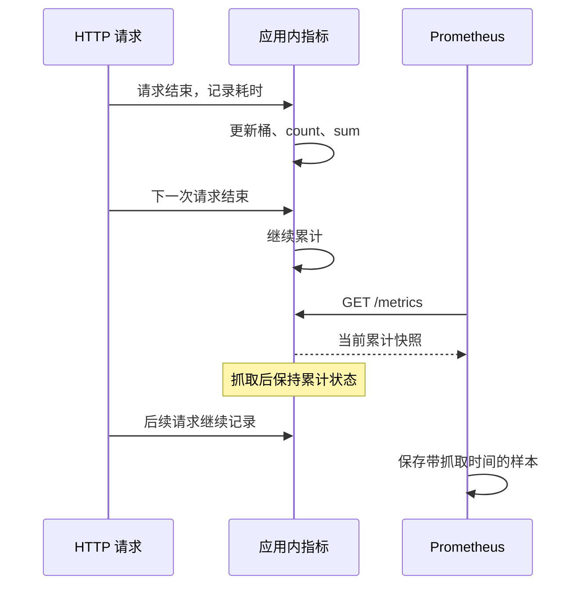
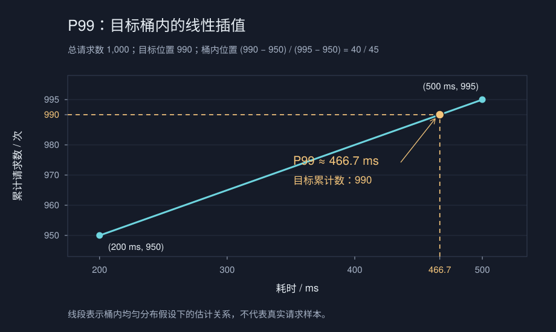
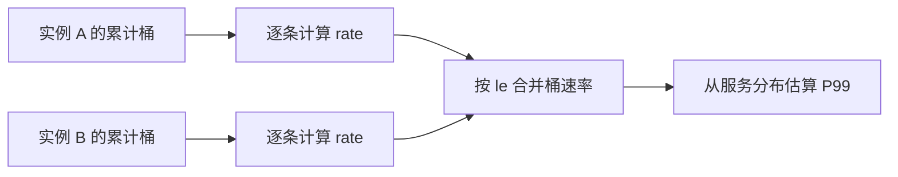

1. Table of Contents, ordered
{:toc}

一个 HTTP 服务希望展示最近 5 分钟的 P99 响应时间，可以直观理解为约 99% 的请求耗时不超过它；把请求按耗时排序后，它位于靠近第 99% 的位置。Prometheus 却可能每隔 30 秒才来抓取一次指标：两次抓取之间，应用需要把每次请求的耗时都存下来，等抓取时再一起发送吗？

要理解这个过程，可以沿着一条请求的耗时，依次看它如何进入应用内存、变成 Prometheus 中的时间序列，最后参与分位数计算。下面以**经典 Histogram（Classic Histogram）**为主；它的固定桶最适合用来展开这条计算链。

## 每次请求只更新一份分布统计

服务完成一次请求后，就知道了它的耗时。逐条保存耗时可以用于精确分析，但实时监控更关心分布：有多少请求很快，有多少进入了慢请求区间。

### 用桶计数代替请求明细

Histogram 预先设置一组耗时上界。假设依次观察到：

```text
80ms、120ms、180ms、350ms、900ms
```

配置上界 `100ms、200ms、500ms、1000ms` 后，对外暴露的结果如下：

| 统计项 | 数值 |
|---|---:|
| 耗时 ≤100ms 的次数 | 1 |
| 耗时 ≤200ms 的次数 | 3 |
| 耗时 ≤500ms 的次数 | 4 |
| 耗时 ≤1000ms 的次数 | 5 |
| 耗时 ≤+∞ 的次数 | 5 |
| 总次数 `_count` | 5 |
| 总耗时 `_sum` | 1.63 秒 |

**这里的桶有两层“累计”含义：既包含所有不超过上界的观测，也随应用运行不断累积。** `≤500ms` 的 4 次已经包含 `≤200ms` 的 3 次；只落在 `(200ms,500ms]` 的次数要用 `4−3=1` 得到。各桶不能直接相加来计算总请求数，总数由 `+Inf` 桶或 `_count` 给出。

Prometheus 文本格式用 `le`（less than or equal）标记上界，耗时通常使用秒：

```text
# TYPE http_request_duration_seconds histogram
http_request_duration_seconds_bucket{le="0.1"} 1
http_request_duration_seconds_bucket{le="0.2"} 3
http_request_duration_seconds_bucket{le="0.5"} 4
http_request_duration_seconds_bucket{le="1"} 5
http_request_duration_seconds_bucket{le="+Inf"} 5
http_request_duration_seconds_count 5
http_request_duration_seconds_sum 1.63
```

每个耗时在记录时就合并进统计状态，随后不必继续保留原始值。一次 180ms 请求在对外语义上会计入所有上界不小于 180ms 的桶；客户端内部也可以只更新一个非重叠区间，再在采集时累加，并不一定逐个修改所有累计桶。[Histogram 客户端说明](https://prometheus.github.io/client_python/instrumenting/histogram/)

同一指标可以按实例、接口等标签区分，每组标签分别维护一套桶。因此，在桶数和标签组合固定时，处理 100 次还是 100 万次请求，保存的统计项数量基本相同。变化的是计数器里的值，而不是待发送请求明细的长度。

### 抓取读取统计状态，不清空桶

应用持续记录，Prometheus 定期读取，两者不需要以抓取周期为单位交换一批请求明细：



**常规累计 Histogram 的抓取不是 flush：返回数据后，桶不会清零。** Spring Boot 应用可以通过 Actuator 的 Prometheus 端点暴露这些统计，端点与应用诊断的关系可参见[Spring Boot 开发、部署与诊断]()。

`Timer` 是指标库的计时抽象，是否导出 Histogram 桶取决于配置和后端，可结合[Micrometer]()与[官方 Timer 文档](https://docs.micrometer.io/micrometer/reference/concepts/timers.html)理解。上述内存结论不能推广到所有实现：例如 Dropwizard 的 [Sliding Time Window Reservoir](https://www.dropwizard.io/projects/metrics/en/latest/manual/core/#sliding-time-window-reservoirs) 确实保留窗口内每次测量，但它的保留窗口由库配置决定，不由抓取周期决定。

## 从累计快照得到时间窗口内的分布

累计桶描述的是从计数器创建或重置以来的观测，而“最近 5 分钟”需要的是一段时间内的变化。Prometheus 保存各次抓取的快照，再在查询时计算这个变化。

### 相减得到增量，查询窗口决定统计范围

先只看一个 `≤500ms` 桶，假设抓取时间和数值如下，期间没有重置：

| 抓取时刻 | 累计次数 |
|---|---:|
| 第 0 秒 | 100 |
| 第 5 秒 | 130 |
| 第 10 秒 | 170 |

拥有这三个快照时，前后两段增量分别是 30 和 40，整个 10 秒的增量是：

$$
(130-100)+(170-130)=170-100=70
$$

对所有桶执行相同的时间差分，就能得到这段时间的分布。**抓取间隔决定快照有多密，查询窗口决定要分析哪一段时间。** Prometheus 并不是先存好互不重叠的 5 秒统计块，再把它们拼起来。

实际 PromQL 使用 `increase()` 估算窗口增量，使用 `rate()` 计算窗口内的平均每秒增长量。例如：

```promql
# 最近 5 分钟，每个桶增加了多少次。
increase(http_request_duration_seconds_bucket[5m])
```

```promql
# 仍使用最近 5 分钟的数据，结果单位换成次/秒。
rate(http_request_duration_seconds_bucket[5m])
```

两者都会处理可识别的重置，并按窗口边界外推。因而 `increase()` 是估计增量，也可能出现小数。[官方函数说明](https://prometheus.io/docs/prometheus/latest/querying/functions/#increase)

例如，按 Prometheus 3 的规则，在第 10 秒计算 `[10s]`，样本选择区间是左开右闭的 `(0,10]`，恰在第 0 秒的样本不被选中，可能只剩第 5、10 秒两个点。函数会基于选中的样本处理窗口边界，不能保证结果等于上面手算的 70。这个限制来自周期采样，不来自 Histogram 的分桶。[时间窗口边界规则](https://prometheus.io/docs/prometheus/latest/querying/basics/#range-vector-selectors)

### 服务重启时，下降按计数器重置处理

应用退出后，内存里的累计值通常会丢失。假设同一条序列被抓到的值依次是：

```text
100 → 130 → 8 → 28
```

Counter 正常情况下只增不减，所以 `130→8` 会被解释为一次重置。忽略窗口边界外推，修正后的样本增量是：

$$
(130-100)+8+(28-8)=58
$$

这不会改写已存储的原始快照，而是在 `rate()`、`increase()` 的计算中处理。经典 Histogram 的各个桶与 `_count` 都可以这样计算；HTTP 耗时非负，所以 `_sum` 也具有累计计数器的性质。[计数器重置规则](https://prometheus.io/docs/prometheus/latest/querying/functions/#resets)

**重置修正无法恢复所有丢失的观测。** 如果上次只抓到 130，实际增长到 140 才重启，额外的 10 次已经没有快照可查。如果重启后迅速增长到 150，仅凭 `130→150` 两个数值也无法发现中间的重置。创建／起始时间元数据也能辅助判断，但需要相应版本、协议和配置支持。[起始时间相关能力](https://prometheus.io/docs/prometheus/latest/feature_flags/)

这里判断的是同一条时间序列。如果重启后 `instance` 等标签改变，Prometheus 会看到一条新序列，而不是原序列上的一次数值回退。

## 从窗口分布估算 P99

得到时间窗口内的桶分布后，剩下的是从这份压缩表示中找到第 99 百分位。桶计数能定位区间，但没有保存区间内部的精确耗时。

### 先定位桶，再换算桶内位置

假设某个 5 分钟窗口内共有 1,000 次请求，为便于手算，采用下面这组整数增量：

| 桶上界 | 窗口内累计次数 |
|---|---:|
| 100ms | 800 |
| 200ms | 950 |
| 500ms | 995 |
| 1000ms | 1000 |
| +∞ | 1000 |

P99 对应的目标位置为 `1000×0.99=990`。前 950 次不超过 200ms，前 995 次不超过 500ms，所以目标位于 `(200ms,500ms]`。

这个区间有 `995−950=45` 次请求，目标位于其中的第 `990−950=40` 个位置。经典 Histogram **假设桶内均匀分布**，把次数比例换算成耗时比例：

$$
P99\approx200+\frac{990-950}{995-950}\times(500-200)
\approx466.7\text{ ms}
$$


_连线表示桶内均匀分布的假设。已知的是两个桶边界上的累计次数，线上的其他位置由插值得到。_

写成通用形式，令目标分位为 $\phi$，窗口总量为 $N$，目标桶上下界为 $L,U$，两端累计计数为 $C_L,C_U$，则有限桶内的估计为：

$$
Q_{\phi}\approx L+\frac{\phi N-C_L}{C_U-C_L}(U-L)
$$

$L$、$U$ 和结果使用相同的耗时单位；分数部分是目标在桶内的位置比例。把 $\phi$ 改为 `0.9` 就是 P90。这里的线性插值规则适用于经典桶，标准指数 Native Histogram 的非零桶使用另一种插值规则。[分位数计算规则](https://prometheus.io/docs/prometheus/latest/querying/functions/#histogram_quantile)

### 近似发生在桶内，不代表漏统计了请求

466.7ms 不一定是任何一次请求的真实耗时。保持前 950 次与后 5 次请求不变，将目标桶的 45 次耗时全部设为 201ms，真实 P99 就是 201ms；全部改为 499ms，真实 P99 就是 499ms。两组数据的**桶计数一样**，上述算法都会估成 466.7ms。

P99 的统计目标没有改变，变化的是保留的信息量。Histogram 可以让每次请求都参与计数，但会丢失桶内的精确位置。实时监控中的近似分位数也不限于这种方法，例如 Elasticsearch 使用 [t-digest 计算 percentile](https://www.elastic.co/docs/reference/aggregations/search-aggregations-metrics-percentile-aggregation)；需要基于完整明细精确计算时，可以选择类似 ClickHouse [`quantileExact`](https://clickhouse.com/docs/reference/functions/aggregate-functions/quantileExact) 的函数。即使保留了全部日志，查询引擎使用近似算法时，结果依然是估计值。

### 换成 rate，分位数为什么不变

同一窗口下，`increase(counter[5m])` 等于 `rate(counter[5m])×300`。使用速率，就是把所有桶的窗口增量统一除以 300，换成“次/秒”。统计范围仍然是最近 5 分钟。

例如，目标桶两端从 950、995 次变为 `950/300`、`995/300` 次/秒，总量从 1,000 次变为 `1000/300` 次/秒。桶内比例为：

$$
\frac{0.99\times(1000/300)-(950/300)}{(995/300)-(950/300)}
=\frac{990-950}{995-950}
=\frac{40}{45}
$$

公共的 `/300` 抵消了，结果仍是 466.7ms。使用速率时，定位的是累计权重达到总权重 99% 的位置，不是在寻找一个编号带小数的真实请求。**分位数依赖各桶的比例，统一缩放所有桶不会改变这个比例。**

## 合并实例，得到整个服务的 P99

服务部署多个实例后，每个实例有自己的累计桶。服务级 P99 描述所有实例共同处理的请求，因此必须先合并它们的分布。

### 合并对应桶，保留请求量的权重

假设前面的 1,000 次请求来自两个实例，在同一个窗口内的增量为：

| 桶上界 | 实例 A | 实例 B | 合并后 |
|---|---:|---:|---:|
| 100ms | 700 | 100 | 800 |
| 200ms | 780 | 170 | 950 |
| 500ms | 798 | 197 | 995 |
| 1000ms | 800 | 200 | 1000 |
| +∞ | 800 | 200 | 1000 |

合并后的分布就是上一节的例子，所以服务级 P99 仍约为 466.7ms。实例 A 处理的请求更多，会自然贡献更多计数，不需要另外对实例设置权重。

**不能先求每个实例的 P99，再做普通平均或按请求量加权平均。** 一个 P99 数值没有保留整份分布，无法表示其他 99% 的请求分别位于哪里。相同边界的桶计数则可以相加。

用于这种常规聚合的经典 Histogram 应保持桶边界、单位、观测含义一致，查询窗口也应一致。同一个 `le="0.5"` 必须对每个实例都表示“耗时不超过 0.5 秒”的请求数。

### 查询顺序是先 rate，再 sum，最后求分位数

假设 `job="api"` 恰好选择这个服务的所有实例，可以用：

```promql
# 各实例独立计算桶速率，再按相同上界合并。
# le 必须保留，否则分位数函数无法识别桶边界。
histogram_quantile(
  0.99,
  sum by (le) (
    rate(http_request_duration_seconds_bucket{job="api"}[5m])
  )
)
```



**先计算各实例的增长，才能分别处理它们的重置。** 如果先把累计值相加，一个实例重启造成的下降可能被另一个实例的增长抵消。`sum by (le)` 还会合并其他标签维度；若要分别查看各接口的 P99，应在聚合中保留实际使用的接口标签。[官方聚合写法与顺序要求](https://prometheus.io/docs/prometheus/latest/querying/functions/#rate)

这里也可以把 `rate` 换成同一窗口的 `increase`：先得到各实例的窗口增量，再合并桶，P99 的结果相同。`rate` 没有额外的分位数精度优势，也没有更强的重置修复能力。

### rate 适合作为可复用的监控结果

实时监控常常同时展示吞吐量、耗时分位数和达标比例。统一保存各桶的每秒速率后，同一组数据可以分别用于：

| 用途 | 计算方式 |
|---|---|
| 服务 QPS | 读取 `+Inf` 桶的速率 |
| P90、P99 | 对桶速率执行 `histogram_quantile()` |
| 耗时达标比例 | 阈值桶速率除以 `+Inf` 桶速率 |

Prometheus 的 recording rules 会定期预计算表达式并保存结果。官方建议对这类规则使用 `rate`，统一采用每秒单位；`increase` 更适合直接回答“这个窗口一共发生了多少次”。[Recording rules 的速率约定](https://prometheus.io/docs/prometheus/latest/querying/functions/#increase)

例如流量稳定在 100 QPS 时，1 分钟和 5 分钟的增量分别是 6,000、30,000 次，速率都是 100 次/秒。单位统一便于复用与设置流量阈值，但不同窗口仍有不同平滑效果：预计算的 5 分钟桶速率并不等于原始累计数据，不能直接当作任意其他窗口的精确分布。

## 按尾部范围、业务阈值和成本设置桶

P99 的误差主要取决于它所在桶的宽度。只覆盖多数请求还不够：慢请求恰好处在尾部，需要让关心的分位数落在有足够分辨率的有限桶里。

### 默认值来自客户端，不是服务端动态学习

Prometheus 服务端没有统一替应用决定的默认桶。[Go 客户端的 `DefBuckets`](https://pkg.go.dev/github.com/prometheus/client_golang/prometheus#DefBuckets) 与 [Java 客户端的经典默认桶](https://prometheus.github.io/client_java/getting-started/metric-types/#histogram) 使用下面这些有限上界，通常用于秒单位的请求耗时：

```text
0.005, 0.01, 0.025, 0.05, 0.1, 0.25,
0.5, 1, 2.5, 5, 10
```

再加一个 `+Inf` 桶。这是从 5ms 到 10s 的不等宽划分，不是每隔 100ms 一个桶。经典桶在创建时确定，哪怕用等比规则自动生成，边界也不会跟着请求分布自由移动。

框架可以有另一套默认值。例如，Micrometer v1.17.2 的[默认配置](https://github.com/micrometer-metrics/micrometer/blob/v1.17.2/micrometer-core/src/main/java/io/micrometer/core/instrument/distribution/DistributionStatisticConfig.java) 不开启 percentile histogram；开启后，[Timer 的默认预期范围](https://github.com/micrometer-metrics/micrometer/blob/v1.17.2/micrometer-core/src/main/java/io/micrometer/core/instrument/AbstractTimerBuilder.java) 是 1ms～30s，用于从预设集合中选择边界。其他版本或框架配置可能不同，排查时应以实际依赖和暴露结果为准。

Micrometer 的 `maximumExpectedValue` 控制桶生成范围，不是请求超时，也不会把超出范围的有效耗时截断或排除出 `_count`、`_sum`。[PrometheusTimer 的记录实现](https://github.com/micrometer-metrics/micrometer/blob/v1.17.2/implementations/micrometer-registry-prometheus/src/main/java/io/micrometer/prometheusmetrics/PrometheusTimer.java)

### 为长耗时请求保留尾部桶

如果大部分请求都在 10 秒以内，默认的 `(5s,10s]` 仍可能过宽。若只有 98% 的请求不超过 10 秒，P99 甚至会落入 `(10s,+Inf)`。

**经典 `histogram_quantile()` 遇到目标落在 `+Inf` 桶时，会返回最高有限上界。** 因此，只配置到 10 秒时出现的“P99=10s”，不能证明真实 P99 就是 10 秒。[最高桶的处理规则](https://prometheus.io/docs/prometheus/latest/querying/functions/#histogram_quantile)

假设重点关心 8～10 秒附近的尾部，可以把下面这组秒单位边界作为调整起点：

```text
0.1, 0.25, 0.5, 1, 2, 4, 6,
7, 8, 8.5, 9, 9.5, 10,
12, 15, 20, 30, +Inf
```

前面粗一些，重点范围细一些，并继续覆盖更慢的请求。它不是通用推荐值：若需要区分 8.1 秒和 8.2 秒，重点范围还要继续加密；若只关心秒级变化，过密的毫秒级桶就未必值得保留。

如果业务目标是“99% 的请求在 10 秒内完成”，直接设置一个 `10s` 边界，并计算该桶占总量的比例，可以避免通过 P99 插值间接判断是否达标：

```promql
# 直接统计不超过 10 秒的请求比例，无需桶内插值。
sum(rate(http_request_duration_seconds_bucket{job="api", le="10.0"}[5m]))
/
sum(rate(http_request_duration_seconds_count{job="api"}[5m]))
```

这里按 Prometheus 3 入库后的标签写 `le="10.0"`；旧版本可能保留 `le="10"`，应以实际查询到的标签值为准。[整数边界标签的规范化](https://prometheus.io/docs/prometheus/latest/migration/#le-and-quantile-label-values)

这避免的是桶内插值误差，窗口采样和外推的限制仍然存在。让业务阈值成为明确边界，也是 [Prometheus 的桶布局建议](https://prometheus.io/docs/practices/the_zen/)。

### 精度成本要乘上标签与实例数量

更细的目标桶会缩小桶内位置的不确定范围，但不保证每个数据集的实际估计误差都严格单调下降。经典 Histogram 的每个桶还会产生独立时间序列，需要同时评估应用计数器、抓取量和服务端存储。

设有限桶边界有 $B$ 个，实际出现的完整标签组合有 $C$ 组，其中包含实例标签。忽略 `_created` 等附加序列后，时序数量约为：

$$
\text{时间序列数}\approx(B+3)\times C
$$

其中 `+3` 对应 `+Inf`、`_count`、`_sum`。如果有 1,000 组标签组合，10 个有限桶约产生 13,000 条序列，50 个有限桶约产生 53,000 条序列。接口、状态码和实例等维度会放大桶数成本；请求量增加则主要增加观测更新的工作，并不直接增加固定桶的数量。[Histogram 的存储与成本](https://prometheus.io/docs/practices/histograms/)

当耗时跨度很大、固定边界难维护时，可以评估整条采集和查询链路对 **Native Histogram** 的支持。标准指数 Native Histogram 按既定分桶规则（schema）确定边界，桶首次被观测到时才分配存储，并可通过桶数上限和降低分辨率控制成本。它并不是自动学习最优 P99 边界；通常使用一条复合样本序列，样本大小仍随实际桶数变化。[Native Histogram 规范](https://prometheus.io/docs/specs/native_histograms/)

实际选择时，先明确要区分多大的耗时变化，再覆盖尾部、对齐业务阈值，最后根据标签规模评估桶数。需要检查某次异常请求或核对精确分位数时，再结合保留明细的日志与链路数据；Histogram 提供的是持续、可聚合的分布统计。
